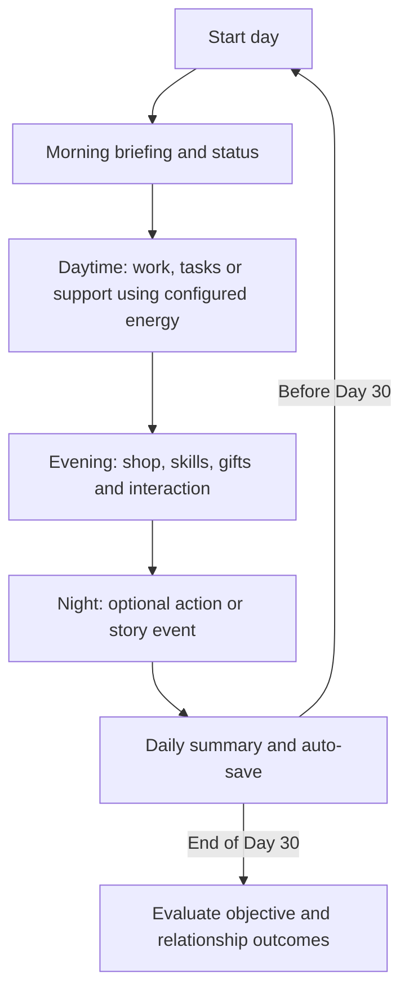

# 01 — VN and Light Simulation Core Systems

**Status:** legacy Sandbox/three-day scenes and the new isometric prototype implement VN/typewriter/choices/deferral, daily talk, time/Stamina, phase pose/position changes, basic pickup/purchase/consumption and safe-point saves. See the [room implementation guide](../04_Technical_And_Tools/02_Isometric_Prototype.md). Remaining rules below are broader planned/draft scope. Remaining sections describe planned scope; see the [implementation guide](../04_Technical_And_Tools/01_Foundation_Sandbox.md). [Master Decisions](00_Master_Vision_And_Decisions.md) approves **30 days** and forgiving, gradual pacing. Numeric balance and the timing map below remain provisional. Systems should support setting changes through data; that capability has not been verified in a game.

Studio-specific work, sprint/review proposals and autonomous-team direction: [Studio Work and Sprints](03_Studio_Work_And_Sprints.md). Attributed player work is implemented; passive production and sprint/task/review are not.

## Daily loop

Money/SP rewards and opportunities depend on authored actions; the diagram is not a requirement to shop or play a minigame every day.

## Campaign pacing — provisional authoring map

| Days | Emotional focus | Management intent |
| --- | --- | --- |
| 1–7 | Introductions, routines, light interactions | Teach systems and allow low-cost experiments. |
| 8–15 | Trust, shared work, early vulnerability | Let players adjust priorities and recover from early mistakes. |
| 16–23 | Personal arcs and deeper choices | Build on earlier interactions; use multi-day event availability. |
| 24–30 | Resolution, catch-up and final project outcome | Preserve recovery opportunities before the Day 30 evaluation. |

Draft opening-event targets: Ploy Day 18 (window 16–24), Grace Day 20 (18–26), Plaifah Day 22 (20–28). These are editable proposals, not fixed route cutoffs or automatic unlocks. Check key item, personal arc, skill and relationship conditions as authored. Late windows may overlap the resolution phase to provide catch-up time.

## Simulation systems

### DayPhaseManager

- Read `GameConfigSO.totalDays`; approved full campaign value: `30`. Sandbox/slice scenes may use shorter test configurations without changing the campaign decision.
- Draft phases: Morning, Daytime, Evening, Night. Change visuals/BGM through data.
- Initial background mapping: Morning/Daytime -> `_Morning`, Evening -> `_Evening`, Night -> `_Night`. Separate artwork for every phase is optional.

### Action budget — AP legacy / Stamina room prototype

Session 022 room trial: cap 100, work -20, rest +30, overnight +40; work/rest use one phase. Ordinary talk uses zero phases: first completion per character/day costs 3 energy and grants 2 affection, repeats are free without rewards. Gift reactions consume items and use no phase/energy. These replace the old ordinary-conversation phase cost. Resource/time commit together; final-phase completion ends the day without auto-starting tomorrow. Navigation/purchase/pickup/use currently cost no phase. These are editable prototype values, not validated difficulty. Legacy AP configs retain ActionPointSystem.

### ActionPointSystem (legacy foundation)

- Configure MaxAP/day and action costs in data. Four AP/day and one AP/action are trial values, not final requirements.
- Work, support and conversation should create tradeoffs without requiring perfect scheduling.
- Do not proportionally increase mandatory workload to consume all added days. Author rest, alternative actions and catch-up opportunities; validate the exact margin in the prototype.

### StatAndRelationshipManager

- Draft global state: MainProgress (normalized 0–100), Money (integer), SkillPoints.
- Draft per-character state: Affection and Stress (0–100), personal-arc flags, relationship stage.
- Crisis condition: `Stress >= burnoutThreshold`; trial threshold `80`. Consequences are data-driven work penalties or events, not a universal immediate game over.
- Relationship gates combine Affection, Stress and personal-arc conditions. Trial ranges `0–29 / 30–69 / 70–100` are writing references, not automatic romance progression.
- Recoverable milestone shortfalls and repairable relationship mistakes should have visible feedback. Final ending details and irreversible story branches remain authored content decisions.

### SkillTreeSystem

Earn SP from tasks/minigames. Draft groups, displayed through data:

| Label | Example effect |
| --- | --- |
| Empathy / Insight | Special dialogue choices and emotional understanding |
| Management / Efficiency | Better work output or action efficiency; Technical Insight is an example specialization |
| Support / Care | Better gifts/consumables and practical support |

Use stable branch IDs; labels are not hardcoded enums tied to this setting.

### ShopAndInventorySystem

- Consumable: restore resources or reduce Stress.
- Gift: character-specific relationship effects.
- Key Item: participate in event/content unlock conditions.
- Prices, effects, stock and requirements belong in data. A free/story item may cost zero.

### IMinigame

Small modular activities return a result/grade and configured rewards. Specific mechanics remain undecided; they should not become mandatory daily grind merely to fill 30 days.

## VN engine

- Display characters at left/center/right (up to three), highlight the speaker, and support authored sprite effects, background crossfades and fullscreen CGs.
- Initial expression keys: Normal, Smile, Angry, Sad, Blush, Surprised; aliases follow [Art Pipeline](../03_Art_And_Audio/00_Art_Pipeline_And_Specs.md).
- DialogueNodeSO carries authored lines/choices/links. EventDataSO handles availability and entry conditions. See [Data Architecture](../04_Technical_And_Tools/00_Designer_Tools_And_Data_Architecture.md).
- Choices may require skills, items or stats; author whether unmet choices are hidden or disabled with a reason. Effects update runtime state.
- Typewriter: set full TMP text and use maxVisibleCharacters; configurable speed and instant reveal. Verify Thai fonts, combining marks, wrapping and rich text in the actual UI.
- Planned QoL: backlog (trial cap 100 lines) with voice replay; Skip All / Skip Read Only, stopping at new text/choices; auto-advance and hide UI.
- Stable line/choice IDs support read/choice history across playthroughs; global history is separate from slot saves.

## Ending evaluation — draft rules

At the end of Day 30, evaluate the main objective and eligible character arcs. Draft outcomes: work failure, objective success without romance, or a character ending after personal-arc and relationship gates. A normalized MainProgress target of 100 and highest eligible Affection are draft criteria, not final tie-break/ending specifications.

An ordinary missed daily action is not the terminal evaluation. Exact milestones, recovery costs and ending conditions require balancing and playtesting.
