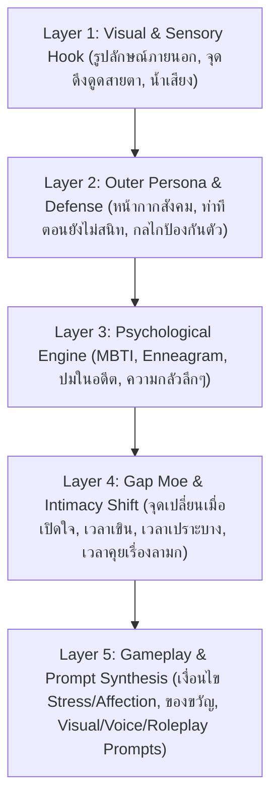

# 00 — ระบบการคิดตัวละครเชิงลึกและกลไก AI วิเคราะห์ความสัมพันธ์ข้อมูล (Character Conception & Bi-Directional AI Inference System)

เอกสารนี้กำหนดโครงสร้าง **"การสร้างตัวละครที่มีมิติเหมือนมีชีวิตจริง"** สำหรับโปรเจกต์ **Project Love** รวมถึงวิธีการทำงานร่วมกับ AI Agent ในกรณีที่ผู้ใช้มีเพียงข้อมูลบางส่วน (เช่น มีแค่บทพูดลอยๆ หรือมีแค่นิสัยบางข้อ) เพื่อให้ Agent คำนวณความน่าจะเป็นและเติมเต็มข้อมูลที่เหลือให้สอดคล้องกันทั้งระบบ

---

## 🧠 1. โครงสร้าง 5 ชั้นของตัวละครเกมจีบสาวที่มีมิติ (The 5-Layer Heroine Architecture)

> **สถานะและขอบเขต:** เอกสารนี้เป็นวิธีร่วมร่างตัวละครกับ Agent ไม่ใช่โปรแกรม Inference Engine ที่สร้างใน Unity แล้ว MBTI/Enneagram/Attachment ใช้เป็นกรอบช่วยเขียนและต้องตามพฤติกรรม/ปมที่ระบุในโปรไฟล์ ไม่ใช้เป็นการวินิจฉัยหรือสูตรทำนายบุคคลจริง เปอร์เซ็นต์เป็นน้ำหนักไอเดียที่ Agent เสนอ ไม่ใช่ความน่าจะเป็นจากการวัด
> ใช้ [Master Template](01_Master_Character_Design_Template.md) สำหรับโปรไฟล์หลัก และ [แบบย่อ](TEMPLATE_Character_Profile.md) สำหรับ brainstorm; สถานะอนุมัติเนื้อหาใช้ [Master Decisions](../../01_Game_Design/00_Master_Vision_And_Decisions.md)

ตัวละครที่น่าหลงใหลและน่าจดจำในเกมจีบสาว (Visual Novel / Dating Sim) จะไม่แบนราบเป็นนิสัยเดียวตลอดทั้งเรื่อง แต่ต้องประกอบด้วย **5 ชั้นข้อมูลที่ส่งผลต่อกัน** ดังนี้:

### สิ่งที่เพิ่มเข้ามาเพื่อให้ครบสมบูรณ์สำหรับเกมจีบสาวโดยเฉพาะ:
นอกจากข้อมูลพื้นฐาน (ชื่อ, อาชีพ, อายุ, สีผม/ตา, ของที่ชอบ, จุดแข็ง/อ่อน, อดีต, MBTI, Enneagram) เราได้เพิ่ม **องค์ประกอบสำคัญที่ทำให้ตัวละครมีเสน่ห์ในเกมจีบสาว** เข้าไปในระบบด้วย:
1. **Gap Moe (ความต่างระหว่าง "เปลือกนอก" กับ "ตัวตนข้างใน"):**
   - เช่น ภายนอกดูดุ เจ้าระเบียบ พูดจาขวานผ่าซาก แต่พออยู่คนเดียวชอบกอดตุ๊กตานุ่มนิ่ม หรือพอโดนชมตรงๆ จะพูดติดอ่างหน้าแดงถึงหู
2. **Lie vs. Truth (สิ่งที่เธอหลอกตัวเอง vs ความต้องการที่แท้จริง):**
   - *สิ่งที่บอกคนอื่น (Surface Want):* "ฉันแค่อยากทำงานให้เสร็จตามหน้าที่ ไม่ต้องการพึ่งใคร"
   - *สิ่งที่โหยหาลึกๆ (Hidden Need):* "อยากมีใครสักคนที่มองเห็นความเหนื่อยของฉัน และบอกว่าฉันเก่งมากแล้วโดยไม่ต้องแบกทุกอย่างคนเดียว"
3. **Enneagram Stress & Growth Arrows (ทิศทางเวลาเครียดจัด vs เวลาปลอดภัย):**
   - เชื่อมโยงกับระบบ `Stress` และ `Affection` ของเกมโดยตรง! เช่น คนลักษณ์ 1 (Perfectionist) เวลา `Stress` สูงจะดิ่งไปลักษณ์ 4 (น้อยใจ ตัดพ้อ ดราม่าเงียบๆ) แต่พอ `Affection` สูงและรู้สึกปลอดภัยจะคลายตัวไปลักษณ์ 7 (ขี้เล่น กล้าปล่อยมุกตลก)
4. **Love Language & Attachment Style (ภาษารักและรูปแบบความผูกพัน):**
   - บอกว่าเธอแพ้ทางผู้เล่นแบบไหน (เช่น *Acts of Service* แพ้คนช่วยทำงานเงียบๆ หรือ *Words of Affirmation* แพ้คำชมที่จริงใจ) และมีกำแพงความผูกพันแบบไหน (เช่น *Dismissive-Avoidant* ชอบถอยหนีเมื่อเริ่มรู้สึกดีเพราะกลัวผิดหวัง)
5. **Speech Quirks & Micro-Expressions (เอกลักษณ์การพูดและภาษากาย):**
   - สรรพนามเรียกตัวเองและเรียกผู้เล่น (ที่เปลี่ยนไปเมื่อสนิทขึ้น), คำติดปาก, และอาการทางกายเวลาโกหก/เขิน/เครียด (เช่น ชอบดันแว่นเวลาประหม่า, ชอบม้วนปลายผมเวลาคิดหนัก)
6. **Sensual / NSFW / Intimate Dynamics (มิติความเย้ายวนและปฏิกิริยาเรื่องลามก):**
   - ระดับความคุ้นชินกับเรื่องทางเพศ, ท่าทีเวลาโดนแซวเรื่องทะลึ่ง (เช่น แกล้งดุกลบเกลื่อน, ช็อกจนสมองค้าง, หรือแกล้งรุกกลับแต่พอโดนเอาจริงกลับเขินม้วน), และจุดอ่อนไหวของร่างกาย

---

## 🔄 2. ระบบคำนวณความน่าจะเป็นและเติมเต็มข้อมูลย้อนกลับ (Bi-Directional AI Inference Engine)

ผู้ใช้ **ไม่จำเป็นต้องกรอกข้อมูลทุกช่องใน Template ด้วยตัวเอง** สามารถกรอกเฉพาะส่วนที่มีในหัว แล้วสั่งให้ Agent วิเคราะห์และคำนวณส่วนที่ว่างอยู่ได้ 3 รูปแบบ:

### รูปแบบที่ 1: รู้จักนิสัย/บทพูด -> ให้ Agent คำนวณหา MBTI, Enneagram และปมในอดีต (Reverse Psychological Profiling)
เมื่อผู้ใช้กรอกเฉพาะ **นิสัยบางส่วน** หรือ **ตัวอย่างประโยคพูด 2–3 ประโยค** Agent จะทำการวิเคราะห์สัญญาณทางภาษาและพฤติกรรม แล้วแสดงผลเป็น **ตารางความน่าจะเป็น (Probability Matrix)** 3 อันดับแรกให้ผู้ใช้เลือก:

> **ตัวอย่างการวิเคราะห์ของ Agent:**
> - **ข้อมูลที่ผู้ใช้ป้อน:** *"สาวแว่นทำงานหนัก ชอบพูดว่า 'ถ้าไม่คิดจะทำจริงจังก็อย่ามาเกะกะ' แต่เวลาเห็นพระเอกอดนอนจะแอบวางเครื่องดื่มชูกำลังไว้ที่โต๊ะโดยไม่บอกว่าเป็นคนซื้อ"*
> - **ผลการคำนวณความน่าจะเป็นโดย Agent:**
>   1. **อันดับ 1 (โอกาส 60%): `ISTJ` | Enneagram `1w9 (sp/so)` — The Quiet Perfectionist**
>      - *เหตุผล:* ใช้ฟังก์ชัน `Si-Te` ยึดมั่นในมาตรฐานงานและประสิทธิภาพภายนอก แต่มี `Fi` (Introverted Feeling) ซ่อนอยู่ในลำดับที่ 3 ทำให้แสดงความห่วงใยผ่านการกระทำเงียบๆ แทนคำพูดหวานๆ
>      - *ปมในอดีตที่น่าจะเป็น:* เคยรับผิดชอบงานแทนคนอื่นที่ทิ้งงานกลางคันจนตัวเองพัง จึงเกลียดความครึ่งๆ กลางๆ
>   2. **อันดับ 2 (โอกาส 30%): `INTJ` | Enneagram `5w6 (sp/sx)` — The Guarded Strategist**
>      - *เหตุผล:* มองภาพรวมและตัดสิ่งรบกวนออกทันที รักษาระยะห่างทางอารมณ์สูงมาก แต่ถ้าใครผ่านเกณฑ์มาตรฐานของเธอ เธอจะลงทุนดูแลคนนั้นอย่างลึกซึ้ง
>   3. **อันดับ 3 (โอกาส 10%): `ESTJ` | Enneagram `8w9` — The Protective Leader**
>      - *เหตุผล:* ดุดันและควบคุมพื้นที่ทำงานโดยตรง แอบดูแลลูกน้องเหมือนแม่ทัพดูแลคนในสังกัด

---

### รูปแบบที่ 2: รู้ MBTI, Enneagram และปมในอดีต -> ให้ Agent สังเคราะห์บทพูดและปฏิกิริยา (Forward Dialogue & Behavior Synthesis)
เมื่อผู้ใช้ระบุบุคลิกและภูมิหลังมาให้ Agent จะใช้เป็นกรอบช่วยร่างบทพูด **7 สถานการณ์ตาม Master Template**: แรกพบ, ทักทาย, ไม่พอใจ/เครียด, รับของขวัญ/คำชม, เปิดใจ, ความใกล้ชิด, และสารภาพรัก โดยตรวจสรรพนาม ระดับความสัมพันธ์ และปมปัจจุบันให้ตรงกัน ไม่ใช้ประเภทบุคลิกบังคับพฤติกรรมทุกฉาก

| ปัจจัยทางจิตวิทยา | ส่งผลต่อการเขียนบทพูดของ Agent อย่างไร? |
| :--- | :--- |
| **Thinking (T) vs Feeling (F)** | สาย `T` เวลาไม่พอใจจะโจมตีที่เหตุผล/ข้อเท็จจริงหรือเงียบตัดบท ส่วนสาย `F` จะตัดพ้อเรื่องความใส่ใจหรือความรู้สึก |
| **Extraverted (E) vs Introverted (I)** | เวลาคุยเรื่องลามก สาย `E` อาจโวยวายเสียงดังหรือแกล้งแซวกลับทันที ส่วนสาย `I` มักจะชะงัก หลบสายตา พูดเสียงเบาลง หรือเปลี่ยนเรื่องหนี |
| **Enneagram Core Fear** | กำหนดเนื้อหาในฉาก **"แชร์เรื่องราวเปราะบาง"** เช่น ลักษณ์ 3 กลัวไร้ค่าเมื่อไม่สำเร็จ, ลักษณ์ 4 กลัวไม่มีใครเข้าใจตัวตนจริง, ลักษณ์ 6 กลัวถูกทอดทิ้้งให้โดดเดี่ยว |

---

### รูปแบบที่ 3: สังเคราะห์ Master Prompts ทั้ง 3 ด้านอัตโนมัติ (Automated Prompt Compiler)
เมื่อมีข้อมูลพอร่าง Agent จะอ่านข้อมูลทุกหมวดแล้วเขียน **Prompt 3 ชุดสำหรับทดลองและรีวิว** ท้ายเอกสาร การมี prompt ครบไม่ใช่การอนุมัติตัวละครหรือหลักฐานว่ามีระบบสร้าง prompt อัตโนมัติในเกม:
1. **🎨 Visual Generation Prompt:**
   - แปลงสีผม สีตา ทรงผม รูปร่าง การแต่งกาย และบุคลิก ให้เป็น Prompt ภาษาอังกฤษแบบละเอียด (แยกเป็น *Character Reference Sheet*, *Standing Sprite Tags*, และ *Lighting/Mood*)
2. **🎙️ Voice & Audio Direction Prompt:**
   - แปลงนิสัยและอายุให้เป็นสเปกเสียง (Pitch, Tempo, Breathiness, Emotion Range) สำหรับใช้สั่งงาน AI Voice Generator หรือใช้เป็นเรฟเลือกนักพากย์/ซาวด์เอฟเฟกต์
3. **🎭 Personality & Roleplay System Prompt:**
   - สรุปจิตวิทยา กฎการพูด ปมในใจ และตัวอย่างบทพูดให้อยู่ในรูปแบบ **System Instruction** ที่พร้อมให้ Agent สวมบทบาทเป็นตัวละครนั้นเพื่อโต้ตอบกับผู้ใช้ได้ทันที

---

## 🛠️ 3. วิธีใช้งานร่วมกับ Agent (Workflow สำหรับผู้ใช้)

1. **สร้างไฟล์ตัวละครใหม่:** คัดลอกเทมเพลตจาก [`01_Master_Character_Design_Template.md`](01_Master_Character_Design_Template.md) ไปตั้งชื่อไฟล์ใหม่ใน `Docs/02_Narrative_And_World/Characters/`
2. **กรอกเท่าที่มีไอเดีย:**
   - ช่องไหนคิดออกแล้ว ให้พิมพ์ลงไปได้เลย
   - ช่องไหนอยากให้ Agent คิดหรือคำนวณความน่าจะเป็นให้ ให้เว้นว่างไว้ หรือเขียนว่า `[ให้ Agent วิเคราะห์]`
3. **สั่งงาน Agent:**
   - บอก Agent ว่า *"ช่วยวิเคราะห์ตัวละครในไฟล์นี้ คำนวณความน่าจะเป็นของส่วนที่ว่างอยู่ และร่างบทพูดกับ Prompt ให้หน่อย"*
   - Agent จะแสดงตัวเลือกความน่าจะเป็นพร้อมเหตุผลให้คุณตัดสินใจก่อนล็อกสเปกลงไฟล์จริง
4. **เมื่อแก้ตัวละคร:** ใช้หมวด 5 เป็นปมปัจจุบัน แล้วตรวจหมวด 3–4, สรรพนามหมวด 6, บทตัวอย่างหมวด 7, gameplay hooks หมวด 8 และ prompts หมวด 9 ให้ตรงกัน หมวด 4.3 เก็บ input เดิมได้ถ้าระบุว่าเป็นประวัติไอเดีย ไม่สรุปว่าได้รับอนุมัติเพราะกรอกครบ
