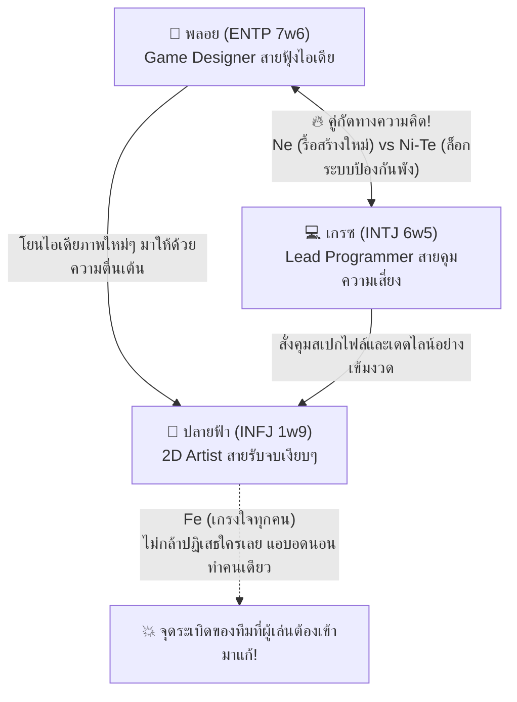

# 05 — รายงานการวิจัยกลุ่มผู้เล่นวัย 20–30 ปี และการวิเคราะห์วิพากษ์เคมี/ปมตัวละครทั้ง 3 คน

เอกสารนี้เป็น **บทวิเคราะห์และข้อเสนอเชิงสร้างสรรค์** สำหรับร่างปลายฟ้า เกรซ และพลอย เพื่อแยกแรงขับของแต่ละคนและทดลองเนื้อหาสำหรับผู้เล่นวัย 20–30 ปี ยังไม่ใช่ข้อสรุปจากการทดสอบตลาดหรือผลวิจัยที่ตรวจแหล่งอ้างอิงครบแล้ว

> **สถานะ:** WORKING DRAFT สำหรับเนื้อหา; รอบเกม 30 วันได้รับการอนุมัติแล้ว ข้อวิเคราะห์เส้นตายปรับตาม Session 008 โดยคงบิลด์อารมณ์และโอกาสแก้ตัว ตาม [Master Decisions](../../01_Game_Design/00_Master_Vision_And_Decisions.md) ตาราง “ปมเดิม vs ปมใหม่” เป็นประวัติการพัฒนา ปมปัจจุบันให้ใช้หมวด 5 ใน [ปลายฟ้า](02_Character_Profile_Plaifah_Artist.md), [เกรซ](03_Character_Profile_Grace_Programmer.md), [พลอย](04_Character_Profile_Ploy_Designer.md) ไม่ใช้คำวิพากษ์ปมเดิมย้อนกลับมาแทนโปรไฟล์
> **หลักฐาน:** ร่างเดิมเอ่ยถึงจุฬาฯ, Deloitte และ Jobsdb 2024–2025 โดยไม่มีชื่อบทความ/ลิงก์/หน้าที่ตรวจสอบได้ Session 007 จึงจัดหัวข้อเหล่านี้เป็นสมมติฐานด้านผู้เล่นที่ต้องตรวจต่อ ไม่อ้างว่าได้ยืนยันข้อสรุปจากแหล่งเหล่านั้นแล้ว

---

## 📊 ส่วนที่ 1: สรุปผลการวิจัยกลุ่มผู้เล่นเป้าหมาย (วัย 20–30 ปี / Gen Z & Young Adults)

สำหรับการร่างเรื่องของกลุ่มเป้าหมายวัย **20–30 ปี** เสนอ **5 ประเด็นชีวิต** ต่อไปนี้เป็นสมมติฐานเพื่อทดลองเขียนและรับความเห็นจากผู้เล่น ยังไม่จัดอันดับความชุกหรือยืนยันว่าผู้เล่นทุกคนต้องการประสบการณ์แบบเดียวกัน:

| อันดับ | ประเด็นปัญหาของวัย 20–30 ปี | รายละเอียดความเจ็บปวดจริง (Real-World Pain Point) | สิ่งที่ผู้เล่นโหยหาจากเกมจีบสาว (Emotional Fantasy) |
| :---: | :--- | :--- | :--- |
| **1** | **Quarter-Life Crisis & เส้นตายทางเศรษฐกิจ** | เรียนจบมาด้วยความฝัน แต่ชนกับกำแพงค่าครองชีพ เงินเดือนเริ่มต้นไม่พอกับค่าเช่าห้อง และคำกดดันจากครอบครัวที่ขีดเส้นตายว่า *"จะลองทำสิ่งที่ชอบไปถึงเมื่อไหร่ เมื่อไหร่จะมั่นคง?"* | อยากเห็นตัวละครที่สู้เพื่อความฝันภายใต้เวลาที่จำกัด และมีผู้เล่นเป็นคนช่วยยืนยันว่าสิ่งที่เธอทุ่มเทนั้นไม่สูญเปล่า |
| **2** | **Passion Exploitation & การสูญเสียตัวตนในงาน** | คนสายครีเอทีฟ (วาดรูป, ทำเกม, เขียนบท) เริ่มงานด้วยความรัก แต่ถูกระบบธุรกิจหรือกระแสสังคมบีบให้ทำแต่งานตามสั่ง (Commercial/Algorithm) จนเกิดคำถามว่า *"นี่ฉันกำลังสร้างผลงานของตัวเอง หรือแค่เป็นเครื่องจักรผลิตงานตามใจคนอื่น?"* | อยากเป็นคนแรกที่มองเห็น "จิตวิญญาณและลายเส้นที่แท้จริง" ของตัวละคร ที่คนอื่นมองข้าม |
| **3** | **The Comparison Trap (กับดักการเปรียบเทียบ)** | ไถโซเชียลเห็นคนอายุเท่ากันประสบความสำเร็จเร็วกว่า เก่งกว่า จนเกิดความรู้สึกว่าตัวเองกำลัง "วิ่งช้ากว่าคนอื่น" และกลัวการถูกทิ้งไว้ข้างหลัง (Fear of Stagnation) | อยากได้พื้นที่ปลอดภัยที่บอกว่า *"ไม่ต้องเปรียบเทียบกับใครแล้ว จังหวะก้าวเดินของเธอก็สวยงามในแบบของเธอ"* |
| **4** | **Toxic Results-Only & ภาระของ "คนเก่งที่ห้ามล้ม"** | คนที่รับผิดชอบงานเก่งมักถูกโยนงานยากๆ มาให้เสมอ และถูกคาดหวังว่าจะต้องจัดการได้ทุกอย่างโดยไม่มีใครถามว่าเหนื่อยไหม จนกลายเป็นโรคไม่กล้าพึ่งพาใคร (Hyper-Independence) | การได้เข้าไปทลายกำแพงของ "สาวแกร่ง" ให้เธอยอมวางดาบลงและกล้าอ่อนแอต่อหน้าเราแค่คนเดียว |
| **5** | **ความเหงาภายใต้หน้ากากสังคม (Smiling Depression)** | ในที่ทำงานต้องปั้นหน้าเป็นคนมีพลังบวก เฟรนด์ลี่ เข้ากับคนง่าย แต่พอกลับถึงห้องเช่าเล็กๆ ตอนกลางคืนกลับรู้สึกว่างเปล่าและโดดเดี่ยวที่สุด | การเป็นคนเดียวในออฟฟิศที่มองทะลุรอยยิ้มนั้น และอนุญาตให้เธอร้องไห้โดยไม่ตัดสิน |

---

## ⚡ ส่วนที่ 2: การวิเคราะห์เคมีของตัวละครทั้ง 3 คน (Character Chemistry & Group Dynamics)

เมื่อนำ **ปลายฟ้า (`INFJ 1w9`)**, **เกรซ (`INTJ 6w5`)**, และ **พลอย (`ENTP 7w6`)** มาอยู่ร่วมกันในห้องทำงานตลอด 30 วัน จะเกิดไดนามิกความสัมพันธ์ที่ชัดเจนมาก ดังนี้:

### 1. คู่ปะทะสร้างสีสัน: "เกรซ (`INTJ`) vs พลอย (`ENTP`)" — สงครามระหว่าง 'กรอบความปลอดภัย' กับ 'ความสนุกไร้ขีดจำกัด'
- **ทำไมถึงตีกัน:** พลอยใช้ฟังก์ชัน `Ne` (คิดนอกกรอบ ชอบเปลี่ยนดีไซน์กะทันหันถ้าคิดว่าสนุกกว่า) ส่วนเกรซใช้ `Ni-Te` บวกปม `6w5` (เกลียดการเปลี่ยนแปลงที่ไม่ได้วางแผนล่วงหน้า เพราะกลัวระบบพัง)
- **ความสนุกในเกม:** ทุกเช้าในห้องประชุม ทั้งคู่จะปะทะฝีปากกันตลอด พลอยจะยิงมุกแซวความตึงของเกรซ ส่วนเกรซจะตอกกลับด้วยมุกตลกหน้าตายและตัวเลขความเสี่ยงที่เชือดนิ่มๆ **ผู้เล่นในฐานะโปรดิวเซอร์ต้องเป็นคนตัดสินว่าจะเข้าข้างความสนุกของพลอย หรือความปลอดภัยของเกรซ!**

### 2. ตัวกลางผู้รับเคราะห์: "ปลายฟ้า (`INFJ`)" — ฟองน้ำซับแรงกระแทกของทีม
- **ทำไมถึงน่าเป็นห่วง:** เมื่อพลอยอยากได้อาร์ตเพิ่ม และเกรซต้องการไฟล์ที่เป๊ะตามเวลา ปลายฟ้าซึ่งมี `Fe` สูงมาก (ไม่อยากเห็นเกรซกับพลอยทะเลาะกัน) จะพูดว่า *"เดี๋ยวฟ้าทำทั้งสองเวอร์ชันให้เองค่ะ ไม่เป็นไรเลย"* แล้วเก็บไปเครียดเงียบๆ คนเดียว

### 3. ⚠️ จุดสังเกตเชิงจิตวิทยาที่ต้องระวัง (The "All-Intuitive" Blind Spot)
- ปัจจุบันนางเอกทั้ง 3 คนเป็นสาย **`N` (Intuition - นักคิดเชิงนามธรรม/อนาคต)** ทั้งหมด (`INFJ`, `INTJ`, `ENTP`) ไม่มีใครเป็นสาย **`S` (Sensing - อยู่กับปัจจุบัน/รายละเอียดจับต้องได้)** เลย
- **วิธีแก้โดยไม่ต้องเปลี่ยนไทป์หลัก:** เวลาเขียนบท ให้เน้นประสาทสัมผัสที่จับต้องได้ของ **ปลายฟ้า** (เช่น กลิ่นสี, สัมผัสกระดาษ, รสชาติขนม) และของ **เกรซ** (เช่น เสียงคีย์บอร์ด, อุณหภูมิห้องเซิร์ฟเวอร์, กาแฟดำ) เพื่อไม่ให้บทสนทนาของทั้ง 3 คนดูลอยเป็นปรัชญาเหมือนกันหมด

---

## 🔍 ส่วนที่ 3: วิพากษ์ปมในอดีตของทั้ง 3 ตัวละครแบบตรงไปตรงมา (Critical Audit & จุดที่ควรปรับปรุง)

เมื่อพิจารณาปมในอดีตของทั้ง 3 คนด้วยสายตาของนักออกแบบเกมและผู้เล่นวัย 20–30 ปี **พบจุดอ่อนสำคัญ 3 จุดที่ควรปรับแก้เพื่อให้ตัวละครคมกริบและไม่ทับซ้อนกัน** ดังนี้ครับ:

---

### 🚨 จุดวิพากษ์ที่ 1: ปมของ "ปลายฟ้า" เรื่อง *"กวาดรางวัลมากมายแต่คิดว่าตัวเองแค่โชคดี"* เสี่ยงต่อการดูไม่สมจริง (Humblebrag Risk)

- **ปัญหาตามข้อเท็จจริง:**
  - ในชีวิตจริงของคนวัย 20–30 ปี โดยเฉพาะสายวาดรูป การจะ "ชนะการประกวดและกวาดรางวัลมากมาย" ต้องส่งประกวดซ้ำๆ และผ่านเวทีใหญ่ ถ้าตัวละครกวาดรางวัลมาเพียบแต่พูดว่า *"ฟ้าไม่เก่งหรอกค่ะ แค่บังเอิญโชคดีเฉยๆ"* ผู้เล่นจำนวนมาก (ที่ในชีวิตจริงวาดรูปแทบตายแต่ไม่เคยได้รางวัลเลย) อาจจะรู้สึกว่า **"ยัยนี่แกล้งถ่อมตัวหรือเปล่า? (Humblebrag)"** แทนที่จะรู้สึกสงสารและเอาใจช่วย!
  - นอกจากนี้ ปม "คิดว่าตัวเองไม่เก่งพอ เลยพัฒนาตัวเองเพื่อให้คนอื่นพอใจ" ยังไป **ทับซ้อนกับปมการพิสูจน์ตัวเองของพลอย** อีกด้วย
- **💡 ข้อเสนอการปรับปมของปลายฟ้าให้ทัชใจสุดขีด (The "Empty Masterpiece" Twist):**
  - **ปรับเป็น:** สมัยเรียน ฟ้าเคยวาดภาพในสไตล์ที่เธอรักและใส่จิตวิญญาณลงไปส่งประกวด แต่กลับ **ตกรอบและถูกวิจารณ์ว่า "เข้าถึงยาก ไม่มีจุดขาย"** หลังจากนั้นเธอจึงลองวิเคราะห์ตลาดและฝืนวาดภาพตามสูตรสำเร็จที่กรรมการและคนทั่วไปชอบ ปรากฏว่า **ภาพที่เธอไม่ได้รักเหล่านั้นกลับกวาดรางวัลชนะเลิศมากมาย!**
  - **ทำไมปมนี้ถึงทรงพลังกว่าเดิม 10 เท่า:**
    1. มันอธิบายได้อย่างมีเหตุผล 100% ว่าทำไมเธอถึงไม่ภูมิใจในรางวัลพวกนั้นเลย! เพราะเธอคิดว่า *"คนที่ได้รับรางวัลไม่ใช่ตัวฉันจริงๆ แต่เป็นหน้ากากที่ฉันวาดตามใจคนอื่นต่างหาก"*
    2. มันสอดคล้องกับประโยคที่คุณตั้งไว้ตอนแรกเป๊ะๆ ว่า **"เธอมาทำอาร์ตเกมเพราะอยากแชร์มุมมองของเธอให้ผู้อื่นรับรู้ และไม่มีใครเข้าใจเธอจริงๆ"** — เพราะที่ผ่านมาคนอื่นชมแค่ฝีมือเทคนิคตามสั่งของเธอ แต่ **พระเอกคือคนแรกที่บังเอิญเห็นสมุดสเก็ตช์ลับของเธอ แล้วตกหลุมรัก "ลายเส้นที่เป็นตัวตนแท้จริง" ของฟ้า!**

---

### 🚨 จุดวิพากษ์ที่ 2: ปมของ "เกรซ" ที่ระบุว่า *"เธอก้าวข้ามความผิดพลาดในอดีตมาได้แล้ว"* ทำให้ผู้เล่นไร้บทบาทสำคัญในรูทของเธอ!

- **ปัญหาตามข้อเท็จจริง:**
  - การที่เกรซเป็นผู้ใหญ่และไม่มานั่งฟูมฟายเรื่องทำโค้ดพังในอดีต เป็นคาแรกเตอร์ที่เท่และมีเสน่ห์มากครับ **แต่ในแง่โครงสร้างดราม่า (Dramatic Arc):** ถ้าเกรซก้าวข้ามปมในอดีตได้สมบูรณ์ 100% แล้วตั้งแต่ก่อนเริ่มเกม คำถามคือ **"แล้วเธอต้องการพระเอกไปทำไม?"**
  - ถ้าตัวละครไม่มีรอยร้าวที่รอการเยียวยา รูทของเกรซจะแบนราบกว่าคนอื่นทันที เพราะพระเอกทำได้แค่ช่วยเสิร์ฟกาแฟกับช่วยตรวจโค้ด
- **💡 ข้อเสนอการปรับปมของเกรซให้ลึกและเป็นผู้ใหญ่ (The "Protector's Curse / Survivor's Guilt" Twist):**
  - **ปรับเป็น:** เกรซก้าวข้าม **"ปมเรื่องความสามารถทางเทคนิค"** ได้แล้วอย่างสมบูรณ์ (เธอไม่กลัวการเขียนโค้ด ไม่ได้จมอยู่กับความผิดพลาดเรื่องไฟล์พัง) **แต่ผลข้างเคียงที่ฝังรากลึกอยู่ในจิตใต้สำนึกของเธอคือ "คำสาปของผู้รอดชีวิต (Survivor's Guilt)"**
  - เพราะในอดีต รุ่นพี่ที่แสนดีต้องเสียสละอนาคตตัวเองเพื่อปกป้องเธอ เกรซจึงสร้างกฎเหล็กในใจว่า **"นับจากนี้ ฉันต้องเป็นฝ่ายปกป้องคนอื่นเท่านั้น ห้ามให้ใครต้องมารับความเสี่ยงหรือเสียสละเพื่อฉันอีกเด็ดขาด"**
  - **ผลลัพธ์ในเกม:** เธอดูเป็นผู้ใหญ่ที่สมบูรณ์แบบและพึ่งพาได้ แต่พอตัวเธอเองป่วยหนักหรือเจองานที่หนักเกินคนเดียวไหว เธอกลับ **ผลักพระเอกออกอย่างรุนแรง** เพราะกลัวว่าถ้าพระเอกเข้ามาช่วยแบก พระเอกจะต้องซวยเหมือนรุ่นพี่ในอดีต! จุดพีคของรูทเกรซคือการที่พระเอกพิสูจน์ให้เธอเห็นว่า *"การยอมให้คนรักเข้ามาช่วยแบก ไม่ใช่ความอ่อนแอ และผมจะไม่พังไปไหนทั้งนั้น เราจะรอดไปด้วยกันทั้งคู่!"*

---

### 🚨 จุดวิพากษ์ที่ 3: ปมของ "พลอย" เรื่อง *"ที่บ้านและเพื่อนไม่ยอมรับ"* กว้างเกินไป ต้องมีเดิมพันที่ชัดเจนภายใต้รอบ 30 วัน โดยให้เวลาบิลด์อารมณ์!

- **ปัญหาตามข้อเท็จจริง:**
  - ปม "พ่อแม่ไม่สนับสนุนให้ทำเกม" เป็นปมมาตรฐานที่พบได้ทั่วไป ความกังวลควรมีผลที่จับต้องได้เมื่อถึงเส้นตาย Day 30 แต่ไม่จำเป็นต้องเร่งวิกฤตทุกวัน ให้ผู้เล่นได้เห็นความผูกพันและความกลัวค่อย ๆ สะสมตลอดรอบ
- **💡 ข้อเสนอการปรับปมของพลอยให้คมและเข้ากับระบบ 30 วัน (The "30-Day Ticket Home" Twist):**
  - **ปรับเป็น:** ที่บ้านของพลอยไม่ได้แค่บ่น แต่ได้ **"ยื่นคำขาดพร้อมเส้นตาย"** ไว้แล้ว! พ่อแม่ตกลงให้เวลาพลอยพิสูจน์ตัวเองในกรุงเทพฯ แค่ถึงสิ้นเดือนนี้ (ซึ่งตรงกับ **Day 30** วันส่งมอบโปรเจกต์พอดี!) หากโปรเจกต์เกมนี้ไม่ผ่านการอนุมัติหรือล้มเหลว พลอยตกลงไว้ว่าจะยอมเก็บกระเป๋าคืนห้องเช่า และกลับต่างจังหวัดไปรับช่วงต่อร้านของที่บ้าน/สอบงานราชการตามที่แม่ต้องการทันทีโดยไม่มีข้อแม้
  - **ทำไมปมนี้ถึงทำให้ตัวละครพลอยมีมิติสุดขีด:**
    - ทุกครั้งที่พลอยพูดติดตลกชวนทุกคนเล่นบอร์ดเกม หรือพูดว่า *"มาทำให้เกมนี้สนุกสุดๆ กันเถอะ!"* ผู้เล่นที่รู้ความจริงเบื้องหลังจะรู้สึกจุกอกทันที เพราะรู้ว่า **เธอกำลังเดิมพันด้วย "ชีวิตอิสระและความฝันครั้งสุดท้ายของเธอ"** ภายในเวลาที่เหลืออีกไม่กี่วัน!

---

## 🎯 ตารางสรุปเปรียบเทียบ: ปมเดิม vs ปมที่อัปเกรดแล้ว (แยก 3 แกนไม่ทับซ้อนกัน 100%)

| ตัวละคร | ปมเดิม (มีความทับซ้อน/จุดอ่อน) | ✨ ปมอัปเกรดใหม่ (แยก 3 แกนชัดเจน & ทัชใจวัย 20–30) | แก่นหลักทางอารมณ์ (Core Theme) |
| :--- | :--- | :--- | :--- |
| **🎨 ปลายฟ้า** (`INFJ 1w9`) | กวาดรางวัลมากมายแต่คิดว่าแค่โชคดี รู้สึกว่าตัวเองยังไม่ดีพอ อยากพัฒนาเพื่อให้คนอื่นพอใจ *(เสี่ยงดู Humblebrag และซ้ำกับพลอย)* | **ศิลปินผู้สูญเสียตัวตน (Identity vs. Expectation):** รางวัลที่ได้มาเกิดจากการฝืนวาดตามสูตรที่ตลาดชอบ ส่วนภาพที่วาดจากหัวใจกลับไม่มีใครมองเห็น เธอจึงซ่อนตัวตนจริงไว้ | **"การกล้าแสดงตัวตนที่แท้จริง โดยไม่ต้องเปลี่ยนตัวเองเพื่อเอาใจโลก"** |
| **💻 เกรซ** (`INTJ 6w5`) | เคยทำระบบพังจนรุ่นพี่รับผิดแทน แต่ตอนนี้ก้าวข้ามมาได้แล้ว เป็นผู้ใหญ่ที่วางแผนรอบคอบ *(ขาดปมปัจจุบันให้พระเอกช่วยเยียวยา)* | **คำสาปของเสาหลักผู้ไม่ยอมพึ่งพาใคร (Hyper-Independence & Trust):** ก้าวข้ามเรื่องเทคนิคแล้ว แต่ฝังใจว่า *"ห้ามให้ใครมาลำบากเพื่อฉันอีก"* จึงแบกทุกอย่างคนเดียวและผลักคนที่หวังดีออกไป | **"การเรียนรู้ที่จะเชื่อใจและยอมแบ่งปันความอ่อนแอให้คนรักช่วยประคอง"** |
| **🎲 พลอย** (`ENTP 7w6`) | เพื่อนและที่บ้านไม่ยอมรับว่าทำเกมได้ จึงอยากพิสูจน์ตัวเอง ข่มความกังวลแล้วยิ้มสู้ *(กว้างไปและซ้ำแนวพิสูจน์ตัวเองกับฟ้า)* | **ตั๋วใบสุดท้ายของความฝัน (Quarter-Life Ultimatum):** มีเส้นตาย 30 วันจากทางบ้าน หากโปรเจกต์นี้ไม่รอดต้องทิ้งวงการเกมกลับบ้านเกิดตลอดกาล จึงยิ่งฝืนหัวเราะกลบเสียงนาฬิกานับถอยหลัง | **"การเผชิญหน้ากับความกลัวภายใต้เส้นตายของชีวิต และการมีคนร่วมสู้เคียงข้าง"** |
