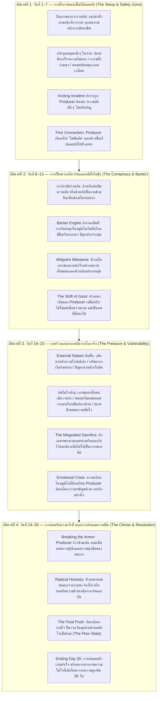

# 01 — พล็อตและบท Rom-Com ที่น่าสนใจจากอนิเมะ ภาพยนตร์ ซีรีส์ และนิยาย (Rom-Com Narrative Reference)

> **สถานะเอกสาร:** รายงานการค้นคว้าเชิงลึกฉบับที่ 1 (Narrative Research Report #1)  
> **หมวดหมู่:** Narrative & Worldbuilding Reference  
> **บริบทการนำไปใช้:** สังเคราะห์เทคนิคการเขียนบท โครงสร้างความสัมพันธ์ เคมีตัวละคร และการหักมุมความคาดหวังเพื่อนำมาปรับใช้กับ **Project Love** (เกม Visual Novel / Light Simulation บริหารสตูดิโอเกม 30 วัน ระหว่าง **Producer** กับ **ปลายฟ้า**, **เกรซ**, และ **พลอย**)  
> **ข้อกำหนดความปลอดภัยทางภาษา (ERR-027):** หลีกเลี่ยงสำนวนหรืออุปมาอุปไมยที่สื่อถึงความรุนแรงหรืออันตรายทางกายภาพ โดยถ่ายทอดความขัดแย้งผ่านเดิมพันทางความรู้สึก แรงกดดันของงาน ความเข้าใจผิด และการประนีประนอมในเชิงสร้างสรรค์เท่านั้น

---

## 1. บทสรุปผู้บริหารและแก่นสำคัญที่ค้นพบ (Executive Summary & Key Takeaways)

จากการสืบค้นและวิเคราะห์ผลงาน Rom-Com ร่วมสมัยที่ประสบความสำเร็จทั้งในฝั่งอนิเมะ มังงะ ไลท์โนเวล ภาพยนตร์ฮอลลีวูด นิยายเบสต์เซลเลอร์ และซีรีส์เอเชีย พบว่าสูตรสำเร็จดั้งเดิมของ Rom-Com (เช่น อุบัติเหตุล้มทับกัน ความเข้าใจผิดที่แก้ได้ง่ายๆ ด้วยคำพูดประโยคเดียว หรือพล็อตแนวฮาเร็มที่ทุกคนรุมชอบตัวเอกโดยไร้ที่มา) ไม่สามารถสร้างความประทับใจให้กับผู้ชมและผู้เล่นยุคใหม่ได้อีกต่อไป

สิ่งที่ทำให้ผลงาน Rom-Com ชั้นครูในยุคนี้มีความ **"สดใหม่ คาดเดาได้ยาก มีจังหวะตลกที่เป็นธรรมชาติ และขยี้ดราม่าได้ลึกซึ้ง"** มีแก่นสำคัญร่วมกันดังนี้:

1. **ความตลกที่เกิดจาก "กลไกป้องกันตัวทางจิตวิทยา" (Humor as a Defense Mechanism):**  
   มุกตลกที่ดีที่สุดไม่ได้เกิดจากการเล่นคำตลกไร้สาระ แต่เกิดจากการที่ตัวละครพยายาม "รักษาฟอร์ม" หรือปกปิดความเปราะบางของตัวเอง เช่น การทำเป็นพูดเหน็บแนมประชดประชัน การอ้างเหตุผลเชิงตรรกะมากลบเกลื่อนความเขินอาย หรือการแสดงอาการลนลานเมื่อความลับที่ซ่อนไว้ถูกเปิดโปง
2. **การก้าวข้าม "ผู้แพ้-ผู้ชนะ" สู่การเติบโตของปัจเจกบุคคล (Deconstructing the Prize Mentality):**  
   ความรักไม่ใช่ "รางวัลชนะเลิศ" ที่ตัวเอกแย่งชิงกัน แต่เป็นกระบวนการที่คนสองคนช่วยปลดล็อกปมค้างคาในใจของกันและกัน ความสัมพันธ์ที่มีพลังต้องทำให้ตัวละครเติบโตขึ้น ไม่ว่าจะลงเอยด้วยการเป็นคู่รักหรือเป็นเพื่อนร่วมงานที่รู้ใจกันอย่างลึกซึ้ง
3. **การผูกพันผ่าน "ภารกิจร่วมแบบสมรู้ร่วมคิด" (The Co-Conspirator Dynamic):**  
   แทนที่จะให้ตัวละครตกหลุมรักกันอย่างกะทันหัน ผลงานชั้นเยี่ยมมักเริ่มจาก "การมีเป้าหมายร่วมกันหรือมีความลับร่วมกัน" ซึ่งบังคับให้ทั้งสองฝ่ายต้องพึ่งพากัน ก่อให้เกิดความไว้วางใจในพื้นที่ปลอดภัย (Safe Space) ก่อนจะแปรเปลี่ยนเป็นความรู้สึกโรแมนติก
4. **ความขัดแย้งที่สมเหตุสมผลและมีรากฐานจากความเป็นจริง (Grounded Stakes over Melodrama):**  
   ดราม่าที่ทรงพลังไม่จำเป็นต้องพึ่งอุบัติเหตุร้ายแรง แต่เกิดจากแรงกดดันในชีวิตจริง เช่น เส้นตายของการทำงาน ความมั่นคงทางอาชีพ ความกลัวว่าจะทำให้คนอื่นผิดหวัง หรือความไม่มั่นใจในคุณค่าของตัวเอง

### 📌 กฎเหล็ก 5 ประการสำหรับนักเขียนบท Rom-Com มืออาชีพ (The 5 Golden Rules)

* **กฎข้อที่ 1: "Smart Mouth, Soft Heart" (ปากเก่งแต่ใจอ่อนไหว):**  
  สร้างบทสนทนาที่มีชั้นเชิง สวนกลับเร็ว มีความยียวนและฉลาด แต่ทิ้งช่องว่างเล็กๆ (Micro-hesitation / Subtext) ให้เห็นว่าภายในจิตใจกำลังหวั่นไหวและแคร์อีกฝ่ายมากเพียงใด
* **กฎข้อที่ 2: "Mundane Specificity as Emotional Proxy" (ใช้เรื่องเล็กๆ ในชีวิตประจำวันสะท้อนเรื่องใหญ่ในใจ):**  
  คนเรามักไม่ทะเลาะกันเรื่องความรักโดยตรง แต่มักระเบิดอารมณ์ใส่กันผ่านรายละเอียดเล็กๆ เช่น ขนาดฟอนต์ในเกม โค้ดที่ไม่ผ่าน หรือขนมในตู้เย็น ซึ่งความจริงแล้วซ่อนความกลัวการถูกปฏิเสธหรือความน้อยใจไว้
* **กฎข้อที่ 3: "Micro-Progression Beats Status Quo" (ทุกปฏิสัมพันธ์ต้องทิ้งรอยก้าวหน้าถาวร):**  
  หลีกเลี่ยงการ Reset อารมณ์กลับมาที่จุดเดิมหลังจบมุกตลก ทุกเหตุการณ์ต้องขยับระยะห่าง (Distance) ระหว่างตัวละครให้ใกล้ชิดขึ้น แม้เพียงการสบตา การยอมเรียกชื่อเล่น หรือการนั่งทำงานดึกข้างกัน
* **กฎข้อที่ 4: "Emotional Reciprocity (Tennis Match)" (ส่งลูกรับลูกทางอารมณ์อย่างเท่าเทียม):**  
  ความสัมพันธ์ต้องไม่ใช่อีกฝ่ายตามตื๊ออยู่ฝ่ายเดียว แต่เป็นจังหวะที่ผลัดกันก้าวล้ำเส้น ผลัดกันถอย และผลัดกันเป็นฝ่ายยื่นมือเข้าไปประคองในวันที่อีกฝ่ายล้มลง
* **กฎข้อที่ 5: "Subverting the Trope from Within" (ใช้นามธรรมของสูตรสำเร็จ แต่เฉลยด้วยความเป็นมนุษย์):**  
  เปิดตัวด้วย Archetype ที่คุ้นตา (สาวขี้อาย, โปรแกรมเมอร์หน้าตาย, ดีไซเนอร์ร่าเริง) เพื่อให้เข้าถึงง่าย แต่ค่อยๆ ลอกเปลือกนอกออกให้เห็นแรงจูงใจและความกลัวที่แท้จริง

---

## 2. กรณีศึกษาเชิงลึก 12 ผลงานชั้นครู (In-Depth Case Studies)

---

### กรณีศึกษาที่ 1: Makeine: Too Many Losing Heroines! (2024)
* **ปี / ประเภทสื่อ:** 2024 / ไลท์โนเวล (Takibi Amamori) & ทีวีอนิเมะ (A-1 Pictures)
* **Logline & High-Concept Hook:** เรื่องราวของเหล่านางเอกที่เพิ่ง "พ่ายแพ้และถูกปฏิเสธความรัก" จากหนุ่มในฝัน โดยมีเด็กหนุ่มตัวประกอบธรรมดาคอยเป็นเพื่อนรับฟังและร่วมกินข้าวปลอบใจ
* **กลไกความตลกและเคมีตัวละคร (Rom-Com Engine):**
  * ความตลกไม่ได้เกิดจากการแข่งขันแย่งชิงความรัก แต่เกิดจาก **"สภาพหลุดฟอร์มหลังอกหัก"** ของสาวๆ ที่พยายามรักษาฟอร์มแต่ล้มเหลวอย่างสิ้นเชิง เช่น แอนนา ยานามิ ที่กินจุผิดปกติเพื่อระบายความเศร้าและชอบยัดเยียดบิลค่าอาหารให้นายนุคุมิซุ
  * เคมีระหว่างนุคุมิซุกับเหล่านางเอกเป็นแบบ **"ผู้ดูแลที่ไม่ตัดสินใคร" (Non-judgmental Sounding Board)** ตัวเอกไม่ได้เป็นฮีโร่ผู้เก่งกาจ แต่เป็นพื้นที่ปลอดภัยที่ปล่อยให้พวกเธอได้แสดงความงี่เง่า ความเห็นแก่ตัว และความขี้แพ้ออกมาได้อย่างสบายใจ
* **การหักมุมความคาดหวังและจุดเปลี่ยนดราม่า (Subversion & Emotional Climax):**
  * *Subversion:* รื้อสร้างขนบเดิมของแนวฮาเร็มที่มองว่านางเอกที่ไม่ถูกเลือกคือ "ตัวละครที่หมดประโยชน์" เรื่องนี้ชี้ให้เห็นว่าช่วงเวลาหลังความล้มเหลวต่างหากคือจุดเริ่มต้นที่แท้จริงของการค้นหาตัวตนและการเติบโต
  * *Climax:* ดราม่าไม่ได้บีบคั้นด้วยความขัดแย้งรุนแรง แต่เป็นความเหงาของการต้องยอมรับว่าตนเองเป็นเพียง "ตัวประกอบในเรื่องรักของคนอื่น" และต้องเริ่มเขียนเรื่องราวชีวิตของตัวเองใหม่
* **จุดที่นำมาประยุกต์ใช้กับ Project Love:**
  * **กับปลายฟ้า:** สภาพ "หลุดฟอร์ม" ของปลายฟ้าเวลาถูกจับได้เรื่องแอคหลุมวาดรูปแซ่บๆ หรือตอนเผลออินกับงานสเก็ตช์ส่วนตัว Producer ต้องทำหน้าที่เป็น "นุคุมิซุ" คือไม่ล้อเลียน ไม่ตัดสิน และยอมนั่งกินชานมไข่มุกเป็นเพื่อนเงียบๆ เพื่อให้ปลายฟ้ากล้าเปิดเผยด้านจริงใจ
  * **กับพลอย:** พลอยที่พยายามยิ้มแย้มสดใสกลบเกลื่อนความเครียดเรื่องกำหนดเวลา 30 วันที่บ้านกำหนดไว้ Producer จะเป็นคนแรกที่สังเกตเห็นความอ่อนล้าหลังรอยยิ้มนั้น และบอกเธอว่า "ไม่จำเป็นต้องทำเป็นร่าเริงตลอดเวลาก็ได้"

---

### กรณีศึกษาที่ 2: The Dangers in My Heart (Boku no Kokoro no Yabai Yatsu) (2023–2024)
* **ปี / ประเภทสื่อ:** 2023–2024 / มังงะ (Norio Sakurai) & ทีวีอนิเมะ (Shin-Ei Animation)
* **Logline & High-Concept Hook:** เด็กหนุ่มสายเบียวมืดมนที่หมกมุ่นกับจินตนาการด้านมืด บังเอิญต้องมาใช้ห้องสมุดร่วมกับสาวสวยดาวเด่นประจำโรงเรียนที่แอบเข้ามาแอบกินขนม
* **กลไกความตลกและเคมีตัวละคร (Rom-Com Engine):**
  * ความตลกเกิดจาก **"ความขัดแย้งระหว่างความคิดในหัวกับพฤติกรรมจริง"** อิจิคาวะคิดว่าตัวเองเป็นคนเย็นชาและอันตราย แต่การกระทำจริงกลับเป็นเด็กหนุ่มที่ใส่ใจ ช่างสังเกต และคอยช่วยเหลือยามาดะอย่างเงียบๆ
  * การพัฒนาความสัมพันธ์แบบ **"Micro-Progression" (ก้าวหน้าทีละคืบ):** ไม่มีการข้ามขั้น ความผูกพันก่อตัวจากการแบ่งขนม การใช้ร่มคันเดียวกัน การส่งข้อความดึกๆ และการลดระยะห่างทางกายภาพในห้องสมุดอย่างเป็นธรรมชาติ
* **การหักมุมความคาดหวังและจุดเปลี่ยนดราม่า (Subversion & Emotional Climax):**
  * *Subversion:* ล้มล้างความเชื่อเรื่อง "สาวสวยสมบูรณ์แบบจับคู่กับหนุ่มไร้ตัวตน" โดยเปิดเผยว่ายามาดะเองก็มีความไม่มั่นใจในอาชีพนักแสดงและรูปร่างของตนเอง ยามาดะเป็นฝ่ายเริ่มรุกและเข้าหาอิจิคาวะก่อน เพราะเขาเป็นคนเดียวที่ไม่มองเธอเป็นวัตถุบนหิ้ง
  * *Climax:* ความกล้าหาญที่จะก้าวข้ามปมดูถูกตัวเอง (Inferiority Complex) ของอิจิคาวะ เพื่อยืนเคียงข้างเธอในฐานะคนที่เท่าเทียมกัน
* **จุดที่นำมาประยุกต์ใช้กับ Project Love:**
  * **กับปลายฟ้า:** ใช้ภาษาทางกายภาพและการสังเกตรายละเอียด (Visual Subtext) เช่น ปลายฟ้าขยับสมุดสเก็ตช์เข้ามาใกล้ Producer มากขึ้นในห้องทำงาน, การแอบมองผ่านหน้าจอวาดภาพ, หรือการส่งสติกเกอร์ที่วาดเองให้ตอนดึก
  * **บทสนทนาที่ไม่มีคำว่ารัก:** ความรักพัฒนาผ่านการทำงานร่วมกัน การที่ Producer คอยหยิบน้ำหวานมาวางไว้ให้เวลาปลายฟ้าสเก็ตช์งานจนดึก โดยไม่ต้องพูดจาหวานเลี่ยน

---

### กรณีศึกษาที่ 3: Kaguya-sama: Love Is War (2019–2023)
* **ปี / ประเภทสื่อ:** 2019–2023 / มังงะ (Aka Akasaka) & ทีวีอนิเมะ (A-1 Pictures)
* **Logline & High-Concept Hook:** อัจฉริยะสองคนในสภานักเรียนที่ต่างมีใจให้กัน แต่ถือคติว่า "ใครสารภาพรักก่อนคือผู้แพ้" จึงเปิดศึกสงครามจิตวิทยาเพื่อบีบให้อีกฝ่ายเอ่ยปากก่อน
* **กลไกความตลกและเคมีตัวละคร (Rom-Com Engine):**
  * **Dramatic Irony ผสมกับความเว่อร์วัง (Ludicrous Escalation):** คนดูรู้ดีว่าทั้งคู่ชอบกันมาก แต่สถานการณ์ธรรมดาในชีวิตประจำวัน (เช่น การแชร์ร่ม, การชวนไปดูหนัง, การแลก LINE) ถูกยกระดับให้กลายเป็นกลยุทธ์ทางจิตวิทยาที่ซับซ้อนระดับชาติ
  * ตัวละครภายนอกที่ไร้เดียงสา (เช่น จิกะ ฟุจิวาระ) ทำหน้าที่เป็น **"ตัวแปรแห่งความโกลาหล" (Agent of Chaos)** ที่เข้ามาทำลายแผนการอันซับซ้อนของทั้งสองคนจนหน้าแตกทั้งคู่
* **การหักมุมความคาดหวังและจุดเปลี่ยนดราม่า (Subversion & Emotional Climax):**
  * *Subversion:* เผยให้เห็นว่าเบื้องหลังความทะนงตนคือ "ความกลัวว่าจะไม่มีใครยอมรับตัวตนที่แท้จริง" ชิโรกาเนะกลัวว่าหากตนไม่ได้เป็นที่หนึ่ง คางุยะจะไม่ชายตามอง ส่วนคางุยะกลัวว่าความเย็นชาของตระกูลใหญ่จะทำลายความสัมพันธ์
  * *Climax:* บทสรุปที่ว่า **"ในความรัก หากมีใครคนหนึ่งแพ้ ทั้งสองคนก็คือผู้แพ้"** ความสัมพันธ์จะก้าวหน้าได้ก็ต่อเมื่อทั้งสองฝ่ายยอมทิ้งเกราะกำแพง ยอมรับความเงอะงะ และยอมเปิดเผยจุดอ่อนให้กันดู
* **จุดที่นำมาประยุกต์ใช้กับ Project Love:**
  * **กับเกรซ (Programmer):** เกรซเป็นคนฉลาด มีเหตุผลสูง และชอบใช้ตรรกะมาอธิบายทุกเรื่อง Producer กับเกรซสามารถมีบทสนทนาประลองไหวพริบเรื่องระบบเกมและสถิติบ่อยครั้ง แต่ใต้บทสนทนานั้นคือการหยั่งเชิงความรู้สึกของกันและกัน
  * **จุดคลี่คลาย:** เกรซที่พยายามแบกโค้ดทั้งหมดคนเดียวเพราะกลัวประวัติศาสตร์ความผิดพลาดในอดีตจะซ้ำรอย Producer ต้องเป็นคนที่บอกให้เกรซยอม "วางเกราะ" ลง และร่วมมือกันแก้ไขจุดบกพร่องในระบบโดยไม่ต้องกลัวเสียฟอร์ม

---

### กรณีศึกษาที่ 4: Saekano: How to Raise a Boring Girlfriend (2015–2019)
* **ปี / ประเภทสื่อ:** 2015–2019 / ไลท์โนเวล (Fumiaki Maruto) & ทีวีอนิเมะ / ภาพยนตร์
* **Logline & High-Concept Hook:** โอตาคุหนุ่มไฟแรงต้องการสร้างเกม Visual Novel ระดับตำนาน โดยดึงเอาสาวเพื่อนร่วมชั้นที่แสนจะ "จืดชืด ไร้จุดเด่น" มาปั้นให้กลายเป็นนางเอกหลักของเกม
* **กลไกความตลกและเคมีตัวละคร (Rom-Com Engine):**
  * **Meta-Doujin Studio Dynamics:** ความตลกและการดำเนินเรื่องผูกเข้ากับกระบวนการสร้างเกมจริงๆ (นักวาดภาพตัวละคร, นักเขียนบท, โปรแกรมเมอร์, โปรดิวเซอร์) การถกเถียงเรื่องกำหนดเวลาส่งงาน (Deadline), ความเหนื่อยล้าจากการแก้งาน (Crunch), และความเห็นต่างเชิงศิลปะกลายมาเป็นเชื้อเพลิงของความสัมพันธ์
  * ความต่างขั้วระหว่าง "สาวธรรมดาที่ไร้คาแรกเตอร์" (เมกุมิ คาโต้) กับสาวๆ ในอุดมคติโอตาคุที่จัดจ้าน เมกุมิตอบสนองต่อความเพ้อฝันของตัวเอกด้วยน้ำเสียงเรียบเฉยและตรรกะโลกจริง ซึ่งกลายเป็นมุกตลกหน้าตายที่ทรงเสน่ห์
* **การหักมุมความคาดหวังและจุดเปลี่ยนดราม่า (Subversion & Emotional Climax):**
  * *Subversion:* เมกุมิไม่ได้เป็นเพียง "ตุ๊กตา" ที่ตัวเอกนำมาปั้นตามใจชอบ แต่เธอค่อยๆ เข้ามามีบทบาทสำคัญในการทำเกม เรียนรู้การเขียนสคริปต์ และกลายมาเป็นเสาหลักที่ช่วยขัดเกลาตัวเอกให้เติบโตเป็นผู้ใหญ่ที่รับผิดชอบ
  * *Climax:* วิกฤตการณ์เรื่องเพื่อนร่วมทีมถูกดึงตัวไปทำงานสตูดิโอใหญ่ และความตึงเครียดเรื่องทิศทางของเกม ทำให้ตัวละครต้องเผชิญหน้ากับความจริงระหว่าง "ความฝันทางศิลปะ" กับ "มิตรภาพในชีวิตจริง"
* **จุดที่นำมาประยุกต์ใช้กับ Project Love:**
  * **โครงสร้างสตูดิโอโดยตรง:** Project Love มีบทบาทคล้ายคลึงกัน (Producer, ปลายฟ้า-Art, เกรซ-Code, พลอย-Design) การจำลองบรรยากาศการนั่งล้อมโต๊ะทำงาน การถกเถียงเรื่องฟีเจอร์เกมที่ตัดไม่ลง และการส่ง Asset ไม่ทันกำหนดเวลา 30 วัน สามารถดึงอารมณ์ร่วมแบบ Saekano มาใช้ได้อย่างแม่นยำ
  * **ความรู้สึกที่ถ่ายทอดผ่านตัวเกม:** ให้การตัดสินใจเลือกเส้นทางเนื้อเรื่องในเกมของพวกเธอ สะท้อนถึงความรู้สึกจริงๆ ที่พวกเธอมีต่อ Producer

---

### กรณีศึกษาที่ 5: Wotakoi: Love Is Hard for Otaku (2018)
* **ปี / ประเภทสื่อ:** 2018 / มังงะ (Fujita) & ทีวีอนิเมะ (A-1 Pictures)
* **Logline & High-Concept Hook:** หนุ่มสาววัยทำงานในออฟฟิศที่ต่างเป็นโอตาคุตัวแม่ตัวพ่อ ตกลงคบกันตั้งแต่ต้นเรื่องเพื่อความสะดวกสบายและไม่ต้องซ่อนรสนิยมลับๆ ต่อกัน
* **กลไกความตลกและเคมีตัวละคร (Rom-Com Engine):**
  * **การเริ่มต้นหลังจากสารภาพรัก (Starting Post-Confession):** ละทิ้งความอืดอาดยืดเยื้อของพล็อต "จะรักหรือไม่รัก" มาเน้นที่ "การปรับตัวของสองคนที่คุ้นเคยกับการเป็นเพื่อนโอตาคุมาสู่การเป็นคนรัก"
  * **ความตลกจากตัวตนสองด้าน (Public vs. Private Persona):** กลวิธีแอบคุยเรื่องมังงะ/เกมในเวลางาน การรักษาสภาพคนทำงานมืออาชีพต่อหน้าเจ้านาย แต่พอเลิกงานไปร้านอิซากายะหรือกลับห้องก็สลัดคราบกลายเป็นเกมเมอร์ตัวยง
  * ความต่างระหว่างคู่เอก (สาวช่างกังวล x หนุ่มเกมเมอร์หน้าตาย) กับคู่รอง (คู่รักรุ่นพี่ที่ชอบเถียงกันตลอดเวลาแต่รักกันเหนียวแน่น)
* **การหักมุมความคาดมุมและจุดเปลี่ยนดราม่า (Subversion & Emotional Climax):**
  * *Subversion:* ปราศจากมือที่สามหรือความเข้าใจผิดไร้สาระ ดราม่าเกิดจากความกลัวในใจของนางเอกที่เคยถูกคนรักเก่าบอกเลิกเพราะรสนิยมโอตาคุ ทำให้เธอไม่มั่นใจว่าฮิโรทากะรักเธอในฐานะผู้หญิงจริงๆ หรือแค่ในฐานะเพื่อนเล่นเกม
  * *Climax:* ความรักในฐานะ **"พื้นที่ปลอดภัย" (Psychological Safety):** ความสุขไม่ได้เกิดจากการทำท่ายิ่งใหญ่ แต่เกิดจากการที่ฮิโรทากะช่วยฟาร์มเลเวลเกมให้ตอนหลับ หรือการเข้าใจความชอบโดยไม่ต้องเอ่ยปากขอ
* **จุดที่นำมาประยุกต์ใช้กับ Project Love:**
  * **พื้นที่ปลอดภัยของปลายฟ้าและเกรซ:** ปลายฟ้าที่ซ่อนความชอบวาดรูปแซ่บๆ และเกรซที่ซ่อนความบ้ามังงะตาหวาน เมื่ออยู่ในสตูดิโอนี้กับ Producer พวกเธอสามารถเป็นตัวของตัวเองได้เต็มที่ 100%
  * **มุกตลกในเวลางานและหลังเลิกงาน:** ฉากช่วงกลางวันคุยกันเรื่องงานด้วยสีหน้าเคร่งขรึม แต่ตอนค่ำนั่งกินบะหมี่กึ่งสำเร็จรูปหรือขนมรอบดึกแล้วเปิดเผยตัวตนจริง

---

### กรณีศึกษาที่ 6: Skip and Loafer (2023)
* **ปี / ประเภทสื่อ:** 2023 / มังงะ (Misaki Takamatsu) & ทีวีอนิเมะ (P.A. Works)
* **Logline & High-Concept Hook:** สาวน้อยบ้านนอกผู้ใสซื่อและจริงจังเกินร้อย เดินทางมาเรียนต่อ ม.ปลาย ในโตเกียว และได้ผูกมิตรกับเด็กหนุ่มเมืองกรุงหน้าตาดีที่ดูเหมือนสมบูรณ์แบบแต่แอบมีปมความเหนื่อยล้าทางใจ
* **กลไกความตลกและเคมีตัวละคร (Rom-Com Engine):**
  * **ความตลกที่เปี่ยมด้วยความอบอุ่น (Wholesome Human Comedy):** มิสึมิไม่ได้ตลกเพราะความซุ่มซ่ามแบบการ์ตูนแก๊ก แต่ตลกเพราะความจริงจังกับทุกเรื่อง ความซื่อตรง และการแสดงออกทางสีหน้าที่จริงใจจนทำให้คนรอบข้างที่เคยใส่หน้ากากเข้าหากันต้องยอมเปิดใจ
  * **การเยียวยาแบบสลับขั้ว:** ชิมะที่เหนื่อยล้าจากความคาดหวังในอดีต ได้รับการชำระล้างจิตใจด้วยความจริงใจของมิสึมิ ขณะที่ชิมะที่มีความฉลาดทางสังคมสูงก็คอยช่วยประคองและปกป้องมิสึมิจากความเขินอายในเมืองใหญ่
* **การหักมุมความคาดหวังและจุดเปลี่ยนดราม่า (Subversion & Emotional Climax):**
  * *Subversion:* ไม่สร้างตัวละครอิจฉาริษยาที่ไร้เหตุผล ตัวละครอย่างมิกะที่ดูเหมือนจะเข้ามาเป็นคู่แข่ง กลับได้รับการคลี่คลายปมความไม่มั่นใจในตัวเองด้วยความเข้าอกเข้าใจ (High Emotional Intelligence)
  * *Climax:* การเรียนรู้ที่จะยอมรับว่าชีวิตไม่จำเป็นต้องสมบูรณ์แบบตามแผนที่วางไว้ การก้าวเดินเคียงข้างกันอย่างช้าๆ มีความหมายมากกว่าการเร่งรัดความสัมพันธ์
* **จุดที่นำมาประยุกต์ใช้กับ Project Love:**
  * **บทบาทของ Producer ในฐานะ "ผู้รับฟังด้วยความเข้าอกเข้าใจ":** Producer ไม่จำเป็นต้องเป็นผู้นำจอมเผด็จการ แต่เป็นคนที่สังเกตเห็นความไม่สบายใจของทีม คอยคลี่คลายความตึงเครียดระหว่างการพัฒนาเกมด้วยความอ่อนโยน
  * **การคลี่คลายปมของพลอย:** พลอยที่แบกรับความคาดหวังจากครอบครัวจนเครียด Producer ต้องรับบทบาทแบบมิสึมิ คือมองทะลุเปลือกนอกและมอบความจริงใจที่ช่วยคลายความกังวลให้พลอย

---

### กรณีศึกษาที่ 7: Palm Springs (2020)
* **ปี / ประเภทสื่อ:** 2020 / ภาพยนตร์ (กำกับโดย Max Barbakow, บทโดย Andy Siara)
* **Logline & High-Concept Hook:** ชายหนุ่มที่ติดอยู่ในลูปเวลาของวันแต่งงานซ้ำๆ จนกลายเป็นคนเฉยชาต่อโลก บังเอิญดึงเอาพี่สาวเจ้าสาวผู้มีบาดแผลในใจเข้ามาติดอยู่ในลูปเวลาด้วยกัน
* **กลไกความตลกและเคมีตัวละคร (Rom-Com Engine):**
  * **In Medias Res (เปิดเรื่องตอนที่ตัวเอกหมดอาลัยตายอยากแล้ว):** ข้ามช่วงเวลาการตื่นตระหนกที่น่าเบื่อ ไนลส์ติดอยู่ในลูปมานานจนรู้ทุกจังหวะ ทุกคำพูด และทำตัวไร้จุดหมายอย่างสนุกสนาน ความตลกเกิดจากการที่เขาไม่แคร์ผลลัพธ์ใดๆ อีกต่อไป
  * เคมีแบบ **"เพื่อนร่วมชะตากรรมที่มองเห็นความว่างเปล่าร่วมกัน"**: การใช้ชีวิตหลุดโลกไปด้วยกันในลูปเวลาที่ไม่มีวันพรุ่งนี้
* **การหักมุมความคาดหวังและจุดเปลี่ยนดราม่า (Subversion & Emotional Climax):**
  * *Subversion:* การลูปเวลาไม่ได้เป็นคำสาปให้ต้องทำความดีเพื่อหลุดพ้นเหมือน *Groundhog Day* แต่เป็นสัญลักษณ์แทน "ความสะดวกสบายของการหลีกหนีความเป็นจริงและความรับผิดชอบ" ไนลส์กลัวการออกไปใช้ชีวิตในโลกจริงที่มีผลลัพธ์และความเจ็บปวด
  * *Climax:* ซาร่าห์ปฏิเสธที่จะจมอยู่กับความนิ่งเฉย เธอศึกษาฟิสิกส์ควอนตัมเพื่อหาทางระเบิดลูปเวลา และยื่นทางเลือกให้ไนลส์: *จะยอมติดอยู่ในความปลอดภัยที่ไร้ความหมาย หรือจะยอมเสี่ยงก้าวสู่วันพรุ่งนี้ไปด้วยกัน แม้ว่าพรุ่งนี้อาจมีความเจ็บปวดรออยู่*
* **จุดที่นำมาประยุกต์ใช้กับ Project Love:**
  * **เส้นตาย 30 วันในฐานะ "ลูปเวลาที่บีบคั้น":** เวลา 30 วันของการทำเกมเหมือนกรอบเวลาจำกัดที่ทุกคนอยากหนีไปสู่ความปลอดภัย (ทำเกมลวกๆ ให้จบ หรือยอมแพ้แล้วแยกย้าย)
  * **การตัดสินใจเลือกเดิมพันทางอารมณ์ในโค้งสุดท้าย:** ในช่วงสัปดาห์สุดท้าย ตัวละครต้องเลือกระหว่างการถอยกลับไปอยู่ใน Safe Zone เดิมๆ ของตนเอง หรือจะยอมเสี่ยงทุ่มเทความรู้สึกและความฝันเพื่อสร้างเกมนี้ให้สำเร็จไปพร้อมกับ Producer

---

### กรณีศึกษาที่ 8: Book Lovers โดย Emily Henry (2022)
* **ปี / ประเภทสื่อ:** 2022 / นิยายเบสต์เซลเลอร์ (Emily Henry)
* **Logline & High-Concept Hook:** ตัวแทนนักเขียนสาวผู้ทะเยอทะยานและเย็นชาแห่งนิวยอร์ก ต้องมาติดอยู่ในเมืองชนบทเล็กๆ และได้พบกับบรรณาธิการหนุ่มคู่ปรับเก่าในวงการหนังสือที่เธอทั้งเคารพและหมั่นไส้
* **กลไกความตลกและเคมีตัวละคร (Rom-Com Engine):**
  * **การรื้อสร้างภาพจำ "สาวเมืองกรุงผู้ใจร้าย" (The City Girl Subversion):** ในหนังรอมคอมดั้งเดิม สาวบ้างานมักถูกทิ้งเพื่อให้พระเอกไปรักกับสาวบ้านทุ่งผู้อ่อนหวาน แต่นิยายเรื่องนี้นำสาวบ้างานมาเป็นนางเอก และทำให้ความฉลาด ความเฉียบคม และความเก่งกาจของเธอเป็นเสน่ห์ที่น่าหลงใหล
  * **Enemies-to-Lovers ผ่านความเคารพในความเป็นมืออาชีพ:** โนราห์กับชาร์ลีปะทะคารมกันด้วยความรอบรู้ในวงการหนังสือ การเชือดเฉือนด้วยคำพูด (Banter) สะท้อนถึงสมองที่ทันกันและมองเห็นคุณค่าในตัวอีกฝ่าย
* **การหักมุมความคาดหวังและจุดเปลี่ยนดราม่า (Subversion & Emotional Climax):**
  * *Subversion:* ไม่บังคับให้นางเอกต้องเปลี่ยนตัวเอง ทิ้งความฝัน หรือละทิ้งงานในเมืองหลวงเพื่อความรัก ชาร์ลีรักโนราห์ในแบบที่เธอเป็น—ผู้หญิงที่ทะเยอทะยานและปกป้องครอบครัวอย่างดุดัน
  * *Climax:* การยอมรับว่าความต้องการของตัวเองก็มีความสำคัญ ไม่จำเป็นต้องยอมเสียสละความสุขส่วนตัวเพื่อทำหน้าที่เป็น "ผู้แบกรับภาระของทุกคน" เพียงลำพัง
* **จุดที่นำมาประยุกต์ใช้กับ Project Love:**
  * **กับเกรซ (Programmer):** เกรซมีลักษณะคล้ายโนราห์ คือเป็นคนเก่ง มีมาตรฐานสูง ดูเหมือนจะดุและเข้มงวดกับเรื่องงาน แต่เบื้องหลังเกิดจากความรับผิดชอบสูงและกลัวทีมงานล้มเหลว
  * **บทสนทนาประลองสมอง:** สร้างบทสนทนาระหว่าง Producer กับเกรซให้เป็นการแลกเปลี่ยนมุมมองทางเทคนิคและปรัชญาการออกแบบเกมที่คมคาย โดยที่ Producer แสดงความเชื่อมั่นในฝีมือของเกรซอย่างแท้จริง ไม่พยายามเปลี่ยนตัวตนที่แข็งกร้าวของเธอ แต่เป็นคนที่คอยระวังหลังให้

---

### กรณีศึกษาที่ 9: Set It Up (2018)
* **ปี / ประเภทสื่อ:** 2018 / ภาพยนตร์ Netflix (เขียนบทโดย Katie Silberman)
* **Logline & High-Concept Hook:** สองผู้ช่วยส่วนตัวที่ทำงานหนักเกินเวลาจนแทบไม่มีชีวิตส่วนตัว วางแผนสมคบคิดจับคู่เจ้านายจอมเผด็จการของทั้งสองฝ่ายให้มารักกัน เพื่อที่พวกตนจะได้มีเวลาว่างพักหายใจบ้าง
* **กลไกความตลกและเคมีตัวละคร (Rom-Com Engine):**
  * **The Co-Conspirator Dynamic (ผู้สมรู้ร่วมคิด):** แทนที่จะเป็นการเกลียดขี้หน้ากัน ทั้งคู่จับมือกันทำภารกิจลับ ทำให้เกิดความสนิทสนมและไว้ใจกันอย่างรวดเร็วผ่านความทุกข์ร่วมในที่ทำงาน
  * **Fast-Paced Friction Banter:** บทสนทนาที่รวดเร็ว ลื่นไหล สไตล์ Screwball Comedy เกิดขึ้นระหว่างการทำงานที่วุ่นวาย ทั้งคู่พูดคุยกันด้วยความเครียดจากงาน แต่แฝงด้วยความเข้าอกเข้าใจในชะตากรรมเดียวกัน
* **การหักมุมความคาดหวังและจุดเปลี่ยนดราม่า (Subversion & Emotional Climax):**
  * *Subversion:* หลีกเลี่ยงความขัดแย้งงี่เง่าในองก์ 3 แต่โฟกัสไปที่ประเด็นจริยธรรมและการตระหนักรู้ว่า "ความสัมพันธ์ที่เกิดจากการหลอกลวงหรือการบงการไม่มีวันยั่งยืน" ทั้งในคู่ของเจ้านายและตัวพวกเขาเอง
  * *Climax:* ทั้งคู่ต้องเผชิญหน้ากับความล้มเหลวในหน้าที่การงานและยอมรับว่า สิ่งที่ทำให้พวกเขายืนหยัดอยู่ได้ไม่ใช่การเอาใจเจ้านาย แต่คือความเชื่อมั่นในศักยภาพของกันและกัน
* **จุดที่นำมาประยุกต์ใช้กับ Project Love:**
  * **ภารกิจลับในสตูดิโอ:** Producer จับมือกับสาวคนใดคนหนึ่งทำภารกิจลับบางอย่างเพื่อช่วยทีม เช่น ร่วมมือกับปลายฟ้าแอบแก้งานภาพตอนดึกเพื่อไม่ให้เกรซรู้ว่าต้องแก้โค้ด หรือร่วมมือกับเกรซจัดตารางงานเพื่อแอบช่วยแบ่งเบาภาระของพลอย
  * **Banter ท่ามกลางความวุ่นวาย:** จังหวะการรับส่งมุกที่เกิดขึ้นขณะกำลังนั่งแก้บั๊กหรือจัดเรียงเอกสารส่งประกวดเกม

---

### กรณีศึกษาที่ 10: When Harry Met Sally... (1989)
* **ปี / ประเภทสื่อ:** 1989 / ภาพยนตร์คลาสสิก (เขียนบทโดย Nora Ephron)
* **Logline & High-Concept Hook:** การเดินทางและการพบกันซ้ำๆ ตลอด 12 ปีของชายหญิงคู่หนึ่ง ที่พยายามพิสูจน์ทฤษฎีที่ว่า "ผู้ชายกับผู้หญิงสามารถเป็นเพื่อนสนิทกันแท้ๆ โดยไม่มีเรื่องเซ็กส์หรือความรักเข้ามาเกี่ยวได้จริงหรือไม่"
* **กลไกความตลกและเคมีตัวละคร (Rom-Com Engine):**
  * **Smart Mouth / Soft Heart:** การใช้ไหวพริบ ความเย้ยหยัน และการเถียงกันในประเด็นปลีกย่อยเป็นเกราะป้องกันความรู้สึก แฮร์รี่พูดจาขวานผ่าซาก แซลลี่เป็นคนจู้จี้เจ้าระเบียบ
  * **Mundane Specificity:** การสร้างความตลกผ่านความหมกมุ่นในเรื่องเล็กๆ เช่น การสั่งแซนด์วิชที่ซับซ้อนของแซลลี่ หรือการบ่นเรื่องโต๊ะกาแฟรูปวงล้อเกวียนเก่าๆ ซึ่งกลายเป็นเอกลักษณ์ประจำตัวที่อีกฝ่ายจดจำได้ขึ้นใจ
* **การหักมุมความคาดหวังและจุดเปลี่ยนดราม่า (Subversion & Emotional Climax):**
  * *Subversion:* การข้ามผ่านขอบเขตของความเป็นเพื่อนไม่ได้นำไปสู่ความสุขในทันที แต่กลับนำมาซึ่งความกลัวว่าจะสูญเสียมิตรภาพที่ดีที่สุดไป
  * *Climax:* คำสารภาพรักวันปีใหม่ที่เป็นตำนาน: ไม่ใช่การบอกรักแบบเพ้อฝัน แต่เป็นการไล่เรียง "รายละเอียดที่น่ารำคาญและแปลกประหลาดของอีกฝ่าย" ที่เขาตกหลุมรักทั้งหมด
* **จุดที่นำมาประยุกต์ใช้กับ Project Love:**
  * **การจำรายละเอียดเล็กๆ ของ Producer:** ผู้เล่นสามารถแสดงความใส่ใจผ่านตัวเลือกที่จำความชอบแปลกๆ ของแต่ละคนได้ เช่น ปลายฟ้าชอบกินชาเขียวหวาน 25% ไม่ใส่น้ำแข็ง, เกรซชอบฟอนต์ขนาด 12 พอยต์ที่ไม่มีหัว, หรือพลอยชอบเคี้ยวเยลลี่เวลาคิดระบบเกม
  * **บทสนทนาแบบ Duet:** ในช่วงปลายเกม บทสนทนาระหว่าง Producer กับนางเอกหลักจะเริ่มพูดต่อประโยคกันได้ รู้ใจกันจนไม่ต้องเอ่ยคำเต็ม

---

### กรณีศึกษาที่ 11: Because This Is My First Life (2017)
* **ปี / ประเภทสื่อ:** 2017 / ซีรีส์เกาหลี (เขียนบทโดย Yoon Nan-joong)
* **Logline & High-Concept Hook:** หนุ่มไอทีผู้ไร้อารมณ์ที่ยอมทำทุกอย่างเพื่อผ่อนบ้าน กับสาวผู้ช่วยนักเขียนบทที่กำลังไร้ที่อยู่ ตกลงแต่งงานทำสัญญาเป็นรูมเมทกันด้วยเหตุผลทางเศรษฐกิจล้วนๆ
* **กลไกความตลกและเคมีตัวละคร (Rom-Com Engine):**
  * **สัญญาทางธุรกิจ vs. ความรู้สึกจริง (Contract Relationship Grounded in Reality):** ความตลกเกิดจากการจัดการเรื่องความสัมพันธ์ให้กลายเป็นตารางเวรทำความสะอาดบ้าน การแยกขยะ และการดูแลแมว โดยพยายามตัดเรื่องอารมณ์ออกไป
  * การแสดงออกที่ไร้อารมณ์ของพระเอก (Deadpan IT Specialist) ปะทะกับความขี้เกรงใจและช่างคิดของนางเอก
* **การหักมุมความคาดหวังและจุดเปลี่ยนดราม่า (Subversion & Emotional Climax):**
  * *Subversion:* ความรักไม่ได้เติบโตจากฉากโรแมนติกชวนฝัน แต่เติบโตจากการแบ่งปันความเงียบ การเคารพพื้นที่ส่วนตัว (Virginia Woolf's *A Room of One's Own*) และการยืนเคียงข้างกันในวันที่โลกภายนอกไม่เป็นใจ
  * *Climax:* นางเอกตัดสินใจยกเลิกสัญญาและเดินออกมา ไม่ใช่เพราะหมดรัก แต่เพื่อพิสูจน์ว่าหากจะอยู่ด้วยกันต่อไป ต้องเป็นการเลือกด้วย "ความรักและความรู้สึกที่แท้จริง" ไม่ใช่เพราะความสะดวกสบายของสัญญาเงินผ่อน
* **จุดที่นำมาประยุกต์ใช้กับ Project Love:**
  * **ความสัมพันธ์แบบเพื่อนร่วมงานที่มีข้อตกลงชัดเจน:** สตูดิโอขนาดเล็กที่มีกรอบเวลา 30 วัน ต้องมีการแบ่งหน้าที่และข้อตกลงที่ชัดเจน แต่ภายใต้ข้อตกลงการทำงานนั้น การกระทำเล็กๆ (เช่น การอยู่ช่วยเก็บกวาดออฟฟิศ, การซื้อแซนด์วิชมาเผื่อ) จะเป็นตัวสื่อสารความรู้สึกที่แท้จริง
  * **พื้นที่ปลอดภัยทางใจ:** การสร้างความรู้สึกว่าสตูดิโอนี้คือ "ห้องส่วนตัว" ที่ทุกคนสามารถวางความกดดันจากครอบครัวและสังคมลงได้

---

### กรณีศึกษาที่ 12: Our Beloved Summer (2021–2022)
* **ปี / ประเภทสื่อ:** 2021–2022 / ซีรีส์เกาหลี (เขียนบทโดย Lee Na-eun)
* **Logline & High-Concept Hook:** อดีตคู่รักวัยเรียนที่เลิกรากันไปแบบไม่เผาผี ต้องกลับมาถ่ายสารคดีภาคต่อด้วยกันอีกครั้งในอีก 10 ปีต่อมาตามคำขอของสังคมโซเชียล
* **กลไกความตลกและเคมีตัวละคร (Rom-Com Engine):**
  * **Meta-Documentary Framing:** การใช้กล้องสัมภาษณ์คู่ขนานระหว่างสิ่งที่ตัวละคร "พูดต่อหน้ากล้อง" กับสิ่งที่ตัวละคร "ทำจริงในชีวิต" ทำให้เกิดความย้อนแย้งที่ตลกและน่ารัก
  * ความต่างขั้วทางจิตวิทยา: ชเวอุง (คนรักความนิ่งสงบ วาดแต่ภาพตึก ไม่วาดคน กลัวการเปลี่ยนแปลง) กับ กุกยอนซู (สาวแกร่งบ้างาน ดิ้นรนเอาชีวิตรอด ไม่ยอมแสดงความอ่อนแอ)
* **การหักมุมความคาดหวังและจุดเปลี่ยนดราม่า (Subversion & Emotional Climax):**
  * *Subversion:* การเลิกราในอดีตไม่ได้เกิดจากหมดรักหรือมีคนอื่น แต่เกิดจากความจนและความกลัวของนางเอกที่ไม่ต้องการให้ความทุกข์ของตนเองไปฉุดรั้งคนที่เธอรัก (หลีกเลี่ยง Noble Idiocy แบบเดิมๆ ด้วยการเผยบาดแผลทางใจที่สมจริง)
  * *Climax:* **"สิ่งที่ยากที่สุดในการรักใครสักคน ไม่ใช่การเผชิญหน้ากับเขา แต่คือการเผชิญหน้ากับส่วนของตัวเองที่เราพยายามซ่อนไว้"** ตัวละครทั้งสองเรียนรู้ที่จะเปิดเผยความกลัว ความขี้แพ้ และยอมรับความช่วยเหลือจากอีกฝ่าย
* **จุดที่นำมาประยุกต์ใช้กับ Project Love:**
  * **บาดแผลในใจของเกรซและพลอย:** เกรซที่เคยทำโปรเจกต์เกมพังมาก่อนจนไม่กล้าขอความช่วยเหลือ และพลอยที่ซ่อนปัญหาครอบครัวไว้ใต้รอยยิ้ม การแสดงออกของพวกเธอไม่ได้ทำร้ายใครด้วยความตั้งใจ แต่เป็นกลไกป้องกันตัวที่กลัวจะเป็นภาระของสตูดิโอ
  * **บทสรุปทางอารมณ์:** การให้ Producer เป็นคนช่วยประคองให้พวกเธอกล้าพูดความจริงออกมา และร่วมรับผิดชอบผลลัพธ์ไปด้วยกัน ไม่ว่าจะเกิดอะไรขึ้นในวันที่ 30

---

## 3. รูปแบบสถานการณ์และโครงสร้างบทที่นำไปใช้ได้จริง (Reusable Narrative Patterns & Beats)

จากการสังเคราะห์กรณีศึกษาทั้ง 12 เรื่อง สามารถสกัดรูปแบบสถานการณ์ จังหวะบทสนทนา และการวางโครงสร้างไทม์ไลน์ 30 วัน สำหรับ Project Love ได้ดังนี้:

### 🧩 รูปแบบสถานการณ์ยอดนิยมที่มีการหักมุม (Situational Tropes with a Twist)

| ชื่อรูปแบบ | รูปแบบดั้งเดิม (Cliché) | รูปแบบที่หักมุมและนำมาใช้ใน Project Love (The Subverted Twist) |
| :--- | :--- | :--- |
| **ความลับรั่วไหล (The Accidental Reveal)** | พระเอกแอบดูโดยไม่ตั้งใจ นางเอกโวยวายตบหน้า | **"การเป็นผู้สมรู้ร่วมคิด"**: Producer บังเอิญเห็นสมุดสเก็ตช์/แอคหลุมของปลายฟ้า แต่แทนที่จะทำตื่นตูม Producer กลับชื่นชมในความกล้าหาญของเส้นสายและช่วยกันปิดบังไม่ให้คนนอกรู้ กลายเป็นความลับสองต่อสอง |
| **ติดฝน / อยู่ดึกสองคน (The Overtime Lock-in)** | บรรยากาศโรแมนติกเกินจริง ไฟดับ ล้มทับกัน | **"ความเหนื่อยล้าที่เปิดเปลือยความจริง"**: นั่งจ้องหน้าจอคอมพิวเตอร์ที่เออร์เรอร์ โค้ดไม่ผ่าน ปลายฟ้าหรือเกรซหมดพลังจนฟุบหลับ การพูดคุยด้วยน้ำเสียงกระซิบเบาๆ เกี่ยวกับความฝันวัยเด็กว่า "ทำไมเราถึงอยากทำเกม" |
| **การประลองฝีปาก (Professional Banter)** | เถียงกันเอาเป็นเอาตายเพื่อเอาชนะ | **"การคุยเรื่องงานที่ซ่อนความห่วงใย"**: เกรซบ่นเรื่องข้อกำหนดของระบบเกมที่ Producer ขอเพิ่ม แต่เบื้องหลังการบ่นคือเกรซกลัวว่า Producer จะไม่ได้นอน จึงแอบไปแก้โค้ดเตรียมไว้ให้ล่วงหน้าแล้ว |
| **อาหารรอบดึก (Midnight Snack Diplomacy)** | ไปเดตหรูหรา | **"อาหารเยียวยาจิตใจในคืนที่งานติดขัด"**: การต้มบะหมี่กึ่งสำเร็จรูปแบ่งกันกินที่โต๊ะทำงาน หรือการซื้อขนมปังรสโปรดมาวางไว้บนโต๊ะทำงานพร้อมโพสต์อิทสั้นๆ สื่อถึงความใส่ใจมากกว่าคำพูดหวานเลี่ยน |

---

### 🎙️ เทคนิคจังหวะการรับส่งบทสนทนา (Dialogue Rhythm & Banter Mechanics)

1. **The Ping-Pong Cadence (การทวนคำแบบไม่อยากเชื่อสายตา):**  
   ใช้คำสั้นๆ ทวนคำพูดของอีกฝ่ายเพื่อสะดุดจังหวะ แล้วตอกกลับด้วยตรรกะเฉพาะตัว  
   *ตัวอย่าง:*  
   > **เกรซ:** "ฉันบอกแล้วไงคะว่าระบบนี้ต้องใช้เวลาเขียน 3 วัน ไม่ใช่ 3 ชั่วโมง"  
   > **Producer:** "สามชั่วโมงสำหรับคนทั่วไป แต่สำหรับเกรซ... น่าจะเสร็จตั้งแต่สิบนาทีที่แล้วด้วยซ้ำ"  
   > **เกรซ:** (ขยับแว่น นิ่งไปสองวินาที) "...อย่ามาใช้จิตวิทยาตื้นๆ กับฉันค่ะ... (หันไปพิมพ์คีย์บอร์ดรัวๆ) ...แต่ถ้าจะเอาแบบไม่มีบั๊ก ขอเวลาชั่วโมงครึ่งค่ะ"

2. **Smart Mouth, Soft Heart (ปากไวแต่แฝงความห่วงใย):**  
   พูดจาประชดประชันหรือใช้คำพูดเชิงวิชาการ/เทคนิค แต่การกระทำกลับตรงกันข้ามอย่างสิ้นเชิง  
   *ตัวอย่าง:*  
   > **ปลายฟ้า:** "รูปนี้... แย่มากเลยใช่ไหมคะ หนูว่าหนูวาดสื่ออารมณ์ไม่ถึงแน่ๆ เลย..."  
   > **Producer:** "ใช่ แย่มากเลยครับ"  
   > **ปลายฟ้า:** (หน้าเสีย ก้มหน้ากำกระโปรงแน่น)  
   > **Producer:** "แย่ตรงที่... ถ้าเอาภาพนี้ใส่เข้าไปในเกม ผู้เล่นคงมัวแต่มองหน้านางเอกจนลืมอ่านบทสนทนาของเกมพอดี"  
   > **ปลายฟ้า:** (หน้าแดงจัด ยกแฟ้มขึ้นมาบังหน้าทันที) "...คนบ้า แกล้งหนูทำไมคะเนี่ย!"

3. **Bit of Business (การผูกบทสนทนาเข้ากับการกระทำทางกายภาพ):**  
   ตัวละครจะไม่ยืนคุยกันเฉยๆ แต่จะต้องมีสิ่งที่มือหรือร่างกายกำลังทำอยู่เสมอ เช่น การแกะหลอดดูดน้ำ, การจัดเรียงกระดาษสเก็ตช์, การหมุนเก้าอี้ทำงาน, การเลื่อนเมาส์ ซึ่งจังหวะการหยุดกระทำจะช่วยเน้นย้ำความเงียบทางอารมณ์

---

### 📅 การวางโครงสร้าง Narrative Beats บนไทม์ไลน์ 30 วันของ Project Love

---

## 4. แหล่งข้อมูลอ้างอิงจากการค้นคว้า (Search References & Sources)

1. **Makeine: Too Many Losing Heroines! Narrative Deconstruction:**  
   * *Takibi Amamori & A-1 Pictures (2024)* — วิเคราะห์โครงสร้างบทและการรื้อสร้างขนบสาวขี้แพ้ผ่าน TV Tropes, Anime News Network และบทวิเคราะห์เชิงโครงสร้างบทใน Asian Movie Pulse.
2. **The Dangers in My Heart Pacing & Emotional Progression:**  
   * *Norio Sakurai & Shin-Ei Animation (2023–2024)* — ศึกษาเทคนิค Micro-progression, Spatial Dynamics ในห้องสมุด และการส่งลูกรับลูกทางอารมณ์จากบทวิเคราะห์ใน Pinned Up Ink และ Reddit Screenwriting Community.
3. **Kaguya-sama: Love Is War Psychological Screenwriting Engine:**  
   * *Aka Akasaka & A-1 Pictures (2019–2023)* — ศึกษาบทวิเคราะห์โครงสร้าง Micro-Battles vs. Macro-Progression และ Dramatic Irony จาก Film Matters Magazine และ Script Analysis Journal.
4. **Saekano: How to Raise a Boring Girlfriend Doujin Production Dynamics:**  
   * *Fumiaki Maruto (2015–2019)* — ศึกษาการสะท้อนวงการอินดี้เกม ความขัดแย้งเชิงศิลปะ และบทบาทของ Producer/Director ในกระบวนการพัฒนาเกม Visual Novel.
5. **Wotakoi: Love Is Hard for Otaku Adult Romance Mechanics:**  
   * *Fujita & A-1 Pictures (2018)* — ศึกษาพล็อตเรื่องแบบ Post-Confession, การสร้างพื้นที่ปลอดภัยทางใจ (Psychological Safety) และความตลกจากตัวตนสองด้านในที่ทำงาน.
6. **Skip and Loafer Emotional Intelligence & Human Comedy:**  
   * *Misaki Takamatsu & P.A. Works (2023)* — วิเคราะห์การใช้ High Emotional Intelligence ในการขับเคลื่อนความสัมพันธ์และการลดทอนความขัดแย้งที่ไร้เหตุผล.
7. **Palm Springs Screenplay Analysis (Andy Siara):**  
   * *Andy Siara & Max Barbakow (2020)* — ศึกษาเทคนิคการเปิดเรื่องแบบ In Medias Res, การตั้งคำถามเชิงอัตถิภาวนิยม (Nihilism vs. Connection) และการเขียนบทฉากไคลแมกซ์ที่ไม่พึ่งพา Airport Run แบบเดิมๆ (The Black List & Script Shadow Analysis).
8. **Book Lovers Trope Subversion (Emily Henry):**  
   * *Emily Henry (2022)* — ศึกษาวิธีการพลิกบทบาท City Girl / Workaholic Archetype, การเขียนบทสนทนาประลองปัญญา (Intellectual Banter) และการหลีกเลี่ยงการบังคับให้ตัวละครสูญเสียตัวตนเพื่อความรัก (The Hoya & Fantasy Hive Critical Essays).
9. **Set It Up Banter and Co-Conspirator Dynamics (Katie Silberman):**  
   * *Katie Silberman (2018)* — ศึกษาเทคนิค Fast-Paced Screwball Dialogue ในบริบทที่ทำงานยุคใหม่ และการสร้างความผูกพันผ่านเป้าหมายลับร่วมกัน (Forbes & The Film Magazine Screenplay Review).
10. **When Harry Met Sally... Dialogue Cadence & BOB (Nora Ephron):**  
    * *Nora Ephron (1989)* — ศึกษาหลักการ Smart Mouth / Soft Heart, Mundane Specificity, และการใช้ Bit of Business (BOB) ตรึงบทสนทนากับการกระทำจริงในฉาก (Mary McNamara Essays & The Black List Analysis).
11. **Because This Is My First Life Grounded Romance Structure (Yoon Nan-joong):**  
    * *Yoon Nan-joong & tvN (2017)* — ศึกษาการนำปัญหาสังคมจริงและภาระเศรษฐกิจมาเป็นแรงขับเคลื่อนความสัมพันธ์ และแนวคิด "A Room of One's Own" ในเชิงความสัมพันธ์ร่วมสมัย (Medium Culture Critique & Dramabeans).
12. **Our Beloved Summer Psychological Core & Character Dynamics (Lee Na-eun):**  
    * *Lee Na-eun & SBS (2021–2022)* — วิเคราะห์รูปแบบความผูกพันทางจิตวิทยา (Avoidant vs. Over-compensating Attachment), การรื้อสร้าง Noble Idiocy, และการทำให้เรื่องธรรมดาในชีวิตกลายเป็นสมรภูมิแห่งความรู้สึก (Elite Journal & The Dramabeans Script Dissection).
