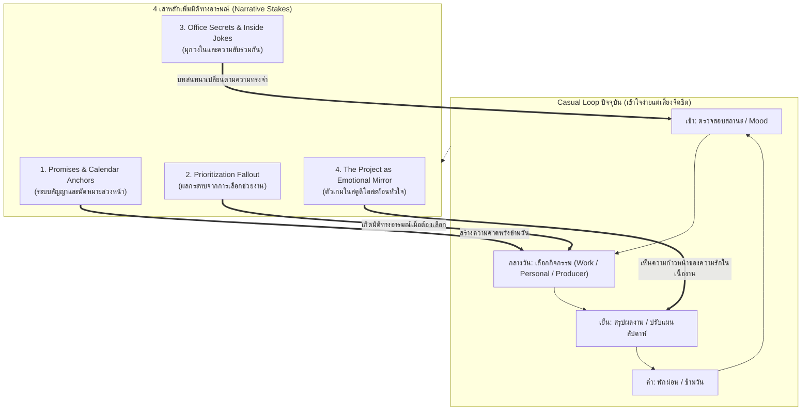
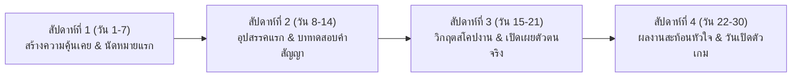

# 04 — กรณีศึกษาแนว Workplace / Creative Studio Rom-Com และเทคนิคการผูกปมเนื้อเรื่องเข้ากับเกมเพลย์แบบ Casual Loop
(Workplace & Creative Studio Rom-Coms and Casual-Loop Narrative Hook Toolkit)

> **สถานะเอกสาร:** รายงานการค้นคว้าบทวิจัยฉบับที่ 4 (Research Reference Document) สำหรับโปรเจกต์ Project Love  
> **ขอบเขตการใช้งาน:** เป็นคลังข้อมูลอ้างอิง เทคนิคการเล่าเรื่อง และชุดเครื่องมือ Narrative Design สำหรับนักเขียนบทและทีมออกแบบ เพื่อนำไปประยุกต์ใช้กับความสัมพันธ์ระหว่าง **Producer กับ 3 สาวนักพัฒนา (ปลายฟ้า, เกรซ, พลอย)** ภายใต้ระบบ Casual Loop (30 วัน)  
> **การปฏิบัติตามมาตรฐานความปลอดภัย (ERR-027 Guardrail):** เอกสารฉบับนี้ไม่มีการใช้สำนวนเปรียบเทียบที่สื่อถึงความรุนแรง การทำร้ายร่างกาย หรือความเป็นความตาย โดยจะถ่ายทอดความตึงเครียดผ่านแรงกดดันของกำหนดส่งงาน (Deadlines), ความภาคภูมิใจในงานสร้างสรรค์ (Artistic Pride), ความกังวลในคุณค่าตนเอง (Imposter Syndrome), ภาระหนี้ทางเทคนิค (Technical Debt), และการจัดสรรเวลาในความสัมพันธ์

---

## 1. บทสรุปผู้บริหารและแก่นสำคัญที่ค้นพบ (Executive Summary & Key Takeaways)

### 1.1 ที่มาและการแก้โจทย์ของโปรเจกต์ (Addressing Session 042 Challenge)
จากการทดสอบระบบและข้อเสนอแนะใน Session 042 พบว่าระบบเกมเพลย์แบบ **Romance-First Casual Loop (30 วัน)** นั้นมีความเข้าใจง่ายและเข้าถึงได้สะดวก ทว่ามีความเสี่ยงที่จะเกิดปัญหา **"ลูปการเล่นเป็นเส้นตรง จืดชืด และขาดสิ่งกีดขวางหรือความท้าทายที่ดึงดูดใจ (Linear, Obstacle-Free Repetition)"** เนื่องจากผู้เล่นสามารถเลือกทำกิจกรรมซ้ำเดิม (เช่น เลือกเฉพาะ Personal Time หรือกดคำสั่งเดิมๆ) เพื่อสะสมค่าความสนิท (Affection) แล้วผ่านวันได้อย่างราบรื่น

จากการค้นคว้าสื่อประเภท Workplace Drama, Game Development Rom-Com และทฤษฎี Narrative Design สำหรับ Dating/Life Simulation พบความจริงสำคัญว่า:
> **"การแก้ปัญหาความจืดชืดของแคชชวลลูป ไม่ใช่การเพิ่มระบบตัวเลขที่ซับซ้อนขึ้นมาให้ปวดหัว แต่คือการเพิ่ม 'เดิมพันทางความรู้สึก (Narrative Stakes)' และ 'การจำกัดเวลาที่นำไปสู่ผลลัพธ์ที่ตามมา (Opportunity Cost & Consequences)'"**

### 1.2 แก่นแท้ของ Creative Studio Rom-Com: งานคือภาษารัก (Craft as Love Language)
ในสตูดิโอสร้างสรรค์ผลงาน ความรักไม่ได้เกิดขึ้นจากการนั่งจีบกันไปวันๆ แต่เกิดจาก **"การร่วมเผชิญหน้ากับความว่างเปล่า แล้วช่วยกันสร้างสิ่งที่มีความหมายขึ้นมาด้วยกัน"** 
- ผลงานที่กำลังสร้าง (Game Project) ทำหน้าที่เป็น **"กระจกสะท้อนตัวตน (Psychological Mirror)"** ของตัวละครแต่ละคน 
- ทักษะเฉพาะทาง (วาดภาพ, เขียนโค้ด, ออกแบบระบบ) กลายเป็น **"กำแพงป้องกันตัวเอง (Defense Mechanism)"** ที่ตัวละครใช้ปิดบังความอ่อนแอในใจ
- หน้าที่ของ Producer ไม่ใช่ผู้สั่งการหรือเจ้านายที่ถือแส้ไล่ต้อน แต่คือ **"ผู้สร้างพื้นที่ปลอดภัยทางอารมณ์ (Emotional Anchor & Enabler)"** ที่คอยรับฟัง ปกป้อง และเชื่อมโยงความฝันของทุกคนเข้าด้วยกัน

### 1.3 กฎเหล็ก 5 ข้อในการผูกเรื่องงานเข้ากับความโรแมนติกและเกมเพลย์
1. **อุปสรรคในงานต้องเข้าใจได้ด้วยสัญชาตญาณความรู้สึก (Emotionally Intuitive Creative Conflict):** คนเล่นทั่วไปไม่จำเป็นต้องเข้าใจสมการคณิตศาสตร์ของการเขียน Shader หรือทฤษฎีการลงสี Color Harmony แต่ต้องเข้าใจทันทีว่า *"ทำไมเกรซถึงกลัวที่จะกด Merge โค้ดชิ้นนี้"* หรือ *"ทำไมปลายฟ้าถึงสเก็ตช์ภาพเดิมซ้ำไปมาสิบรอบโดยไม่ยอมส่ง"* ความขัดแย้งต้องขับเคลื่อนด้วยความกลัว ความหวัง และความภาคภูมิใจเสมอ
2. **โปรดิวเซอร์คือผู้แบกรับความไม่แน่นอนเพื่อปกป้องความฝันของทีม (Producer as Shield):** ความผูกพันที่โรแมนติกและลึกซึ้งที่สุด เกิดขึ้นเมื่อตัวละครหญิงเห็นว่า Producer ไปรับแรงกดดันจากภายนอกมา เพื่อให้พวกเธอได้สร้างสรรค์ผลงานอย่างสบายใจที่สุด
3. **ความขาดแคลนของเวลาสร้างน้ำหนักให้ความสัมพันธ์ (Scarcity & Opportunity Cost):** เมื่อเวลาในหนึ่งวันมีจำกัด การเลือกไปกินข้าวกับคนหนึ่งย่อมหมายถึงการสละโอกาสที่จะไปช่วยอีกคน การตัดสินใจจึงมีความหมายเมื่อผู้เล่นต้อง "เลือกสละบางสิ่ง" ไม่ใช่การเก็บแต้มได้ครบทุกคนแบบไร้ข้อจำกัด
4. **คำสัญญาและนัดหมายสร้างการรอคอยข้ามวัน (Promises Drive Anticipation):** แทนที่จะเป็นการกดคุยแล้วจบในวันนั้น การหยอด "คำสัญญาล่วงหน้า" (เช่น *"วันศุกร์นี้ ช่วยมาดูตัวอย่างแรกด้วยกันหน่อยได้ไหมคะ"*) จะเปลี่ยนลูปซ้ำซากให้กลายเป็นการนับถอยหลังรอคอยอีเวนต์ที่มีความหมาย
5. **ความสนิทสนมแสดงออกผ่านมุกวงในและความลับร่วมกัน (Micro-Intimacy & Shared Office Culture):** สายตาที่สบกันข้ามโต๊ะประชุม, รหัสลับในคอมเมนต์โค้ด, เมนูเครื่องดื่มยามดึกที่มีแค่สองคนที่รู้ใจกัน สิ่งเหล่านี้สร้างความโรแมนติกที่อบอุ่นและมีเสน่ห์มากกว่าคำบอกรักที่โจ่งแจ้ง

---

## 2. กรณีศึกษาเชิงลึก (In-Depth Case Studies)

---

### กรณีศึกษาที่ 1: *Shirobako* (2014–2015)
* **ชื่อผลงาน / ผู้สร้าง:** *Shirobako* (ก้าวต่อไปเพื่อฝัน) / กำกับโดย Tsutomu Mizushima, ผลิตโดยสตูดิโอ P.A. Works (TV Anime 24 ตอน + ภาพยนตร์)
* **Logline & High-Concept Hook:** ห้าสาวเพื่อนสนิทที่เคยสัญญาว่าจะสร้างอนิเมะด้วยกัน ก้าวเข้าสู่อุตสาหกรรมอนิเมะของจริง และต้องเผชิญกับคลื่นลมแห่งความเป็นจริง กำหนดส่งงานที่กระชั้นชิด และการประสานงานระหว่างบุคลากรต่างขั้ว
* **กลไกความตลกและเคมีตัวละคร (Rom-Com & Workplace Engine):** 
  - ความขบขันเกิดขึ้นจากความต่างของคนทำงานสร้างสรรค์ เช่น ผู้กำกับที่จิตใจอ่อนไหวและชอบจมอยู่ในจินตนาการจนไม่ยอมตรวจสตอรี่บอร์ด, แอนิเมเตอร์ระดับตำนานที่ไม่ยอมใช้คอมพิวเตอร์, และโปรดักชันแอสซิสแทนท์ (อาโออิ มิโมริ) ที่ต้องวิ่งวุ่นแก้ปัญหาเฉพาะหน้าด้วยความจริงใจ
  - เสน่ห์ของความผูกพันไม่ได้มาจากการจีบกันตรงๆ แต่เกิดจาก **"ภาวะร่วมลงเรือลำเดียวกัน (Camaraderie under Crunch)"** เมื่อทีมงานนั่งกินโดนัทด้วยกันตอนตีสองเพื่อฉลองที่ส่งงานทันกำหนด
* **การหักมุมความคาดหวัง / จุดเปลี่ยนดราม่า (Subversion & Emotional Climax):**
  - หลีกเลี่ยงตัวร้ายแบบการ์ตูน: ในเรื่องไม่มีใครเป็นคนไม่ดี ทุกคนรักงานอนิเมะเหมือนกันหมด แต่ความขัดแย้งเกิดจาก **"วิสัยทัศน์ที่มองคนละมุมและเวลาที่ไม่คอยท่า"**
  - ฉากสะเทือนอารมณ์ระดับตำนาน: เมื่อชิซึกะ (เพื่อนสนิทที่เป็นนักพากย์และตกคัดเลือกมานับครั้งไม่ถ้วน) ได้รับบทตัวละครที่มีประโยคพูดว่า *"ตอนนี้ฉันเข้าใกล้ความฝันขึ้นอีกนิดแล้วสินะคะ"* และอาโออิที่นั่งคุมแผงเสียงน้ำตาไหลออกมาอย่างเงียบๆ เป็นช่วงเวลาที่แสดงให้เห็นว่างานโปรดิวเซอร์มีความหมายที่สุดเมื่อได้เห็นคนที่เรารักและห่วงใยประสบความสำเร็จ
* **จุดที่นำมาประยุกต์ใช้กับ Project Love (Actionable Takeaway):**
  - **การประสานงานคือศิลปะ:** ให้ Producer ในเกมของเรารับบทบาทเป็น "ผู้เชื่อมประสาน" ระหว่างความต้องการของเกรซ (โปรแกรมเมอร์ที่ต้องการสเปกชัดเจน) กับปลายฟ้า (อาร์ตทิสต์ที่ต้องการอิสระในการร่างภาพ) 
  - **ฉากการผ่อนคลายหลังวิกฤต (Post-Crisis Relief):** นำโมเมนต์การนั่งพักดื่มเครื่องดื่มอุ่นๆ ในออฟฟิศยามค่ำคืนหลังแก้ปัญหางานใหญ่ลุล่วงมาเป็นรางวัลความสัมพันธ์ (Bonding Moment) ที่ทรงพลัง

---

### กรณีศึกษาที่ 2: *Saekano: How to Raise a Boring Girlfriend* (2015–2019)
* **ชื่อผลงาน / ผู้สร้าง:** *Saekano: How to Raise a Boring Girlfriend* (*Saenai Heroine no Sodatekata*) / ประพันธ์โดย Fumiaki Maruto (ผู้เขียนบทเกม Visual Novel ระดับตำนานอย่าง *White Album 2*)
* **Logline & High-Concept Hook:** โอตาคุหนุ่มผู้คลั่งไคล้เกมจีบสาว ก่อตั้งเซอร์เคิลอินดี้เพื่อสร้างเกมวิชวลโนเวลในอุดมคติ โดยมีแรงบันดาลใจจากสาวมัธยมปลายธรรมดาๆ ไร้จุดเด่นที่เขาบังเอิญพบใต้ต้นซากุระ
* **กลไกความตลกและเคมีตัวละคร (Rom-Com & Workplace Engine):**
  - ใช้ความเป็น Visual Novel มาล้อเลียนความจริง (Meta-Humor): โทโมยะ (โปรดิวเซอร์) ต้องรับมือกับ เอริริ (นักวาดสาวซึนเดเระที่เป็นเพื่อนสมัยเด็ก) และ อุทาฮะ (นักเขียนบทสาวคูลเดเระรุ่นพี่ผู้เจนจัด)
  - ความตลกและแรงดึงดูดเกิดจากการที่สาวๆ ใช้ **"สคริปต์เกมและภาพ CG ในเกม" เป็นเครื่องมือในการสารภาพรักและท้าทายหัวใจของพระเอก** เช่น อุทาฮะเขียนรูทตัวละครที่บังคับให้พระเอกต้องเลือกว่าจะยอมรับความรู้สึกของเธอหรือไม่
* **การหักมุมความคาดหวัง / จุดเปลี่ยนดราม่า (Subversion & Emotional Climax):**
  - **การรื้อสร้างนางเอกแบบพิมพ์นิยม:** คาโต้ เมกุมิ ซึ่งตอนแรกดูเหมือนจะเป็นแค่เด็กสาวไร้บุคลิก (Boring Girl) กลับค่อยๆ ซึมซับบทบาทรองโปรดิวเซอร์ เธอเรียนรู้วิธีการทำงานร่วมกับโทโมยะ รับฟังปัญหา และกลายเป็นเสาหลักทางใจที่ขาดไม่ได้
  - **จุดแตกหักเมื่อวิชาชีพปะทะความรู้สึกส่วนตัว:** เอริริและอุทาฮะเลือกที่จะก้าวไปสู่โปรเจกต์ระดับมืออาชีพที่ใหญ่กว่า เพราะโทโมยะในฐานะโปรดิวเซอร์ "ถนอมพวกเธอมากเกินไปจนไม่สามารถผลักดันฝีมือไปสู่จุดสูงสุดได้" ความเจ็บปวดของการแยกย้ายเพื่อเติบโตทำให้เมกุมิกลายเป็นคนที่คอยประคับประคองโทโมยะจนความรักผลิบานในที่สุด
* **จุดที่นำมาประยุกต์ใช้กับ Project Love (Actionable Takeaway):**
  - **Meta-Narrative สะท้อนความสัมพันธ์:** ให้เกมจำลองที่ปลายฟ้า, เกรซ และพลอยกำลังสร้างในสตูดิโอ มีเนื้อหาหรือองค์ประกอบบางอย่างที่เปลี่ยนไปตามการดูแลของ Producer (เช่น ถ้า Producer สนิทกับปลายฟ้า ปลายฟ้าจะแอบใส่ดีเทลของ Producer ลงในภาพคอนเซปต์ หรือถ้าสนิทกับเกรซ เกรซจะเขียน Easter Egg ลับซ่อนไว้ในโค้ด)
  - **เสน่ห์แบบ Slow-Burn ของคนที่อยู่เคียงข้าง:** คาแรกเตอร์อย่างปลายฟ้าหรือเกรซสามารถใช้จังหวะความนิ่งเงียบที่ค่อยๆ เปิดใจคล้ายเมกุมิได้เป็นอย่างดี

---

### กรณีศึกษาที่ 3: *New Game!* และ *New Game!!* (2016–2017)
* **ชื่อผลงาน / ผู้สร้าง:** *New Game!* / มังงะโดย Shotaro Tokuno, ดัดแปลงอนิเมะโดยสตูดิโอ Doga Kobo
* **Logline & High-Concept Hook:** อาโอบะ เด็กสาวจบใหม่ผู้หลงใหลเกม Fairies Story ก้าวเข้าทำงานเป็น 3D Character Artist ในบริษัท Eagle Jump ภายใต้การดูแลของ โค ยางามิ คาแรกเตอร์ดีไซเนอร์ระดับตำนานที่เป็นไอดอลของเธอ
* **กลไกความตลกและเคมีตัวละคร (Rom-Com & Workplace Engine):**
  - ความน่ารักสดใส (Cute Girls Doing Game Dev Things) ผสมผสานกับความสมจริงของชีวิตการทำงาน เช่น การนอนค้างที่ออฟฟิศในถุงนอน, ปัญหาบั๊กที่ไม่รู้สาเหตุ, และความเขินอายเวลาต้องถูกหัวหน้าตรวจงาน
  - ไดนามิกของความสัมพันธ์ในที่ทำงานระหว่างเพื่อนร่วมงานรุ่นเดียวกัน และระหว่างรุ่นพี่รุ่นน้องที่พัฒนาผ่านการคอมเมนต์งานอย่างตรงไปตรงมา
* **การหักมุมความคาดหวัง / จุดเปลี่ยนดราม่า (Subversion & Emotional Climax):**
  - **การแข่งขันออกแบบตัวละคร (PECO Character Design Competition ในซีซัน 2):** เมื่อผู้บริหารเปิดโอกาสให้ทุกคนในทีมส่งประกวดแบบตัวละคร อาโอบะต้องแข่งกับโค ยางามิ ซึ่งเป็นทั้งหัวหน้าและไอดอลของตน
  - งานของอาโอบะชนะการประกวดเพราะตอบโจทย์ความสดใหม่ของเกมใหม่ แต่สิ่งที่ตามมาไม่ใช่ความสุขล้วนๆ หากแต่เป็น **"ความรู้สึกผิด (Survivor's Guilt & Imposter Syndrome)"** ที่ผลงานของตนไปบดบังคนที่ตนเคารพรัก ขณะที่โคเองก็ต้องก้าวข้ามความเจ็บปวดในศักดิ์ศรี เพื่อทำหน้าที่ Art Director ช่วยขัดเกลางานของลูกศิษย์ให้สมบูรณ์
* **จุดที่นำมาประยุกต์ใช้กับ Project Love (Actionable Takeaway):**
  - **ปมของปลายฟ้า (Plaifah):** ปลายฟ้ามีปมเรื่องความมั่นใจและกลัวว่าจะวาดได้ไม่ดีพอ การให้ผู้เล่นมีบทบาทในการ "เชื่อมั่นและปกป้องผลงานร่างของเธอ" จะสร้างโมเมนต์ใจฟูที่ซาบซึ้งอย่างยิ่ง
  - **การทำงานร่วมกันข้ามสายงาน (Cross-Discipline Dynamics):** ปลายฟ้าต้องส่งภาพให้เกรซเอาไปทำสไปรต์ และต้องคุยกับพลอยเรื่องดีไซน์ นำจังหวะการรับส่งงานนี้มาเป็นจุดเปิดบทสนทนาแบบ Work Together

---

### กรณีศึกษาที่ 4: *Bokutachi no Remake (Remake Our Life!)* (2021)
* **ชื่อผลงาน / ผู้สร้าง:** *Bokutachi no Remake* / ประพันธ์โดย Nachi Kio, ออกอากาศเป็นอนิเมะโดย Feel
* **Logline & High-Concept Hook:** เคียวยะ โปรดิวเซอร์เกมวัย 28 ปีที่ชีวิตล้มเหลว ย้อนเวลากลับไป 10 ปีก่อนในรั้วมหาวิทยาลัยศิลปะ และได้กลายเป็นเพื่อนร่วมบ้านกับ 3 บุคคลที่จะกลายเป็น "รุ่นแพลทินัม" (เหล่ายอดอัจฉริยะในอนาคต)
* **กลไกความตลกและเคมีตัวละคร (Rom-Com & Workplace Engine):**
  - ความเฮฮาของการทำโปรเจกต์ส่งอาจารย์ในหอพักร่วมชายหญิง ความตื่นเต้นของการระดมสมองข้ามคืน และความใกล้ชิดที่เกิดจากการที่เคียวยะใช้ประสบการณ์ในอนาคตคอยเป็น "ผู้จัดการทีม" แก้ไขปัญหาการผลิตให้เพื่อนๆ
* **การหักมุมความคาดหวัง / จุดเปลี่ยนดราม่า (Subversion & Emotional Climax):**
  - **บทเรียนราคาแพงของโปรดิวเซอร์ผู้ควบคุมทุกอย่าง (Over-Meddling Producer):** เคียวยะพยายาม "แก้ปัญหาแทนทุกคน" เพื่อให้งานเสร็จทันและปลอดภัย จนกลายเป็นว่าเขา **"ลิดรอนโอกาสในการเผชิญหน้ากับความยากลำบากของเหล่ายอดฝีมือ"** ทำให้อัจฉริยะอย่างอากิ ชิโนะ และสึรายูกิไม่ได้ขัดเกลาศักยภาพที่แท้จริง
  - **แก่นแท้ของ Producer:** โปรดิวเซอร์ที่ดีไม่ใช่คนที่เข้าไปแย่งงานหรือสั่งให้ทุกคนทำตามสูตรสำเร็จปลอดภัย แต่คือคนที่ **"ยอมรับความเสี่ยง เชื่อใจในตัวตนของทีมงาน และสร้างสิ่งแวดล้อมที่พวกเขาสามารถเบ่งบานได้ด้วยตัวเอง"**
* **จุดที่นำมาประยุกต์ใช้กับ Project Love (Actionable Takeaway):**
  - **การสนับสนุนโดยไม่ก้าวก่าย (Support without Overriding):** ในระบบ Weekly Support Focus หรือการ Work Together ผู้เล่นจะต้องไม่ใช่คนที่เข้าไปสั่งแก้ผลงานของปลายฟ้า, เกรซ หรือพลอย แต่เข้าไปเป็นกำลังใจ ช่วยจัดการงานจิปาถะรอบตัว เพื่อให้พวกเธอได้จดจ่อกับสิ่งที่เธอรัก
  - สร้างฉากที่ตัวละครกล้าบอกความต้องการของตัวเองออกมาเมื่อระดับความไว้ใจ (Trust) สูงขึ้น

---

### กรณีศึกษาที่ 5: *Mythic Quest* (2020–ปัจจุบัน)
* **ชื่อผลงาน / ผู้สร้าง:** *Mythic Quest* / ซีรีส์ทาง Apple TV+ สร้างโดย Rob McElhenney, Charlie Day และ Megan Ganz
* **Logline & High-Concept Hook:** เบื้องหลังสตูดิโอพัฒนาเกม MMORPG ระดับโลกที่เต็มไปด้วยความวุ่นวาย นำโดย เอียน กริมม์ ครีเอทีฟไดเรกเตอร์ผู้มีอีโก้ล้นพ้น และ ป็อปปี้ หลี่ ลีดโปรแกรมเมอร์อัจฉริยะผู้เก็บกดและเนิร์ดขั้นสุด
* **กลไกความตลกและเคมีตัวละคร (Rom-Com & Workplace Engine):**
  - เคมีแบบ "คู่กัดขั้วตรงข้าม (Visionary vs. Practical Engineer)": เอียนชอบเสนอไอเดียยิ่งใหญ่ลอยฟ้า ส่วนป็อปปี้ต้องกุมขมับเพราะต้องเป็นคนเขียนโค้ดแปลงความเพ้อฝันให้กลายเป็นจริงในทางฟิสิกส์และระบบ
  - มุกตลกหน้าตายและการโต้เถียงด้วยตรรกะสุดกวน ที่ยิ่งเถียงกันมากเท่าไหร่ก็ยิ่งแสดงให้เห็นว่าทั้งคู่เข้าใจความคิดของกันและกันมากกว่าใครในโลก
* **การหักมุมความคาดหวัง / จุดเปลี่ยนดราม่า (Subversion & Emotional Climax):**
  - แม้จะดูเหมือนไม่ลงรอยกันตลอดเวลา แต่เมื่อคนหนึ่งพังทลาย อีกคนจะกลายเป็นหลักยึดเสมอ ในตอนพิเศษช่วงวิกฤตกักตัว (Quarantine) ป็อปปี้ที่เผชิญกับความเหงาและแรงกดดันจนร้องไห้ เอียนได้ขับรถข้ามเมืองมายืนกอดเธอหน้าประตูบ้าน
  - การยอมรับว่า **"ต่างฝ่ายต่างเติมเต็มสิ่งที่อีกฝ่ายขาดหายไป"** (เอียนทำให้ป็อปปี้กล้าฝันใหญ่ ส่วนป็อปปี้ทำให้เอียนคงอยู่กับความเป็นจริง) กลายเป็นสายสัมพันธ์ที่ลึกซึ้งเกินกว่าเพื่อนร่วมงานทั่วไป
* **จุดที่นำมาประยุกต์ใช้กับ Project Love (Actionable Takeaway):**
  - **เคมีระหว่าง Producer กับ เกรซ (Grace):** เกรซมีบุคลิกแบบ Kuudere และเป็นเสาหลักทางเทคนิคเหมือนป็อปปี้ เธอต้องการความชัดเจน มีตรรกะ และมักเหน็บแนมไอเดียที่ไร้การวางแผน หาก Producer แสดงให้เห็นถึงความใส่ใจในสถาปัตยกรรมโค้ดและความพยายามที่จะเข้าใจข้อจำกัดของเธอ เกรซจะค่อยๆ ยอมลดความเข้มงวดลง และเผยด้านขี้อ้อนที่ซ่อนอยู่

---

### กรณีศึกษาที่ 6: *Keep Your Hands Off Eizouken!* (2020)
* **ชื่อผลงาน / ผู้สร้าง:** *Eizōken ni wa Te o Dasu na!* / มังงะโดย Sumito Oowara, อนิเมะโดย Masaaki Yuasa (Science SARU)
* **Logline & High-Concept Hook:** สามสาวมัธยมปลายรวมตัวกันตั้งชมรมสร้างอนิเมะอินดี้ โดยมี อาซากุสะ (คนคิดโลกและคอนเซปต์), มิซึซากิ (คนวาดการเคลื่อนไหวของตัวละคร), และ คานาโมริ (โปรดิวเซอร์สาวร่างสูงผู้รักเงินและบริหารเวลาอย่างเฉียบขาด)
* **กลไกความตลกและเคมีตัวละคร (Rom-Com & Workplace Engine):**
  - ความเพ้อฝันไร้ขอบเขตของฝ่ายครีเอทีฟที่ถูกดึงกลับสู่โลกความเป็นจริงด้วยเสียงเคาะกระดานของคานาโมริ
  - คานาโมริไม่ได้มองว่าตนเองเป็นศิลปิน แต่เธอภูมิใจในการเป็น "เกราะป้องกัน" ที่คอยหาเงิน หาสถานที่ และปกป้องไม่ให้อาซากุสะกับมิซึซากิถูกผู้บริหารหรือคณะกรรมการนักเรียนเอารัดเอาเปรียบ
* **การหักมุมความคาดหวัง / จุดเปลี่ยนดราม่า (Subversion & Emotional Climax):**
  - **การประนีประนอมไม่ใช่ความพ่ายแพ้ (Compromise as Creative Engineering):** เมื่อเวลาเหลือน้อยและไม่สามารถวาดทุกเฟรมได้อย่างสมบูรณ์แบบ คานาโมริไม่ได้สั่งให้ลดคุณภาพ แต่สอนให้ **"ออกแบบทางลัดที่ยังคงมนต์สะกดของงานไว้ได้"** (เช่น การตัดต่อเสียง หรือการใช้มุมกล้องช่วย)
  - ความสุขของการสร้างผลงานไม่ใช่การมีภาพวาดในสมุดสเก็ตช์ที่ไม่เคยมีใครเห็น แต่คือ **"การส่งมอบผลงานที่เสร็จสมบูรณ์ให้ผู้ชมได้สัมผัสและชื่นชม"**
* **จุดที่นำมาประยุกต์ใช้กับ Project Love (Actionable Takeaway):**
  - **บทบาท Producer Work ในเกม:** เมื่อผู้เล่นกดคำสั่ง Producer Work ควรมีเรื่องเล่าประกอบว่ากำลังไปเจรจาขยายเวลา ขอความร่วมมือ หรือจัดหาสิ่งอำนวยความสะดวกมาให้สาวๆ เพื่อให้เห็นผลงานของ Producer เป็นรูปธรรม
  - **การปรับเปลี่ยนแผนงาน (Scope Adjustment):** เมื่อเกิดเหตุการณ์ไม่คาดฝัน การตัดฟีเจอร์บางอย่างออกพร้อมการพูดคุยที่จริงใจ ควรได้รับความเคารพจากทีม ไม่ใช่การลดคะแนนความสัมพันธ์โดยอัตโนมัติ

---

### กรณีศึกษาที่ 7: *16bit Sensation: Another Layer* (2023)
* **ชื่อผลงาน / ผู้สร้าง:** *16bit Sensation: Another Layer* / ผลงานร่วมของ Tamiki Wakaki (ผู้เขียน *เซียนเกมรักขอเป็นเทพนักจีบ*) ร่วมกับตำนานนักวาดเกมค่าย Leaf อย่าง Misato Mitsumi และ Tatsuki Amazuyu
* **Logline & High-Concept Hook:** โคโนฮะ นักวาดภาพประกอบสาวในยุคปัจจุบันผู้รักเกมวิชวลโนเวลยุค 90s เป็นชีวิตจิตใจ บังเอิญข้ามเวลาไปยังปี 1992 และได้ร่วมงานกับค่ายเกมอินดี้ขนาดเล็กชื่อ Alcohol Soft เพื่อสร้างเกม PC-98 ภายใต้ข้อจำกัด 16 สี
* **กลไกความตลกและเคมีตัวละคร (Rom-Com & Workplace Engine):**
  - บรรยากาศอบอุ่นสไตล์ "Garage Band Studio": ทีมงานไม่กี่คนแออัดอยู่ในห้องเช่า ทำงานแข่งกับเวลาเพื่อส่งแผ่นฟลอปปีดิสก์ไปขายในงานคอมิเกะ
  - เคมีระหว่าง โคโนฮะ (นักวาดสายพลังใจ) กับ มาโมรุ (โปรแกรมเมอร์หนุ่มปากร้ายแต่ใจดี ผู้เชี่ยวชาญด้านฮาร์ดแวร์ยุคเก่า) ที่ผลัดกันช่วยเหลือและเรียนรู้จากกันและกัน
* **การหักมุมความคาดหวัง / จุดเปลี่ยนดราม่า (Subversion & Emotional Climax):**
  - **เทคโนโลยีล้ำสมัยไม่อาจแทนที่หัวใจของงานศิลป์:** แม้โคโนฮะจะมาจากอนาคตที่มีซอฟต์แวร์และคอมพิวเตอร์ที่ล้ำหน้า แต่เธอกลับพบว่าภาพวาด 16 สีที่ต้องจัดวางเม็ดพิกเซลทีละจุดอย่างประณีตนั้นมีมนต์ขลังและความผูกพันที่เทคโนโลยีปัจจุบันมอบให้ไม่ได้
  - ความผูกพันของทีมไม่ได้เกิดจากความสะดวกสบาย แต่เกิดจาก **"การร่วมกันฟันฝ่าข้อจำกัดของยุคสมัย"**
* **จุดที่นำมาประยุกต์ใช้กับ Project Love (Actionable Takeaway):**
  - **ความเรียบง่ายแต่เปี่ยมด้วยความใส่ใจ:** ใช้สะท้อนบรรยากาศสตูดิโอขนาดเล็กของ Project Love (ห้อง 4 คน) ให้เป็นพื้นที่ที่อบอุ่น เต็มไปด้วยเศษกระดาษโน้ต แก้วกาแฟ และสายต่อระโยงระยาง ที่แสดงถึงความมีชีวิตชีวาของทีมอินดี้

---

### กรณีศึกษาที่ 8: *Start-Up* (2020) และ *Bakuman* (2008–2012)
* **ชื่อผลงาน / ผู้สร้าง:** *Start-Up* (ซีรีส์เกาหลีโดย Park Hye-ryun) และ *Bakuman* (มังงะโดย Tsugumi Ohba & Takeshi Obata)
* **Logline & High-Concept Hook:** 
  - *Start-Up:* หนุ่มโปรแกรมเมอร์อัจฉริยะผู้ไร้เสน่ห์ทางสังคม (นัมโดซาน) ร่วมมือกับหญิงสาวผู้เปี่ยมวิสัยทัศน์ (ซอดัลมี) ในการก่อตั้งสตูดิโอเทคโนโลยีเพื่อเข้าประกวดในแซนด์บ็อกซ์
  - *Bakuman:* สองคู่หู มาชิโระ (นักวาด) และ ทาคากิ (คนแต่งเรื่อง) สัญญากับสาวในดวงใจว่าจะทำให้ผลงานได้สร้างเป็นอนิเมะเพื่อที่จะได้แต่งงานกัน
* **กลไกความตลกและเคมีตัวละคร (Rom-Com & Workplace Engine):**
  - การทำงานร่วมกันเพื่อพิชิตเป้าหมายใหญ่ที่มีระยะเวลาเป็นตัวกำหนด (Demo Day ใน Start-Up / การจัดอันดับผลโหวตรายสัปดาห์ใน Bakuman)
  - ความโรแมนติกที่ผูกไว้กับ "ความสำเร็จร่วมกัน": การสัมผัสมือกันครั้งแรกหน้าจอคอมพิวเตอร์เมื่อโค้ดรันผ่าน หรือการสบตากันในห้องสเก็ตช์ภาพ
* **การหักมุมความคาดหวัง / จุดเปลี่ยนดราม่า (Subversion & Emotional Climax):**
  - **Start-Up:** การพัฒนาแอป *Noongil* (AI ช่วยเหลือผู้บกพร่องทางการมองเห็น) กลายเป็นการนำเทคโนโลยีที่แห้งแล้งมาผูกเข้ากับความรักและความกตัญญูต่อคุณย่า ทำให้การเขียนโค้ดของโดซานมีความหมายทางใจอย่างลึกซึ้ง
  - **Bakuman:** สัญญาความรักระยะยาวระหว่างมาชิโระกับมิโฮะ กลายเป็นตัวขับเคลื่อนให้เขายอมอดทนต่อการปฏิเสธสตอรี่บอร์ดนับครั้งไม่ถ้วน แต่ความรักที่แท้จริงคือการเคารพเส้นทางของกันและกัน ไม่ใช่การเรียกร้องความสนใจ
* **จุดที่นำมาประยุกต์ใช้กับ Project Love (Actionable Takeaway):**
  - **เป้าหมาย 30 วันที่มีความหมาย:** การสร้างเกมในโปรเจกต์ 30 วันของเรา ต้องไม่ใช่แค่การทำยอดขายหรือส่งงานให้ผ่าน แต่คือการสร้างผลงานที่จะเป็น "อนุสรณ์แห่งความทรงจำของพวกเรา 4 คน"
  - ใช้ปมของพลอย (Ploy - Game Designer) ที่มักกลัวว่าเกมที่เธอออกแบบจะไม่มีใครเล่น นำมาผูกกับการที่ Producer คอยทดสอบและชื่นชมความตั้งใจของเธอ

---

## 3. รูปแบบสถานการณ์และโครงสร้างบทที่นำไปใช้ได้จริง (Reusable Narrative Patterns & Beats)

---

### 3.1 สี่เสาหลักแก้ปัญหาแคชชวลลูปจืดชืด (4 Pillars to Solve Repetitive Casual Loops)



---

#### เสาหลักที่ 1: ระบบสัญญาและนัดหมายล่วงหน้า (Promises, Calendar Anchors & Visible Invitations)
* **ปัญหาเดิม:** ผู้เล่นตื่นมาแล้วกด Personal Time ทันทีเพื่อเอาแต้มหัวใจ วันต่อวันไม่มีความต่าง ไม่มีการรอคอย
* **เทคนิคที่ใช้แก้:** การหยอด "การนัดหมายที่มีกำหนดเวลา (Scheduled Commitments)"
  - ระหว่างทำกิจกรรมในวันอังคาร ตัวละครอาจเอ่ยปากชวน: *"วันพฤหัสบดีช่วงเย็น... ปลายฟ้าอยากชวนไปดูนิทรรศการหนังสือภาพที่หอศิลป์ใกล้ๆ ออฟฟิศ จะได้หาไอเดียมาทำฉากหลังด้วยกัน... คุณพอจะว่างไหมคะ?"*
  - **กลไกในเกม:** คำสัญญานี้จะถูกปักหมุดลงบนปฏิทินของสัปดาห์ เมื่อถึงวันพฤหัสฯ ช่วงเย็น หากผู้เล่นรักษาสัญญาและกด Personal Time กับปลายฟ้า จะได้เข้าสู่อีเวนต์พิเศษระดับพรีเมียม (Shared Special Scene) ที่มีบทสนทนาลึกซึ้ง
  - **การจัดการกรณีผิดสัญญา (Broken Promise & Graceful Repair):** หากเกิดเหตุฉุกเฉินในสตูดิโอจนผู้เล่นต้องไปทำงานอื่น เกมจะไม่ลงโทษด้วยการตัดจบรูท แต่ตัวละครจะมีปฏิกิริยาเหงาๆ ในวันรุ่งขึ้น และเปิดโอกาสให้ Producer ได้ "ขอโทษอย่างจริงใจและหาโอกาสชดเชย" ซึ่งการซ่อมแซมความสัมพันธ์นี้จะเผยให้เห็นเสน่ห์อีกด้านของตัวละคร

---

#### เสาหลักที่ 2: ผลกระทบจากการเลือกลำดับความสำคัญ (Prioritization Fallout & Contextual Misunderstanding)
* **ปัญหาเดิม:** การเลือกไปช่วยคนหนึ่ง ไม่มีผลอะไรต่ออีกสองคนที่เหลือ ทำให้รู้สึกเหมือนตัวละครไม่มีชีวิตและไม่รับรู้สิ่งแวดล้อมรอบตัว
* **เทคนิคที่ใช้แก้:** การสร้าง "ความตระหนักรู้ของเพื่อนร่วมทีม (Team Awareness)" โดยปราศจากความหึงหวงไร้เหตุผล
  - เมื่อผู้เล่นเลือกตั้งค่า Weekly Support Focus ไปที่เกรซตลอดทั้งสัปดาห์ ในการประชุมย่อปลายสัปดาห์ พลอยอาจเอ่ยปากแซวด้วยน้ำเสียงขี้เล่น: *"ช่วงนี้โปรดิวเซอร์ตัวติดกับพี่เกรซตลอดเลยนะคะ บั๊กหายเกลี้ยงเลย... ส่วนบาลานซ์เกมของพลอย คงต้องเล่นคนเดียวไปก่อนสินะคะ~"*
  - หากผู้เล่นเลือกไปช่วยงานปลายฟ้าจนดึก ในวันถัดมาเกรซอาจวางกล่องวิตามินซีไว้บนโต๊ะผู้เล่นพร้อมโน้ตสั้นๆ: *"เห็นเมื่อคืนอยู่ช่วยคุณปลายฟ้าจนดึก อย่าหักโหมจนป่วยล่ะคะ งานทางนี้ฉันยังคุมอยู่"*
  - **หัวใจสำคัญ:** ไม่ใช่การลงโทษด้วยความหึงหวงแบบพิษร้าย (Toxic Jealousy) แต่เป็นการแสดงให้เห็นว่า **ทุกคนมองเห็นการทุ่มเทของผู้เล่น** และทำให้การเลือกมีน้ำหนักในใจ

---

#### เสาหลักที่ 3: ความลับในออฟฟิศและมุกวงใน (Office Secrets, Micro-Intimacy & Shared Rituals)
* **ปัญหาเดิม:** บทสนทนาทั่วไป (Ordinary Talk) วนลูปและพูดแต่เรื่องซ้ำๆ
* **เทคนิคที่ใช้แก้:** การสะสม "มุกวงใน (Shared Inside Jokes)" และ "ความลับเฉพาะเราสองคน"
  - **ปลายฟ้า:** การรู้ว่าปลายฟ้าชอบแอบถอดแว่นตาแล้วนวดหัวตาเวลาเหนื่อย, มีสเก็ตช์ภาพการ์ตูนล้อเลียน Producer ซ่อนอยู่ในหน้าสุดท้ายของสมุดสเก็ตช์
  - **เกรซ:** การค้นพบว่าเกรซแอบตั้งชื่อตัวแปรในโค้ดตามชื่อของหวานที่เธอชอบกินตอนเด็ก, หรือการส่งสัญญาณเคาะแก้วกาแฟเมื่อต้องการพักเบรก 5 นาที
  - **พลอย:** การแอบส่งกระดาษโน้ตรูปหน้ายิ้มข้ามโต๊ะประชุมเพื่อไม่ให้บรรยากาศตึงเครียด, หรือการแอบแบ่งขนมใต้โต๊ะตอนหัวหน้าไม่อยู่
  - **การนำมาใช้ในเกม:** เมื่อระดับความสนิทเพิ่มขึ้น บทสนทนาในออฟฟิศจะแทรกการอ้างอิงถึงความลับเหล่านี้ ทำให้ผู้เล่นรู้สึกว่าความสัมพันธ์มีความคืบหน้าอย่างเป็นรูปธรรม แม้จะอยู่ในฉากออฟฟิศเดิม

---

#### เสาหลักที่ 4: ตัวเกมในสตูดิโอสะท้อนหัวใจ (The In-Game Project as Emotional Mirror)
* **ปัญหาเดิม:** โปรเจกต์เกม 30 วันเป็นเพียงตัวเลขหลอดเปอร์เซ็นต์ (Code / Art / Design) ที่แห้งแล้ง
* **เทคนิคที่ใช้แก้:** ทำให้สิ่งที่พวกเธอสร้างสะท้อนความรู้สึกจริงที่เกิดขึ้นในสตูดิโอ
  - **ช่วงเริ่มต้น (วันที่ 1–10):** ตัวละครในเกมที่กำลังสร้างยังดูไร้ทิศทาง ขาดจุดเชื่อมโยง เหมือนกับทีมงานที่เพิ่งมารวมตัวกันและยังรักษาระยะห่าง
  - **ช่วงกลาง (วันที่ 11–20):** เมื่อ Producer ให้เวลาและรับฟังใคร ผลงานส่วนนั้นจะเปล่งประกายขึ้นมา เช่น ตัวเอกของเกมมีลักษณะนิสัยอบอุ่นและคอยปกป้องคนอื่นเหมือน Producer
  - **ช่วงท้าย (วันที่ 21–30):** บทสนทนาหรือฉากจบของเกมที่พวกเธอกำลังพัฒนา มีบทพูดที่สะท้อนถึงช่วงเวลา 30 วันที่ผ่านมา เช่น ข้อความในเครดิตท้ายเกม หรือ Easter Egg ลับที่ตัวละครหญิงตั้งใจใส่ไว้เพื่อบอกความรู้สึกแก่ Producer

---

### 3.2 การประยุกต์ใช้กับตัวละครทั้งสามของ Project Love

| ตัวละคร | อุปสรรคในงานสร้างสรรค์ที่เข้าใจง่าย | สะพานเชื่อมความโรแมนติกผ่านงาน | ความลับในออฟฟิศ / มุกวงใน (Inside Joke) | Meta-Reflection (สิ่งที่สะท้อนในตัวเกม) |
| :--- | :--- | :--- | :--- | :--- |
| **ปลายฟ้า (Plaifah)**<br/>*2D Concept Artist* | **วิกฤตความมั่นใจในตนเอง (Imposter Syndrome):** กลัวว่าลายเส้นของตัวเองจะธรรมดาเกินไป วาดแก้ซ้ำๆ จนไม่กล้าลงสีจริง | Producer นั่งเคียงข้างในความเงียบ ช่วยเปิดไฟโต๊ะทำงาน หาเรฟเฟอเรนซ์ ชงชามัทฉะอุ่นๆ และชมภาพร่างแรกที่ไม่มีใครเคยเห็น | ปลายฟ้ามี **"สมุดสเก็ตช์ลับเล่มสีน้ำตาล"** ที่แอบวาดรูป Producer ในอิริยาบถต่างๆ เวลาเผลอ | ตัวละครนำหญิงในเกมมีผ้าพันคอหรือเครื่องประดับแบบเดียวกับที่ Producer เคยให้เป็นของขวัญ |
| **เกรซ (Grace)**<br/>*Lead Programmer* | **ความกังวลในสถาปัตยกรรมระบบ (Technical Debt):** ไม่ยอมปล่อยผ่านบั๊กแม้แต่นิดเดียว แบกรับความปลอดภัยของทั้งโปรเจกต์ไว้คนเดียวจนล้า | Producer ช่วยตรวจเอกสาร Requirement รับฟังตรรกะทางเทคนิคโดยไม่เบื่อ ช่วยกันสกรีนงานไม่ให้มีงานแทรก | **"คอมเมนต์ลับในโค้ด (#TODO)"** ที่เกรซแอบบ่นเรื่องกาแฟหมด หรือเขียนขอบคุณ Producer ซ่อนไว้หลังบรรทัดฟังก์ชัน | บอสในเกมที่เกรซเขียน มีท่าการเคลื่อนไหวที่ถอดแบบมาจากนิยายรักโรแมนติกที่เธอแอบอ่าน |
| **พลอย (Ploy)**<br/>*Game Designer* | **ความกลัวความน่าเบื่อ (Feature Overload & Identity Crisis):** กลัวว่าเกมจะไม่สนุก จึงพยายามยัดระบบทุกอย่างเข้ามาจนเกมสะเปะสะปะ | Producer อาสาเป็น "เครื่องเล่นทดสอบ (Playtester)" ให้พลอยตลอดเวลา ช่วยเธอตัดฟีเจอร์ที่ไม่จำเป็นออกโดยไม่ทำร้ายจิตใจ | **"สัญญาณนิ้วใต้โต๊ะ"** และการตั้งชื่อบอร์ดเกมจำลองด้วยชื่อตลกๆ ที่รู้กันแค่สองคน | เควสต์ในเกมของพลอย มีบทสนทนาล้อเลียนมุกตลกที่ Producer เคยเล่นกับเธอในห้องกาแฟ |

---

### 3.3 การแมปเข้าสู่ระบบเกมเพลย์หลักของ Project Love (Session 041 Spec)

```
┌────────────────────────────────────────────────────────────────────────┐
│                        DAILY 3-PHASE LOOP                              │
├─────────────────────┬──────────────────────────┬───────────────────────┤
│  Morning (เช้า)     │      Daytime (บ่าย)      │     Evening (เย็น)    │
│  - เช็ก Mood สตูดิโอ│  - Work Together         │  - Producer Work      │
│  - รับคำนัดหมาย/จดหมาย│  - Personal Time (นัดไว้) │  - Night OT (ถ้ามี)   │
└─────────────────────┴──────────────────────────┴───────────────────────┘
```

1. **Work Together (ทำงานร่วมกัน - กลางวัน/บ่าย):**
   - *ไม่ใช่แค่แต้ม Affection + แต้มงานเล็กน้อย:* ให้บทสนทนาสะท้อนถึง "ทักษะและการยอมรับซึ่งกันและกัน (Professional Respect)"
   - เป็นพื้นที่เปิดเผยนิสัยการทำงาน: เช่น เห็นเกรซเวลาใส่แว่นแล้วเพ่งจออย่างจริงจัง, ปลายฟ้าเอานิ้วแตะริมฝีปากเวลาคิดภาพไม่ออก, หรือพลอยที่ทำแก้มป่องเวลาคิดเงื่อนไขเควสต์ไม่ออก
   - จังหวะการอยู่ด้วยกันในความเงียบที่ผ่อนคลาย (Comfortable Silence) ทำให้เกิดความรู้สึกว่า "แค่มีคนนี้อยู่ข้างๆ โต๊ะทำงาน ก็รู้สึกอุ่นใจแล้ว"

2. **Personal Time (เวลาส่วนตัว - บ่าย/เย็น):**
   - *ช่วงเวลาแห่งการถอดหน้ากากทำงาน (Vulnerability & De-masking):* 
   - ปลายฟ้าถอดแว่นสายตาแล้วพูดคุยเรื่องความฝันในวัยเด็ก
   - เกรซยอมปลดท่าทีกอดอกหน้านิ่ง เล่าถึงความเหงาของการเป็นพี่สาวคนโตที่ต้องแบกรับความหวังของครอบครัว
   - พลอยยอมถอดรอยยิ้มร่าเริง เผยความกลัวว่าตัวเองจะทำให้ทุกคนผิดหวัง
   - เป็นช่วงเวลาสำหรับการออกไปเดินเล่นข้างนอก ซื้อขนมที่ชอบ และรักษาสัญญาที่นัดหมายไว้ล่วงหน้า

3. **Producer Work (งานโปรดิวเซอร์ - เย็น):**
   - *การแสดงความเป็นผู้นำและการปกป้องทีม (Protective Competence):*
   - กิจกรรมนี้ต้องให้ความรู้สึกว่าผู้เล่นไม่ได้แค่นั่งกรอกเอกสาร แต่กำลัง **"ออกไปเจรจาต่อรองกับผู้จัดจำหน่าย (Publisher)"** หรือ **"จัดการปัญหาลิขสิทธิ์ฟอนต์และเพลง"** เพื่อไม่ให้ความเครียดตกมาถึงโต๊ะของน้องๆ ทั้งสาม
   - ในเช้าวันถัดไป ตัวละครหญิงจะเข้ามาขอบคุณที่ช่วยเคลียร์ปัญหายุ่งยากให้ ทำให้ความเคารพและความรักเติบโตขึ้นอย่างสมเหตุสมผล

4. **Character Mood (ระบบอารมณ์ 5 สถานะที่สะท้อนใจ ไม่ใช่หลอดความเครียด):**
   - **สดชื่น/มีไฟ (Inspired):** ตัวละครจะริเริ่มชวนคุยก่อน เสนอนัดหมายล่วงหน้า หรือมีไอเดียพิเศษมาเล่าให้ฟัง
   - **อ่อนล้า (Fatigued):** ไม่ต้องการคำพูดสั่งการ แต่ต้องการการชงชาให้ การชวนพักสายตา หรือการแค่นั่งอยู่ข้างๆ เงียบๆ
   - **สับสน/ตัน (Blocked):** ต้องการคำปรึกษา การ Work Together จะเกิดผลทางใจมากเป็นพิเศษ
   - **ซาบซึ้ง/ปลื้มปริ่ม (Touched):** เกิดขึ้นหลังผู้เล่นทำตามสัญญาหรือช่วยแก้ปัญหาใหญ่ จะมีบทพูดที่แสดงความใกล้ชิดเป็นพิเศษ
   - **สงบนิ่ง (Content):** สภาวะความสัมพันธ์ที่มั่นคง เปิดทางให้คุยเรื่องลึกซึ้งในชีวิตส่วนตัว

---

### 3.4 โครงสร้างจังหวะเวลา 30 วัน (30-Day Narrative Rhythm Blueprint)



#### ช่วงที่ 1: สัปดาห์ที่ 1 (วันที่ 1–7) — ก้าวแรกและความประทับใจ (Initial Trust & Shared Routine)
* **บรรยากาศหลัก:** การปรับตัวเข้าหากันในสตูดิโอใหม่ ตัวละครยังรักษาระยะห่างแบบมืออาชีพ
* **จังหวะเล่าเรื่อง (Beats):**
  - *วันที่ 1–3:* Producer สำรวจโต๊ะทำงาน สังเกตเห็นสิ่งของประจำตัวของแต่ละคน (แก้วน้ำของฟ้า, แว่นสำรองของเกรซ, ของเล่นจิ๋วของพลอย) การพูดคุยเน้นเรื่องงาน
  - *วันที่ 4–5:* มีโอกาสนัดหมายล่วงหน้าครั้งแรก (Early Invitation) เช่น การชวนไปร้านกาแฟหน้าตึก หรือชวนไปเลือกซื้ออุปกรณ์วาดรูป
  - *วันที่ 6–7 (Milestone 1):* ส่งมอบงานร่างแรก (Concept & Prototype) ฉลองเล็กๆ ในออฟฟิศ เริ่มเห็นความหวังในดวงตาของทุกคน

#### ช่วงที่ 2: สัปดาห์ที่ 2 (วันที่ 8–14) — อุปสรรคแรกและการทดสอบคำสัญญา (First Roadblock & The Value of Promises)
* **บรรยากาศหลัก:** งานเริ่มมีความท้าทายจริงเข้ามา เริ่มเห็นข้อจำกัดและนิสัยแท้จริงเวลาทำงาน
* **จังหวะเล่าเรื่อง (Beats):**
  - *วันที่ 8–10:* เกิดปัญหาอุปสรรคชิ้นแรก (เช่น อาร์ตไดเรกชันยังไม่เข้ากับระบบ หรือโค้ดมีปัญหาการแสดงผล) ตัวละครเริ่มมีสภาวะ Mood: Blocked หรือ Fatigued
  - *วันที่ 11–12:* **จุดทดสอบคำสัญญา (Dilemma Beat):** ผู้เล่นอาจมีนัดกับตัวละครหนึ่ง แต่มีอีกงานแทรกเข้ามา การตัดสินใจเลือกลำดับความสำคัญจะแสดงผลลัพธ์ในวันถัดไป
  - *วันที่ 13–14 (Milestone 2):* ผ่านพ้นอุปสรรคแรกมาได้ ตัวละครเริ่มเปิดเผย "มุกวงใน" และเริ่มยอมรับความช่วยเหลือจาก Producer มากขึ้น

#### ช่วงที่ 3: สัปดาห์ที่ 3 (วันที่ 15–21) — ทางแยกของสโคปงานและการเปิดใจ (Scope Crisis, Ideological Clash & Vulnerability)
* **บรรยากาศหลัก:** จุดเปลี่ยนทางอารมณ์ที่เข้มข้นที่สุด (Midpoint Climax) งานสะสมมาถึงจุดที่ต้องตัดสินใจว่าจะ "ตัด" หรือ "ดันต่อ"
* **จังหวะเล่าเรื่อง (Beats):**
  - *วันที่ 15–17:* สโคปงานเริ่มล้น ทุกคนเหนื่อยล้า Producer ต้องตัดสินใจเรื่องขอบเขตงาน (Scope Cut Decision) ตัวละครแสดงอารมณ์ที่ซ่อนอยู่ (เกรซยอมรับว่ากลัวล้มเหลว, ปลายฟ้ายอมรับว่ากลัวไม่เก่งพอ, พลอยยอมรับว่ากลัวคนอื่นมองว่าตนเองไม่เอาไหน)
  - *วันที่ 18–19:* ฉากความใกล้ชิดขั้นสูง (De-masking Moment): ตัวละครชวน Producer ไปยัง "สถานที่ที่มีความทรงจำส่วนตัว" นอกออฟฟิศ เพื่อพูดคุยเปิดใจถึงเหตุผลที่เธอมาทำงานในวงการนี้
  - *วันที่ 20–21 (Milestone 3 - Beta Build):* ตัวเกมเวอร์ชันทดสอบเล่นได้เป็นรูปธรรม ทุกคนเห็นผลลัพธ์ของความพยายามร่วมกัน ความสัมพันธ์ก้าวข้ามจากเพื่อนร่วมงานสู่คนพิเศษ

#### ช่วงที่ 4: สัปดาห์ที่ 4–5 (วันที่ 22–30) — โค้งสุดท้ายแห่งความภาคภูมิใจและคำสารภาพ (Final Polish, Release & Confession)
* **บรรยากาศหลัก:** บรรยากาศของการร่วมแรงร่วมใจ ความอบอุ่น และการนับถอยหลังสู่การเปิดตัวผลงาน
* **จังหวะเล่าเรื่อง (Beats):**
  - *วันที่ 22–26:* การขัดเกลาตัวเกมขั้นสุดท้าย (Polishing Phase) ตัวละครเริ่มมองย้อนกลับไปถึงวันแรกที่ Producer เข้ามาในสตูดิโอ มีบทสนทนาแสดงความขอบคุณและความผูกพันที่แน่นแฟ้น
  - *วันที่ 27–29 (Release Preparation):* ตัวเกมเสร็จสมบูรณ์ ทุกคนนั่งล้อมวงเปิดเล่นเกมด้วยกันเป็นครั้งแรก และได้เห็นสิ่งที่แอบใส่ไว้เพื่อ Producer (The Meta-Payoff)
  - *วันที่ 30 (Launch Day & Ending):* เกมวางจำหน่าย เสียงตอบรับจากผู้เล่นหลั่งไหลเข้ามา Producer กับตัวละครที่สนิทที่สุดได้อยู่ด้วยกันตามลำพังบนดาดฟ้าออฟฟิศหรือหน้าร้านกาแฟประจำ นำไปสู่การสารภาพความรู้สึกที่แท้จริงและคำสัญญาในอนาคต

---

## 4. แหล่งข้อมูลอ้างอิงจากการค้นคว้า (Search References & Sources)

1. **Tsutomu Mizushima & P.A. Works (2014–2015):** *Shirobako Animation Production & Workplace Dynamics Analysis*, Anime News Network & Sakugabooru Studies. (วิเคราะห์บทบาท Production Assistant ในฐานะผู้ประสานความขัดแย้งของสายงานครีเอทีฟ).
2. **Fumiaki Maruto & Blessing Software (2015–2019):** *Saekano: How to Raise a Boring Girlfriend — Meta-Fiction, Visual Novel Production Tropes and Character Psychology*, Kadokawa Sneaker Bunko & A-1 Pictures Documentation. (เทคนิคการใช้บทเกมและภาพประกอบเป็นเครื่องมือสื่อสารความรู้สึก).
3. **Shotaro Tokuno & Doga Kobo (2016–2017):** *New Game! & New Game!! Character Design Competition & Mentorship Dilemmas*, Houbunsha Manga Time Kirara. (กรณีศึกษาการก้าวข้ามไอดอลและภาวะ Imposter Syndrome ของนักวาดรุ่นน้อง).
4. **Nachi Kio & Feel (2021):** *Bokutachi no Remake (Remake Our Life!) — The Producer Dilemma: Over-Meddling vs. Empowering Creative Talent*, Media Factory / MF Bunko J. (วิเคราะห์ความผิดพลาดของโปรดิวเซอร์ที่พยายามแก้ปัญหาแทนทีมจนทำลายพัฒนาการของอัจฉริยะ).
5. **Rob McElhenney, Charlie Day & Megan Ganz (2020–ปัจจุบัน):** *Mythic Quest: Creative Director vs. Lead Engineer Dynamics in Video Game Development*, Apple TV+ / Lionsgate Television. (ไดนามิกคู่กัดทางปัญญาและการเติมเต็มระหว่างคนคิดฝันกับคนสร้างโค้ด).
6. **Sumito Oowara & Masaaki Yuasa (2020):** *Keep Your Hands Off Eizouken! — The Producer as Reality Anchor and Shield for Artistic Passion*, Shogakukan & Science SARU. (บทบาทของโปรดิวเซอร์ในการแปลงจินตนาการให้กลายเป็นตารางงานที่เป็นไปได้จริง).
7. **Tamiki Wakaki, Misato Mitsumi & Tatsuki Amazuyu (2023):** *16bit Sensation: Another Layer — Retro PC-98 Game Development Culture and Creative Camaraderie*, Kadokawa Shoten & Silver. (การฟันฝ่าข้อจำกัดของฮาร์ดแวร์เพื่อสร้างความทรงจำที่อบอุ่น).
8. **Park Hye-ryun & tvN (2020):** *Start-Up: Bridging Code and Empathy in Creative Tech Ventures*, Studio Dragon. (การสร้างเทคโนโลยีที่มีหัวใจและการทำงานเป็นทีมในแซนด์บ็อกซ์).
9. **Narrative Design Research on Dating/Life Sim Loops (2020–2025):** *Subverting the Spreadsheet Simulator: Weaponizing Promises, Opportunity Costs, and State-Based Context in Casual VN Game Loops*, GDC Narrative Summit & Game Developer Insights. (หลักการออกแบบคำสัญญา นัดหมายล่วงหน้า และการกระจายน้ำหนักของเวลาในเกมแนวจำลองชีวิต).
