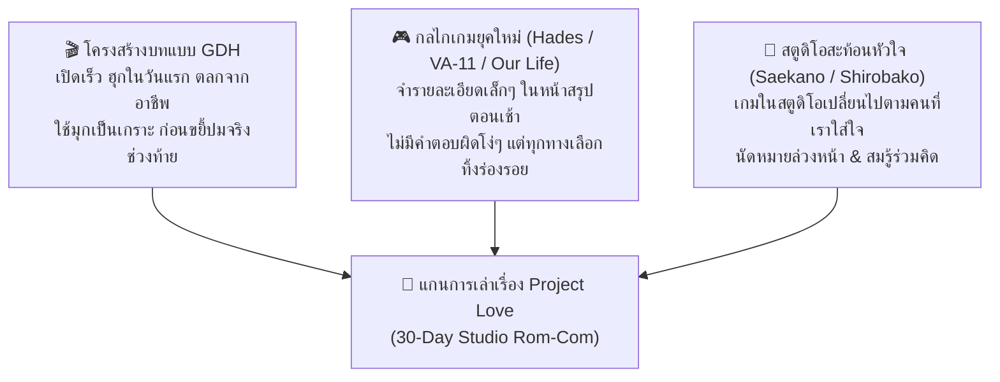
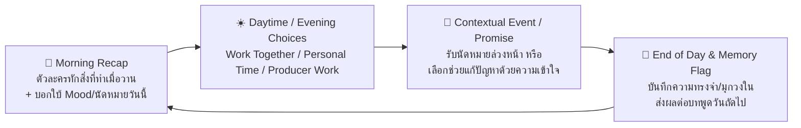

# 05 — รายงานสังเคราะห์ผลการวิจัยและข้อเสนอแนวทางเนื้อเรื่อง Project Love (Master Synthesis & Story Proposals)

> **ทิศทางที่เจ้าของอนุมัติล่าสุด (Session 058 — Modern Non-Melodramatic Storytelling):** เจ้าของโปรเจกต์อนุมัติหลักการเล่าเรื่องสมัยใหม่ใน **หมวดที่ 7 ด้านล่าง** (ถอดรหัสจาก 8 อนิเมะ: *Wotakoi, Nozaki-kun, Kimi ni Todoke, Dungeon Meshi, Campfire Cooking, Frieren, Bakuman, Blue Period*) — **"การเล่าเรื่องให้สนุกและตราตรึงใจคน ไม่จำเป็นต้องร้องไห้ฟูมฟาย แต่เกี่ยวกับการเล่าตัวตนและความรู้สึกของตัวละครที่คนดูสัมผัสได้ถึงชีวิตจริงๆ"** โดยให้ใช้โครงสร้างรูทปลายฟ้าในหมวดที่ 7 แทนร่าง *When the Brief Ends* เดิมในหมวด 2.1 (ดูเส้นเรื่อง 30 วันฉบับอัปเดตที่ [พล็อต 30 วัน/สามรูท](../05_Thirty_Day_Story_Spine_And_Character_Routes.md))

> **สถานะเอกสาร:** ข้อเสนอเชิงออกแบบและแนวทางพัฒนาบท (Narrative Design Proposal — ยังไม่ใช่เนื้อหาที่ล็อกหรืออนุมัติเข้าสู่โค้ด/ยูนิตี้)  
> **ที่มา:** สังเคราะห์จากรายงานการค้นคว้าของ Sub-Agent ทั้ง 4 ฉบับ รวมกว่า 38 กรณีศึกษา ([`01_RomCom_Anime_Movies_Novels`](01_RomCom_Anime_Movies_Novels_Reference.md), [`02_Modern_RomCom_Games`](02_Modern_RomCom_Games_And_VN_Reference.md), [`03_GDH_Thai_Storytelling`](03_GDH_And_Thai_RomCom_Storytelling_Case_Study.md), [`04_Workplace_Creative_Hooks`](04_Workplace_Creative_Team_And_Gameplay_Narrative_Hooks.md))  
> **เป้าหมาย:** แก้โจทย์ Session 042 ("เกมเพลย์เข้าใจง่ายแล้ว แต่เนื้อเรื่องและการเล่นยังเป็นเส้นตรง คาดเดาได้ง่าย และขาดความตื่นเต้นน่าติดตาม") โดยผูกบทที่สนุก ตลกโบ๊ะบ๊ะช่วงแรก และขยี้ดราม่าช่วงท้ายเข้ากับระบบ **Romance-First Casual Loop (30 วัน)** ของ **Producer x ปลายฟ้า, เกรซ, พลอย** โดยไม่เพิ่มความซับซ้อนของระบบจัดการ

---

## 1. บทสรุปการประมวลผล: ทำไมบทเกมจีบสาวทั่วไปถึง "เดาง่าย" และเราจะฉีกกรอบอย่างไร?

จากการประมวลผลรายงานทั้ง 4 ฉบับ พบว่าสาเหตุที่บทซึ่งเขียนจากความจำทั่วไปมักจะ **"จืดชืดและเดาง่าย"** เป็นเพราะมันตกหลุมพราง 3 ข้อ:
1. **ชมกันตรงๆ ตั้งแต่วันแรก (Premature Validation):** พอตัวละครบ่นว่าเหนื่อย พระเอกก็พูดคำคมปลอบใจ ตัวละครก็หน้าแดงแล้วได้แต้ม `+Affection` ทันที ทำให้ไม่มีแรงตึงเครียด (Romantic Tension)
2. **งานกับความรักแยกเป็นคนละโลก (Disconnected Work & Romance):** เวลากดทำงานได้แต้มโปรเจกต์ เวลากดคุยส่วนตัวได้แต้มหัวใจ โดยที่ "เกมที่พวกเธอกำลังสร้าง" ไม่มีผลต่อเรื่องราวความรักเลย
3. **ตัวละครไม่มีปฏิกิริยาข้ามวัน (Stat Grinding without Memory):** กดทำกิจกรรมเดิมซ้ำๆ ตัวละครก็พูดประโยคเดิม ไม่มีการนัดหมายล่วงหน้า ไม่มีการทวงสัญญา และไม่มีมุกวงในที่เติบโตขึ้นตามเวลา

### 🌟 สูตรผสมใหม่ของ Project Love: "GDH Rhythm × Modern VN Reactivity × Studio Meta-Mirror"

| องค์ประกอบ | แบบเดิมที่เดาง่าย (Cliché AI Writing) | แบบใหม่ของ Project Love (Research-Driven) |
| :--- | :--- | :--- |
| **จังหวะเปิดเรื่อง (Day 1–3)** | เดินแนะนำตัวทีละโต๊ะ คุยเรื่องงานสุภาพเรียบร้อย | **Fast Hook แบบ GDH:** เปิดมาเจอวิกฤตฮาๆ ทันที! ทั้งสามสาวกำลังเถียงกันเรื่อง "ฉากสารภาพรักในเกม" ที่ไม่มีใครยอมใคร แล้วโยนระเบิดให้ Producer คนใหม่ตัดสินตั้งแต่นาทีแรก! |
| **กลไกความตลก (Comedy Engine)** | มุกซุ่มซ่ามล้มทับกัน หรือแซวเรื่องหน้าตา | **Occupational & Defense Comedy:** ตลกจากนิสัยคนทำเกมจริงๆ และอาการ "หลุดฟอร์ม" เวลาพยายามรักษาภาพลักษณ์มืออาชีพ (เช่น เกรซตอบคำถามความรักเป็นโค้ด Boolean, ปลายฟ้าลนลานซ่อนไฟล์เลเยอร์ลับ, พลอยดีดคิดระบบตกปลาตอนตีสอง) |
| **การผูกกับ Casual Loop** | กด `Work Together` / `Personal Time` เพื่อปั๊มหลอดตัวเลข | **Promises & Micro-Progression:** มีการ "นัดหมายล่วงหน้า" (เช่น นัดไปดูงานอาร์ตวันศุกร์เย็น) มีภารกิจสมรู้ร่วมคิด และหน้า **Morning Recap** ทักทายสิ่งที่ทำเมื่อวาน 1 ประโยคเสมอ |
| **จุดเปลี่ยนดราม่า (Emotional Pivot)** | จู่ๆ ตัวละครก็ร้องไห้เล่าปมอดีตยาวเหยียด | **The Cracking Shield:** สิ่งที่เราเคยขำในสัปดาห์แรก (ความบ้าพลังของพลอย, ความเป๊ะของเกรซ, การยอมแก้ภาพทุกอย่างของปลายฟ้า) แท้จริงคือ "แผลในใจ" ที่ปะทุออกมาเมื่อเดดไลน์วันที่ 30 บีบคั้น |

---

## 2. เจาะลึกเคมีและ "เครื่องยนต์ Rom-Com" ของ 3 สาว (Character Rom-Com & Drama Blueprint)

เพื่อไม่ให้ทั้ง 3 คนพูดจาหรือมีจังหวะความรักเหมือนกัน เราใช้เทคนิคจาก *Kaguya-sama*, *Makeine*, *Book Lovers* และ *ไอฟาย..แต๊งกิ้ว..เลิฟยู้ / ฟรีแลนซ์ฯ* มาออกแบบ **Rom-Com Engine** เฉพาะตัวของแต่ละคนดังนี้:

---

### 🎨 1. ปลายฟ้า (Plaifah) — สำรวจทางเลือกปมดราม่าและ Rom-Com Engine
- **Reference หลัก:** *ฟรีแลนซ์..ห้ามป่วย ห้ามพัก ห้ามรักหมอ* + *ไอฟาย..แต๊งกิ้ว..เลิฟยู้* + *แฟนเดย์* + *The Dangers in My Heart*
- **โจทย์สำคัญจากเจ้าของโปรเจกต์:** ปมต้องไม่เฉพาะทางจนมีแค่ศิลปินที่เข้าใจ (ไม่งอแงเรื่องบรีฟ และไม่ฟูมฟายเรื่องวาดแววตาไม่ออกจนดูอ่อนไหวเกินจริง) แต่ต้องเป็น **"ความเปราะบางของมนุษย์ธรรมดาที่คนทั่วไปมีประสบการณ์ร่วมทันที"** แบบหนัง GDH

#### 🌟 ทางเลือกหลักใหม่ (GDH Universal Human Truth): *"When the Brief Ends" (ข้ออ้างที่ชื่อว่างาน กับความกลัวของคนเข้าสังคมไม่เก่ง)*
- **รากฐานจิตวิทยาที่คนทั่วไปอิน 100%:**
  - ปลายฟ้าคือตัวแทนของ **"คนพูดไม่เก่ง จืดชืด และเข้าหาคนไม่เป็น (Socially Awkward & People Pleaser)"** ที่เชื่อมาตลอดว่าตัวเองไม่มีเสน่ห์ดึงดูดใจใคร สิ่งเดียวที่ทำให้คนอื่นหันมามองและอยากคุยกับเธอตั้งแต่ตอนชนะประกวดคือ **"ฝีมือการทำงานและประโยชน์ของเธอ"** เธอจึงขยันพัฒนาทักษะไม่หยุด เพราะกลัวว่าถ้าตัวเองไม่เก่งหรือไม่เป็นประโยชน์ เธอจะกลับไปเป็น "คนล่องหน" ที่ไม่มีใครจำได้
  - สำหรับปลายฟ้า **"เรื่องงานและบรีฟ"** ไม่ใช่สิ่งที่เธอเกลียด แต่คือ **"สะพานเดียวที่เธอใช้เชื่อมโยงกับผู้คน"** เพราะเธอไม่กล้าชวนใครคุยเรื่องส่วนตัวก่อน!
- **ฮุกความตลกช่วงแรก (Act 1 Comedy — โบ๊ะบ๊ะ ย่อยง่าย):**
  - เวลาปลายฟ้าอยากคุยหรืออยากดูแล Producer เธอไม่กล้าเดินมาทักตรงๆ เหมือนพลอย แต่จะ **"สร้างข้ออ้างเรื่องงานที่ลงทุนเกินเบอร์"** (เช่น วาดไอคอนปุ่มกดมาให้เลือก 15 แบบเพื่อจะได้นั่งข้างๆ เรา 15 นาที, หรือพกโพยจดมุกชวนคุยไว้ในสมุดสเก็ตช์แต่ดันอ่านผิดบรรทัด!)
  - และเมื่อเราบังเอิญเห็นสมุดสเก็ตช์/โฟลเดอร์ลับที่เธอแอบวาดภาพคู่รักโรแมนติก-เซ็กซี่ (ซึ่งเธอวาดเก่งมากแต่ชีวิตจริงไม่เคยมีแฟน) Producer กับเธอจึงใช้ข้ออ้างว่า **"มาซ้อมเก็บข้อมูลความโรแมนติกเพื่อทำเกมกันเถอะ"** เป็นเกราะกำบังในการทำเรื่องกุ๊กกิ๊กด้วยกันในออฟฟิศ
- **การบิ้วอัพและจุดพีคแบบ GDH (Act 2 -> Act 3 Emotional Pivot):**
  - ตลอด 3 สัปดาห์ ทุกโมเมนต์ใจฟูระหว่างเรากับเธอ (การจับมือ, การไปเดินดูท้องฟ้า, การนั่งเฝ้ากันตอนดึก) ล้วนเกิดขึ้นภายใต้ข้ออ้างคำว่า **"เพื่อโปรเจกต์ / ในฐานะโปรดิวเซอร์กับอาร์ทิสต์"**
  - **จุดพีค (สัปดาห์ที่ 3–4 เมื่องานอาร์ตกำลังจะเสร็จ 100%):** แทนที่ปลายฟ้าจะดีใจที่งานใกล้เสร็จ ยิ่งหลอด Progress เต็ม เธอกลับยิ่งซึมและแอบถอยห่าง (เหมือนยุ่นใน *ฟรีแลนซ์ฯ* ที่กลัวหายป่วยแล้วจะไม่ได้เจอหมออิม หรือยิมใน *ไอฟายฯ* ที่กลัวสอบผ่านแล้วจะไม่ได้เจอครูเพลง)
  - ความแตกเมื่อเธอแอบรับงานเพิ่มจนป่วย/ฝืนตัวเอง หรือพยายามยื้อไม่ส่งไฟล์สุดท้ายตามเวลาปกติ พอ Producer เข้าไปถามด้วยความเป็นห่วง เธอจึงระเบิดความกลัวที่แท้จริงออกมา:
    > *"พอส่งไฟล์สุดท้ายนี้... หน้าที่ของฟ้าก็จบแล้วใช่ไหมคะ? ที่ผ่านมาที่พี่ใจดีกับฟ้า ที่ยอมจับมือฟ้า ที่คอยชงชาเขียวหรือพาฟ้าไปดูท้องฟ้า... ลึกๆ ฟ้าแอบถามตัวเองทุกวันเลยว่า พี่ทำเพราะมันเป็น 'หน้าที่ของโปรดิวเซอร์' ที่ต้องดูแลอาร์ทิสต์ให้งานเสร็จหรือเปล่า... ถ้าพรุ่งนี้ไม่มีบรีฟต้องส่งแล้ว คนพูดไม่เก่งและน่าเบื่ออย่างฟ้า จะเหลือข้ออ้างอะไรให้ได้คุยกับพี่อีกล่ะคะ?!"*
  - **การคลี่คลาย:** Producer พิสูจน์ให้เธอเห็นทันทีว่า ความสัมพันธ์ของพวกเราไม่ได้ผูกอยู่กับสัญญาจ้างหรือหลอด Progress ของเกม ด้วยการนัดเดตและดูแลเธอในวันที่ "ห้ามพูดเรื่องงานแม้แต่คำเดียว"

#### 📌 ทางเลือกสำรองที่เก็บไว้เปรียบเทียบ (Archived / Alternative Options)
1. **ทางเลือกสำรอง A ("คนที่มีค่าแค่ตอนมีประโยชน์"):** โฟกัสที่การไม่กล้าปฏิเสธและกลัวการเป็นภาระ จนกระทั่งวันหนึ่งเธอป่วย/มือเจ็บในช่วงเร่งส่งงาน แล้วกลัวสุดขีดว่าถ้าตัวเองทำงานไม่ได้และกลายเป็นตัวถ่วง จะไม่มีใครต้องการเธออีก
2. **ทางเลือกสำรอง B ("เก่งในโลกสมมติ ขี้ขลาดในโลกความจริง"):** ในภาพวาดและในแชตทำงาน เธอเป็นคนโรแมนติกและคมคายมาก แต่ตัวจริงขี้อายสุดขีดและไม่มั่นใจในรูปลักษณ์ตัวเอง กลัวว่าถ้า Producer รู้จักตัวจริงที่จืดชืดนอกเหนือจากผลงาน จะผิดหวังเหมือนคนในอดีต
3. **ทางเลือกสำรอง C (เก็บไว้จากรอบก่อน — "The Anatomy of Warmth"):** อาร์ทิสต์สายทฤษฎีที่ทำตามบรีฟเทคนิคได้เป๊ะ แต่ติดกำแพงเมื่อต้องวาด "สายตาของคนที่เชื่อว่าตัวเองถูกรัก" เพราะตัวเองยังมีกำแพงในใจ

---

### 💻 2. เกรซ (Grace) — *"Logic vs. Shoujo Manga" (สงครามตรรกะของสาวหน้านิ่งผู้แอบอ่านมังงะตาหวาน)*
- **Reference หลัก:** *Kaguya-sama: Love Is War* (ปะทะไหวพริบแต่แอบเขิน) + *Book Lovers* (เคารพในความเก่ง) + *ไอฟาย..แต๊งกิ้ว..เลิฟยู้* (ตรรกะอาชีพปะทะเรื่องหัวใจ)
- **ฮุกความตลกช่วงแรก (Act 1 Comedy):**
  - เกรซเปิดตัวด้วยมาดหัวหน้าโปรแกรมเมอร์สุดเฮี้ยบ ประเมิน Producer ด้วยตัวเลขความเสี่ยง และชอบปล่อย **มุกตลกหน้าตาย (Deadpan Humor)** แบบไม่กะพริบตา
  - ความตลกโบ๊ะบ๊ะเกิดเมื่อทีมต้องทำระบบความรักในเกม แต่เกรซพยายามเขียนอัลกอริทึมความรักด้วยทฤษฎีที่เธอ **แอบจำมาจากมังงะรักตาหวาน (Shoujo Manga)** ที่ซ่อนไว้ใต้โต๊ะ! (เช่น เกรซเถียงหน้าตายว่า *"ตามสถิติแล้ว ถ้าตัวเอกบังเอิญเอามือชนกันตอนหยิบแฟ้ม อัตราการเต้นหัวใจต้องเพิ่มขึ้น 40% ไม่ใช่เหรอคะ?"* จน Producer จับโป๊ะได้ว่าเธออ้างอิงจากการ์ตูนตาหวานเล่มใหม่ล่าสุด!)
- **การพัฒนาความใกล้ชิด (Act 2 Spark):**
  - เกรซแอบสื่อสารความรู้สึกผ่าน **`// कमेंटต์ในโค้ด (#TODO)`** และ **"เป็ดเหลือง Rubber Duck"** บนโต๊ะทำงาน เวลาเธอไม่กล้าพูดตรงๆ เธอจะหันไปบ่นใส่เป็ดเหลืองให้ Producer ได้ยิน (เช่น *"คุณเป็ดคะ บอกโปรดิวเซอร์ทีว่าถ้าเขายังไม่กินข้าวเย็น ระบบประมวลผลของฉันจะรวนแล้วค่ะ"*)
- **การขยี้ดราม่าช่วงท้าย (Act 3 Emotional Pivot):**
  - สัปดาห์ที่ 3–4 เมื่อเกิดปัญหาระบบคอขวดหรือเกรซโหมงานหนักจนร่างกายเริ่มประท้วง เกรซกลับ **ล็อกสิทธิ์การเข้าถึงโค้ดหลักไว้คนเดียวและไล่ Producer กลับบ้านอย่างเย็นชา**
  - ความตลกเรื่องความเป๊ะของเธอในตอนแรก ถูกเฉลยว่าเป็น **"คำสาปของผู้รอดชีวิต (Survivor's Guilt)"** — เธอกลัวสุดหัวใจว่าถ้าปล่อยให้ Producer เข้ามาช่วยแบกความเสี่ยง แล้วโปรเจกต์ล้มเหลว Producer จะต้องเสียอนาคตเหมือนรุ่นพี่ของเธอในอดีต
  - จุดพีคคือการที่ Producer ไม่ยอมถอย ไม่ได้เข้าไปแย่งเขียนโค้ด แต่ใช้สิทธิ์ Producer นั่งเฝ้าและแบ่งเบาภาระข้างๆ พร้อมทลายกำแพงว่า **"ผมไม่ใช่รุ่นพี่คนนั้น และเกรซก็ไม่ใช่เด็กฝึกงานคนเดิมอีกแล้ว ให้ผมได้ยืนข้างๆ เกรซในฐานะคู่หูจริงๆ เถอะนะ"**

---

### 🎲 3. พลอย (Ploy) — *"The Smiling Clock" (รอยยิ้มพันล้านกับนาฬิกานับถอยหลัง 30 วัน)*
- **Reference หลัก:** *Makeine* (ความเปราะบางหลังการหลุดฟอร์ม) + *รถไฟฟ้า มาหานะเธอ / Friend Zone* (ความเหงาของคนขี้เล่น) + *Our Beloved Summer* (การซ่อนปัญหาไว้ใต้ความร่าเริง)
- **ฮุกความตลกช่วงแรก (Act 1 Comedy):**
  - พลอยคือตัวป่วนประจำออฟฟิศ ชอบชวน Producer พนันเล่มเกม (ใครแพ้เลี้ยงชานม), ชอบเสนอฟีเจอร์เพี้ยนๆ ตอนดึก, และชอบหยอดมุกจีบแซวสองแง่สองง่ามใส่ Producer ก่อนเสมอ
  - แต่ **Gap Moe ที่ตลกและน่ารักที่สุด** คือ พลอยเป็นพวก **"รุกเก่งแต่รับไม่เป็น (Glass Cannon Teaser)"** — พอ Producer ไม่เขินหนี แต่แกล้งรับมุกแล้วรุกกลับด้วยน้ำเสียงจริงจัง พลอยจะช็อตฟีล หน้าแดงแจ๋ พูดติดอ่าง แล้วมุดหนีลงใต้โต๊ะทันที!
- **การพัฒนาความใกล้ชิด (Act 2 Spark):**
  - ทุกเย็นหรือหลังเลิกงาน พลอยจะชวน Producer มาเป็น **"Playtester คนแรก"** ทดสอบบอร์ดเกมทำมือหรือมินิเกมที่เธอออกแบบ โดยที่กติกาของเกมที่เธอสร้างมักจะแอบซ่อนคำถามเพื่อแอบถามความรู้สึกของ Producer ทางอ้อม
- **การขยี้ดราม่าช่วงท้าย (Act 3 Emotional Pivot):**
  - มุกตลกที่พลอยชอบพูดตั้งแต่สัปดาห์แรกว่า *"ต้องทำให้เสร็จใน 30 วันนะ ไม่งั้นพลอยกลายเป็นฟักทองแน่!"* ถูกเฉลยในสัปดาห์ที่ 3 เมื่อ Producer บังเอิญเห็น **ใบแจ้งคืนห้องเช่าและตั๋วรถกลับต่างจังหวัด** ในกระเป๋าของเธอ
  - เมื่อสโคปงานบีบคั้นจนฟีเจอร์หลักที่พลอยทุ่มเทออกแบบเสี่ยงจะต้องถูกตัดออกเพื่อให้เกมส่งทัน รอยยิ้มของพลอยก็พังทลายลงในคืนฝนตก เพราะถ้าเธอไม่มีผลงานชิ้นนี้ไปพิสูจน์ให้ที่บ้านเห็นในวันที่ 30 เธอต้องทิ้งความฝันและกลับบ้านเกิดตลอดกาล
  - จุดพีคคือการที่ Producer กอดเธอไว้ในวันที่เธอไม่ต้องฝืนยิ้มอีกต่อไป และช่วยกันปรับดีไซน์ให้แก่นความสนุกของพลอยยังคงอยู่ในเกมอย่างสง่างาม

---

## 3. ข้อเสนอแกนเรื่องหลักของสตูดิโอ (3 High-Concept Story Directions)

เพื่อให้การทำเกม 30 วันของ Producer และสามสาวมี **"จุดมุ่งหมายที่ชัดเจน สนุก และผูกกับความรักโดยตรง"** ขอเสนอ 3 แนวทางพล็อตหลัก (สามารถเลือกใช้แนวทางเดียว หรือผสมกันได้):

### 💡 แนวทางที่ 1 (แนะนำสูงสุด): *"Project Mirror — เกมรักที่พวกเราสร้าง แต่ยังไม่มีใครรู้ตอนจบ"*
- **High-Concept Hook:** สตูดิโอต้องสร้างเดโมเกมแนว **"Romance / Slice-of-Life"** ส่งประกวดภายใน 30 วัน แต่ปัญหาคือ... **ทั้งสามสาวไม่มีใครเคยมีแฟนจริงในชีวิตเลยสักคน!** (ปลายฟ้าเก่งแต่ทฤษฎีวาดรูปคู่รัก, เกรซรู้เรื่องรักจากมังงะตาหวาน, พลอยแซวเก่งแต่ไม่เคยคบใครจริง)
- **ทำไมพล็อตนี้ถึงสนุกและผูกกับเกมเพลย์ได้แนบเนียนที่สุด:**
  1. **ทุกการกระทำในเกมมีข้ออ้างเรื่องงาน (The "For Research!" Excuse):** เวลาไปใช้ `Personal Time` หรือ `Work Together` สาวๆ จะอ้างว่า *"น-นี่เป็นการเก็บข้อมูลทำเกมนะคะ ไม่ได้อยากไปเดตด้วยสักหน่อย!"* (เช่น ปลายฟ้าขอจับมือเพื่อดูโครงสร้างกระดูก, เกรซขอซ้อมบทพูดสารภาพรักเพื่อเช็กความสมจริงของสคริปต์, พลอยชวนไปเดินตลาดกลางคืนเพื่อจำลองฉากอีเวนต์ในเกม)
  2. **Meta-Mirror:** เกมที่พวกเธอกำลังสร้างจะค่อยๆ เปลี่ยนไปตามคนที่ Producer เลือกใช้เวลาด้วย จนในสัปดาห์สุดท้าย ทั้งสองฝ่ายเริ่มแยกไม่ออกว่า *"เรากำลังซ้อมบทเกม หรือกำลังสารภาพรักกันจริงๆ กันแน่!"*

### 💡 แนวทางที่ 2: *"The Underdog 30-Day Pitch — ภารกิจกู้ชีพโปรเจกต์นอกสายตา"*
- **High-Concept Hook:** โปรเจกต์ของทีมทั้ง 4 คนถูกมองว่าเป็น "ทีมสำรองที่ไม่มีทางรอด" มีเวลาเพียง 30 วันในการสร้าง Vertical Slice ไปพิสูจน์ในงาน Indie Showcase หากไม่ผ่าน สตูดิโอจะต้องยุบทีมแยกย้าย
- **จุดเด่น:** ได้อารมณ์แบบ *Shirobako* ผสม *Start-Up* และ *อ้าย..คนหล่อลวง* เน้นความเป็นทีมเวิร์ก การแก้ปัญหาเฉพาะหน้าสุดป่วน และการที่ Producer ทำหน้าที่เป็นเกราะป้องกันทีมจากแรงกดดันภายนอก

### 💡 แนวทางที่ 3: *"Secret Feature Conspiracy — ปฏิบัติการแอบใส่หัวใจลงในเกม"*
- **High-Concept Hook:** นอกจากเป้าหมายหลักในการทำเกมให้เสร็จตามสเปกมาตรฐาน (100% Progress) สาวแต่ละคนจะมี **"ความฝันลับๆ (Secret Passion Feature)"** ที่อยากแอบใส่ลงไปในเกม (เช่น ปลายฟ้าอยากใส่ฉากลับที่วาดด้วยลายเส้นจริงของเธอ, เกรซอยากใส่ระบบมินิเกมย้อนยุคที่เคยทำกับรุ่นพี่, พลอยอยากใส่เควสต์ลับที่ทำให้คนเล่นยิ้มได้)
- **จุดเด่น:** เปลี่ยนระบบ `Weekly Support Focus` และ `Work Together` ให้กลายเป็น **"ภารกิจสมรู้ร่วมคิด"** ระหว่าง Producer กับนางเอก เพื่อช่วยกันทำฟีเจอร์ลับนี้ให้สำเร็จโดยไม่ให้งานหลักเสีย!

---

## 4. วิธีผูกบทเข้ากับเกมเพลย์ปัจจุบัน (Romance-First Casual Loop Integration)

เรามีระบบที่เข้าใจง่ายอยู่แล้วใน `StudioRomancePrototype` (มีเวลาเป็น Phase, มี `Work Together`, `Personal Time`, `Producer Work`, `Ordinary Talk`, `Mood`, `Weekly Support Focus`, และ `Morning Recap`) เราสามารถทำให้มัน **"สนุกและมีชั้นเชิงขึ้น 10 เท่า"** ด้วยการออกแบบบทให้ใช้ประโยชน์จากระบบเหล่านี้โดยตรง:

| ระบบที่มีอยู่แล้วในเกม | วิธีเขียนบทให้ผูกกับเกมเพลย์อย่างมีชั้นเชิง (ไม่ต้องแก้โค้ดระบบใหญ่) |
| :--- | :--- |
| **1. `Morning Recap` (หน้าสรุปตอนเช้า)** | ใช้หลัก **"Nice Haircut Philosophy" (จาก *Hades*)**: ให้ข้อความแนะนำตอนเช้าไม่ได้มีแค่ตัวเลข แต่มี **1 ประโยคที่สะท้อนสิ่งที่ผู้เล่นทำเมื่อวาน** เช่น *"เมื่อวานที่อยู่ช่วยปลายฟ้าเลือกสีท้องฟ้า... เช้านี้เธอดูอารมณ์ดีและแอบวางลูกอมรสเปรี้ยวไว้ที่โต๊ะคุณ"* |
| **2. `Character Mood` (Calm / Cheerful / Tired / NeedsSupport)** | ใช้หลัก **"Active Observation" (จาก *VA-11 Hall-A*)**: เวลาตัวละครอยู่ในสถานะ `Tired` หรือ `NeedsSupport` บทสนทนาในฉากจะบอกใบ้สิ่งที่เธอต้องการจริงๆ ตามนิสัย (ปลายฟ้าต้องการคนนั่งเงียบๆ ข้างๆ, เกรซต้องการคนช่วยแบ่งเบาด้วยเหตุผล, พลอยต้องการคนที่ไม่บังคับให้เธอต้องฝืนยิ้ม) |
| **3. `Weekly Support Focus` (เลือกโฟกัส 1 คนต่อสัปดาห์)** | เปลี่ยนจากการกดปุ่มรับบัฟเฉยๆ ให้เป็น **"ภารกิจร่วมประจำสัปดาห์ (Co-Conspirator Goal)"**: เมื่อเลือกโฟกัสใครในสัปดาห์นั้น การกด `Work Together` ครั้งแรกของสัปดาห์จะปลดล็อกหัวข้อสนทนาพิเศษ (`Topic Flag`) ที่กลายเป็น **"มุกวงใน"** สำหรับคุยใน `Ordinary Talk` ตลอดสัปดาห์! |
| **4. `Visible Invitations & Promises` (นัดหมายล่วงหน้าผ่าน Event Bubbles)** | แก้ปัญหาลูปเส้นตรงด้วยการให้ตัวละคร **"เอ่ยปากนัดล่วงหน้า 1–2 วัน"** (เช่น วันอังคารพลอยชวนว่า *"วันพฤหัสฯ ตอนเย็น 마เทสต์บอร์ดเกมใหม่กันนะ ห้ามเบี้ยวนะคะ!"*) ทำให้ผู้เล่นตั้งตารอวันพฤหัสฯ และหากมีโอกาสอื่นมาชนในวันพฤหัสฯ ผู้เล่นจะต้องตัดสินใจเลือกที่มีความหมาย! |
| **5. `Producer Work` (งานโปรดิวเซอร์)** | แทนที่จะรู้สึกว่ากดปั๊มเงิน/โปรเจกต์คนเดียวเหงาๆ ให้เขียนฉากสั้นๆ ของ `Producer Work` ว่าเป็นการ **"ออกรับหน้าเคลียร์ปัญหาให้ทีม"** (เช่น ไปต่อรองสเปก, ไปหาซื้อเสบียงกองทัพ, ไปเคลียร์เอกสารลิขสิทธิ์) และให้สาวๆ เอ่ยทักขอบคุณในวันถัดไป! |

---

## 5. ตัวอย่างพิมพ์เขียวสัปดาห์แรก (Week 1: Days 1–7 Concrete Story & Gameplay Prototype)

เพื่อให้เห็นภาพชัดเจนว่าจะนำผลวิจัยทั้งหมดมาเขียนลงใน **Workspace** ของเราได้อย่างไร นี่คือโครงร่าง **สัปดาห์ที่ 1 (Days 1–7)** ที่ผสมผสานจังหวะเปิดเรื่องเร็วแบบ GDH + การนัดหมายล่วงหน้า + การเก็บข้อมูลทำเกม:

| วัน | จังหวะเนื้อเรื่อง (Narrative Beat) | สิ่งที่เกิดในเกมเพลย์ (Gameplay Hook & Choices) | ผลลัพธ์และการจดจำข้ามวัน (Reactivity & Payoff) |
| :--- | :--- | :--- | :--- |
| **Day 1** | **Fast Hook: "ศึกฉากสารภาพรักวันเปิดโปรเจกต์!"** Producer เข้ามาวันแรก เจอทั้ง 3 สาวกำลังถกกันเรื่องฉากไคลแมกซ์ของเกมเดโม: พลอยอยากได้ฉากสารภาพรักกลางพายุลูกกวาด, เกรซบอกไร้ตรรกะสิ้นดี, ปลายฟ้านั่งเหงื่อตกไม่รู้จะวาดแบบไหน | **Forced Welcome Scene:** Producer ต้องเลือกแนวทางเริ่มต้นเพื่อสงบศึก และประกาศกฎว่า *"ตลอด 30 วันนี้ ถ้าใครคิดฉากไม่ออก เราจะมาทดลองทำจริงกันในออฟฟิศนี่แหละ!"* | เริ่มต้นลูปวันแรกอย่างมีเป้าหมายและอารมณ์ขัน ทุกคนเปิดใจรับ Producer เข้าทีม |
| **Day 2** | **Incident 1: "อัลกอริทึมหัวใจของเกรซ"** เช้าวันที่ 2 เกรซมีสถานะ `Tired` เพราะอดนอนเขียนระบบความสัมพันธ์แต่ติดบั๊กตรรกะ | **Bubble Event (เกรซ):** เมื่อคลิกคุย เกรซเผลอหลุดอ้างอิงทฤษฎีจากมังงะตาหวาน Producer เลือกได้ว่าจะ **"แซวขำๆ แต่ช่วยเก็บความลับ"** หรือ **"ช่วยวิเคราะห์มุมมองความรู้สึกอย่างจริงจัง"** | เกรซอารมณ์ดีขึ้น (`Calm`/`Cheerful`) และแอบเขียนคอมเมนต์ขอบคุณไว้ในโค้ดที่จะโผล่ในหน้าสรุปเช้าวันถัดไป |
| **Day 3** | **Incident 2: "เลเยอร์ลับของปลายฟ้า & คำนัดหมายวันศุกร์"** วันที่ 3 ปลายฟ้ามีสถานะ `NeedsSupport` เพราะวาดภาพฉากหลังยามเย็นไม่ออก | **Bubble Event (ปลายฟ้า):** Producer บังเอิญเห็นภาพร่างลายเส้นจริงของเธอและชมจากใจจริง ปลายฟ้าเขินแต่มีกำลังใจ จึงรวบรวมความกล้า **เอ่ยปากนัดล่วงหน้า:** *"วันศุกร์ (Day 5) ตอนเย็น... ไปเดินดูแสงพระอาทิตย์ตกดินของจริงเป็นเพื่อนฟ้าหน่อยได้ไหมคะ?"* | เกิด **Promise Flag (นัดหมายเย็นวันที่ 5)** ทำให้ผู้เล่นมีเป้าหมายที่ตั้งตารอคอยในปลายสัปดาห์! |
| **Day 4** | **The Studio Dilemma: "ไอเดียพันล้านของพลอย"** พลอยดีดสุดขีด คิดกิมมิกมินิเกมใหม่ขึ้นมาได้ และอยากชวนทำเพิ่มสำหรับเดโมสัปดาห์แรก | **Bubble Event (พลอย):** พลอยเสนอทางเลือก: จะเน้นทำตัวเดโมมาตรฐานให้ชัวร์ หรือจะสละเวลาช่วงเย็นวันศุกร์มาช่วยเธอปั้นกิมมิกพิเศษ (ซึ่งจะชนกับเวลานัดของปลายฟ้าพอดี หรือต้องเจรจาเลื่อนเวลา!) | สร้าง **Opportunity Cost** ที่ผู้เล่นเข้าใจได้ทันทีโดยไม่ต้องคำนวณตัวเลขซับซ้อน |
| **Day 5** | **The Payoff Day: "รักษาสัญญา หรือ ปรับแผนร่วมกัน"** ถึงเย็นวันศุกร์ที่นัดหมายไว้ | **Decision Resolution:** - **ทางเลือก A (ไปดูพระอาทิตย์ตกกับปลายฟ้าตามนัด):** ได้ฉากโรแมนติกริมดาดฟ้า/สะพานลอย ปลายฟ้าถอดแว่นและวาดรูป Producer ลงสมุดสเก็ตช์ลับ - **ทางเลือก B (ขอคุยกับปลายฟ้าตรงๆ เพื่อช่วยพลอยทำกิมมิกก่อน แล้วพาปลายฟ้าไปดูดาวตอนค่ำแทน):** ได้ฉากร่วมมือกับพลอยสุดฮา และฉากขอโทษ/ชดเชยกับปลายฟ้าตอนค่ำที่อบอุ่นไม่แพ้กัน! | ทั้งสองทางเลือกมีฉากที่คุ้มค่าและน่าจดจำ (ไม่มีทางเลือกที่เป็นขยะ) และบันทึกความทรงจำ (`Memory Flag`) คนละแบบ |
| **Day 6–7** | **Weekend Milestone & Callback: "เดโมสัปดาห์แรกของเรา"** สรุปผลงานสัปดาห์ที่ 1 และเปิดรันเกมทดสอบด้วยกัน | **Callback Scene:** เมื่อเปิดรันตัวเกมในเย็นวันที่ 7 ภาพฉากหลังในเกมของปลายฟ้า หรือกิมมิกในเกมของพลอย จะเปลี่ยนรายละเอียดไปตามสิ่งที่ผู้เล่นเลือกทำในวันที่ 5! | ผู้เล่นเห็นผลลัพธ์ของการตัดสินใจปรากฏอยู่ใน "ตัวเกมของพวกเธอ" จริงๆ และอยากเล่นต่อเข้าสู่สัปดาห์ที่ 2! |

---

## 6. สรุปขั้นตอนต่อไปที่แนะนำ (Recommended Next Steps)

1. **เลือกแกนเรื่องหลักของสตูดิโอ (Story Direction):** พิจารณาว่าชอบแนวทาง **"Project Mirror (ทำเกมรักแต่ทีมงานไม่เคยมีแฟน เลยต้องมาทดลองเก็บข้อมูลกับ Producer)"** ผสมกับปมเฉพาะตัวของทั้ง 3 สาวหรือไม่
2. **ทดลองเขียนและรันสคริปต์สัปดาห์ที่ 1 (Days 1–7):** เมื่อตกลงแนวทางแล้ว เราสามารถนำโครงร่าง Days 1–7 นี้ไปสร้างเป็น Event Drafts ภาษาไทยใน **Tools > Project Love > Workspace** เพื่อให้คุณสามารถค้นหา แก้ไขคำพูด พรีวิวหน้าจอ และลองเล่นเพื่อเช็กความสนุกได้ทันทีครับ!

---

## 7. อัปเดตการค้นคว้ารอบที่ 2: ถอดรหัส 8 อนิเมะมาสเตอร์พีซเพื่อฉีกกรอบดราม่าที่คาดเดาง่าย

จากการค้นคว้าเพิ่มเติมในรายงานฉบับที่ **06, 07 และ 08** ([`06_Wotakoi_Nozaki_KimiNiTodoke`](06_DeepDive_RomCom_Wotakoi_Nozaki_KimiNiTodoke.md), [`07_DungeonMeshi_Campfire_Frieren`](07_DeepDive_SlowBurn_Pacing_DungeonMeshi_Campfire_Frieren.md), [`08_Bakuman_BluePeriod`](08_DeepDive_Creator_Ambition_Bakuman_BluePeriod.md)) พบคำตอบสำคัญว่าทำไมพล็อตแนว *"นางเอกมีปมด้อย -> สัปดาห์ที่ 3 ร้องไห้ตัดพ้อ -> พระเอกปลอบใจ"* ถึงยังดูเดาง่าย และเราจะเปลี่ยนมาใช้ **4 กลไกการเล่าเรื่องแบบใหม่** สำหรับรูทปลายฟ้าได้อย่างไร:

1. **เลิกใช้ "ดราม่าร้องไห้ตัดพ้อ" แล้วใช้ "การทดลองสุดเพี้ยนของคนเบื้องหลัง" (*Gekkan Shoujo Nozaki-kun* & *Dungeon Meshi*):**
   - ปลายฟ้าไม่ใช่สาวขี้แย แต่เป็น **"Quiet Otaku Artisan"** ที่เวลาตั้งใจทำโจทย์เกมรัก จะใช้วิธีทดลองหา Reference แบบจริงจังเกินเบอร์แต่ผลลัพธ์ออกมาป่วนและตลกหน้าตาย (เช่น เอาไฟฉายส่องหุ่นดัมมี่หาองศาใจเต้น, ทดลองกางร่มในออฟฟิศ)
2. **เปลี่ยนกิจวัตรรายวันให้เป็น "Process Porn & Comfort Loop" (*Campfire Cooking* & *Dungeon Meshi*):**
   - ความสนุกในแต่ละวันเกิดจากรายละเอียดที่มีชีวิตชีวาของการทำเกม (การเลือกพาเลตต์สี การจัดแสง) คู่กับมื้อดึกง่ายๆ ที่ Producer เตรียมให้ (ขนมปังปิ้งเนยนมร้อนๆ กับชาเขียวข้าวคั่ว) จนเกิดความผูกพันจากความสบายใจเมื่ออยู่เงียบๆ ด้วยกัน (*Wotakoi*)
3. **เปลี่ยน Producer เป็น "คู่หูวางกลยุทธ์ล่าฝัน" (*Bakuman* & *Blue Period*):**
   - ปมการชนะรางวัลในอดีตของปลายฟ้าคือปมแบบ *คุวานะ มาคิ / ยาโทระ (Blue Period)* คือเธอเคยชนะด้วยภาพที่ทำตามสูตรเก็งข้อสอบของกรรมการจนรู้สึกเหมือนตัวเองเป็นแค่เครื่องถ่ายเอกสาร แต่ยังไม่เคยสร้างงานที่ตัวเองหัวใจเต้นแรงจริงๆ
   - เมื่อมีแรงกดดันเรื่องยอด Wishlist และข้อเสนอของ Publisher Producer จะสวมบทบาทแบบ **บก. ฮัตโตริ (*Bakuman*)** ที่มองเห็น "อาวุธลับ" ในสมุดสเก็ตช์ของปลายฟ้า (การวาดภาพมุมมองสายตาคนที่แอบสังเกตคนอื่นอย่างอบอุ่น) และร่วมมือกับเธอใช้สไตล์นั้นเป็นจุดขายหลักของเกมแทนการลอกสูตรตลาด
4. **เปลี่ยนจุดพีคและฉากจบเป็น "Delayed Emotional Resonance / แหวนดอกบัวกระจก" (*Frieren* & *Blue Period*):**
   - แทนที่จะให้ปลายฟ้ามาร้องไห้ถามว่า *"จบงานแล้วจะทิ้งฟ้าไหม"* เราใช้ปรัชญา **"ศิลปะคือภาษาไร้คำพูด"** (*Blue Period*) ผสานกับการเฉลยความทรงจำย้อนหลัง (*Frieren*):
   - สำหรับคนพูดไม่เก่งอย่างปลายฟ้า การจะวาดฉากไคลแมกซ์ของเกมให้ทัชใจคนเล่นได้ เธอต้องยอม **"เปลื้องความรู้สึกจริง"** ลงไปในภาพ ซึ่งสิ่งที่ทำให้เธอชะงักในสัปดาห์ที่ 3 ไม่ใช่ความเหนื่อย แต่คือ **ความเขินและกลัวว่าถ้าวาดความรู้สึกจริงลงไป Producer ที่ตรวจงานจะรู้ทันทีว่าเธอแอบชอบเขา!**
   - และในวันปล่อยเกม (Day 30) จุดพีคที่กระแทกใจผู้เล่นแบบไม่ทันตั้งตัว คือการที่ Producer เปิดดูไฟล์ภาพทั้งหมดที่ปลายฟ้าวาดตลอด 30 วัน แล้วเพิ่งตระหนักรู้ย้อนหลัง (Retrospective Awakening) ว่า **ในทุกฉากหลังตั้งแต่วันที่ 1 จนถึงเงาสะท้อนในดวงตาของนางเอกใน CG จบ ล้วนซ่อนรายละเอียดความทรงจำระหว่างเธอกับเขาไว้ทั้งหมด** เป็นการสารภาพรักไร้คำพูดที่งดงามและไม่ซ้ำใคร!

### ✅ สถานะการอนุมัติจากเจ้าของโปรเจกต์ (Owner Endorsement — Session 058)
> *"ถูกต้อง นี่แหละเป็นบทสมัยใหม่ การเล่าเรื่องให้สนุก ตราตรึงใจคน ไม่จำเป็นต้องร้องไห้ฟูมฟาย แต่มันเกี่ยวกับการเล่าตัวตน ความรู้สึกของตัวละครตัวนั้นที่คนดูสามารถรู้สึกได้ถึงชีวิตจริงๆ บันทึกแนวทางนี้ไว้ได้"*

#### พิมพ์เขียวเส้นเรื่อง 30 วันของปลายฟ้าฉบับอนุมัติ: *"เงาสะท้อนในเฟรมสุดท้าย (The Unspoken Canvas)"*
- **Act 1 (Days 1–7) — การทดลองสุดเพี้ยนของคนเบื้องหลัง (*Nozaki-kun*) + มื้อดึกฮีลใจ (*Campfire Cooking / Dungeon Meshi*):**
  - **Day 1–2 (The Reference Lab):** ปลายฟ้าเป็นสายอินโทรเวิร์ตที่จริงจังกับงานมาก พอต้องวาดฉากโรแมนติกทั้งที่ไม่เคยมีแฟน เธอจึงตั้ง "แล็บทดลองหา Reference" แบบตลกหน้าตายในออฟฟิศตอนค่ำ (เช่น เอาไฟฉายส่องคางหุ่นดัมมี่หาองศาใจเต้น, เอาไม้บรรทัดวัดระยะนิ้วชนกัน) และดึง Producer มาเป็นผู้ช่วยทดลอง
  - **Day 3–5 (Process Porn & Late-Night Comfort Loop):** ระหว่างทำงานคู่กัน เกิดลูปความอบอุ่นจากรายละเอียดการทำศิลปะ (การผสมสีน้ำเงินครามยามค่ำ การจัดเลเยอร์แสง) คู่กับมื้อดึกง่ายๆ ที่ Producer เตรียมให้ (ขนมปังปิ้งทาเนยโรยน้ำตาล นมสดอุ่น หรือพุดดิ้งคาราเมล)
  - **Day 6–7 (Mori-senpai's Validation — *Blue Period*):** เมื่อเลือกชมปลายฟ้าที่ **"วิธีคิดและมุมมองการสังเกต"** แทนการชมแบบขอไปทีว่า "เก่งจัง" ปลายฟ้าจะชะงักและเปิดใจยอมให้ดู **สมุดสเก็ตช์ปกน้ำตาล** ที่เธอวาดเก็บมุมมองสายตาเวลาแอบมองคนอื่นในชีวิตประจำวัน
- **Act 2 (Days 8–14) — คู่หูวางกลยุทธ์ล่าฝัน (*Bakuman*) + ความเงียบที่สบายใจ (*Wotakoi / Kimi ni Todoke*):**
  - **ปมรางวัลในอดีตแบบ *คุวานะ มาคิ / ยาโทระ (Blue Period)*:** เธอไม่ชอบพูดถึงรางวัลที่เคยชนะ ไม่ใช่เพราะหยิ่ง แต่เพราะภาพนั้นเธอวาดตาม "สูตรสำเร็จที่เก็งว่ากรรมการชอบ" จนรู้สึกเหมือนตัวเองเป็นเครื่องถ่ายเอกสารที่ยังไม่เคยมีผลงานที่ทำให้หัวใจตัวเองเต้นแรงได้เลย
  - **Producer สวมบท บก. ฮัตโตริ (*Bakuman*):** เมื่อทีมต้องทำภาพโปรโมตเรียกยอด Wishlist Producer มองเห็นว่า "มุมมองภาพแบบ First-Person POV ที่อบอุ่นและขี้อาย" ในสมุดสเก็ตช์ของปลายฟ้าคืออาวุธลับที่ไม่เหมือนเกมไหนในตลาด จึงเสนอให้ใช้สไตล์นี้เป็นจุดขายหลัก โดยมีเกรซและพลอยช่วยหนุนหลัง (*Kimi ni Todoke*) จนยอด Wishlist พุ่งทะยาน
  - **โมเมนต์หลังเลิกงาน (*Wotakoi*):** ทั้งคู่นั่งอยู่ในห้องเดียวกันโดยไม่ต้องพยายามหาเรื่องคุย และเริ่มเล่นเกมเล็กๆ อย่าง **"ชาเลนจ์ห้ามพูดเรื่องงาน 30 นาที"**
- **Act 3 (Days 15–22) — ศิลปะคือภาษาไร้คำพูด (*Blue Period*) + ความรู้สึกใต้ภูเขาน้ำแข็ง (*Frieren*):**
  - **ไม่มีดราม่าร้องไห้ฟูมฟาย:** ในสัปดาห์ที่ 3 เมื่อต้องวาด **ชุดภาพ Ending CG ไร้บทพูด 5 เฟรม** ปลายฟ้าชะงักไป ไม่ใช่เพราะเหนื่อยหรือกลัวโดนทิ้ง แต่เพราะตามปรัชญา *Blue Period* การจะวาดภาพที่ขยับหัวใจคนดูได้ ศิลปินต้องยอม **"เปลือยความรู้สึกจริง (Emotional Nakedness)"** ลงบนผืนผ้าใบ — ซึ่งถ้าเธอวาดความรู้สึก "รัก" ของจริงลงไป Producer ที่เป็นคนตรวจทุกเลเยอร์จะต้องรู้ความในใจของเธอแน่นอน
  - **ฉากริมระเบียงหลังฝนตก (*Frieren* Tone):** ในความเงียบสงบ ปลายฟ้าพูดด้วยน้ำเสียงเรียบง่ายแต่จริงใจว่า *"ฟ้าพูดไม่เก่งเหมือนพลอย อธิบายเป็นเหตุผลไม่เก่งเหมือนเกรซ... สิ่งเดียวที่ฟ้าใช้บอกความรู้สึกได้มีแค่ภาพที่ฟ้าวาดเท่านั้นค่ะ เพราะฉะนั้น... ตอนพี่ตรวจไฟล์ CG จบชุดนี้ ต่อให้เห็นอะไรในภาพ... ก็ห้ามหัวเราะฟ้านะคะ"*
- **Act 4 / Climax & Ending (Days 23–30) — แหวนดอกบัวกระจก & การตระหนักรู้ย้อนหลัง (*Frieren* Delayed Emotional Resonance):**
  - **Day 29–30 (The Retrospective Awakening):** ในคืนวันปล่อยเกม ขณะที่ปลายฟ้าเผลอหลับพิงไหล่ Producer ไปเพราะความล้า Producer เปิดโหมด Gallery ตรวจเช็กงานภาพทั้งหมดตั้งแต่ Day 1 ถึง Day 30 รวดเดียว แล้วเพิ่งสังเกตเห็นความจริงที่ซ่อนอยู่มาตลอด 30 วัน:
    1. **BG ห้องเรียนยามเย็น (สัปดาห์ที่ 1):** บนโต๊ะมุมห้องมีตลับลูกอมรสมะนาววางคู่กับแก้วกาแฟดำเหมือนโต๊ะของเขาเป๊ะ
    2. **BG ร้านขนมปังยามค่ำ (สัปดาห์ที่ 2):** นาฬิกาในร้านชี้เวลา `21:15 น.` ซึ่งเป็นเวลาที่เขาปิ้งขนมปังเนยนมให้เธอกินในออฟฟิศ
    3. **Ending CG เฟรมสุดท้าย (สัปดาห์ที่ 4):** เมื่อซูมดูดวงตาของนางเอกในภาพและเงาสะท้อนบนกระจกหน้าต่าง เงาของคนที่นางเอกในภาพมองอยู่ด้วยสายตาอบอุ่นที่สุด... คือ **เงาของ Producer เอง**
  - **บทสรุปที่งดงาม:** เมื่อปลายฟ้าลืมตาตื่นขึ้นมา เธอไม่ร้องไห้ แต่หน้าแดงนิดๆ แล้วถามเสียงเบาว่า *"ตรวจไฟล์เสร็จแล้ว... ให้ผ่านไหมคะ โปรดิวเซอร์?"* เป็นการสารภาพรักไร้คำพูดที่สมบูรณ์แบบและตราตรึงใจผู้เล่นด้วยตัวตนของตัวละครจริงๆ
