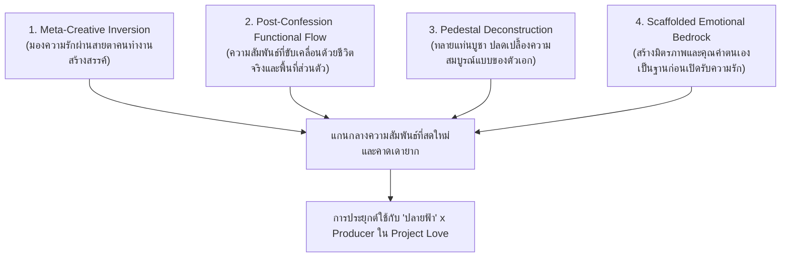
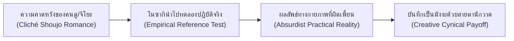
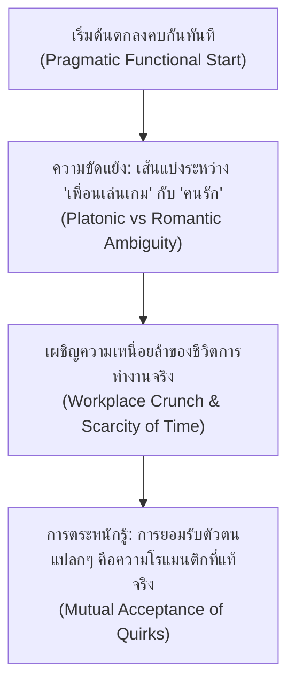
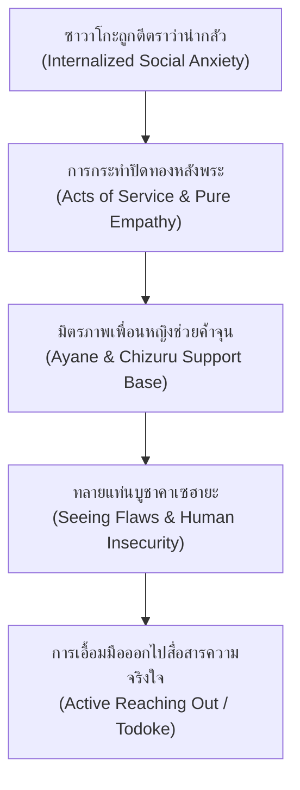
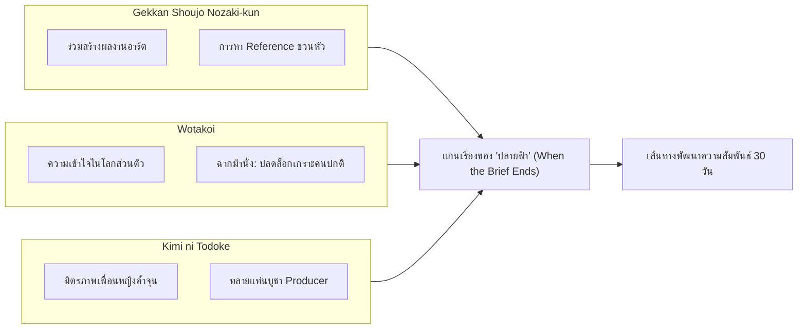

# 06 — รายงานการค้นคว้าเชิงลึก: ถอดรหัสชั้นเชิงการเขียนบท Rom-Com จาก Gekkan Shoujo Nozaki-kun, Wotakoi และ Kimi ni Todoke สู่การออกแบบตัวละคร "ปลายฟ้า"

> **สถานะเอกสาร:** รายงานการค้นคว้าเชิงวิเคราะห์โครงสร้างบท (Narrative & Screenwriting Research Report) สำหรับ Project Love  
> **หมวดหมู่:** คลังอ้างอิงการออกแบบบทและการเล่าเรื่อง (`Docs/02_Narrative_And_World/Research_References/`)  
> **ผู้รับผิดชอบ:** Narrative Designer & Screenwriting Researcher  
> **เป้าหมาย:** วิเคราะห์กลไกบทภาพยนตร์/มังงะ/อนิเมะ Rom-Com 3 เรื่องเอกที่สร้างความสดใหม่ ไม่ซ้ำซาก คาดเดายาก และกินใจ เพื่อสกัดเป็นเทคนิคการเขียนบทและออกแบบอีเวนต์ตัวละคร **"ปลายฟ้า" (2D Concept Artist & UI Designer)** ในลูป 30 วันของสตูดิโอทำเกม

---

## 1. บทสรุปผู้บริหารและแก่นสำคัญที่ค้นพบ (Executive Summary & Key Takeaways)

จากการสืบค้นและวิเคราะห์เชิงลึกในโครงสร้างบทของสื่อ Rom-Com ระดับขึ้นหิ้ง 3 เรื่อง ได้แก่ **Gekkan Shoujo Nozaki-kun** (2014), **Wotakoi: Love Is Hard for Otaku** (2018) และ **Kimi ni Todoke** (2009–2024) พบว่าจุดร่วมที่ทำให้ผลงานเหล่านี้โดดเด่นเหนือ Rom-Com สูตรสำเร็จทั่วไป ไม่ใช่การประดิษฐ์พล็อตให้หวือหวาเกินจริง แต่คือ **"การปรับสเกลของความขัดแย้งให้อยู่ในระดับมนุษย์ปกติ (Grounded Human Stakes) แล้วใช้กลไกเฉพาะทางมาขับเคลื่อนให้เกิดมุมมองใหม่"**

ผลงาน Rom-Com แบบเดิมมักติดกับดัก 3 ประการ:
1. **The Artificial Obstacle Trap:** การสร้างอุปสรรคแบบจงใจ เช่น การเข้าใจผิดที่แค่คุยกันประโยคเดียวก็เคลียร์ได้, มือที่สามจอมวางแผน, หรือเหตุการณ์อุบัติเหตุล้มทับ
2. **The Confession Finish-Line Fallacy:** การมองว่า "การสารภาพรัก" คือเป้าหมายเดียวของเรื่อง เมื่อสารภาพแล้วเรื่องก็จบ ทำให้ระหว่างทางเต็มไปด้วยการยื้อเวลาที่น่าหงุดหงิด
3. **The Perfect Archetype Syndrome:** พระเอกสมบูรณ์แบบไร้ที่ติคอยปกป้องนางเอก หรือนางเอกขี้อายที่ทำอะไรไม่เป็นนอกจากรอรับการช่วยเหลือ

ในทางตรงกันข้าม ทั้ง 3 เรื่องนี้ใช้ **"กฎเหล็ก 4 ข้อแห่งการเล่าเรื่อง Rom-Com ยุคใหม่" (The 4 Golden Rules of Modern Rom-Com Writing)**:

1. **Meta-Creative Inversion (การมองความรักผ่านสายตาคนทำงานสร้างสรรค์):**  
   ใน *Nozaki-kun* ความรักไม่ได้ถูกมองแบบอารมณ์หวานเลี่ยน แต่ถูก "แยกชิ้นส่วน" (Deconstructed) ราวกับการทดลองทางกลศาสตร์และการผลิตงานศิลปะ การหา Reference วาดภาพหรือแต่งนิยายกลายเป็นเครื่องมือที่นำไปสู่สถานการณ์ตลกขบขันที่หักมุมความคาดหวังอย่างทรงพลัง
2. **Post-Confession / Pragmatic Functional Flow (ความสัมพันธ์ที่ขับเคลื่อนด้วยชีวิตจริง):**  
   ใน *Wotakoi* การข้ามช่วงเวลา "ไล่ล่าจีบกัน" มาสู่การตกลงคบกันตั้งแต่ต้น ทำให้ตัดดราม่าผิวเผินทิ้งไป แล้วเจาะลึกถึง "การเจรจาต่อรองในชีวิตประจำวันของคนทำงาน" (Negotiating Daily Adulthood) การยอมรับความแปลกแยกและโลกส่วนตัวของกันและกันกลายเป็นหัวใจของความโรแมนติก
3. **Pedestal Deconstruction & Mutual Vulnerability (การทลายแท่นบูชาตัวละคร):**  
   ใน *Kimi ni Todoke* พระเอกที่ดูสมบูรณ์แบบมีด้านที่หึงหวง ดื้อรั้น และกลัวการถูกปฏิเสธ ขณะที่นางเอกขี้อายไม่ได้รอคอยให้ใครมาช่วยชีวิต แต่มีพลังใจในการยืนหยัดเพื่อคนที่เธอรัก ความสัมพันธ์จะก้าวหน้าได้จริงก็ต่อเมื่อทั้งสองฝ่ายถอด "หน้ากากคนดี" แล้วยอมรับความไม่สมบูรณ์แบบของกันและกัน
4. **Scaffolded Emotional Bedrock (มิตรภาพและคุณค่าตนเองเป็นฐานราก):**  
   ความรักที่มั่นคงไม่ได้เกิดจากการพึ่งพิงฝ่ายตรงข้ามเพียงคนเดียว แต่เกิดจากการที่ตัวละครมี "มิตรภาพที่ปลอดภัย" (เช่น มิตรภาพเพื่อนหญิงระหว่าง ซาวาโกะ-จิซึรุ-อายาเนะ หรือ จิโยะ-โนซากิ-มิโคชิบะ) ช่วยค้ำจุนให้ตัวละครตระหนักรู้ว่าตนเองมีคุณค่า ก่อนที่จะก้าวไปสู่ความรักอย่างเท่าเทียม

---

## 2. กรณีศึกษาเชิงลึก (In-Depth Case Studies)

---

### กรณีศึกษาที่ 1: Gekkan Shoujo Nozaki-kun (นักเขียนสุดป่วนกับผู้ช่วยสุดแก่น)

* **ชื่อผลงาน / ปี / ประเภทสื่อ:** *Gekkan Shoujo Nozaki-kun* (*Monthly Girls' Nozaki-kun* / 月刊少女野崎くん), อนิเมะปี 2014 (สร้างโดย Doga Kobo) จากมังงะต้นฉบับ 4 ช่องของอาจารย์ Izumi Tsubaki (2011–ปัจจุบัน)
* **Logline & High-Concept Hook:**  
  ซากุระ จิโยะ รวบรวมความกล้าสารภาพรักกับ โนซากิ อุเมทาโร่ หนุ่มร่างยักษ์หน้าตาย แต่เขากลับเข้าใจผิดคิดว่าเธอเป็นแฟนคลับ จึงมอบลายเซ็นให้และชวนเธอมาที่ห้อง... เพื่อช่วยถมหมึกดำในฐานะผู้ช่วยนักเขียนมังงะตาหวานชื่อดัง "ยูเมโนะ ซากิโกะ" ที่เขาใช้นามปากกาผู้หญิงแอบวาดอยู่!

#### กลไกความตลกและเคมีตัวละคร (Rom-Com Engine)

1. **การร่วมกันสร้างผลงานโรแมนติก (Co-creating Romance as an Engine):**  
   แก่นที่ทำให้ความสัมพันธ์ของโนซากิกับจิโยะสดใหม่ คือทั้งสองไม่ได้อยู่ในสถานะ "คนจีบกับคนถูกจีบ" แต่อยู่ในสถานะ **"คู่หูคนสร้างสรรค์ผลงาน" (Creative Comrades)**
   - จิโยะทำหน้าที่ลงสีถมหมึก (Beta) และเป็นกระจกสะท้อนความรู้สึกของคนดู (The Straight Man / Tsukkomi)
   - ความใกล้ชิดไม่ได้เกิดจากการไปเดตหรูหรา แต่เกิดจากการนั่งทำงานข้ามคืนใต้แสงโคมไฟโต๊ะดราฟต์ การส่งต่อกระดาษต้นฉบับ และการถกเถียงกันว่า "ทำไมฉากนี้ถึงยังไม่ชวนใจเต้น"
   - ความตลกเกิดจาก **ความย้อนแย้งขั้นสุด (Ultimate Irony)**: โนซากิเป็นนักเขียนมังงะตาหวานระดับท็อปที่คนอ่านนับแสนยกย่องว่าเข้าใจหัวอกผู้หญิงอย่างลึกซึ้ง แต่ในชีวิตจริงเขาคือคนที่ไร้เดียงสาเรื่องความรัก มโนความรู้สึกมนุษย์ผ่านตรรกะแบบกลไก และมองทุกการกระทำของจิโยะเป็นเพียง "วัตถุดิบลงช่องมังงะ"

2. **การหา Reference วาดการ์ตูนตาหวานที่หักมุมความคาดหวังคนดู (Trope-Busting Reference Gathering):**  
   โครงสร้างมุกของเรื่องใช้สูตร 4 ขั้นตอนอย่างแม่นยำ:
   - *ขั้นที่ 1 (Setup):* โนซากิติดปัญหาในการวาดฉากโรแมนติกยอดฮิต (เช่น ขี่จักรยานซ้อนท้าย, กางร่มคันเดียวกันกลางสายฝน, เดินบ้านผีสิง, วิ่งหลบฝน)
   - *ขั้นที่ 2 (Literalization):* แทนที่จะใช้จินตนาการ โนซากิต้องการ "ทดลองทางกายภาพจริง" (Physical Experiment) เพื่อดูมุมภาพและแสงเงา
   - *ขั้นที่ 3 (Subversion/Chaos):*  
     - *ฉากจักรยานสองคนปั่น (Tandem Bike):* หวังว่าจะได้ภาพโรแมนติก แต่ความเป็นจริงการขี่จักรยานสองตอนผิดกฎหมายจราจรญี่ปุ่น จึงเปลี่ยนเป็นจักรยานคู่ขนานที่โนซากิตัวใหญ่ปั่นอย่างดุดันจนจิโยะหัวกระเซิง หมดสภาพความหวาน
     - *ฉากกางร่มกลางฝน (Sharing an Umbrella):* โนซากิตัวสูง 190 ซม. จิโยะสูง 145 ซม. เมื่อโนซากิกางร่มให้จิโยะ น้ำฝนจากขอบร่มจึงไหลเทลงมาใส่หัวจิโยะจนเปียกโชก พอเปลี่ยนมาใช้ร่มคันใหญ่ของโนซากิ ลมก็พัดร่มหงายกลายเป็นแอ่งรับน้ำ
   - *ขั้นที่ 4 (Deadpan Payoff):* ฉากจบลงโดยที่โนซากิตวัดปากกาจดบันทึกอย่างจริงจังว่า "วิธีนี้ใช้ไม่ได้ผลกับนางเอกตัวเล็ก" โดยไม่สนใจเลยว่าจิโยะจะเหนื่อยล้าหรือใจสลายเพียงใด

3. **การสลับบทบาททางเพศและขนบตัวละคร (Role Reversal & Archetype Subversion):**  
   อาจารย์ Izumi Tsubaki สลับบทบาทคลาสสิกของมังงะตาหวานอย่างแยบยล:
   - **มิโคชิบะ มิโคโตะ (Mikoshiba / Mikorin):** ภายนอกดูเป็นหนุ่มหล่อผมแดง ปากหวาน เจ้าเสน่ห์ (Playboy) แต่ภายในกลับเป็นคนขี้อายอย่างรุนแรง พอพูดจาหวานเลี่ยนเสร็จจะเขินจนหน้าแดงและอยากมุดดินหนี ที่สำคัญที่สุดคือ **มิโคชิบะคือ Reference ต้นแบบตัวจริงของ "มามิโกะ" นางเอกมังงะตาหวานผู้อ่อนหวานและขี้อายของโนซากิ!**
   - **คาชิมะ ยู (Kashima) x โฮริ มาซายูกิ (Hori):** คาชิมะเป็นผู้หญิงแท้ๆ แต่มีรูปร่างสูงสง่าและมีเสน่ห์จนได้รับบท "เจ้าชาย" ในชมรมการละครและมีแฟนคลับสาวๆ ล้อมรอบ ขณะที่รุ่นพี่โฮริ (ผู้ชายร่างเล็ก ประธานชมรม) ต้องคอยวิ่งตามดูแล ดุด่า และสั่งสอนคาชิมะเหมือนผู้ปกครองหรือนางเอกที่คอยจัดการเจ้าชายจอมเกเร
   - **เซโอะ ยูซึกิ (Seo) x วากามัตสึ ฮิโรทากะ (Wakamatsu):** เซโอะเป็นสาวนักกีฬาผู้ไม่สนใจบรรยากาศรอบข้าง ไร้ความอ่อนหวาน และเล่นบาสเกตบอลอย่างดิบเถื่อน ขณะที่วากามัตสึเป็นรุ่นน้องผู้ชายจิตใจอ่อนไหว นอนไม่หลับเพราะความเครียด แต่กลับหลับสบายเมื่อได้ฟังเสียงร้องเพลงของ "ลอเรไลแห่งชมรมขับร้อง" (ซึ่งก็คือเซโอะคนที่เขาหวาดกลัวนั่นเอง)

4. **กรณีศึกษาพิเศษ: ตอนเล่นเกมจีบสาว (The Tomoda Dating Sim Sequence - ตอนที่ 4):**  
   - โนซากิและมิโคชิบะเล่นเกม Galgame เพื่อหาไอเดียบทพูดของตัวละครชาย แต่โนซากิตั้งชื่อตัวเอกว่า "ซูซูกิ" (พระเอกในการ์ตูนของตัวเอง) และปฏิเสธที่จะจีบสาวคนใดในเกมเพราะมองว่าเป็นการทรยศ "มามิโกะ"
   - จุดหักมุมคือ ทั้งสองคนกลับไปหลงใหลและซาบซึ้งในความเสียสละของ **"โทโมดะ" (Tomoda)** ตัวละครเพื่อนพระเอกในเกมที่คอยบอกข้อมูล ช่วยให้พระเอกเพิ่มค่าพลัง และยอมสละช่วงเวลาวัยรุ่นของตัวเองเพื่อให้เพื่อนได้คบกับสาว
   - ตอนจบลงที่โนซากิและมิโคชิบะนั่งร้องไห้ตอนตี 4 ด้วยความสงสารโทโมดะ แล้วตัดสินใจอดนอนทั้งคืนเพื่อ **"วาดมังงะคู่จิ้น (Doujinshi) ระหว่างซูซูกิกับโทโมดะ"** เพื่อมอบความสุขให้โทโมดะเป็นการตอบแทน! นี่คือการล้อเลียนธรรมชาติของคนทำงานสร้างสรรค์ (Creator Satire) ที่มักตกหลุมรักตัวละครรองที่ไม่มีใครสนใจ

#### การหักมุมความคาดหวังและจุดเปลี่ยนทางอารมณ์ (Subversion & Climax Dynamics)
- ซีรีส์นี้ไม่ยอมตบเข้าสู่ฉากสารภาพรักสำเร็จรูป ฉากไคลแมกซ์ดูดอกไม้ไฟ (Fireworks Climax ตอนที่ 12) จิโยะบอกว่า "ฉันชอบคุณมาตลอดนะ" โนซากิตอบกลับว่า "อืม ฉันก็ชอบเหมือนกัน..." แต่ประโยคถัดมาคือ "...ชอบดอกไม้ไฟน่ะ"
- แม้จะดูเหมือนไม่คืบหน้า แต่คนดูกลับรู้สึกอบอุ่นหัวใจ เพราะโนซากิเริ่มจดจำรายละเอียดเล็กๆ ของจิโยะ เช่น การสังเกตเห็นที่ติดผมรูปโบ หรือการแอบกระซิบข้างหูเธอท่ามกลางเสียงดอกไม้ไฟว่าเขารู้สึกขอบคุณที่เธออยู่เคียงข้างเสมอ

#### จุดที่นำมาประยุกต์ใช้กับ Project Love ได้ (Actionable Takeaways)
- **การใช้ "การหา Reference งานเกม" เป็นสะพานเชื่อมความสัมพันธ์:** ปลายฟ้า (Artist) จำเป็นต้องวาดฉากกุมมือ โอบไหล่ หรือสบตากันในเกม Visual Novel ของสตูดิโอ เธอไม่กล้าขอให้คนอื่นช่วย จึงขอให้ Producer ช่วยโพสท่าเป็นหุ่นลองมุมภาพ การจัดแสงและกายวิภาคที่จริงจังเกินเหตุจะช่วยลดความอึดอัด แต่กลับจุดประกายความเขินอายที่คาดไม่ถึง
- **การนำเอา "ความเปิ่นของคนเบื้องหลัง" มาสร้างบทสนทนา:** ให้บทสนทนาระหว่างทำงานสะท้อนความหมกมุ่นทางเทคนิค เช่น ปลายฟ้าเผลอวิเคราะห์โครงสร้างกระดูกและกล้ามเนื้อมือของ Producer แทนที่จะพูดจาหวานๆ ทำให้ Producer หลุดขำและผ่อนคลายลง

---

### กรณีศึกษาที่ 2: Wotakoi: Love Is Hard for Otaku (ยากแท้หยั่งถึงรักของโอตาคุ)

* **ชื่อผลงาน / ปี / ประเภทสื่อ:** *Wotakoi: Love Is Hard for Otaku* (*Wotaku ni Koi wa Muzukashii* / ヲタクに恋は難しい), อนิเมะปี 2018 (สร้างโดย A-1 Pictures) จากมังงะต้นฉบับของอาจารย์ Fujita (2014–2021)
* **Logline & High-Concept Hook:**  
  โมโมเสะ นารุมิ สาวออฟฟิศที่พยายามปกปิดตัวตนว่าเป็นสาววาย (Fujoshi) ย้ายมาทำงานที่บริษัทใหม่และได้พบกับ นิฟูจิ ฮิโรทากะ เพื่อนสมัยเด็กผู้เป็นหนุ่มเกมเมอร์ระดับฮาร์ดคอร์ เมื่อนารุมิบ่นว่าชีวิตรักพังทลายเพราะผู้ชายรับตัวตนโอตาคุของเธอไม่ได้ ฮิโรทากะจึงเสนออย่างหน้าตายว่า: *"งั้นถ้าคบกับฉัน ฉันช่วยฟาร์มของในเกมได้ ไปช่วยถือของที่งานคอมิเกะได้ และไม่เคยรังเกียจตัวตนของเธอ... สนใจไหม?"*

#### กลไกความตลกและเคมีตัวละคร (Rom-Com Engine)

1. **การเริ่มต้นความสัมพันธ์แบบก้าวกระโดดแต่เต็มไปด้วยความจริงใจ (Post-Confession Arc):**  
   *Wotakoi* ไม่เสียเวลากับการจีบกัน 12 ตอน แต่ให้ตัวเอกตกลงคบกันตั้งแต่ตอนที่ 1 ด้วย "สัญญาผลประโยชน์ร่วมกัน" (Convenience Dating) 
   - สิ่งนี้ทำให้เกิดคำถามใหม่ที่ผู้ใหญ่ทุกคนต้องเจอ: **"เมื่อเริ่มคบกันแล้ว เราจะเปลี่ยนจากเพื่อนสนิทที่คุยแต่เรื่องเกม มาเป็นคนรักที่มีความลึกซึ้งทางอารมณ์ได้อย่างไร?"**
   - ความตลกไม่ได้เกิดจากการปกปิดความรู้สึก แต่เกิดจาก **"ความเคอะเขินในการแสดงความรักของคนวัยทำงาน"** (Awkward Romantic Calibration) เช่น ฮิโรทากะส่งอีเมลงานด้วยภาษาสุภาพเคร่งขรึม แต่ตอนท้ายแนบมีมเกม หรือการที่ทั้งคู่นั่งทำงานจนดึกแล้วแอบชำเลืองมองกัน

2. **การไม่ต้องพึ่งดราม่าฟูมฟาย แต่ใช้ "ความเข้าใจในโลกส่วนตัว" (Acceptance of Quirks):**  
   - ในสังคมญี่ปุ่น (และสังคมคนทำงานทั่วไป) การเป็นโอตาคุที่หมกมุ่นกับซับคัลเจอร์มักถูกมองว่าไม่เป็นผู้ใหญ่ นารุมิต้องใช้ชีวิตแบบสองหน้า (Double Life) ในที่ทำงานเธอคือสาวออฟฟิศสวยเนี้ยบ แต่ในห้องนอนเธอคือนักวาดการ์ตูนวาย
   - ฮิโรทากะกลายเป็น **"พื้นที่ปลอดภัยสมบูรณ์แบบ" (Safe Haven)** ของนารุมิ เพราะเขาไม่เคยตัดสิน ไม่เคยสั่งให้เธอเลิกทำสิ่งที่รัก และพร้อมนั่งรอเธอเลือกซื้อหนังสือโดจินชิอย่างใจเย็น
   - ความโรแมนติกของเรื่องจึงแสดงออกผ่าน **Acts of Service แบบเงียบๆ** เช่น ฮิโรทากะช่วยนารุมิเก็บเลเวลตัวละครในเกมตอนที่เธอทำงานล่วงเวลา, การจำได้ว่าเธอชอบดื่มกาแฟแบบไหน, หรือการเดินบังฝนให้โดยไม่พูดจาโอ้อวด

3. **คู่ขนานเปรียบเทียบ: โคยานางิ ฮานาโกะ x คาบาคุระ ทาโร่ (The Veteran Couple Foil):**  
   - เรื่องนี้ใช้คู่รองเป็นตัวเปรียบเทียบชั้นยอด โคยานางิ (รุ่นพี่สาวสุดเท่ นักคอสเพลย์ชาย) กับ คาบาคุระ (หัวหน้างานหน้าดุแต่ชอบอ่านการ์ตูนสาวน้อย) เป็นคู่รักที่คบกันมานานตั้งแต่สมัยมัธยม
   - ทั้งคู่ทะเลาะกันเสียงดังเรื่องงานอดิเรกและความคิดเห็นที่ไม่ตรงกันตลอดเวลา แต่ทุกครั้งที่เกิดปัญหา ทั้งคู่รู้ลิมิตและมีวุฒิภาวะพอที่จะปรับความเข้าใจกัน เป็นภาพสะท้อนว่า "คู่รักที่แท้จริงไม่จำเป็นต้องมีความเห็นตรงกันทุกเรื่อง แต่ต้องเคารพขอบเขตของกันและกัน"

4. **ฉากเดตที่สวนสนุก: การตั้งกฎ "ห้ามคุยภาษาโอตาคุ" (The Normie Ban Challenge - มังงะเล่ม 3 / อนิเมะตอนที่ 9):**  
   - ฮิโรทากะและนารุมิไปเดตที่สวนสนุก ทั้งสองตกลงกันว่าจะลองทำตัวเป็น "คู่รักปกติทั่วไป" (Normies) โดยตั้งกฎว่า **"หากใครหลุดพูดศัพท์โอตาคุหรือเปรียบเทียบสิ่งรอบตัวเป็นเกม/การ์ตูน จะต้องถูกปรับเงินหยอดกระปุก"**
   - *จังหวะความตลก:* ทั้งคู่เกร็งจนแทบหายใจไม่ออก ไม่รู้จะคุยเรื่องอะไร บรรยากาศเงียบเหงาและอึดอัดจนดูไม่เหมือนมาเดต
   - *จุดเปลี่ยนทางอารมณ์ (Turning Point on the Bench):* นารุมิเดินมานั่งข้างฮิโรทากะบนม้านั่งแล้วพูดขึ้นมาอย่างกะทันหันว่า *"พอกันทีเถอะ... เรายกเลิกกันเถอะ"* ฮิโรทากะใจหายวูบคิดว่าเธอขอเลิกคบ แต่นารุมิรีบแก้ว่า *"ยกเลิกกฎห้ามพูดภาษาโอตาคุต่างหากล่ะ! พยายามฝืนทำตัวเป็นคนปกติแล้วมันเหนื่อยจะตายอยู่แล้ว!"*
   - *บทสรุปที่ลึกซึ้ง:* เมื่อปลดล็อกกฎเกณฑ์ ทั้งคู่กลับมาหัวเราะและยิงมุกใส่กันได้อย่างเป็นธรรมชาติ นารุมิมอบต่างหูที่เธอแอบซื้อให้ฮิโรทากะ และฮิโรทากะก็ดึงเธอเข้ามากอดอย่างอบอุ่น ฉากนี้สื่อสารสาระสำคัญอย่างทรงพลังว่า: **ความรักไม่ใช่การดัดแปลงตัวเองให้ตรงตามมาตรฐานสังคม แต่คือการได้เป็นตัวเองอย่างเต็มที่เมื่ออยู่ต่อหน้าคนที่เรารัก**

#### การหักมุมความคาดหวังและจุดเปลี่ยนทางอารมณ์ (Subversion & Climax Dynamics)
- ซีรีส์ไม่สร้างตัวร้าย ไม่มีฉากแย่งชิงคนรักที่ไร้เหตุผล ความขัดแย้งเกิดจาก "ความไม่มั่นใจในตัวเอง" เช่น ฮิโรทากะกลัวว่านารุมิมองเขาเป็นแค่เพื่อนเล่นเกมที่สะดวกสบาย ไม่ได้มองเป็นผู้ชายคนหนึ่ง ขณะที่นารุมิก็กลัวว่าตัวเองจะทำให้ฮิโรทากะอึดอัด
- การคลี่คลายทำผ่าน **บทสนทนาที่จริงใจของผู้ใหญ่ (Grown-up Conversations)** ในบาร์เหล้าหลังเลิกงาน หรือบนชานชาลารถไฟขากลับ

#### จุดที่นำมาประยุกต์ใช้กับ Project Love ได้ (Actionable Takeaways)
- **การใช้ชีวิตการทำงานจริงเป็นจังหวะรัก (Workplace Micro-Gaps):** ความสัมพันธ์ของ Producer กับปลายฟ้าไม่จำเป็นต้องมีฉากสารภาพรักยิ่งใหญ่ แต่เกิดจาก "ช่วงเวลาพัก 15 นาทียามบ่าย", "การแบ่งขนมปังปิ้งให้กัน", "การนั่งทำงานเงียบๆ ข้างกันในออฟฟิศดึกดื่นโดยไม่ต้องมีใครพูดอะไร" (Comfortable Silence)
- **มินิอีเวนต์ "กฎงดคุยเรื่องงาน" (The No-Brief Challenge):** ถอดแบบจากฉากสวนสนุกของ Wotakoi โดยให้ Producer ชวนปลายฟ้าออกไปกินขนมข้างนอกหลังเลิกงาน แล้วตั้งกฎว่า "ห้ามพูดคำว่า บรีฟ, งานอาร์ต, หรือ เส้นตาย แม้แต่คำเดียว" เพื่อทลายกำแพงที่ปลายฟ้ามักเอาเรื่องงานมาเป็นเกราะกำบัง

---

### กรณีศึกษาที่ 3: Kimi ni Todoke (ฝากใจไปถึงเธอ)

* **ชื่อผลงาน / ปี / ประเภทสื่อ:** *Kimi ni Todoke* (*From Me to You* / 君に届け), อนิเมะซีซัน 1 (2009), ซีซัน 2 (2011), ซีซัน 3 (2024 โดย Production I.G) จากมังงะต้นฉบับระดับตำนานของอาจารย์ Karuho Shiina (2005–2017)
* **Logline & High-Concept Hook:**  
  คุโรนุมะ ซาวาโกะ เด็กสาวมัธยมปลายผู้มีจิตใจบริสุทธิ์และชอบช่วยเหลือผู้อื่น แต่ด้วยผมยาวสีดำสนิท ผิวขาวซีด และท่าทางประหม่า ทำให้เพื่อนร่วมชั้นหวาดกลัวและตั้งฉายาให้ว่า "ซาดาโกะ" (ผีจากเดอะริง) ชีวิตอันโดดเดี่ยวของเธอเริ่มเปลี่ยนไปเมื่อ คาเซฮายะ โชตะ หนุ่มป๊อปปูลาร์ผู้สดใสและมีน้ำใจต่อทุกคน ก้าวเข้ามาทักทายเธออย่างเท่าเทียมและเปิดประตูสู่โลกภายนอก

#### กลไกความตลกและเคมีตัวละคร (Rom-Com Engine)

1. **การเขียนตัวละครสาวขี้อายและประหม่าทางสังคม (Writing Introversion with Dignity):**  
   สิ่งที่ทำให้นักวิจารณ์และผู้ชมหลงรักซาวาโกะ แทนที่จะรำคาญความขี้อายของเธอ คือ **"ความไม่เสแสร้งและหัวใจที่คิดถึงคนอื่นก่อนตัวเองเสมอ" (Unconditional Altruism)**
   - ความประหม่าของซาวาโกะไม่ใช่แค่นิสัยแบ๊วๆ แต่เป็นผลพวงจากการถูกสังคมผลักไสมาตั้งแต่เด็กจนเกิดแผลใจ เธอคิดว่าการที่คนอื่นอยู่ใกล้เธอจะทำให้พวกเขาโชคร้าย
   - ซาวาโกะไม่เคยโกรธคนที่ล้อเลียนเธอ แต่พยายาม "ฝึกยิ้มหน้ากระจก" ทุกเช้าเพื่อไม่ให้คนอื่นกลัว (แม้รอยยิ้มเกร็งๆ จะยิ่งทำให้ดูเหมือนผีหลอกก็ตาม ซึ่งกลายเป็นมุกตลกที่น่ารักและน่าเห็นใจ)
   - เธอแสดงความใส่ใจผ่าน **Acts of Service** เงียบๆ เช่น การมาเช้าเพื่อเก็บขยะในห้องเรียน, การทำสมุดสรุปบทเรียนให้อาจารย์, การรดน้ำแปลงดอกไม้ การกระทำเหล่านี้พิสูจน์ให้คนดูเห็นว่าเธอเป็นคนมีคุณค่าทางจิตใจสูงส่งตั้งแต่ก่อนที่พระเอกจะเข้ามาในชีวิต

2. **มิตรภาพเพื่อนหญิง: ฐานรากที่มั่นคงก่อนก้าวสู่ความรัก (Scaffolded Female Friendship):**  
   *Kimi ni Todoke* เป็นมังงะตาหวานที่ให้ความสำคัญกับ "มิตรภาพระหว่างผู้หญิง" สูงเทียบเท่าหรือมากกว่าความรักหนุ่มสาว
   - **ยาโนะ อายาเนะ (Ayane):** สาวมั่น ทันคน ฉลาดในการมองจิตวิทยาของคน
   - **โยชิดะ จิซึรุ (Chizuru):** สาวเลือดร้อน ซื่อตรง จริงใจ และรักเพื่อนสุดหัวใจ
   - **ฉากการเผชิญหน้าในห้องน้ำ (The Bathroom Rumor Confrontation - ตอนที่ 6):**  
     เมื่อมีข่าวลือว่าซาวาโกะแอบปล่อยข่าวเสียหายของอายาเนะและจิซึรุเพื่อหวังเข้าใกล้คาเซฮายะ กลุ่มเด็กสาวขี้อิจฉาได้ต้อนซาวาโกะเข้าไปในห้องน้ำหญิงเพื่อข่มขู่
     - *การเติบโตของซาวาโกะ:* ซาวาโกะที่เคยยอมคนมาตลอด กลับยืนหยัดอย่างกล้าหาญ เธอยอมรับความกดดันทางอารมณ์และมองตาหัวโจกตรงๆ เพื่อพูดว่า: *"จะว่าอะไรฉันก็ได้... แต่ห้ามพูดจาให้ร้ายยาโนะจังกับโยชิดะซังเด็ดขาด เพราะทั้งสองคนคือเพื่อนที่มีค่าที่สุดของฉัน!"*
     - *การรับรู้ร่วมกัน:* อายาเนะและจิซึรุที่เปิดประตูเข้ามาได้ยินประโยคนั้นพอดี ทั้งสองจึงเข้ามาช่วยปกป้องซาวาโกะและไล่กลุ่มคนเหล่านั้นออกไป
     - *ผลทางอารมณ์:* ฉากร้องไห้กอดกันหลังจากนั้น ไม่ใช่แค่การเคลียร์ความเข้าใจผิด แต่คือ **"การปลดปล่อยซาวาโกะจากความโดดเดี่ยวตลอด 15 ปี"** มิตรภาพนี้ทำให้ซาวาโกะมั่นใจว่าเธอสามารถมีตัวตนในโลกใบนี้ได้โดยไม่ต้องพึ่งพาคาเซฮายะเพียงคนเดียว

3. **การทลายแท่นบูชาพระเอก: คาเซฮายะไม่ใช่เทวดา (Deconstructing the "Refreshing Saint"):**  
   ในตอนแรก ซาวาโกะมองคาเซฮายะเป็น "สิ่งมีชีวิตที่เปล่งประกายดั่งแสงอาทิตย์" (Refreshing / 爽やか) จนแทบจะกราบไหว้อยู่บนหิ้งบูชา
   - อาจารย์ Karuho Shiina ได้เขียนบทสัมภาษณ์และวางโครงเรื่องอย่างชัดเจนว่า **คาเซฮายะเป็นเพียงวัยรุ่นชายธรรมดาคนหนึ่งที่มีข้อบกพร่องทางอารมณ์สูงมาก**
   - คาเซฮายะรู้สึกอึดอัดที่ถูกซาวาโกะยกย่องเป็นเทวดา เพราะมันสร้างระยะห่างที่ทำให้เข้าไม่ถึงหัวใจของเธอ
   - คาเซฮายะมีมุม **หึงหวง (Jealousy), เอาแต่ใจ, และใจร้อน** เมื่อเห็นซาวาโกะสนิทกับริว หรือเมื่อเคนโตะเข้ามาแตะเนื้อต้องตัวซาวาโกะ คาเซฮายะถึงกับหลุดฟอร์ม แสดงอารมณ์ตึงเครียด และสื่อสารผิดพลาดจนทำให้ความสัมพันธ์เกือบพัง
   - จุดไคลแมกซ์ที่ทำให้ทั้งคู่คบกันได้จริง คือวันที่ซาวาโกะมองเห็นว่าคาเซฮายะก็มีความกลัว ความประหม่า และความเปราะบางเหมือนกับเธอ เธอจึงก้าวข้ามจากการเป็น "ผู้รับความช่วยเหลือ" มาเป็น **"ผู้ที่เอื้อมมือออกไปจับมือคาเซฮายะไว้" (The Act of Reaching Out)**

#### การหักมุมความคาดหวังและจุดเปลี่ยนทางอารมณ์ (Subversion & Climax Dynamics)
- ซีรีส์หลีกเลี่ยงการสร้างดราม่าปลอมด้วยการให้ตัวละคร **"พยายามอธิบายความรู้สึกอย่างจริงใจ"** แม้จะมีอุปสรรคเรื่องความขี้อาย แต่เมื่อถึงจุดวิกฤต ซาวาโกะจะวิ่งไปหาคาเซฮายะที่หน้าต่างห้องเรียนเพื่อพูดสิ่งที่อยู่ในใจออกมาตรงๆ
- คนดูไม่รู้สึกรำคาญการเข้าใจผิดของซาวาโกะ เพราะเข้าใจดีว่ารากเหง้าของมันเกิดจาก "Imposter Syndrome" (เธอคิดว่าตัวเองไม่คู่ควรกับสิ่งดีๆ) ซึ่งเมื่อเธอค่อยๆ ปลดล็อกปมนี้ได้ ชัยชนะทางอารมณ์จึงยิ่งใหญ่และสะเทือนใจอย่างแท้จริง

#### จุดที่นำมาประยุกต์ใช้กับ Project Love ได้ (Actionable Takeaways)
- **การให้เพื่อนร่วมทีม (เกรซ x พลอย) เป็นเบาะรองรับทางอารมณ์ (Scaffolding):** ปลายฟ้าไม่ควรมี Producer เป็นที่พึ่งทางใจคนเดียวในสตูดิโอ เกรซ (Programmer สายลอจิกแต่คอยดูแล) และพลอย (Designer สายชิลแต่เข้าใจคน) ต้องทำหน้าที่เป็นเพื่อนหญิงที่ช่วยเชียร์ ปลอบใจ และผลักดันให้ปลายฟ้ากล้าพูดความในใจ
- **การทลายแท่นบูชา Producer (Deconstructing the Producer):** ปลายฟ้าอาจมองว่า Producer เก่งไปหมดทุกอย่าง เป็นคนที่พาสตูดิโอก้าวไปข้างหน้า แต่บทต้องเปิดโอกาสให้ Producer ทำพลาด อ่อนล้า หรือแสดงความกังวลเรื่องทิศทางเกม เพื่อให้ปลายฟ้าเป็นฝ่ายยื่นมือเข้ามาดูแล ปลอบโยน และยืนเคียงข้างในฐานะคนที่มีสถานะเท่าเทียมกัน

---

## 3. รูปแบบสถานการณ์และโครงสร้างบทที่นำไปใช้ได้จริง (Reusable Narrative Patterns & Beats)

จากการสังเคราะห์ทั้ง 3 เรื่อง สามารถสกัดเป็น 5 รูปแบบสถานการณ์ (Tropes with a Creative Twist) ที่สามารถนำไปบรรจุลงในไทม์ไลน์ 30 วันของ Project Love ได้ทันที:

| ลำดับ | รูปแบบสถานการณ์ (Trope with a Twist) | กลไกการเล่าเรื่อง (Narrative Mechanism) | การหักมุมความคาดหวัง (Subversive Twist) | ผลลัพธ์ต่อความสัมพันธ์ (Relationship Beat) |
| :---: | :--- | :--- | :--- | :--- |
| **T-01** | **The Reference Seeking Trap** *(การหาเรฟวาดภาพที่เตลิดเปิดเปิง)* | อิงจาก *Nozaki-kun*: ตัวละครอาร์ตต้องการวาดฉากโรแมนติกที่สมจริง จึงขอให้ Producer ช่วยทำท่าทางประกอบ | แทนที่จะหวานเลี่ยน กลับกลายเป็นการวิเคราะห์มุมมอง ท่าทางที่เกร็งจนตะคริวกิน หรือเถียงกันเรื่องกายวิภาคจนหลุดขำ | เกิดความสนิทใจแบบเพื่อนร่วมงานที่เห็นความเปิ่นของกันและกัน ลดความเกร็งในการสัมผัสตัว |
| **T-02** | **The Normie Ban / No-Work Filter** *(ความท้าทาย: งดคุยเรื่องงาน 30 นาที)* | อิงจาก *Wotakoi*: พากันออกไปดื่มกาแฟหรือกินขนม แล้วท้าทายกันว่าห้ามเอ่ยถึง "เกม, โค้ด, บรีฟ" แม้แต่คำเดียว | พอไม่มีเรื่องงานเป็นเกราะป้องกัน ทั้งสองคนกลับเงียบสนิท ไม่รู้จะเริ่มคุยอะไร สะท้อนความกลัวว่า "ถ้าไม่มีงาน เราจะยังมีค่าให้คุยด้วยไหม" | เปิดพื้นที่ให้คุยเรื่องความชอบส่วนตัวในวัยเด็ก ความฝัน หรือรสนิยมลับที่ไม่มีใครรู้ |
| **T-03** | **The Accidental Passion Leak** *(การหลุดเผยความลับที่ไม่ตั้งใจ)* | อิงจาก *Wotakoi / Nozaki-kun*: ตัวละครเก็บความลับงานอดิเรกไว้ แต่มีเหตุให้ Producer ไปเห็นสมุดสเก็ตช์หรือไฟล์งานลับ | Producer ไม่ได้ตกใจหรือรังเกียจ แต่กลับมองเห็นเสน่ห์ ความทุ่มเท และฝีมือที่เปี่ยมไปด้วยอารมณ์ความรู้สึก | คลายความอับอายของตัวละคร (Imposter Syndrome) และเปลี่ยนความลับให้กลายเป็นสายใยความไว้วางใจ |
| **T-04** | **The Pedestal Shatter** *(ช่วงเวลาที่คนเก่งกลายเป็นคนเปราะบาง)* | อิงจาก *Kimi ni Todoke*: ตัวละครที่ดูนำทีมได้เสมอ (Producer) เกิดอาการหมดไฟ สับสน หรือกังวลกับอนาคตของสตูดิโอ | ฝ่ายหญิงขี้อายที่เคยเป็นผู้รับความช่วยเหลือ ไม่ได้ตื่นตระหนก แต่ดึงความกล้าหาญเงียบๆ ออกมาเพื่อรับฟังและปกป้องจิตใจของเขา | เปลี่ยนความสัมพันธ์จากการพึ่งพิงฝ่ายเดียว (Dependency) ไปสู่ความเป็นหุ้นส่วนชีวิตที่เท่าเทียม (Partnership) |
| **T-05** | **The Group Sanctuary** *(การปกป้องของเพื่อนร่วมทีม)* | อิงจาก *Kimi ni Todoke (ฉากห้องน้ำ)*: เมื่อตัวละครเผชิญคำวิจารณ์ด้านลบจากภายนอก เพื่อนร่วมทีมผู้หญิงไม่ปล่อยให้เธอสู้คนเดียว | เกรซและพลอยช่วยกันกางปีกปกป้องปลายฟ้าด้วยวิธีการเฉพาะตัว ทำให้ปลายฟ้ารู้ว่าสตูดิโอนี้คือบ้านที่ปลอดภัย | ปลายฟ้ามั่นใจในคุณค่าของตัวเองมากขึ้น ทำให้เธอพร้อมที่จะเปิดใจรับความรักโดยไม่กลัวการถูกทอดทิ้ง |

---

## 4. การสังเคราะห์เพื่อใช้กับตัวละคร "ปลายฟ้า" (Plaifah x Producer Synthesis & Event Design)

### 4.1 วิเคราะห์แกนตัวละครของปลายฟ้า (Core Psychological Dynamics)

- **ตัวตนพื้นฐาน (Identity):** 2D Concept Artist & UI Designer สาวแว่นวัย 23 ปี (INFJ, 1w9), สุภาพ ถ่อมตน พูดน้อย ไม่เคยเริ่มบทสนทนาก่อน
- **ปมลึกในใจ (Core Wound / Imposter Syndrome):** เคยชนะการประกวดวาดภาพระดับประเทศ แต่เชื่อฝังใจว่า "ตัวเองแค่โชคดี กรรมการคงตาลาย" เธอไม่มั่นใจในเสน่ห์ของตนเอง มองว่าตัวเองจืดชืด และกลัวว่าถ้าคนอื่นรู้จักตัวตนแท้จริงแล้วจะผิดหวัง
- **งานอดิเรกลับ (Secret Passion):** แอบเปิดแอคเคานต์ลับวาดภาพประกอบคู่รักแนว Romantic/Sensual ที่เปี่ยมด้วยอารมณ์ลึกซึ้ง (ซึ่งขัดแย้งกับภาพลักษณ์สาวเรียบร้อย)
- **แกนเรื่อง 30 วัน (The Story Arc - When the Brief Ends):**  
  *"ถ้าไม่มีบรีฟงาน... จะยังมีเหตุผลให้ใครอยากพบเธอไหม?"*  
  ปลายฟ้าใช้ "งานและคำถามบรีฟ" เป็นเกราะกำบังในการเข้าหา Producer เธอรับบรีฟเก่งและทำงานเสร็จเนี้ยบเสมอ แต่เมื่อใกล้วันปิดโปรเจกต์ (Day 22–30) ความวิตกกังวลของเธอจะพุ่งสูงขึ้น เพราะกลัวว่าเมื่อเกมเสร็จสิ้นและไม่มีงานต้องส่งต่อ Producer ก็จะไม่มีเหตุผลอะไรที่ต้องอยู่ข้างเธออีกต่อไป

---

### 4.2 ออกแบบชุดเหตุการณ์รูปธรรม 30 วัน (Plaifah Route Concrete Event Design)

การออกแบบเหตุการณ์ต่อไปนี้ สังเคราะห์เทคนิคจาก Nozaki-kun (ความตลกจากการหาเรฟ), Wotakoi (ความสบายใจของผู้ใหญ่และฉากม้านั่ง), และ Kimi ni Todoke (การก้าวข้ามความกลัวและมิตรภาพเพื่อนหญิง) ผูกเข้ากับไทม์ไลน์ 30 วันของ Project Love:

#### ช่วงที่ 1: สัปดาห์แรก (Day 1 – Day 7) — "สร้างความไว้ใจผ่านงานและ Reference สุดป่วน"
*แก่น: ดึงลูกเล่น Reference Gathering จาก Nozaki-kun มาทลายความเกร็ง*

- **Day 2 (Evening) — Event: "ช่วยเป็นหุ่นลองมุมภาพให้หน่อยได้ไหมคะ..."**
  - *สถานการณ์:* ปลายฟ้าได้รับมอบหมายให้ออกแบบภาพคัตซีนสำคัญของเกม เป็นฉากพระเอกเอื้อมมือไปคว้าข้อมือนางเอกใต้ต้นไม้ เธอติดปัญหาเรื่องสัดส่วนและแสงเงา จึงรวบรวมความกล้าเดินมากระซิบถาม Producer หลังออฟฟิศเริ่มว่าง
  - *จังหวะตลกสไตล์ Nozaki-kun:* แทนที่จะเกิดความโรแมนติก ปลายฟ้าหยิบไม้บรรทัดวัดมุมแสงและจัดท่า Producer ด้วยท่าทางจริงจังระดับหมอศัลยกรรม Producer ต้องยืนเกร็งยกแขนค้างไว้จนกล้ามเนื้อเริ่มกระตุก ปลายฟ้ามัวแต่วาดจนลืมเวลา พลอยเดินผ่านมาเห็นจึงแซวว่า "นี่สตูดิโอเกมหรือห้องตรวจกายภาพบำบัดเนี่ย?" ทั้งคู่หลุดหัวเราะออกมา และปลายฟ้าหน้าแดงจัดจนต้องเอากระดาษสเก็ตช์ขึ้นมาปิดครึ่งหน้า
  - *ผลลัพธ์:* ปลายฟ้าบันทึกภาพมือของ Producer ไว้ในสมุด และเริ่มรู้สึกว่า Producer เป็นคนที่ปลอดภัยในการอยู่ใกล้ชิด

- **Day 6 (Evening) — Event: "แสงพระอาทิตย์ตกที่มุมเดิม"**
  - *สถานการณ์:* นัดดูแสงยามเย็นนอกระเบียงออฟฟิศเพื่อเทียบสีท้องฟ้าในเกม
  - *ผลของทางเลือก:* หาก Producer มารักษานัดทัน ปลายฟ้าจะแอบยื่นกล่องนมถั่วเหลืองอุ่นๆ ให้เงียบๆ (Acts of Service) โดยไม่สบตา หาก Producer ติดธุระและมาสาย ปลายฟ้าไม่ได้โกรธ แต่เธอเก็บภาพแสงนั้นไว้ในความทรงจำและวาดเป็นภาพสเก็ตช์สไตล์สีน้ำวางไว้บนโต๊ะทำงานของเขาในเช้าวันถัดไป

---

#### ช่วงที่ 2: สัปดาห์ที่สอง (Day 8 – Day 14) — "พื้นที่ปลอดภัยและความลับในสมุดสเก็ตช์"
*แก่น: ดึงมิตรภาพเพื่อนหญิงจาก Kimi ni Todoke และความผ่อนคลายในโลกส่วนตัวจาก Wotakoi*

- **Day 10 (Daytime) — Event: "กลุ่มป้องกันภัยของสองสาว" (Group Sanctuary)**
  - *สถานการณ์:* สตูดิโอปล่อยเดโมตัวแรก มีคอมเมนต์หนึ่งจากอินเทอร์เน็ตวิจารณ์ลายเส้นของเกมว่า "ก็สวยดีแต่ดูไม่มีวิญญาณ เหมือนภาพทั่วไป" ปลายฟ้าเงียบไป แววตาหม่นลงและดิ่งเข้าสู่ภาวะ Imposter Syndrome ("เราคงเก่งไม่พอจริงๆ...")
  - *จังหวะเพื่อนหญิงสไตล์ Kimi ni Todoke:* ก่อนที่ Producer จะทันได้พูดอะไร เกรซเดินเข้ามากดกาแฟกระป๋องวางบนโต๊ะปลายฟ้าแล้วพูดสั้นๆ ด้วยเสียงนิ่งๆ ว่า "คนคอมเมนต์เขียนโค้ดไม่เป็น และตาบอดสี ลายเส้นของฟ้าจัดคอมโพสิชันสมบูรณ์แบบที่สุดแล้ว" ส่วนพลอยเดินเข้ามากอดคอปลายฟ้าพร้อมเปิดสถิติให้ดูว่ามีคนชมภาพมากกว่าคนติถึงร้อยเท่า
  - *บทบาท Producer:* Producer ไม่ได้ทำตัวเป็นฮีโร่ผู้ยิ่งใหญ่ แต่พาปลายฟ้าไปนั่งพักตรงมุมระเบียงเงียบๆ ฟังเธอระบายความไม่มั่นใจในอดีตเรื่องการชนะประกวด และบอกเธออย่างซื่อตรงว่า "ผมไม่ได้เลือกงานของคุณเพราะคุณเคยได้รางวัล แต่เลือกเพราะภาพของคุณทำให้ผมอยากสร้างเกมนี้ขึ้นมาจริงๆ"

- **Day 13 (Evening) — Event: "ภาพที่หลุดออกจากโฟลเดอร์ลับ" (The Accidental Leak)**
  - *สถานการณ์:* ขณะเตรียมไฟล์ภาพสำหรับงานฉลองสัปดาห์ที่ 2 ปลายฟ้าเผลอลืม Flash Drive ส่วนตัวทิ้งไว้ Producer หยิบมาคืน แต่โฟลเดอร์ Preview บนหน้าจอแสดงภาพแฟนอาร์ตแนวโรแมนติกที่วาดด้วยอารมณ์หวานซึ้งและมีความวาบหวิวทางกายวิภาคที่งดงามมาก
  - *จังหวะสไตล์ Wotakoi:* ปลายฟ้าตกใจแทบช็อก วิ่งเข้ามายืนบังหน้าจอจนแว่นเกือบหลุด แต่ Producer ไม่ได้แซวด้วยความทะลึ่ง กลับชื่นชมด้วยสายตามืออาชีพว่า "การใช้แสงเงาบนผิวและการสื่ออารมณ์ตรงนี้... สื่อความรู้สึกโหยหาความรักได้ลึกซึ้งมากเลยนะ" คำชมที่ตรงจุดทำให้ปลายฟ้าใจสั่น เธอตระหนักว่า Producer คือคนแรกที่มองทะลุเปลือกสาวแว่นเรียบร้อยเข้ามาเห็นโลกจินตนาการข้างในของเธอ

---

#### ช่วงที่ 3: สัปดาห์ที่สาม (Day 15 – Day 21) — "การทลายแท่นบูชาและกฎงดคุยเรื่องงาน"
*แก่น: ถอดรหัสฉากม้านั่งจาก Wotakoi และการเผยความเปราะบางของ Producer แบบ Kimi ni Todoke*

- **Day 17 (Evening) — Event: "กฎห้ามพูดคำว่าบรีฟ 30 นาที" (The No-Brief Challenge)**
  - *สถานการณ์:* เพื่อผ่อนคลายความเครียดของโปรเจกต์ Producer ชวนปลายฟ้าไปร้านขนมปังปิ้งเนยนมเจ้าประจำใกล้สตูดิโอ และท้าทายกันว่าจะไม่พูดเรื่องงานแม้แต่คำเดียว
  - *จังหวะตลกปนเคอะเขิน:* ทั้งคู่นั่งมองหน้ากัน เงียบไปเกือบ 3 นาทีจนได้ยินเสียงแอร์ ปลายฟ้าเริ่มบิดชายเสื้อคาร์ดิแกนแน่นเพราะไม่รู้จะเริ่มประโยคอย่างไรเมื่อไม่มีงานเป็นหัวข้อ สุดท้ายปลายฟ้าหลุดพูดว่า "แล้ว... สไปรต์ตัวละครตัวต่อไป..." จนโดนปรับเงินหยอดแก้ว
  - *จุดเปลี่ยนทางอารมณ์บนม้านั่งหน้าร้าน:* หลังจากหัวเราะกับความพ่ายแพ้ ปลายฟ้าค่อยๆ เอ่ยถามเสียงเบาว่า "คุณโปรดิวเซอร์คะ... ถ้าวันหนึ่งเราทำเกมนี้เสร็จแล้ว... เวลาเรามานั่งกินขนมปังด้วยกันแบบนี้ เราจะคุยอะไรกันเหรอคะ?" คำถามนี้ส่งสัญญาณถึงปมกลัวการสิ้นสุดหน้าที่

- **Day 19 (Night) — Event: "คืนที่ Producer หมดแรง" (The Pedestal Shatter)**
  - *สถานการณ์:* สตูดิโอเจอปัญหาเรื่องการเจรจากับพาร์ตเนอร์ภายนอก Producer นั่งทำงานดึกจนเผลอหลับฟุบไปบนโต๊ะด้วยความอ่อนล้า แผ่นงานวางระเกะระกะ
  - *จังหวะสไตล์ Kimi ni Todoke:* ปลายฟ้าไม่ได้ปลุก แต่เดินไปหยิบเสื้อคลุมของตัวเองมาห่มให้เขา จัดเรียงเอกสารให้เรียบร้อย และนั่งลงข้างๆ วาดรูปการ์ตูน Producer ตัวจิ๋วกำลังชูกำปั้นแปะไว้บนโน้ต เมื่อ Producer ตื่นขึ้นมาพบปลายฟ้ายังนั่งอยู่ เธอสบตาเขาแล้วพูดว่า "ไม่ต้องแบกทุกอย่างไว้คนเดียวหรอกนะคะ... ถ้าเหนื่อย ฟ้าพร้อมรับฟังเสมอค่ะ" นี่คือจุดที่บทบาทสลับกัน ปลายฟ้าก้าวขึ้นมาเป็นที่พึ่งทางใจให้ Producer

---

#### ช่วงที่ 4: สัปดาห์สุดท้าย (Day 22 – Day 30) — "When the Brief Ends & The Real Invitation"
*แก่น: ไคลแมกซ์ทางอารมณ์ที่สกัดจากทั้ง 3 เรื่อง การเอื้อมมือครั้งสุดท้าย*

- **Day 22 (Evening) — Event: "ใบส่งมอบงานชุดสุดท้าย"**
  - *สถานการณ์:* ปลายฟ้าทำงานอาร์ตชิ้นสุดท้ายของเกมเสร็จสมบูรณ์ เธอยื่นแฟลชไดรฟ์และเอกสารส่งมอบที่เนี้ยบไร้ที่ติให้ Producer
  - *บทสนทนาวัดใจ:* ปลายฟ้ายืนกุมมือแน่น ริมฝีปากสั่นเล็กน้อยก่อนจะรวบรวมความกล้าถามสิ่งที่ค้างคาในใจมาตลอด 30 วัน:  
    *"งานอาร์ตทั้งหมด... ฟ้าส่งครบแล้วนะคะ... หลังจากนี้ ถ้าไม่มีอะไรให้ช่วย... ฟ้ายังทักไปหาคุณได้ไหมคะ?"*
  - *การตอบสนองของ Producer:* Producer ต้องตอบโดยไม่เอาเรื่องงานมาอ้าง ไม่ใช่ตอบว่า "เดี๋ยวมีโปรเจกต์หน้า" แต่ต้องตอบด้วยความรู้สึกส่วนตัวว่า "ผมไม่ได้อยากคุยกับฟ้าเพราะฟ้าเป็นอาร์ตติสต์... แต่เพราะฟ้าคือปลายฟ้าต่างหาก"

- **Day 26 (Daytime/Evening) — Event: "การนัดพบที่ไร้งานเป็นข้ออ้าง"**
  - ทั้งสองคนออกไปข้างนอกด้วยกันหนึ่งช่วงเวลา โดยไม่มีสมุดสเก็ตช์ ไม่มีแล็ปท็อป และไม่มีกำหนดการ ปลายฟ้าเป็นฝ่ายเลือกร้านและสถานที่เอง แสดงถึงการเติบโตที่กล้าก้าวออกจากกรอบความกลัว

- **Day 29 (Night) — Event: "คืนก่อนวันปล่อยเกม"**
  - ทั้งคู่นั่งดูหน้าจอไตเติลเกมที่เสร็จสมบูรณ์ร่วมกับทีม เมื่อทุกคนแยกย้ายกลับบ้าน เหลือ Producer กับปลายฟ้าสองคนใต้แสงไฟออฟฟิศ ปลายฟ้าถอดแว่นตาออก เผยให้เห็นดวงตากลมโตที่สบมอง Producer ตรงๆ
  - ปลายฟ้ายื่นสมุดสเก็ตช์เล่มใหม่ให้ ด้านในไม่ใช่ภาพประกอบเกม แต่เป็นภาพวาดชีวิตประจำวันตลอด 30 วันที่ผ่านมา: ภาพ Producer ตอนดื่มกาแฟ, ตอนขมวดคิ้วแก้ปัญหา, และภาพทั้งสองคนนั่งเคียงข้างกัน

- **Day 30 (Evening/Night) — Epilogue & Conclusion: "คราวนี้ไม่ได้มาหาเรฟแล้วนะคะ"**
  - เมื่อเกมเปิดตัวอย่างเป็นทางการและผลลัพธ์ผ่านพ้นไปด้วยดี (ไม่ว่าจะมียอด Wishlist เท่าใด มิตรภาพและความพยายามของทีมได้รับการพิสูจน์แล้ว)
  - ปลายฟ้าเดินมายืนข้างหน้า Producer นอกอาคารในเวลาพระอาทิตย์ตกดินเหมือนวันแรก เธอยิ้มจนตาหยีเป็นสระอิแล้วเอ่ยประโยคปิดท้ายอันน่าประทับใจ:  
    *"คุณโปรดิวเซอร์คะ... คราวนี้ฟ้าไม่ได้ชวนมาหา Reference วาดรูปแล้วนะคะ... แต่ฟ้าอยากชวนคุณไปเดินเล่นด้วยกันจริงๆ... จะไปด้วยกันไหมคะ?"*

---

## 5. แหล่งข้อมูลอ้างอิงจากการค้นคว้า (Search References & Sources)

1. **Izumi Tsubaki & Gekkan Shoujo Nozaki-kun Production Notes:**
   - *Tsubaki, Izumi.* (2011–2024). *Monthly Girls' Nozaki-kun* (Gangan Online / Square Enix).
   - "Gekkan Shoujo Nozaki-kun: The Anatomy of a Rom-Com Parody", *Anime News Network & The Fandomentals* (การวิเคราะห์โครงสร้าง Sitcom Meta-Parody, การสลับเพศของตัวละคร Mikoshiba/Mamiko, Kashima/Hori, และบทวิเคราะห์ความตลกของ Episode 4 Tomoda Dating Sim).
   - "Subverting Shoujo Tropes: How Nozaki-kun Deconstructs Romance Clichés", *Josei Next Door & MangaBookshelf*.
2. **Fujita & Wotakoi: Love Is Hard for Otaku Narrative Studies:**
   - *Fujita.* (2014–2021). *Wotaku ni Koi wa Muzukashii* (Pixiv / Comic POOL / Ichijinsha).
   - "Kodansha Creator Retrospective: Fujita on Writing Adult Otaku Relationships and the Scarcity of Time in Corporate Japan", *Kodansha USA*.
   - "Wotakoi Volume 3 / Episode 9 Analysis: The Theme Park Date as a Deconstruction of Normie Standards and Embracing Authenticity", *Anime Corner & Manga Splaining*.
   - "Adult Romance Mechanics: Why Post-Confession Pacing Works for Working Adults", *Anime News Network Editorial*.
3. **Karuho Shiina & Kimi ni Todoke Character Architecture:**
   - *Shiina, Karuho.* (2005–2017). *Kimi ni Todoke: From Me to You* (Bessatsu Margaret / Shueisha).
   - "Deconstructing the Refreshing Prince: Why Shota Kazehaya Is Deliberately Flawed, Insecure, and Possessive", *Shoujo Beat Retrospectives & Production I.G Production Notes*.
   - "The Power of Female Friendship: An Emotional Analysis of Season 1 Episode 6 'Friends' and Sawako's Empathy-Driven Heroism", *Bessatsu Margaret Creator Interviews & LiveJournal Anime Studies*.
   - "Sawako Kuronuma and the Psychology of Overcoming Internalized Social Stigma", *TV Tropes & Anime Feminist*.

---
*รายงานฉบับนี้จัดทำขึ้นเพื่อใช้เป็นพิมพ์เขียวสำหรับนักเขียนบท (Narrative Designer) ในการร่างบทสนทนาจริงและจัดวาง Trigger Flag ของปลายฟ้าในระบบ Campaign 30 วันของ Project Love โดยสอดคล้องกับข้อกำหนดและมาตรฐานสากลทุกประการ*
