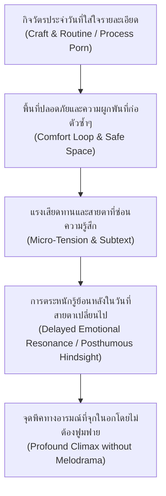
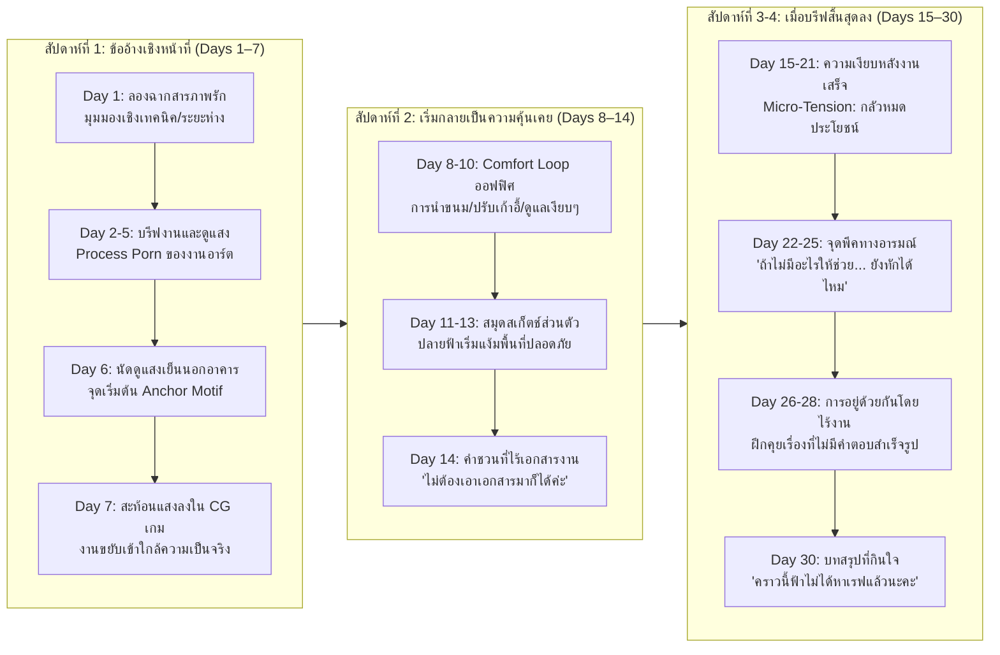

# 07 — ศิลปะการเล่าเรื่องแบบ "เรื่อยๆ แต่กินใจ ลึกซึ้ง และวางไม่ลง" (Engaging Slow-Burn & Slice-of-Life Craft)
> **กรณีศึกษาเชิงลึก:** *Dungeon Meshi (สูตรลับตำรับดันเจี้ยน)*, *Campfire Cooking in Another World with My Absurd Skill (สกิลสุดพิสดารกับมื้ออาหารในต่างโลก)* และ *Frieren: Beyond Journey's End (คำอธิษฐานในวันที่จากลา FRIEREN)*  
> **หมวดหมู่:** Narrative & Worldbuilding Reference  
> **บริบทการนำไปใช้:** สังเคราะห์เทคนิคการวางจังหวะ (Pacing), ความลึกซึ้งระดับจุลภาค (Micro-Tension), ลูปความสบายใจ (Comfort Loop) และการขยี้อารมณ์แบบเงียบเชียบ (Understated Emotional Storytelling) เพื่อนำมาปรับใช้กับลูปเกมเพลย์ 30 วันของ **Project Love** และเส้นเรื่องรูท **"ปลายฟ้า" (Artist)**  
> **ข้อกำหนดความปลอดภัยทางภาษา (ERR-027):** หลีกเลี่ยงสำนวนหรืออุปมาอุปไมยที่สื่อถึงความรุนแรง อันตรายทางกายภาพ หรือถ้อยคำประหาร/ทำร้าย โดยถ่ายทอดความขัดแย้งในงานสร้างสรรค์ผ่านเดิมพันทางความรู้สึก แรงกดดันของเส้นตายส่งมอบงาน ความเข้าใจผิด และการประนีประนอมในเชิงวิชาชีพเท่านั้น

---

## 1. บทสรุปผู้บริหารและแก่นสำคัญที่ค้นพบ (Executive Summary & Key Takeaways)

หนึ่งในความท้าทายสูงสุดของการเขียนบทแนวจำลองชีวิตและโรแมนติก (Slice-of-Life & Romance Simulation) คือ **"ความเข้าใจผิดที่ว่าเรื่องราวเรื่อยๆ เท่ากับความน่าเบื่อ"** บ่อยครั้งที่คนเขียนบทแก้ปัญหาความน่าเบื่อด้วยการยัดเยียดดราม่ารุนแรง (Melodrama) เช่น การทะเลาะโวยวาย อุบัติเหตุไม่คาดฝัน หรือพฤติกรรมงี่เง่าที่ขัดหูขัดตา ซึ่งทำลายบรรยากาศอบอุ่นและทำให้ผู้เล่นรู้สึกเหนื่อยล้าทางอารมณ์

จากการค้นคว้าเชิงลึกจากผลงานมาสเตอร์พีซ 3 เรื่องที่โดดเด่นด้าน Slow-Burn และ Slice-of-Life ระดับโลก ได้แก่ **Dungeon Meshi**, **Campfire Cooking in Another World** และ **Frieren: Beyond Journey's End** พบว่า ผลงานเหล่านี้ไม่ได้ดำเนินเรื่องด้วย "ความขัดแย้งใหญ่โตภายนอก" (Macro-Conflict) แต่ขับเคลื่อนด้วย **"ความประณีตในกระบวนการทำงาน" (Process Porn)**, **"ลูปกิจวัตรที่ให้ความอบอุ่นใจ" (Comfort Loop)** และ **"แรงตึงเครียดระดับจุลภาคที่ซ่อนอยู่ใต้ผิวน้ำ" (Micro-Tension & Subtext)**

### 📌 กฎเหล็ก 5 ประการของการเขียนบท Slow-Burn ให้ตรึงใจ (The 5 Golden Rules)

1. **Rule 1: "Micro-Tension over Macro-Threat" (สร้างความตื่นเต้นจากแรงตึงเครียดระดับจุลภาค ไม่ใช่หายนะล้างโลก)**  
   ในแต่ละฉาก ตัวละครไม่จำเป็นต้องเผชิญวิกฤติตาย-เป็น แต่ต้องมี **"ความต้องการที่ขัดกันเล็กน้อย" (Slightly Divergent Wants)** เช่น คนหนึ่งอยากอธิบายสเปกงานให้อีกฝ่ายประทับใจ แต่อีกคนกำลังกังวลเรื่องเวลา; คนหนึ่งพยายามเก็บอาการเขิน แต่อีกคนสังเกตเห็นมือที่สั่นเบาๆ ความตึงเครียดเล็กๆ นี้ทำหน้าที่เป็นออกซิเจนที่ทำให้บทสนทนาธรรมดามีชีวิตชีวา
2. **Rule 2: "Process Porn as Emotional Anchor" (ใช้รายละเอียดของวิชาชีพเป็นสะพานสร้างความน่าเชื่อถือและความผูกพัน)**  
   แทนที่จะบอกเล่าแบบกว้างๆ ว่าตัวละคร "เก่ง" หรือ "ขยัน" ให้พาคนดูดำดิ่งลงไปใน **ขั้นตอนการทำงานจริง** (การชำแหละและปรุงอาหารใน Dungeon Meshi, เทคนิคการใช้เครื่องปรุงใน Campfire Cooking, หรือการจัดแสงและลากเส้นใน Project Love) มนุษย์จะตกหลุมรักคนที่ตั้งใจทำสิ่งหนึ่งอย่างประณีตเสมอ
3. **Rule 3: "Routine as Emotional Ritual" (เปลี่ยนกิจวัตรประจำวันให้เป็นพิธีกรรมทางความรู้สึก)**  
   การทำสิ่งเดิมซ้ำๆ (การต้มกาแฟยามเช้า, การแบ่งขนมปัง, การส่งสรุปงานรอบเย็น) ไม่ใช่ความซ้ำซาก แต่คือ **"Comfort Loop"** ที่มอบความมั่นคงทางใจ เมื่อใดที่เกิดความเปลี่ยนแปลงแม้เพียงนิดเดียวในกิจวัตรนั้น (เช่น การมีกระดาษโน้ตแนบมา หรือการชงกาแฟหวานน้อยลงตามที่เคยบอก) คนดูจะรับรู้ได้ทันทีว่าความสัมพันธ์ได้ก้าวข้ามเส้นไปแล้ว
4. **Rule 4: "Understated Emotion & The Iceberg Principle" (อารมณ์ที่ทรงพลังที่สุดคืออารมณ์ที่ไม่ได้ตะโกนออกมา)**  
   ตามแบบฉบับของ *Frieren* 90% ของความรู้สึกลอยอยู่ใต้ผิวน้ำ ตัวละครจะไม่ร้องไห้คร่ำครวญหรือสารภาพรักหวานเลี่ยน แต่จะแสดงออกผ่านการหยุดชะงัก (Micro-hesitation), การเบือนหน้าหนีเล็กน้อย, น้ำเสียงที่เปลี่ยนไปเพียงครึ่งคีย์, หรือการดูแลเอาใจใส่เรื่องเล็กๆ โดยไม่หวังคำขอบคุณ
5. **Rule 5: "Delayed Resonance / The Retrospective Awakening" (การฝากความหมายไว้ล่วงหน้า แล้วกลับมาเก็บเกี่ยวในภายหลัง)**  
   ของขวัญธรรมดา คำพูดผ่านหู หรือพฤติกรรมเคยชินที่ตัวเอกเคยมองข้ามในวันแรกๆ จะถูกนำมา **"เปิดเผยความหมายที่แท้จริง"** ในช่วงท้ายเรื่อง การที่ตัวละคร (และผู้เล่น) เพิ่งเข้าใจว่าสิ่งที่อีกฝ่ายทำให้นั้นลึกซึ้งเพียงใด คือหมัดฮุกทางอารมณ์ที่สร้างความประทับใจระดับตำนาน

---

## 2. กรณีศึกษาเชิงลึก 3 ผลงานชั้นครู (In-Depth Case Studies)

---

### กรณีศึกษาที่ 1: Dungeon Meshi (สูตรลับตำรับดันเจี้ยน / Delicious in Dungeon)

* **ปี / ประเภทสื่อ:** 2014–2023 (มังงะ โดย Ryoko Kui) / 2024 (ทีวีอนิเมะ โดย Studio Trigger)
* **Logline & High-Concept Hook:** ปาร์ตี้ผู้กล้าที่หมดตัวกลางดันเจี้ยนลึก ต้องเอาชีวิตรอดและเดินทางไปช่วยน้องสาวด้วยการ "ล่ามอนสเตอร์ในดันเจี้ยนมาทำเป็นอาหารกินประทังชีวิต"
* **กลไกการเล่าเรื่องและจังหวะ Slow-Burn (Narrative Mechanics):**
  * **Ecology as Worldbuilding Engine (เปลี่ยนนิเวศวิทยาให้เป็นเครื่องจักรขับเคลื่อนเรื่อง):** อาจารย์ Ryoko Kui ไม่ได้มองมอนสเตอร์เป็นเพียง "กระสอบทรายเก็บเลเวล" แต่มองเป็นสิ่งมีชีวิตในระบบนิเวศที่มีกายวิภาค กล้ามเนื้อ แหล่งอาหาร และพฤติกรรมตามธรรมชาติ (เช่น การที่เกราะมีชีวิตจริงๆ คือสิ่งมีชีวิตคล้ายหอยที่สร้างเปลือกเรียงตัวกัน หรือบาซิลิสก์มีจุดอ่อนที่เส้นประสาท) เมื่อตัวละครเข้าใจธรรมชาติของมอนสเตอร์ พวกเขาจึงแก้ปัญหาการต่อสู้ด้วยสติปัญญาและชีววิทยา ไม่ใช่พลังมิตรภาพระเบิดพลัง
  * **Process Porn & Shokuiku (สุขศาสตร์แห่งการลงมือทำ):** จากบทสัมภาษณ์ของ Ryoko Kui เธอระบุว่าเธอเป็นคนเลือกกินตั้งแต่เด็กและเคยมีปัญหากับการกินอาหารร่วมกับผู้อื่น เธอจึงสร้างเรื่องนี้ผ่านมุมมองของ *Shokuiku* (การศึกษาเรื่องคุณค่าของอาหาร) ทุกเมนูมีขั้นตอนการเตรียมนิ้วต่อเซนติเมตร การรีดพิษ การแล่ การควบคุมอุณหภูมิ และการจัดสัดส่วนสารอาหารให้ครบหมู่ รายละเอียดกระบวนการทำงานที่ประณีตนี้สะกดคนดูให้จดจ่อ (Sensory Immersion) และทำให้โลกแฟนตาซีมีความสมจริงจับต้องได้
  * **Character Quirks & Problem-Solving Dynamic (เคมีของคนแปลกที่ต้องแก้ปัญหาร่วมกัน):**
    * *Laios (ผู้นำสายหมกมุ่น):* มีความอยากรู้อยากเห็นเรื่องมอนสเตอร์ระดับหลุดโลก ขาดทักษะทางสังคม แต่ความหมกมุ่นระดับสารานุกรมนี้กลับเป็นกุญแจไขปัญหาทางตันเสมอ
    * *Chilchuck (มนุษย์ฮาล์ฟฟุต ผู้รักษาเส้นแบ่งการทำงาน):* ทำงานแบบมืออาชีพเคร่งครัดเรื่องสัญญาจ้าง (Contractor Mentality) เกลียดการเสี่ยงโดยไม่จำเป็น คอยดึงสติทีมไม่ให้เลยเถิด เป็นตัวแทนของความปลอดภัยและการจัดการความเสี่ยง
    * *Marcille (เอลฟ์นักวิชาการผู้ขี้กังวล):* ยึดติดกับตำราและเวทมนตร์มาตรฐาน มีอาการสติแตก (Panic/Meltdown) ร้องยี้ทุกครั้งที่ต้องกินของแปลก แต่สุดท้ายก็เป็นคนที่รักเพื่อนสุดหัวใจและยอมปรับตัวประนีประนอม
    * *Senshi (คนแคระนักอนุรักษ์ธรรมชาติ):* มองดันเจี้ยนเป็นบ้านและระบบปิด ยึดหลักความยั่งยืน ไม่เก็บเกี่ยวเกินความจำเป็น และเป็นเสาหลักทางจิตใจที่คอยดูแลสุขภาพของทุกคน
  * **Thematic Build-up to Climax (การบิ้วอัพสู่แก่นเรื่องระดับปรัชญา):** ความเป็น Slice-of-Life ทำอาหารไม่ได้เป็นเพียงมุกคั่นเวลา แต่เป็นการปูรากฐานสู่แก่นเรื่องหลักของจักรวาล: **"การกินคือการพรากชีวิตผู้อื่นมาต่อชีวิตตน"** และ **"ความปรารถนา (Desire) คือพลังขับเคลื่อนของสิ่งมีชีวิต"** เมื่อเรื่องเข้าสู่ช่วงท้าย การต่อสู้กับสิงโตปีก (Winged Lion) จึงไม่ใช่การประลองดาบ แต่เป็นการปะทะกันระหว่าง "ความอยากอาหาร/ความอยากมีชีวิตตามธรรมชาติ" กับ "ความว่างเปล่าไร้จุดสิ้นสุด" ทำให้การเดินทางทำอาหารที่ดูเรื่อยๆ ในวันแรกกลายเป็นบทสรุปที่ลึกซึ้งและทรงพลังอย่างสมบูรณ์แบบ
* **จุดที่นำมาประยุกต์ใช้กับ Project Love:**
  * **เกมทำอาหาร = เกมทำเกม:** ในสตูดิโอทำเกม เราสามารถเปลี่ยน "การแก้ปัญหาบั๊ก, การสเก็ตช์ท่าทางตัวละคร, หรือการจัดวาง Layout" ให้มีมนต์ขลังแบบ Process Porn ได้ โดยให้ตัวละครอธิบายหลักการจัดวางแสงเงาหรือการเขียนโครงสร้างโค้ดด้วยความรู้จริง
  * **เคมีทีมแบบ Dungeon Meshi:** ให้ Producer เป็นเหมือน Senshi/Laios (ผู้ประสานและมองภาพรวม), ปลายฟ้าเป็นเหมือน Marcille/Senshi (ช่างฝีมือผู้ยึดมั่นในคุณภาพ), เกรซเป็นเหมือน Chilchuck (ผู้คุมขอบเขตและความเสี่ยง ไม่ยอมให้ใครรับภาระเกินตัว), และพลอยเป็นตัวจุดประกายความสดใส การแก้ปัญหาในออฟฟิศต้องเกิดจากการประนีประนอมจุดเด่นของแต่ละคน ไม่ใช่ให้ใครคนใดคนหนึ่งเป็นฮีโร่กู้โลกคนเดียว

---

### กรณีศึกษาที่ 2: Campfire Cooking in Another World with My Absurd Skill (สกิลสุดพิสดารกับมื้ออาหารในต่างโลก)

* **ปี / ประเภทสื่อ:** 2016–ปัจจุบัน (นิยายเว็บ/ไลท์โนเวล โดย Ren Eguchi) / 2023 (ทีวีอนิเมะ โดย MAPPA)
* **Logline & High-Concept Hook:** มนุษย์เงินเดือนชาวญี่ปุ่นธรรมดาถูกอัญเชิญไปต่างโลกพร้อมสกิล "เน็ตซูเปอร์" (เปิดหน้าร้านสั่งซื้อของสดและเครื่องปรุงจากญี่ปุ่นได้) เขาจึงตัดสินใจใช้ชีวิตแบบสโลว์ไลฟ์ หลบเลี่ยงสงคราม แล้วออกเดินทางทำอาหารรสเลิศจนมัดใจสัตว์อสูรในตำนานมาเป็นผู้ติดตาม
* **กลไกการเล่าเรื่องและจังหวะ Slow-Burn (Narrative Mechanics):**
  * **The 5-Stage Comfort Loop (ลูปความสุข 5 จังหวะที่เสพติดได้ไม่รู้เบื่อ):** อนิเมะเรื่องนี้ไม่ได้มีพล็อตซับซ้อน แต่มีโครงสร้างตอน (Episodic Rhythm) ที่แม่นยำดั่งนาฬิกา:
    1. *Arrival & Scenery:* เดินทางถึงพื้นที่ใหม่ ตั้งแคมป์ท่ามกลางธรรมชาติอันสงบ
    2. *Procurement / Hunt:* สัตว์อสูร (เฟล/ซุย) ล่าวัตถุดิบระดับสูงมาให้แบบสบายๆ ไร้ความตึงเครียด
    3. *The Net Super Routine:* มุโคดะเปิดหน้าต่างเสมือน เลือกซื้อเครื่องปรุงญี่ปุ่นแท้ๆ (ซอสโชยุ, มิริน, ซอสบาร์บีคิว, ขนมปัง)
    4. *ASMR Crafting Process:* การปรุงอาหารที่สตูดิโอ MAPPA บรรจงวาดอย่างพิถีพิถัน เสียงฉ่าของเนื้อย่างติดมัน ความเงาวาวของซอส กลิ่นควันที่ลอยผ่านจอ
    5. *Pure Payoff & Unconditional Gratitude:* เฟลและซุยกินด้วยความเอร็ดอร่อยเปล่งประกาย ความสุขใจของคนทำที่เห็นคนที่เรารักกินอิ่มนอนหลับ และปิดท้ายด้วยการพักผ่อนอย่างอบอุ่น
  * **The "Relatable Caretaker" Dynamic (เคมีมนุษย์เงินเดือนผู้คอยดูแล):** มุโคดะ (Mukouda) ไม่ใช่คนเก่งกาจ ไม่มีพลังโจมตีเวทมนตร์อลังการ และค่อนข้างขี้ระแวงกลัวอันตรายตามสัญชาตญาณคนทำงานออฟฟิศ แต่เขามี **"หัวใจแห่งการบริการและความใส่ใจ" (Domestic Caretaking / Hospitality)** เขาจำได้ว่าเฟลชอบเนื้อแบบไหน ซุยชอบกินขนมปังรสอะไร และเทพีหนินริลอยากได้ของหวานชนิดใด การกระทำเล็กๆ ของมุโคดะทำให้สิ่งมีชีวิตระดับทำลายล้างยอมสยบกลายเป็นครอบครัวที่พร้อมปกป้องเขาด้วยความรัก
  * **Zero-Anxiety & Low Stakes Appeal (เสน่ห์แห่งความไร้กังวล):** ผู้ชมในยุคปัจจุบันเผชิญความเครียดสูงจากชีวิตประจำวัน *Campfire Cooking* จึงทำหน้าที่เป็น "มื้ออาหารเยียวยาจิตใจ" (Healing/Iyashikei Anime) การที่เรื่องตัดความขัดแย้งทางการเมือง การทรยศหักหลัง หรือฉากบีบคั้นหัวใจออกไป แล้วเน้นเฉพาะ "ความพึงพอใจในการทำหน้าที่เล็กๆ ให้สำเร็จ" จึงกลายเป็นความเพลิดเพลินที่ดูซ้ำได้เรื่อยๆ โดยไม่อึดอัด
* **จุดที่นำมาประยุกต์ใช้กับ Project Love:**
  * **Daily Office Comfort Loop:** จำลองลูปความสบายใจใน 30 วันของสตูดิโอ: เช้าเริ่มงานด้วยการทักทาย -> เปิดระบบเช็กความคืบหน้า -> ช่วงบ่ายชงเครื่องดื่มหรือเตรียมของว่างที่รู้ใจ -> ช่วงเย็นนั่งดูผลงานหน้าจอที่เสร็จไปอีกเปลาะหนึ่ง การกระทำที่สม่ำเสมอนี้สร้างความอบอุ่นและทำให้ผู้เล่นผูกพันกับตัวละครทีละวัน
  * **Producer as the Supportive Caretaker:** ตัวเอกของ Project Love ไม่จำเป็นต้องเป็นยอดมนุษย์ที่แก้โค้ดได้หรือวาดรูปเทพ แต่เป็น "ผู้ดูแลพื้นที่ปลอดภัย" (Safe Space Provider) คอยขจัดอุปสรรคภายนอก ซื้อชานมที่ปลายฟ้าชอบ จัดโต๊ะทำงานให้เกรซ หรือรับฟังไอเดียของพลอย ความเอาใจใส่นี้คือเสน่ห์โรแมนติกที่มั่นคงและจับต้องได้จริง

---

### กรณีศึกษาที่ 3: Frieren: Beyond Journey's End (คำอธิษฐานในวันที่จากลา FRIEREN)

* **ปี / ประเภทสื่อ:** 2020–ปัจจุบัน (มังงะ โดย Kanehito Yamada & Tsukasa Abe) / 2023–2024 (ทีวีอนิเมะ โดย Madhouse)
* **Logline & High-Concept Hook:** หลังปาร์ตี้ผู้กล้าปราบราชาปีศาจและแยกย้ายกันไปใช้ชีวิต เมจเอลฟ์ผู้มีอายุยืนยาวนับพันปีเพิ่งตระหนักถึงความสั้นของชีวิตมนุษย์เมื่อผู้กล้าฮิมเมลแก่ชราจนจากไป เธอจึงเริ่มต้นออกเดินทางตามรอยเส้นทางเดิมอีกครั้งเพื่อ "ทำความเข้าใจมนุษย์" และรับรู้ความรู้สึกที่เธอเคยมองข้าม
* **กลไกการเล่าเรื่องและจังหวะ Slow-Burn (Narrative Mechanics):**
  * **Understated Emotional Storytelling (การเล่าแบบสงบเงียบแต่บาดลึก):** ฟรีเรนไม่เคยมีฉากกรีดร้องฟูมฟาย ไม่มีการระเบิดอารมณ์บีบน้ำตาแบบละครเมโลดราม่า สีหน้าของฟรีเรนส่วนใหญ่เรียบนิ่ง (Deadpan / Micro-expressions) ความรู้สึกของตัวละครจะถูกถ่ายทอดผ่าน **ภาษากายที่แผ่วเบา** เช่น การหยุดเดินชั่วครู่, การก้มมองมือตัวเอง, สายตาที่ทอดมองท้องฟ้ายามเช้า, หรือรอยยิ้มจางๆ ที่ไม่มีคำพูดประกอบ ความเงียบสงบนี้ทำให้ทุกความรู้สึกมีน้ำหนักมหาศาล
  * **Memory as Narrative Catalyst (ความทรงจำคือเข็มทิศปัจจุบัน):** โครงสร้างเรื่องใช้การย้อนอดีต (Flashback) ที่ไม่ได้ใส่มาเพื่อบอกเล่าประวัติศาสตร์ (Exposition Dump) แต่ใส่มาเป็น **"สะพานเชื่อมใจ"** ทุกครั้งที่ฟรีเรนเดินผ่านสถานที่เดิมในปัจจุบัน เหตุการณ์เล็กๆ ในอดีตกับฮิมเมลจะผุดขึ้นมา เช่น การหยุดเก็บสมุนไพร, การช่วยชาวบ้านถอนหญ้า, หรือบทสนทนาไร้สาระเรื่องเวทมนตร์เสกดอกไม้ สิ่งที่ฟรีเรนเคยคิดว่า "ไร้ประโยชน์และเสียเวลา" ในอดีต กลับกลายเป็น "ความทรงจำที่มีค่าที่สุด" ในปัจจุบัน
  * **The Tragedy and Warmth of Posthumous Comprehension (การตระหนักรู้ย้อนหลัง):** แก่นอารมณ์ที่ทำให้คนดูจุกในอกคือการที่ฟรีเรนเพิ่งเข้าใจความหมายของการกระทำของฮิมเมลในวันที่เขาไม่อยู่แล้ว:
    * *รูปปั้นผู้กล้า:* ฮิมเมลยืนยันให้ช่างปั้นรูปปั้นตัวเองในทุกเมือง ไม่ใช่เพราะความหลงตัวเอง แต่เพราะเขารู้ว่าฟรีเรนจะต้องมีชีวิตอยู่อย่างโดดเดี่ยวอีกนับพันปี เขาจึงสร้างรูปปั้นไว้เพื่อเป็นเครื่องเตือนใจว่า "เธอไม่ได้อยู่ตัวคนเดียว และครั้งหนึ่งพวกเราเคยอยู่ที่นี่ด้วยกัน"
    * *แหวนดอกบัวกระจก (Mirrored Lotus Ring):* ตอนที่ฮิมเมลซื้อแหวนให้ฟรีเรน เขาไม่ได้คุกเข่าสารภาพรักอย่างเอิกเกริก แต่สวมให้เงียบๆ โดยไม่บอกความหมายของภาษาดอกไม้ (ดอกบัวกระจก = "ความรักนิรันดร์") หลายสิบปีต่อมาเมื่อฟรีเรนทำแหวนหล่นหายและค้นหาอย่างเอาเป็นเอาตาย จนกระทั่งรู้ความหมายของมันจากพ่อค้า ความรักของฮิมเมลจึงเบ่งบานในใจของฟรีเรนอย่างช้าๆ แต่คงอยู่ตลอดกาล
  * **Empathetic Pacing (จังหวะการเล่าที่เลียนแบบกาลเวลา):** อนิเมะจงใจเดินเรื่องช้า ให้ฉากและบรรยากาศได้หายใจ ลมพัดใบไม้ร่วง ฤดูกาลผันผ่าน ทำให้คนดูปรับคลื่นหัวใจให้เข้ากับมุมมองของเอลฟ์ และสัมผัสได้ว่าชีวิตมนุษย์นั้นแสนสั้นและเปราะบางเพียงใด
* **จุดที่นำมาประยุกต์ใช้กับ Project Love:**
  * **Intimacy through Micro-Habits (ความผูกพันผ่านความคุ้นเคยเล็กๆ):** ในรูทปลายฟ้า ความรักไม่จำเป็นต้องเริ่มจากการสารภาพรัก แต่เริ่มจากการสังเกตเห็นนิสัยเล็กๆ ของกันและกัน เช่น วิธีการจับปากกาสไตลัส, การขมวดคิ้วเวลาเส้นไม่ตรงใจ, ท่าทางการดื่มน้ำตอนล้า, หรือการแอบจดบันทึกไอเดียในสมุดส่วนตัว
  * **The "Mirrored Lotus" Object in Project Love:** สร้าง "วัตถุหรือรายละเอียดที่ซ่อนความหมาย" ไว้ในเกม เช่น แสงแดดช่วงเย็นที่ทั้งคู่เคยยืนมองด้วยกันใน Day 6 หรือภาพสเก็ตช์เล่นๆ ที่ซ่อนไว้ในมุมหน้าจอ เมื่อถึง Day 29–30 วัตถุชิ้นเดิมนี้จะกลับมาเฉลยความหมายที่ทำให้ผู้เล่นอบอุ่นหัวใจอย่างที่สุด

---

## 3. การเปรียบเทียบเชิงวิเคราะห์โครงสร้างบท (Comparative Narrative Matrix)

| องค์ประกอบการเล่าเรื่อง | Dungeon Meshi (สูตรลับตำรับดันเจี้ยน) | Campfire Cooking (สกิลสุดพิสดารฯ) | Frieren (คำอธิษฐานในวันที่จากลา) | การประยุกต์ใช้ใน Project Love (30 วัน) |
| :--- | :--- | :--- | :--- | :--- |
| **แรงขับเคลื่อนเรื่อง (Core Narrative Engine)** | การศึกษาชีววิทยามอนสเตอร์และการปรุงอาหารเพื่อรอดชีวิต | ลูปการเดินทาง แคมป์ปิ้ง และสั่งของมาปรุงอาหารรสเลิศ | การเดินทางตามรอยอดีตเพื่อทำความเข้าใจมนุษย์และความรัก | การพัฒนาเกมอินดี้ "ก่อนร้านจะปิด" ให้เสร็จทันเส้นตาย 30 วัน |
| **บทบาทของกระบวนการทำงาน (Process Porn)** | สุขศาสตร์การชำแหละ ชั่งตวงวัด และโภชนาการในดันเจี้ยน | เสน่ห์ภาพและเสียง (ASMR) ของการทอด ปรุง ย่าง และราดซอส | รายละเอียดของเวทมนตร์เก็บขยะ เสกดอกไม้ ล้างคราบสนิม | เทคนิคการลากเส้น อุณหภูมิสี บรีฟงาน และการจัดแสงในหน้าจอเกม |
| **เคมีและความขัดแย้งในทีม (Team Dynamic & Friction)** | ถกเถียงเรื่องความเสี่ยง สุขอนามัย และตรรกะการเอาตัวรอด | ความสัมพันธ์แบบคนรับใช้ที่เต็มใจดูแลเจ้านาย/เด็กขี้อ้อน | ครู-ศิษย์ และเพื่อนร่วมทางที่เรียนรู้ระยะห่างและเวลาของกันและกัน | มืออาชีพ 4 คนที่มีความกลัวต่างกัน แต่ร่วมมือกันผ่านการประนีประนอม |
| **การจัดการดราม่า (Handling Dramatic Peaks)** | เชื่อมโยงนิเวศวิทยาเข้ากับปรัชญาความปรารถนาและการอยู่รอด | ตัดดราม่าหนักออก คงไว้เพียงความสุขและความผ่อนคลาย | ใช้ความเงียบ การสบตา และการตระหนักรู้ย้อนหลัง (Hindsight) | ขยี้ปม "เมื่อหมดงาน จะยังมีความหมายต่อกันไหม" โดยไม่โวยวาย |
| **สัญลักษณ์แทนใจ (Anchor Motif)** | กระทะทำอาหารของเซนชิ และหม้อรวมมิตรที่ล้อมวงกินด้วยกัน | โต๊ะพับสนาม และชามอาหารที่เติมเต็มความอบอุ่น | แหวนดอกบัวกระจก, รูปปั้นฮิมเมล, ดอกบลูมูนวีด | แสงอาทิตย์มุมตึก, แผ่นบรีฟงาน, ภาพสเก็ตช์ในโฟลเดอร์ลับ |

---

## 4. การสังเคราะห์เพื่อใช้กับเกมเพลย์ 30 วันของ Project Love และรูท "ปลายฟ้า" (Artist)

---

### 4.1 การแปลงบรรยากาศออฟฟิศทำเกมให้เป็น "Dungeon & Comfort Loop"

* **The Daily Office Comfort Loop (ลูปความสุขประจำวันในสตูดิโอ):**
  * *Morning Stand-up (จังหวะรับพลังงาน):* การพบกันยามเช้าหน้าโต๊ะทำงาน การสังเกตแก้วกาแฟ สีหน้า และสิ่งของชิ้นเล็กๆ ที่เปลี่ยนไปบนโต๊ะ
  * *Focus & Craft Phase (ช่วงเวลาแห่ง Process Porn):* ให้ผู้เล่นได้เห็นกระบวนการทำงานจริงของปลายฟ้า เช่น การซูมดูรอยต่อของเส้น Line Art, การทดลองเกรดสีพาเล็ตต์ 3 เฉดเพื่อหาสีท้องฟ้ายามโพล้เพล้, หรือการจัดแสงตกกระทบบนผิวตัวละคร รายละเอียดเหล่านี้ทำให้ผู้เล่นรู้สึกว่า "เกมนี้น่าเชื่อถือและมีเสน่ห์ของงานฝีมือ"
  * *Evening Wind-Down (จังหวะคืนความสงบ):* การปิดไฟบางดวงในออฟฟิศ เหลือเพียงโคมไฟโต๊ะทำงาน แสงสลัวหน้าจอ และช่วงเวลาสั้นๆ ที่นั่งคุยกันเรื่องขนมปังหรือลมหนาวนอกหน้าต่าง เป็นพื้นที่ปลอดภัยที่ตัดเสียงรบกวนภายนอกออกไป

---

### 4.2 ถอดรหัสเคมีทีมแบบ Dungeon Meshi สู่ทีม Project Love

การแก้ปัญหาในสตูดิโอทำเกมต้องเลียนแบบเคมีของปาร์ตี้ดันเจี้ยนเมชิ คือ **"แก้ปัญหาด้วยความถนัดเฉพาะตัวและยอมรับจุดบกพร่องของกันและกัน"**:
* **Producer (เหมือน Senshi ผสม Chilchuck):** ทำหน้าที่ดูแลความเป็นอยู่และขอบเขตงาน ไม่ผลักดันใครให้ทำงานจนเหนื่อยล้า และไม่สัญญาเรื่องที่เป็นไปไม่ได้กับภายนอก
* **ปลายฟ้า (เหมือน Marcille ในแง่ความเป็นเพอร์เฟกต์ชันนิสต์ + Senshi ในแง่ช่างฝีมือ):** มีทักษะการวาดที่เฉียบขาด แต่มีความกังวลว่างานของตนจะถ่ายทอดอารมณ์ได้ไม่ลึกซึ้งพอ เธอคิดคำนวณสัดส่วนและองศาของภาพจับมือเหมือนสมการคณิตศาสตร์
* **เกรซ (เหมือน Chilchuck):** ชัดเจนเรื่องขอบเขตและหน้าที่ ป้องกันความเสี่ยงของระบบโค้ดอย่างเข้มงวด และคอยเตือนสติทีมเรื่องเวลา
* **พลอย (เหมือน Laios/Marcille):** เต็มไปด้วยไอเดียสร้างสรรค์ที่แปลกใหม่และสร้างรอยยิ้ม แม้บางครั้งจะต้องถูกเกรซและ Producer ช่วยตีกรอบให้อยู่ในความเป็นจริง

---

### 4.3 การสร้างรูทความสัมพันธ์ของ "ปลายฟ้า" (When the Brief Ends) ด้วยจังหวะแบบ Frieren

ปมของปลายฟ้าตามโครงเรื่องหลักคือ **"ถ้าไม่มีบรีฟ จะยังชวนคุณได้ไหม"** (ความกลัวว่าตัวเองจะมีค่าต่อเมื่อมีประโยชน์ในเรื่องงานเท่านั้น):

#### 1. ความผูกพันแบบ Micro-Progression (ค่อยๆ ขยับระยะห่างทีละคืบ)
* **ช่วงวัน 1–7 (กำแพงแห่งความเป็นมืออาชีพ):**  
  ปลายฟ้าคุยเก่งและคล่องแคล่วเฉพาะเวลาเปิดไฟล์งาน เธอถามสเปกละเอียดระดับพิกเซล “องศาแขน 45 องศานี้ดูผ่อนคลายพอหรือยังคะ” ปลายฟ้ารู้สึกปลอดภัยเมื่อมี "เอกสารบรีฟ" เป็นเกราะกำบังระหว่างเธอกับ Producer
* **ช่วงวัน 8–14 (การเปิดพื้นที่ส่วนตัวโดยไม่ตั้งใจ):**  
  Producer เริ่มแสดงการดูแลแบบ *Campfire Cooking* เช่น การวางกล่องขนมปังเจ้าโปรดไว้บนโต๊ะ หรือการช่วยยกของโดยไม่ถามเซ้าซี้ ปลายฟ้าเริ่มผ่อนคลายจนเผลอเปิดหน้าต่างสมุดสเก็ตช์ส่วนตัวให้เห็นภาพการ์ตูนล้อเลียนขำๆ แล้วรีบปิดด้วยความเขินอาย แต่ในวันที่ 14 เธอเป็นฝ่ายเอ่ยปากชวนด้วยประโยคสั้นๆ: *“เย็นนี้... ไม่ต้องเอาเอกสารบรีฟติดมือไปก็ได้นะคะ”*
* **ช่วงวัน 15–21 (ความเงียบที่น่ากลัวเมื่อภาระงานใกล้หมด):**  
  เมื่อภาพประกอบหลัก (CG) ของเกมใกล้เสร็จสมบูรณ์ ปลายฟ้าเริ่มพูดน้อยลงอย่างเห็นได้ชัด เธอส่งงานตรงเวลาและงานสมบูรณ์แบบไร้ที่ติ แต่เธอกลับไม่ชวนคุยเรื่องหยุมหยิมเหมือนเดิม Producer ที่ช่างสังเกตแบบฮิมเมลจะเข้าใจได้ทันทีว่า **นี่ไม่ใช่ความเบื่องาน แต่คือความกลัวการหมดความหมาย**

#### 2. The Anchor Motif: แสงแดดยามเย็นที่มุมตึก (เทียบเท่าแหวนดอกบัวกระจก)
* ใน **Day 6** ทั้งคู่เคยออกไปยืนดูแสงแดดตกกระทบตึกตรงข้ามเพื่อเก็บข้อมูลสีท้องฟ้า ปลายฟ้าแอบวาดภาพสเก็ตช์เร็วๆ ของ Producer ที่ยืนรับลมไว้เงียบๆ
* ใน **Day 30** เมื่อภาพจบของเกมถูกเปิดทดสอบ Producer พบว่าปลายฟ้าแอบนำ "โทนสีและเงาของแสงแดดวันนั้น" มารองพื้นเป็นแสงบรรยากาศในฉากจบของเกม เป็นข้อความลับทางสายตาที่มีเพียงทั้งสองคนที่รู้ความหมาย

#### 3. จุดพีคทางอารมณ์ที่ไม่พึ่งพาความโวยวาย (The Quiet Climax - Days 22–25)
* หลังส่งมอบไฟล์งานชุดสุดท้ายเสร็จสิ้น ปลายฟ้ายืนส่งแฟลชไดรฟ์และเอกสารส่งมอบงานให้อย่างเป็นทางการ บรรยากาศในห้องเงียบสงบ มีเพียงเสียงพัดลมระบายความร้อนของคอมพิวเตอร์
* ปลายฟ้าก้มหน้ามองมือตัวเอง แล้วถามด้วยน้ำเสียงแผ่วเบาที่พยายามเก็บความสั่น:
  > **ปลายฟ้า:** “งานอาร์ตทั้งหมด... ฟ้าส่งให้ครบแล้วนะคะ ไม่มีอะไรต้องแก้อีกแล้ว... หลังจากนี้ ถ้าไม่มีอะไรให้ฟ้าช่วยแล้ว... ฟ้ายังทักไปหาคุณได้ไหมคะ?”
* ดราม่าจุดนี้ทรงพลังที่สุด เพราะมันไม่ได้เกิดจากการที่ใครทำผิดพลาด แต่เกิดจาก **"ความเปราะบางของมนุษย์ที่ยอมถอดเกราะหน้าที่ออกเพื่อขอความสัมพันธ์จริงใจ"** Producer ตอบกลับด้วยการยอมรับความจริงเช่นกันว่า ตนเองก็กลัวว่าจะหมดหน้าที่และไม่มีสิทธิ์ได้เจอเธออีก ทั้งคู่จึงก้าวข้ามเส้น "คนจ้างงานกับฟรีแลนซ์" สู่ "คนสำคัญในชีวิตจริง"

---

## 5. รูปแบบสถานการณ์และโครงสร้างบทที่นำไปใช้ได้จริง (Reusable Narrative Beats)

โครงสร้างบทย่อย 4 จังหวะที่สามารถนำไปวางในเหตุการณ์ประจำวัน (Daily Events) ของเกมเพลย์ 30 วัน:

### Beat 1: The Shared Focus & Quiet Intimacy (การจดจ่อร่วมกันในความเงียบ)
* **สถานการณ์:** ตัวละครสองคนนั่งทำงานอยู่ข้างกันในห้องทำงานที่เงียบสงบยามค่ำ ไม่มีใครพูดอะไรกันเป็นเวลาหลายสิบนาที มีเพียงเสียงปากกาดิจิทัลเคาะหน้าจอและเสียงแป้นพิมพ์
* **แก่นทางอารมณ์:** ความสนิทสนมระดับลึกซึ้งไม่ได้วัดจากปริมาณคำพูด แต่วัดจาก **"การรู้สึกสบายใจแม้จะนั่งเงียบๆ อยู่ในห้องเดียวกัน"** (Comfortable Silence)
* **บทสนทนาตัวอย่าง:**
  > *(เสียงปากกาสไตลัสเคาะจังหวะสม่ำเสมอ... ก่อนจะหยุดลงชั่วครู่)*  
  > **ปลายฟ้า:** “...กาแฟที่วางไว้ เย็นหมดแล้วนะคะ”  
  > **Producer:** “ปลายฟ้าก็ยังไม่ได้แตะชาเขียวแก้วนั้นเหมือนกันนี่ครับ”  
  > **ปลายฟ้า:** *(ยิ้มบางๆ แล้วขยับแก้วน้ำ)* “...นั่นสิคะ แต่ถ้านั่งเงียบแบบนี้ไปเรื่อยๆ... ฟ้าว่างานวันนี้คงเสร็จเร็วกว่าปกติแน่เลย”

### Beat 2: The Practical Caretaker / Acts of Service (การดูแลผ่านการกระทำที่เป็นรูปธรรม)
* **สถานการณ์:** ตัวละครหนึ่งสังเกตเห็นความล้าของอีกฝ่าย แต่ไม่พูดคำหวานเลี่ยนหรือแสดงความสงสารเกินเหตุ กลับเลือกช่วยแก้ปัญหาเชิงกายภาพอย่างเงียบๆ
* **แก่นทางอารมณ์:** การเลียนแบบมุโคดะและฮิมเมล คือการแสดงความรักผ่านการกระทำที่ลดภาระให้อีกฝ่าย (Reducing Friction)
* **บทสนทนาตัวอย่าง:**
  > *(Producer เดินไปเลื่อนม่านบังแดดที่ส่องเข้าตาปลายฟ้าลงเล็กน้อย แล้ววางเบาะรองหลังอันใหม่ไว้ที่พนักเก้าอี้ของเธอ)*  
  > **ปลายฟ้า:** “เอ๊ะ... อันนี้?”  
  > **Producer:** “เห็นตอนบ่ายคุณเปลี่ยนท่านั่งบ่อยๆ ครับ พลอยบอกว่ารุ่นนี้ช่วยลดอาการปวดหลังได้ดี ลองใช้ดูนะครับ”  
  > **ปลายฟ้า:** *(เอามือแตะเบาะเบาๆ แล้วก้มหน้ายิ้ม)* “...ขอบคุณนะคะ สังเกตเห็นด้วยเหรอเนี่ย”

### Beat 3: The Delayed Flashback Callback (การเรียกคืนความทรงจำที่เคยมองข้าม)
* **สถานการณ์:** ตัวละครพูดถึงเรื่องเล็กๆ ที่เคยเกิดขึ้นเมื่อ 2 สัปดาห์ก่อน ซึ่งอีกฝ่ายคิดว่าลืมไปแล้ว แต่ความจริงถูกจดจำไว้อย่างลึกซึ้ง
* **แก่นทางอารมณ์:** การส่งต่อความรู้สึกแบบ *Frieren* ว่า "ทุกช่วงเวลาที่อยู่ด้วยกันมีความหมายเสมอ"
* **บทสนทนาตัวอย่าง:**
  > **Producer:** “จำวันแรกที่พวกเราลองฉากสารภาพรักได้ไหมครับ ที่ปลายฟ้าวาดตัวละครยืนห่างกันเหมือนเผื่อที่จอดรถ”  
  > **ปลายฟ้า:** *(หัวเราะเบาๆ)* “จำได้สิคะ ตอนนั้นฟ้าไม่รู้จริงๆ นี่นา ว่าระยะห่างที่คนสองคนเขารู้สึกปลอดภัยมันต้องใกล้แค่ไหน”  
  > **Producer:** “แล้วตอนนี้ล่ะครับ พอรู้หรือยัง?”  
  > **ปลายฟ้า:** *(หันมาสบตาตรงๆ แล้วขยับเก้าอี้เข้ามาใกล้ขึ้นอีกนิด)* “...ถ้าเป็นระยะนี้ ฟ้าว่า... ไม่น่ามีที่ว่างให้จอดรถแล้วนะคะ”

### Beat 4: When the Task is Over (เมื่อภาระงานสิ้นสุดลง)
* **สถานการณ์:** วันสุดท้ายของการส่งงาน เมื่องานเสร็จสิ้นและไม่มีข้ออ้างเรื่องโปรเจกต์ให้ต้องเจอกันอีก
* **แก่นทางอารมณ์:** การเปลี่ยนผ่านจาก "หน้าที่" สู่ "ความตั้งใจส่วนตัว" (From Obligation to Choice)
* **บทสนทนาตัวอย่าง:**
  > **ปลายฟ้า:** “พรุ่งนี้... ฟ้าไม่ต้องส่งรายงานประจำวันแล้วนะคะ”  
  > **Producer:** “ครับ โฟลเดอร์งานสมบูรณ์แบบมาก”  
  > **ปลายฟ้า:** “...แล้วพรุ่งนี้ตอนสิบโมงเช้า ถ้าฟ้าไม่ได้จะส่งงาน... คุณจะยังรับสายฟ้าไหมคะ?”  
  > **Producer:** “ถ้าเป็นสายจากปลายฟ้า ผมรอรับตั้งแต่เก้าโมงเช้าแล้วครับ”

---

## 6. แหล่งข้อมูลอ้างอิงจากการค้นคว้า (Search References & Sources)

1. **Dungeon Meshi (Delicious in Dungeon) — Ryoko Kui Interviews & Screenwriting Analysis:**
   - *Denfaminicogamer Interview with Ryoko Kui:* บทสัมภาษณ์เจาะลึกเรื่องภูมิหลังการเป็นคนเลือกกิน, การใช้แนวคิด *Shokuiku* (Food Education) ในการเล่าเรื่อง, และการสร้างมอนสเตอร์จากล่างขึ้นบนตามห่วงโซ่อาหาร ([automaton-media.com](https://automaton-media.com/en/interviews/delicious-in-dungeon-creator-ryoko-kui-interview-denfaminicogamer/))
   - *Anime Trending & Anime News Network Analysis:* การวิเคราะห์จังหวะ Pacing ของสตูดิโอ Trigger และการใช้ช่วงเวลาทำอาหารเป็นจังหวะพักหายใจ (Decompression) ระหว่างการต่อสู้เสี่ยงตาย ([anitrendz.net](https://anitrendz.net/news/2024/05/23/interview-delicious-in-dungeon-ryoko-kui-trigger-staff/))
2. **Campfire Cooking in Another World with My Absurd Skill (Tondemo Skill de Isekai Hourou Meshi) — MAPPA & Narrative Loop Analysis:**
   - *Crunchyroll & Anime News Network Features:* การวิเคราะห์เสน่ห์ของ "Iyashikei / Cozy Isekai" และเทคนิคการสร้างความพึงพอใจทางประสาทสัมผัส (Food Animation Craft) ของ MAPPA ที่เปลี่ยนความซ้ำซากให้กลายเป็นความผ่อนคลายระดับสูง ([crunchyroll.com](https://www.crunchyroll.com/news/features/2023/1/24/campfire-cooking-in-another-world-mappa-food-animation))
   - *ScreenCraft / Slice-of-Life Narrative Design:* การวิเคราะห์โครงสร้าง "Comfort Loop" และบทบาทของตัวเอกประเภท "Domestic Caretaker" ในการสร้างพื้นที่ปลอดภัยทางอารมณ์
3. **Frieren: Beyond Journey's End (Sousou no Frieren) — Pacing, Micro-Tension & Understated Emotion:**
   - *IAFOR Journal & Media Analysis on Sousou no Frieren:* การวิเคราะห์การเล่าเรื่องแบบภูเขาน้ำแข็ง (Iceberg Storytelling), การใช้ความทรงจำย้อนหลังเป็นตัวขับเคลื่อนพล็อต (Memory as Active Catalyst), และเทคนิค Delayed Realization / Posthumous Grief ([iafor.org](https://iafor.org/frieren-narrative-structure-analysis/))
   - *Animation & Screenplay Craft Essays:* การวิเคราะห์การแสดงออกทางอารมณ์แบบสงบเสงี่ยม (Understated Acting / Restraint), การทำงานของสัญลักษณ์แหวนดอกบัวกระจก (Mirrored Lotus Ring), และรหัสภาษาดอกไม้ในวรรณกรรมญี่ปุ่น ([medium.com/storytelling-frieren-understated-masterpiece](https://medium.com/@narrativedesign/frieren-beyond-journeys-end-masterclass-in-pacing))
4. **General Screenwriting & Narrative Design Craft:**
   - *Kishotenketsu & Slice-of-Life Micro-Tension:* ทฤษฎีโครงสร้างบท 4 องก์แบบเอเชียที่ไม่พึ่งพาความขัดแย้งแบบตะวันตก แต่เน้นการเปลี่ยนมุมมองและการสะท้อนความรู้สึกภายใน (Thematic Shift over Clashing Conflict) ([septembercfawkes.com/kishotenketsu-structure](https://www.septembercfawkes.com/2020/07/kishotenketsu-structure-explained.html))
