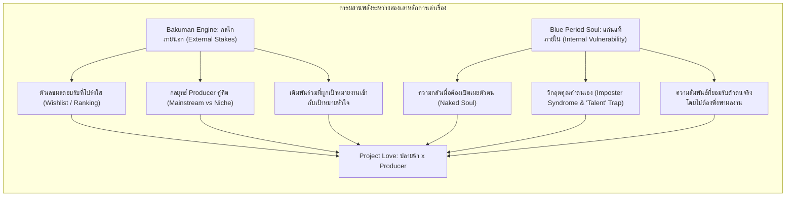
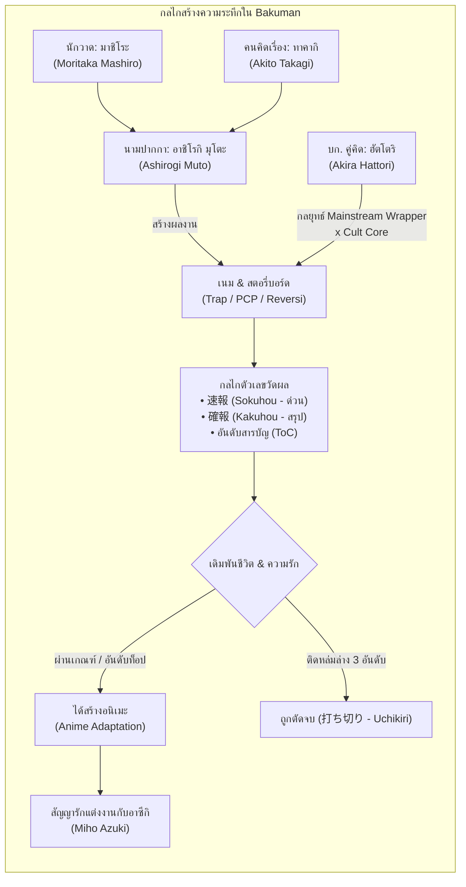
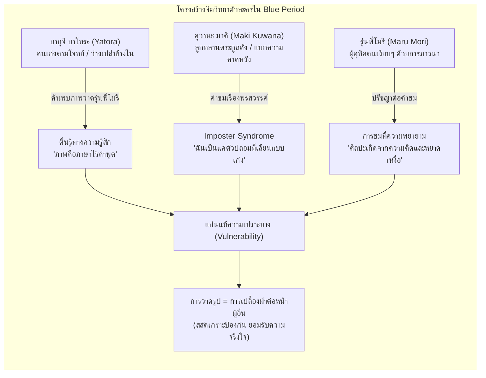
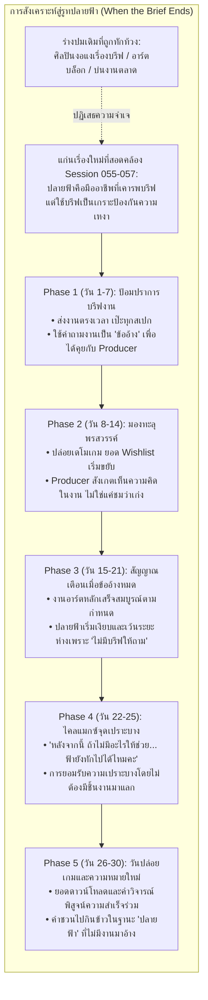
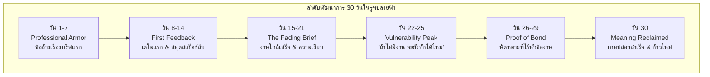

# 08 — เจาะลึกการเล่าเรื่องแนว "คนทำงานสร้างสรรค์และการไล่ล่าความฝัน" (Creative Ambition, Craft & Human Struggle)
## กรณีศึกษาเชิงลึก: *Bakuman (วัยซนคนการ์ตูน)* และ *Blue Period (บลูพีเรียด)* สู่การออกแบบรูท "ปลายฟ้า" และบทบาท Producer ใน Project Love

> **สถานะเอกสาร:** รายงานการค้นคว้าบทวิจัยฉบับที่ 8 (Research Reference Document) สำหรับโปรเจกต์ Project Love  
> **ขอบเขตการใช้งาน:** เป็นคู่มือวิเคราะห์โครงสร้างบท (Screenwriting & Narrative Design Guide) และคลังกลยุทธ์จิตวิทยาตัวละคร สำหรับนำไปประยุกต์ใช้ในการเขียนบทเส้นเรื่องความรักและการทำงานระหว่าง **Producer x ปลายฟ้า (Artist)** ภายใต้กรอบเวลา 30 วัน (Casual Loop & Romance-First VN)  
> **การปฏิบัติตามมาตรฐานความปลอดภัย (ERR-027 Guardrail):** เอกสารฉบับนี้ไม่มีการใช้สำนวนเปรียบเทียบที่สื่อถึงความรุนแรง การทำร้ายร่างกาย หรือความเป็นความตาย โดยจะถ่ายทอดความตึงเครียดผ่านแรงกดดันของกำหนดส่งงาน (Deadlines), ตัวเลขผลตอบรับทางการตลาด (Market Feedback & Wishlists), ความเปราะบางของศักดิ์ศรีศิลปิน (Artistic Vulnerability), ความกลัวการไร้คุณค่า (Imposter Syndrome & Utility-Based Worth), และความเข้าอกเข้าใจในความสัมพันธ์

---

## 1. บทสรุปผู้บริหารและแก่นสำคัญที่ค้นพบ (Executive Summary & Key Takeaways)

### 1.1 ปริศนาความสำเร็จ: ทำไม "คนนั่งวาดรูปในห้องสี่เหลี่ยม" ถึงทำให้คนดูทั่วไปลุ้นและร้องไห้ตามได้?
หนึ่งในความท้าทายที่ยากที่สุดของการเขียนบทแนวคนทำงานสร้างสรรค์ (Creative/Craft Drama) คือ **"ธรรมชาติของงานสร้างสรรค์เป็นการทำงานที่นิ่ง เงียบ และอยู่กับตัวเองสูงมาก"** การนั่งสเก็ตช์ภาพบนแท็บเล็ต การเขียนสตอรี่บอร์ด หรือการนั่งแก้งานหน้าจอคอมพิวเตอร์ ไม่มีการเคลื่อนไหวทางกายภาพที่เร้าใจ ไม่มีศัตรูภายนอก และหากเขียนไม่ระวัง เรื่องราวจะกลายเป็นเพียง "สารคดีบ่นความเหนื่อยล้าของคนทำงาน" ที่คนดูทั่วไปที่ไม่ได้เป็นศิลปินไม่รู้สึกเชื่อมโยงด้วย

จากการค้นคว้าและผ่าตัดโครงสร้างบทของสองผลงานระดับมาสเตอร์พีซ:
1. **Bakuman (สึงุมิ โอบะ และ ทาเคชิ โอบาตะ):** เปลี่ยน "การส่งต้นฉบับและการประชุมบก." ให้กลายเป็นการประลองเชิงกลยุทธ์ที่ลุ้นระทึกไม่แพ้การ์ตูนต่อสู้โชเน็น ผ่านการใช้ **"ตัวเลขผลตอบรับสาธารณะที่มีเดิมพันเชื่อมกับความรัก"** และ **"ความสัมพันธ์แบบพาร์ตเนอร์เชิงกลยุทธ์ระหว่าง Content Creator กับ Producer/Editor"**
2. **Blue Period (สึบาสะ ยามากุจิ):** เปลี่ยน "การผสมสีน้ำมันและการเตรียมสอบศิลปะ" ให้กลายเป็นการขุดค้นความเปราะบางและตัวตนแท้จริงของมนุษย์ ผ่านการส่องไฟไปยัง **"ความหวาดกลัวการถูกตัดสินเมื่อต้องเปลื้องตัวตนให้คนอื่นเห็น"** และ **"กับดักทางจิตวิทยาของคำชมที่ทำให้คนมีพรสวรรค์กลายเป็นคนไม่มั่นใจในตัวเอง (Imposter Syndrome)"**

แก่นแท้ร่วมกันที่ทำให้คนทั่วไปอินได้จนถึงที่สุด คือ:
> **"ผลงานสร้างสรรค์ไม่ใช่แค่ชิ้นงาน แต่มันคือ 'ภาษาไร้คำพูด' ที่เปิดเผยความอ่อนแอที่สุดของมนุษย์ และการสร้างสรรค์ร่วมกันคือรูปแบบการสารภาพรักที่ลึกซึ้งที่สุด"**

---

### 1.2 กฎเหล็ก 5 ข้อในการเล่าเรื่องคนทำงานสร้างสรรค์ให้คนดูทั่วไปอินและไม่ตกหลุมพรางความซ้ำซาก

#### กฎข้อที่ 1: แปลงคุณค่าทางสุนทรียะให้เป็น "เดิมพันเชิงกลยุทธ์และตัวเลขที่จับต้องได้" (Gamify the Creative Ambition)
คนเล่นเกมทั่วไปอาจไม่เข้าใจลึกซึ้งว่าเส้นแบบไหนสวยกว่า หรือการคุมน้ำหนักแสงเงาแบบไหนถูกต้องตามทฤษฎี แต่ทุกคนเข้าใจ **"ตัวเลขสถิติ, อันดับความนิยม, และปฏิกิริยาของผู้รับชม"**  
- ใน *Bakuman* ผู้เขียนไม่ได้บอกแค่ว่า "ตอนนี้การ์ตูนกำลังสนุกขึ้น" แต่ใช้ **แบบสอบถามผู้อ่าน (Ankēto), อันดับสารบัญ (ToC Ranking), และยอดพิมพ์รวม** เป็นมาตรวัดผลที่บีบหัวใจ  
- ใน *Project Love* เราต้องไม่ให้การทำงานของปลายฟ้าเป็นเพียงการกดปุ่มเก็บค่า Stat ในฉากหลัง แต่ต้องผูกงานภาพของเธอกับ **"ยอดกดสิ่งที่อยากได้ (Steam Wishlist), อัตราคนดาวน์โหลดเดโม, และข้อเสนอจากค่ายจัดจำหน่าย (Publisher Pitch Offers)"**

#### กฎข้อที่ 2: โปรดิวเซอร์ไม่ใช่เจ้านายสั่งงาน แต่คือ "เกราะกำบังวิสัยทัศน์และคู่คิดเชิงกลยุทธ์" (The Producer as Shield & Strategist)
ความสัมพันธ์ระหว่าง Producer กับ Artist จะน่าเบื่อทันทีหากพระเอกเป็นเพียงผู้จัดการที่คอยทวงเดดไลน์หรือบอกให้แก้งานตามใจตลาด  
- ต้นแบบจาก **ฮัตโตริ อากิระ (Akira Hattori)** ใน *Bakuman* คือ โปรดิวเซอร์ที่ **"อ่านขาดเนื้อแท้ของนักวาด"** ฮัตโตริรู้ว่าอาชิโรกิ มุโตะ ไม่ใช่นักเขียนการ์ตูนสายหลักสู้กันปล่อยพลัง แต่เป็นสายใช้สมอง วางพล็อตลึกลับดาร์ก เขาจึงปกป้องไม่ให้ทีมถูกแรงกดดันภายนอกบีบให้เปลี่ยนแนวทางตามกระแสฉาบฉวย  
- Producer ใน *Project Love* ต้องทำหน้าที่เป็นคนที่ **"มองเห็นจุดเด่นในลายเส้นของปลายฟ้าที่แม้แต่ตัวเธอเองยังมองข้าม"** คอยรับแรงกระแทกจากคอมเมนต์ภายนอก และวางแผนจัดวางงานของเธอให้เปล่งประกายที่สุด

#### กฎข้อที่ 3: กะเทาะเปลือก "คำชมเรื่องพรสวรรค์" สู่การยอมรับ "หยาดเหงื่อและความคิด" (Deconstruct 'Talent' into Labor & Intention)
ศิลปินและคนทำงานสร้างสรรค์มักถูกคนภายนอกมองข้ามกระบวนการคิด ด้วยคำชมสั้นๆ ว่า *"เก่งจัง มีพรสวรรค์จัง โชคดีจังนะ"*  
- ใน *Blue Period* **รุ่นพี่โมริ (Maru Mori)** ปฏิเสธคำว่าพรสวรรค์อย่างนุ่มนวล เพราะคำชมว่ามีพรสวรรค์ให้ความรู้สึกเหมือนลบล้างชั่วโมงฝึกซ้อมและความเจ็บปวดที่ต้องคิดงานทิ้งไป  
- Producer ในเกมของเราจะชนะใจปลายฟ้าได้ ไม่ใช่ด้วยการชมเลื่อนลอยว่า *"ปลายฟ้าวาดรูปสวยจังครับ"* แต่เกิดจากการ **"สังเกตเห็นดีเทลเล็กๆ ที่เธอตั้งใจใส่ลงไป"** (เช่น แสงสะท้อนในตาตัวละคร, การเลือกใช้โทนสีหม่นเพื่อสะท้อนความเหงา) การที่ใครสักคนมองเห็น "ความคิดและความพยายาม" คือการเยียวยาจิตวิญญาณคนทำงานที่ทรงพลังที่สุด

#### กฎข้อที่ 4: ความเปราะบางขั้นสุดคือ "การยืนเปลื้องผ้าทางจิตใจต่อหน้าคนอื่น" (Art as Emotional Nakedness)
งานศิลปะและงานสร้างสรรค์ไม่ใช่แค่สินค้า แต่มันคือการนำเอาความทรงจำ ความเจ็บปวด และรสนิยมลึกๆ ของคนทำออกมาร้อยเรียงให้สายตานับร้อยนับพันคู่มองดู  
- ใน *Blue Period* การเปิดให้คนอื่นดูงานของตัวเอง ให้ความรู้สึกไม่ต่างจากการยืนเปลื้องผ้าต่อหน้าฝูงชน หากงานถูกปฏิเสธ คนทำจะรู้สึกเหมือนตัวตนทั้งหมดของตนถูกปฏิเสธ  
- ในรูทปลายฟ้า การที่เธอยอมเปิดสมุดสเก็ตช์ส่วนตัวให้ Producer ดู จึงไม่ใช่แค่เหตุการณ์บริการแฟนคลับ แต่เป็น **"หมุดหมายของความไว้ใจระดับสูงสุด (The Ultimate Leap of Faith)"**

#### กฎข้อที่ 5: ปลดล็อกปม "คุณค่าที่ผูกติดกับประโยชน์ใช้งาน" (Separating Human Worth from Utility)
ศิลปินระดับมืออาชีพจำนวนมากมีบาดแผลทางใจ (Core Wound) คล้ายกับ **คุวานะ มาคิ (Kuwana Maki)** ใน *Blue Period* และ **ปลายฟ้า** ในโปรเจกต์ของเรา: นั่นคือการคิดว่า **"ตัวเองมีค่า ตราบใดที่ยังส่งมอบงานตามความคาดหวังของคนอื่นได้เท่านั้น"**  
- การเล่าเรื่องจะทรงคุณค่าและฉีกออกจากความซ้ำซาก เมื่อคลายปมดราม่าไม่ใช่เรื่อง "วาดภาพไม่ออกเพราะหมดไฟ" แต่เป็นคำถามชวนสะเทือนใจเมื่อถึงวันที่งานเสร็จสมบูรณ์ว่า:  
  > **"เมื่อบรีฟงานชิ้นสุดท้ายสิ้นสุดลง... ถ้าฉันไม่มีประโยชน์ให้ใช้งานอีกต่อไป คุณจะยังต้องการฉันอยู่ไหม?"**

---

## 2. กรณีศึกษาเชิงลึก (In-Depth Case Studies)

---

### กรณีศึกษาที่ 1: *Bakuman (วัยซนคนการ์ตูน)* — กลไกเปลี่ยนงานสร้างสรรค์ให้เป็นการขับเคี่ยวระดับโชเน็น
* **ชื่อผลงาน / ผู้สร้าง:** *Bakuman (バクマン。)* / เนื้อเรื่องโดย Tsugumi Ohba, ภาพโดย Takeshi Obata (Weekly Shōnen Jump / Shueisha)
* **Logline & High-Concept Hook:** สองคู่หูนักเรียนมัธยมปลาย—คนหนึ่งวาดภาพอัจฉริยะแต่สิ้นหวังกับชีวิต อีกคนหนึ่งมีหัวคิดวางโครงเรื่องระดับอัจฉริยะ—จับมือกันก้าวเข้าสู่สมรภูมิของนิตยสารการ์ตูนอันดับหนึ่ง โดยมีสัญญารักกับหญิงสาวในดวงใจเป็นเดิมพันชีวิต

#### 2.1 กลไกการเล่าเรื่อง: เปลี่ยนการนั่งทำงานในห้องสี่เหลี่ยมให้ตื่นเต้นเหมือนการ์ตูนต่อสู้
ผู้เขียน Tsugumi Ohba และ Takeshi Obata แก้โจทย์ความนิ่งของการวาดการ์ตูนด้วยเทคนิคบทละคร 4 ระดับ:
1. **การสร้างหน่วยวัดที่ชัดเจนและมีกำหนดเวลาตายตัว (Tick-tock Clock & Tangible Metrics):**  
   ในเรื่องนี้ "แบบสอบถามผู้อ่านฉบับด่วน" (Sokuhou - 速報) จะส่งมาในวันพุธ และ "ผลคะแนนทางการ" (Kakuhou - 確報) จะสรุปในวันศุกร์ การกำหนดเวลารอโทรศัพท์จาก บก. เวลา 17:00 น. สร้างบรรยากาศที่คนดูหัวใจเต้นตามทุกสัปดาห์
2. **การวางกฎการอยู่รอดแบบ Darwinian (The 10-Chapter Probation & The Axe):**  
   ซีรีส์ใหม่มีเวลาพิสูจน์ตัวเองเพียง 10 ตอนแรก (Buffer Period) หากหลังจากนั้นผลคะแนนยังจมอยู่ใน 3 อันดับสุดท้ายของสารบัญติดต่อกัน ผลงานจะถูก "ตัดจบ" (Uchikiri - 打ち切り) กฎเหล็กนี้ทำให้การทำงานทุกสัปดาห์มีเดิมพันระดับวิกฤต
3. **การออกแบบคู่ปรับที่เป็นเสมือนภูผาที่ไม่มีวันโค่นล้มได้ง่ายๆ (Rivalry Engine):**  
   **นีซึมะ เอจิ (Eiji Niizuma)** ถูกวางเป็น "อัจฉริยะโดยกำเนิด" ที่วาดการ์ตูนตามสัญชาตญาณบริสุทธิ์ ในขณะที่คู่หูพระเอกคือ "นักวางแผนสายกลยุทธ์ที่ต้องคำนวณทุกย่างก้าว" การต่อสู้ไม่ใช่การชกต่อย แต่คือการแย่งชิงอันดับ 1 ในสารบัญเล่มเดียวกัน
4. **ภาษากายและมุมกล้องของงานสเก็ตช์ (Dynamic Visual Direction):**  
   Takeshi Obata ใช้การซูมโคลสอัพที่ปลายปากกา G-Pen เสียงขูดขีดบนกระดาษต้นฉบับ เงาเหงื่อที่หยดลงบนช่องว่าง และการพลิกหน้ากระดาษเนม (Name - ネーム) สลับกับการตัดต่อจังหวะพูดคุยที่รวดเร็ว เพื่อสร้างอัตราเร่งทางอารมณ์

#### 2.2 บทบาทของโปรดิวเซอร์/บก. "ฮัตโตริ อากิระ" (The Strategic Producer Blueprint)
ฮัตโตริคือตัวอย่างของ **"สุดยอดผู้นำเชิงกลยุทธ์ที่ศิลปินต้องการที่สุด"** มีบทเรียนสำคัญที่นำมาประยุกต์ใช้กับตำแหน่ง Producer ได้ดังนี้:
* **การอ่านขาดจุดแข็ง-จุดอ่อนที่แท้จริง (Diagnosis of Core Competency):**  
  เมื่อมาชิโระและทาคากิส่งงานช่วงแรกที่พยายามเลียนแบบการ์ตูนสายหลักสู้กันปล่อยพลัง ฮัตโตริรู้ทันทีว่าฝืนธรรมชาติ เพราะทาคากิเก่งเรื่องบทสนทนาคมคาย ปมจิตวิทยา และพล็อตหักมุม เขาจึงสั่งห้ามไม่ให้ไปแข่งในสังเวียนที่เสียเปรียบ แต่ชี้นำให้ไปสู่แนว "สืบสวนและเกมจิตวิทยา"
* **ทฤษฎี "เปลือกนอกสายหลัก แก่นในสายลึก" (Mainstream Wrapper, Cult Core):**  
  ฮัตโตริสอนให้ทีมเข้าใจว่า อย่าทำการ์ตูนนอกกระแสที่แปลกแยกจนคนทั่วไปไม่เหลียวแล แต่ให้ใช้ **"โครงสร้างที่คนทั่วไปเข้าถึงง่าย" (เช่น แนวสืบสวนคดีใน *Detective Trap* หรือแนวแกล้งก่ออาชญากรรมแบบเด็กๆ ใน *PCP*)** มาห่อหุ้ม **"เนื้อหาที่ซับซ้อนแยบยล"** เพื่อดึงคนอ่านกลุ่มกว้างเข้ามาก่อน
* **ความแตกต่างระหว่างโปรดิวเซอร์ที่ฉลาด กับโปรดิวเซอร์ที่ผลักดันผิดทิศ (Hattori vs. Miura):**  
  เมื่อทีมต้องเปลี่ยน บก. ไปเป็น **มิอุระ ยูจิโร่ (Yujiro Miura)** มิอุระพยายามบีบให้ทีมวาดการ์ตูนแก๊กตลกเบาสมอง เพราะเชื่อสถิติตลาดแบบตื้นเขิน ส่งผลให้ทีมสูญเสียตัวตน อันดับร่วงกราว และเกือบหมดกำลังใจ สิ่งนี้เตือนใจว่า **โปรดิวเซอร์ที่ดีต้องไม่เอาเทรนด์ตลาดฉาบฉวยมาบดขยี้จุดแข็งเฉพาะตัวของศิลปิน**
* **การยืนหยัดปกป้องวิสัยทัศน์ของศิลปินต่อหน้าผู้บริหาร (The Producer as Shield):**  
  ในช่วงไคลแมกซ์ของผลงานชิ้นเอก *Reversi* ผู้บริหารและคณะกรรมการสร้างอนิเมะต้องการให้ยืดเรื่องยาวออกไปเพื่อผลประโยชน์ทางธุรกิจ แต่ทาคากิและมาชิโระมองว่าเรื่องนี้ควรจบที่ 49 ตอนอย่างสมบูรณ์แบบที่จุดพีคสูงสุด **ฮัตโตริยอมเอาตำแหน่งของตัวเองเข้าแลกเพื่อปกป้องการตัดสินใจของนักวาด** จนหัวหน้า บก. ยอมอนุมัติให้จบตามใจปรารถนา

#### 2.3 การเชื่อมโยง "ตัวเลขในงาน" เข้ากับ "เดิมพันความรัก" (Stakes-Binding Engine)
จุดอัจฉริยะของ *Bakuman* ที่ทำให้เรื่องไม่กลายเป็นละครธุรกิจที่แห้งแล้ง คือการตั้งเงื่อนไขตั้งแต่ตอนที่ 1 ว่า:  
> **"มาชิโระกับอาซึกิ (นักพากย์สาวที่เป็นรักแรก) จะไม่พบหน้ากัน และจะติดต่อกันทางข้อความเท่านั้น จนกว่าการ์ตูนของมาชิโระจะได้เป็นอนิเมะ และอาซึกิได้พากย์เป็นนางเอก เมื่อวันนั้นมาถึง ทั้งสองจะแต่งงานกัน"**

การวางเงื่อนไขนี้ส่งผลให้:
1. ทุกคะแนนโหวตในแบบสอบถาม ไม่ใช่แค่ตัวเลขผลงาน แต่มันคือ **"ระยะห่างระหว่างเขากับเธอ"** ถ้าอันดับตก ระยะห่างก็ยิ่งถอยห่างออกไป
2. การงดพบหน้าเปลี่ยนการส่งข้อความสั้นๆ ให้กลายเป็นโมเมนต์ใจฟูที่ประเมินค่าไม่ได้ ทุกตัวอักษรกลายเป็นแรงผลักดันในการอดทนนั่งสเก็ตช์งานข้ามคืน
3. เมื่อถึงวันที่ผลงานประสบความสำเร็จ ชัยชนะในหน้าที่การงานกับความสมหวังในความรักจะหลอมรวมเป็นสิ่งเดียวกันอย่างสมบูรณ์

---

### กรณีศึกษาที่ 2: *Blue Period (บลูพีเรียด)* — จิตวิทยาสากลของความเปราะบางและศิลปะในฐานะภาษาของจิตวิญญาณ
* **ชื่อผลงาน / ผู้สร้าง:** *Blue Period (ブルーピリオド)* / ประพันธ์โดย Tsubasa Yamaguchi (ผู้สำเร็จการศึกษาจากคณะจิตรกรรมสีน้ำมัน มหาวิทยาลัยศิลปะโตเกียว - Geidai) ตีพิมพ์ในนิตยสาร Afternoon (Kodansha)
* **Logline & High-Concept Hook:** เด็กหนุ่มมัธยมปลายผู้เพียบพร้อมทั้งผลการเรียนและการเข้าสังคม แต่หัวใจข้างในว่างเปล่า ได้ค้นพบความหลงใหลในศิลปะเป็นครั้งแรก และตัดสินใจเดิมพันอนาคตเพื่อสอบเข้ามหาวิทยาลัยศิลปะอันดับหนึ่งของญี่ปุ่น ท่ามกลางสมรภูมิการทดสอบอัตราการแข่งขัน 1 ต่อ 200

#### 2.1 สึบาสะ ยามากุจิ เขียนปมศิลปินอย่างไรให้ "คนไม่ใช่นักวาดก็ร้องไห้ตามได้"?
ความลับที่ทำให้ *Blue Period* สั่นสะเทือนอารมณ์คนอ่านทุกสาขาอาชีพ คืออาจารย์สึบาสะไม่ได้เล่าเรื่อง "ความสามารถพิเศษ" แต่เล่าเรื่อง **"วิกฤตตัวตนของมนุษย์ (Existential Struggle)"**:
1. **การเผชิญหน้ากับความว่างเปล่าของการทำตามความคาดหวังของสังคม (The Emptiness of Conformity):**  
   ยาโทระเริ่มต้นเรื่องด้วยการเป็นเด็กเรียนดี สูบบุหรี่ เที่ยวกลางคืน มีเพื่อนเฮฮา ทำคะแนนสอบได้ท็อปตามเกณฑ์ที่ผู้ใหญ่กำหนด แต่เขารู้สึกว่าตัวเองไม่ได้กำลัง "มีชีวิตอยู่จริงๆ" จนกระทั่งเขาได้ระบายภาพเมืองชิบูย่ายามเช้าเป็นสีฟ้าตามที่สายตาของเขาเห็นจริงๆ แล้วเพื่อนพูดว่า *"เช้าตรู่ที่ชิบูย่ามันเป็นสีฟ้าแบบนี้จริงๆ ด้วย"* วินาทีนั้นคือครั้งแรกในชีวิตที่เขารู้สึกว่า **เขาได้สื่อสารตัวตนที่แท้จริงกับมนุษย์คนอื่นโดยไม่ต้องใส่หน้ากาก**
2. **ความทรมานของการเปรียบเทียบในโลกที่ไม่มีเฉลยถูกผิด (Subjectivity & Comparison):**  
   ในวิชาคณิตศาสตร์หรือการสอบทั่วไป มีคำตอบที่ถูกชัดเจน แต่ในศิลปะและงานสร้างสรรค์ "ไม่มีมาตรวัดที่สมบูรณ์" ความรู้สึกว่าตัวเองฝึกซ้อมแทบตาย แต่ภาพของเพื่อนร่วมชั้นกลับมีเสน่ห์ดึงดูดใจมากกว่า สะท้อนถึงคนทำงานทุกคนที่เคยตั้งคำถามกับตัวเองว่า *"สิ่งที่เราทุ่มเททำลงไป มันมีคุณค่าจริงๆ หรือเปล่า?"*
3. **การประเมินผลงาน (Kōhyō-kai) คือการชำแหละจิตวิญญาณ:**  
   ฉากการวิจารณ์ผลงานในโรงเรียนกวดวิชาศิลปะ ไม่ใช่แค่การตรวจการบ้าน แต่คือการนำตัวตนที่นักเรียนกลั่นออกมาวางเรียงกัน แล้วถูกอาจารย์ชี้จุดบกพร่องอย่างตรงไปตรงมา ความรู้สึกเจ็บปวดจนแทบจะก้าวขาไม่ออกเป็นประสบการณ์สากลของทุกคนที่เคยส่งโปรเจกต์ที่ตัวเองรักแล้วถูกปฏิเสธ

#### 2.2 เจาะลึก 3 ปมตัวละคร: ต้นแบบจิตวิทยาที่สะท้อนคนทำงาน
* **ยากุจิ ยาโทระ (Yatora Yaguchi): ผู้เชี่ยวชาญการทำตามโจทย์ ที่ต้องเรียนรู้การเปิดเปลือยความจริงใจ**  
  - ยาโทระคือตัวแทนของคนทำงานที่มีวินัย ทำงานส่งทัน มีทักษะ (Skill) และเข้าใจข้อกำหนดเป็นอย่างดี แต่ผลงานช่วงแรกของเขามักถูกวิจารณ์ว่า *"ถูกต้อง สวยงาม แต่น่าเบื่อและไร้จิตวิญญาณ"* เพราะเขาวาดเพื่อ "ตอบโจทย์ให้ได้คะแนน" ไม่ได้วาดจาก "สิ่งที่ตนเองอยากสื่อสารจริงๆ"  
  - จุดเปลี่ยนของยาโทระคือตอนที่เขาไปทะเลกับ ริวจิ (ยูกะจัง) ก่อนการสอบรอบสอง ทั้งคู่เหนื่อยล้า เครียด และเปลื้องเสื้อผ้าออกเพื่อวาดภาพเปลือยของตัวเอง การเผชิญหน้ากับรอยแผล รูปร่างที่ไม่ได้สมบูรณ์แบบ และความอัปลักษณ์ในตัวเอง ทำให้ยาโทระเข้าใจว่า **งานศิลปะที่แท้จริงต้องยอมให้ความเปราะบางของตัวเองไหลลงสู่ปลายพู่กัน**
* **คุวานะ มาคิ (Maki Kuwana): วิกฤตคนเก่งในเงามืดตระกูลดัง (Imposter Syndrome & The Weight of Legacy)**  
  - มาคิมาจากตระกูลศิลปิน พ่อแม่และพี่สาว (ยูกิ) ล้วนสอบติดมหาวิทยาลัยเกไดตั้งแต่รอบแรก มาคิได้คะแนนอันดับ 1 ในโรงเรียนกวดวิชาเสมอ ทุกคนมองว่าเธอคือ "อัจฉริยะลอยลำ"  
  - แต่ภายใต้รอยยิ้มและการกินขนมตลอดเวลา มาคิต้องเผชิญกับ **Imposter Syndrome ขั้นรุนแรง** เธอรู้สึกว่าภาพวาดของเธอเป็นเพียง "เทคนิคที่จำมาจากพี่สาว" เธอไม่เคยรู้สึกว่าตัวเองเก่งจริง และกลัวสุดขีดว่าถ้าวันหนึ่งล้มเหลว ทุกคนจะรู้ว่าเธอเป็นแค่คนไร้ค่า  
  - การสอบตกเกไดในรอบแรกของมาคิทำให้หน้ากากของเธอพังทลาย แต่จุดเปลี่ยนที่งดงามคือปีถัดมา **เธอตัดสินใจย้ายจากสาขาจิตรกรรมสีน้ำมันไปเรียนสาขาประติมากรรม (Sculpture)** เพื่อก้าวออกจากเส้นทางของพี่สาวและค้นหาเสียงของตัวเองอย่างแท้จริง
* **รุ่นพี่โมริ (Maru Mori): พลังแห่งการอุทิศตนเงียบๆ และการภาวนาในชิ้นงาน**  
  - รุ่นพี่โมริตัวเล็ก พูดจานุ่มนวล ไม่เคยโอ้อวด แต่ภาพวาดนางฟ้าของเธอมีพลังตรึงสายตาจนเปลี่ยนชีวิตยาโทระ  
  - โมริไม่ได้วาดเพื่อเรียกร้องความสนใจ แต่เธอวาดด้วยความเคารพในวัตถุ และศึกษาโครงสร้างวิธีการอย่างจริงจัง เธอเป็นตัวแทนของศิลปินผู้มีจิตวิญญาณบริสุทธิ์ ที่มอบพื้นที่ปลอดภัยและคำแนะนำโดยไม่ตัดสินใคร

#### 2.3 ถอดรหัสประโยคและแนวคิดสำคัญ: ทำไมถึงทัชใจคนทำงานทุกสายอาชีพ?
1. **"การวาดรูปให้คนอื่นดู ก็เหมือนการเปลื้องผ้าต่อหน้าคนอื่น" (Drawing is standing naked):**  
   เมื่อเราเขียนบท ออกแบบระบบเกม หรือวาดภาพ เรากำลังเผยรสนิยม ปมในใจ และความฝันให้สายตาภายนอกตัดสิน คนทำงานหลายคนจึงเลือกสร้าง "เกราะป้องกัน" ด้วยการทำงานตามสูตรสำเร็จ เพลย์เซฟ เพื่อที่เวลาโดนวิจารณ์จะได้ปลอบตัวเองว่า *"มันแค่ทำงานตามสั่ง ไม่ใช่ตัวตนจริงของเรา"*
2. **"คำชมว่า 'เก่งจัง/มีพรสวรรค์' บางครั้งกลายเป็นการทำร้ายคนฟัง":**  
   รุ่นพี่โมริกล่าวไว้ว่า: *"ฉันไม่ได้มีพรสวรรค์หรอก ฉันแค่ใช้เวลาคิดเกี่ยวกับมันมากกว่าคนอื่น และจำเป็นต้องศึกษาเทคนิควิธีการเพื่อสร้างงานศิลปะ การปัดมันทิ้งว่าแค่ 'พรสวรรค์' มันเหมือนกับบอกว่าฉันไม่ได้ลงหยาดเหงื่อความพยายามอะไรเลย"*  
   คนทำงานทุกคนที่ทุ่มเทค้นคว้า อดนอนแก้งาน และใช้สมองอย่างหนัก ย่อมเจ็บปวดเมื่อได้รับคำชมสั้นๆ ว่า *"คุณนี่พรสวรรค์แท้ๆ เลยนะ"* เพราะมันลบล้างกระบวนการคิดและหยาดเหงื่อทั้งหมดไปในพริบตา
3. **"ศิลปะคือภาษาที่ไร้คำพูด" (Art is a language without words — คุณครูซาเอกิ):**  
   สำหรับคนที่เป็น Introvert หรือพูดไม่เก่ง งานสร้างสรรค์คือช่องทางเดียวที่พวกเขาสามารถตะโกนบอกความรู้สึกแท้จริงกับโลกได้

---

## 3. การสังเคราะห์เพื่อใช้กับรูท "ปลายฟ้า" และบทบาท Producer ใน Project Love

### 3.1 การรื้อถอนภาพจำเก่า: ทำไมปลายฟ้าต้องไม่ใช่ศิลปินที่งอแงเรื่องบรีฟ?
ตามข้อตกลงและทิศทางล่าสุดของโปรเจกต์ (Session 055–057):
- **หลีกเลี่ยงความจำเจ:** ศิลปินในชีวิตจริงที่ทำงานในสตูดิโอไม่ได้งอแง ปฏิเสธงานตลาด หรือมีพฤติกรรมเป็นเด็กเอาแต่ใจ การเขียนให้ปลายฟ้าประท้วงไม่ยอมวาดรูปตามบรีฟจะทำให้ตัวละครดูไม่เป็นมืออาชีพและน่ารำคาญ
- **ตัวตนแท้จริงของปลายฟ้า:** เธอเป็นศิลปิน 2D ระดับท็อปที่มีความรับผิดชอบสูง ส่งงานตรงเวลา เคารพความต้องการของทีม และภูมิใจในงานคอมเมอร์เชียลที่ตนทำ
- **บาดแผลที่แท้จริง (Core Wound จาก Blue Period + Bakuman):** ปลายฟ้ามีส่วนผสมของ **คุวานะ มาคิ** (คิดว่าตัวเองไม่เก่งจริง รางวัลที่ได้มาแค่ฟลุก มีคุณค่าแค่ตอนส่งงานตามสั่ง) ผสมกับ **ความกลัวการถูกปฏิเสธเมื่อต้องเปิดเผยตัวตน**:  
  > **เธอใช้ "บรีฟงาน" เป็นเกราะกำบังทางสังคม (Social Armor) และเป็น "บัตรผ่านประตูใบเดียว" ที่ทำให้เธอกล้าเดินเข้ามาคุยกับ Producer เพราะลึกๆ ในใจเธอกลัวว่า หากเธอไม่มีประโยชน์เรื่องงานแล้ว ตัวตนจริงๆ ของเธอช่างจืดชืด ไร้เสน่ห์ และไม่มีใครอยากใช้เวลาด้วย**

---

### 3.2 บทบาทของ Producer: การผสาน "ฮัตโตริ (นักวางกลยุทธ์)" กับ "รุ่นพี่โมริ / คุณครูซาเอกิ (ผู้สร้างพื้นที่ปลอดภัย)"
เพื่อให้ผู้เล่นรู้สึกว่าบทบาท Producer มีความหมายและน่าประทับใจ ผู้เล่นจะต้องทำหน้าที่ 2 ด้านพร้อมกัน:

| ด้านบทบาท | แรงบันดาลใจ | การแสดงออกต่อปลายฟ้าในเกม | ผลกระทบต่อความสัมพันธ์และเกมเพลย์ |
| :--- | :--- | :--- | :--- |
| **1. Strategic Producer (ด้านการงานแบบฮัตโตริ)** | *Akira Hattori (Bakuman)* | • ปกป้องเธอจากความต้องการที่ไม่สมเหตุผลของค่ายภายนอก (Publisher Feature Creep) • ช่วยจัดวางขอบเขตงานอาร์ต (Art Scope) ไม่ให้เธอต้องอดนอนแก้งานจนล้า • วิเคราะห์ผลตอบรับผู้เล่นจากตัวเลข Wishlist และฟีดแบ็กเดโมอย่างมีเหตุผล ไม่ใช้อารมณ์ | ปลายฟ้ารู้สึกว่า Producer คือ **"เกราะป้องกันที่พึ่งพาได้"** ทำให้เธอสร้างสรรค์งานได้อย่างมั่นคงโดยไม่ต้องกลัวว่าจะโดนทิ้งไว้กลางทาง |
| **2. Emotional Anchor (ด้านหัวใจแบบโมริ & ซาเอกิ)** | *Maru Mori & Masako Saeki (Blue Period)* | • ไม่ใช้คำชมตื้นเขินว่า "เก่งจัง/มีพรสวรรค์" แต่ชมเจาะจงถึง **"ความคิดและความพยายามในการเลือกใช้สี/สัญลักษณ์"** • สังเกตเห็นความเหงาที่ซ่อนอยู่หลังหน้ากากมืออาชีพ • สร้างพื้นที่ที่เธอสามารถนั่งเฉยๆ โดยไม่ต้องคอยเสิร์ฟผลงานให้ใครพอใจ | ปลายฟ้าค่อยๆ คลายเกราะป้องกัน ยอมเปิดสมุดสเก็ตช์ส่วนตัว และตระหนักว่า **"ตัวตนของเธอมีคุณค่า แม้ในวันที่เธอไม่ได้วาดรูปให้ใคร"** |

---

### 3.3 ไทม์ไลน์ 30 วันในรูทปลายฟ้า: จังหวะเล่าเรื่อง ตัวเลขวัดผล และการพัฒนาความสัมพันธ์

#### ช่วงที่ 1 (วัน 1–7): ป้อมปราการแห่งความเป็นมืออาชีพและ "ข้ออ้างแรก"
* **สถานการณ์การทำงาน:** โปรเจกต์เริ่มตั้งไข่ ทีมต้องกำหนดทิศทางภาพรวม (Art Direction) เพื่อทำหน้าเพจร้านค้าและตัวอย่างภาพนิ่ง ปลายฟ้าส่งงานสเก็ตช์ที่ประณีต ตรงบรีฟ 100% 
* **พฤติกรรมของปลายฟ้า:** สุภาพ เกรงใจ ใช้สรรพนาม "ปลายฟ้า" เรียกผู้เล่นว่า "คุณโปรดิวเซอร์" เธอจะทักผู้เล่นเฉพาะเวลามีประเด็นเรื่องงาน เช่น ขอให้ช่วยยืนยันตำแหน่งแสง หรือขอให้ช่วยทำท่าทางมือเป็นแบบอ้างอิง (Reference)
* **การเผชิญหน้ากับคำชม (The 'Talent' Test):**
  - *ตัวเลือกผิดพลาด:* "คุณปลายฟ้ามีพรสวรรค์สุดยอดไปเลยครับ รูปนี้สวยไร้ที่ติจริงๆ" -> ปลายฟ้าจะยิ้มแห้งๆ สองมือกำชายเสื้อคาร์ดิแกนแน่น ตอบว่า *"ขอบคุณค่ะ... แต่คงเป็นเพราะบรีฟชัดเจนมากกว่าค่ะ ฝีมือปลายฟ้ายังธรรมดาอยู่มาก"* (Affection เพิ่มน้อย, ปลายฟ้ารู้สึกว่าผู้เล่นแค่มองผ่านๆ)
  - *ตัวเลือกที่ถูกต้อง (แบบโมริ-เซนไป):* "ผมสังเกตว่าฟ้าเลือกใช้โทนสีฟ้าหม่นตรงมุมห้องเพื่อสะท้อนความเหงาของตัวเอก... การคิดเชื่อมโยงอารมณ์ตรงนี้ละเอียดอ่อนและทุ่มเทมากเลยนะครับ" -> ปลายฟ้าชะงัก แววตาหลังเลนส์แว่นเบิกกว้าง แก้มเริ่มขึ้นสีแดงจางๆ *"คุณโปรดิวเซอร์... สังเกตเห็นตรงนั้นด้วยเหรอคะ..."*
* **นัดหมาย Day 6:** ชวนไปดูแสงแดดยามเย็นนอกระเบียงออฟฟิศเพื่อเทียบแสงสีในเกม หากผู้เล่นตรงเวลาก็จะได้เห็นเธอสเก็ตช์ภาพแสงจริงอย่างเพลิดเพลิน

#### ช่วงที่ 2 (วัน 8–14): ตัวเลขแรกเริ่ม (Wishlist Pulse) และสมุดสเก็ตช์แห่งความลับ
* **สถานการณ์การทำงาน:** ทีมเปิดหน้าเกมและปล่อยภาพตัวอย่างแรก ยอดกด Wishlist พุ่งขึ้นระลอกแรก มีข้อเสนอจาก Publisher รายย่อยติดต่อเข้ามา ปลายฟ้าเริ่มรู้สึกกดดันว่าภาพของเธอดีพอที่จะดึงดูดคนเล่นหรือไม่
* **จังหวะแบบ Bakuman (Sokuhou Tension):** ทีมลุ้นยอดกด Wishlist ใน 48 ชั่วโมงแรก Producer ทำหน้าที่วิเคราะห์ข้อมูลให้ปลายฟ้าฟังอย่างใจเย็น ไม่ตื่นตระหนก และให้กำลังใจว่าสไตล์ภาพของเธอมีกลุ่มผู้เล่นที่ชื่นชอบอย่างเหนียวแน่น
* **การเปิดเผยความเปราะบาง (The Naked Sketchbook):** ในคืนทำงานล่วงหน้า ปลายฟ้าเผลอลืมสมุดสเก็ตช์ส่วนตัวไว้ที่โต๊ะ หรือผู้เล่นเดินไปพบเธอกำลังนั่งวาดภาพส่วนตัวยามดึก  
  - ภาพในสมุดไม่ใช่ภาพตัวละครตามสั่งของตลาด แต่เป็นภาพวาดสถานที่อบอุ่น ท้องฟ้าที่มีมิติแปลกตา หรือภาพการ์ตูนล้อเลียนความเปิ่นของตัว Producer เอง
  - ปลายฟ้าตกใจมาก รีบเอาสมุดซ่อนไว้ข้างหลังด้วยความกลัวว่าผู้เล่นจะมองว่าเธอไร้สาระ แต่เมื่อ Producer แสดงความชื่นชมในความอบอุ่นของภาพเหล่านั้น เธอจึงเริ่มกล้าที่จะแทนตัวเองว่า "ฟ้า" และเริ่มชวนคุยเรื่องขนมหรือเครื่องดื่มที่ชอบ

#### ช่วงที่ 3 (วัน 15–21): สัญญาณเตือนเมื่อ "ข้ออ้างเริ่มหมดลง" (The Brief Fades Away)
* **สถานการณ์การทำงาน:** ตัวเกมเข้าสู่ช่วงเตรียมเดโมใหญ่สำหรับงานจัดแสดง ทีมผ่านการอนุมัติสเปกหลักทั้งหมด ปลายฟ้าเร่งมือปั่นงานจน Asset ภาพวาด 2D ทั้งหมด (CG, สไปรต์ตัวละคร, พื้นหลัง) ทยอยเสร็จสิ้นก่อนกำหนด
* **จุดเปลี่ยนทางจิตวิทยา (The Subversion of Drama):**  
  แทนที่ปลายฟ้าจะดีใจที่งานเสร็จ พฤติกรรมของเธอกลับเปลี่ยนไป:  
  - เธอเริ่มเงียบลง ไม่ค่อยเดินมาที่โต๊ะ Producer  
  - ไม่มีการทักถามเรื่องดีเทลเล็กๆ น้อยๆ เหมือนสัปดาห์ก่อน  
  - ผู้เล่นที่อ่านเกมไม่ขาดอาจเข้าใจผิดว่าเธอ "เหนื่อย อยากพัก หรือไม่อยากคุยด้วย" แต่ความจริงคือ **"เพราะงานอาร์ตของเธอเสร็จแล้ว เธอจึงหมดข้ออ้างที่จะเดินเข้ามาหา Producer"**
* **ไดอะล็อกสะท้อนใจยามค่ำคืน:**  
  Producer เดินไปส่งเธอที่ป้ายรถเมล์ ปลายฟ้ามองแก้วน้ำในมือแล้วพูดเสียงเบา:  
  *"พอภาพร่างเซ็ตสุดท้ายผ่าน... พรุ่งนี้ฟ้าก็ไม่มีอะไรต้องให้คุณโปรดิวเซอร์ช่วยตรวจแล้วนะคะ... รู้สึกแปลกๆ เหมือนกันนะคะ"*

#### ช่วงที่ 4 (วัน 22–25): ไคลแมกซ์ของความเปราะบาง — "เมื่อไม่มีบรีฟ ฉันยังจะมีค่าสำหรับคุณไหม?"
* **สถานการณ์การทำงาน:** การส่งมอบงานเวอร์ชันสมบูรณ์ (Gold Master / Final Release Scope) ปลายฟ้าส่งมอบโฟลเดอร์ไฟล์ภาพทั้งหมดที่จัดระเบียบเลเยอร์อย่างประณีต ไร้ที่ติ ไม่มีอะไรต้องแก้อีกต่อไป
* **ฉากไคลแมกซ์อารมณ์ (Emotional Climax):**  
  ปลายฟ้าวางแท็บเล็ตและเอกสารส่งมอบลงบนโต๊ะของ Producer สองมือกำกระโปรงแน่น ไหล่สั่นระริกเล็กน้อย เธอไม่ได้ร้องไห้งอแงเรื่องความเหนื่อย แต่สูดหายใจลึกแล้วเอ่ยคำถามที่ติดอยู่ในใจมาตลอดชีวิต:  
  > *"คุณโปรดิวเซอร์คะ... ตลอดเวลาที่ผ่านมา ฟ้าพยายามอย่างหนักเพื่อเป็นนักวาดที่ดี ทำตามบรีฟของคุณทุกอย่าง ไม่เคยทำให้ทีมต้องเดือดร้อน... แต่ตอนนี้ งานของฟ้าหมดหน้าที่ลงแล้ว..."*  
  > *(เธอเงยหน้าขึ้น แววตาหลังกรอบแว่นเต็มไปด้วยหยาดน้ำตาและความเปราะบางอย่างแท้จริง)*  
  > *"ถ้าหลังจากนี้... ฟ้าไม่มีภาพให้ช่วยดู ไม่มีบรีฟงานมาเป็นข้ออ้างอีกแล้ว... ฟ้ายังสามารถทักหาคุณได้ไหมคะ? คนที่ไม่มีประโยชน์เรื่องงานอะไรเลยอย่างฟ้า... คุณยังอยากให้อยู่ข้างๆ ไหมคะ?"*
* **การตอบสนองของ Producer:**  
  Producer ปฏิเสธที่จะตอบด้วยการชมเรื่องงาน แต่ยอมรับความจริงใจว่า:  
  > *"ฟ้าครับ... ผมไม่เคยรอคุยกับฟ้าเพราะเรื่องบรีฟเลยนะ สิ่งที่ทำให้ผมอยากมาทำงานทุกวัน ไม่ใช่เพราะจะได้ตรวจภาพวาดสวยๆ... แต่เพราะคนวาดภาพนั้นคือฟ้าต่างหาก"*

#### ช่วงที่ 5 (วัน 26–29): การพิสูจน์ร่วมกัน — ฝึกอยู่ด้วยกันโดย "ไม่ต้องมีผลงานมาแลก"
* **การกระทำเพื่อเยียวยาปมในใจ (Proof of True Acceptance):**  
  Producer ชวนปลายฟ้าออกไปข้างนอกในวันหยุด หรือช่วงพักเบรก โดยมีกฎเหล็กว่า **"วันนี้ห้ามพกสมุดสเก็ตช์ ห้ามหยิบแท็บเล็ต และห้ามพูดเรื่องเกมแม้แต่คำเดียว"**  
* ทั้งสองไปนั่งกินขนมปังปิ้งเนยนมในร้านคาเฟ่เงียบๆ เดินดูวิวท้องฟ้ายามเย็น และแบ่งปันเรื่องราวความกลัว ความล้มเหลวในอดีตของ Producer ให้ปลายฟ้าฟัง เพื่อให้เธอเห็นว่า **"มนุษย์ไม่จำเป็นต้องสมบูรณ์แบบหรือมีประโยชน์ตลอดเวลา ถึงจะมีสิทธิ์ได้รับความรัก"**

#### ช่วงที่ 6 (วัน 30): วันปล่อยเกมและการทวงคืนความหมาย (Reclaiming Meaning)
* **การประเมินผลงาน (Game Launch & Final Review):**  
  เกมเปิดตัวอย่างเป็นทางการ ยอดดาวน์โหลดและคะแนนรีวิวสะท้อนความสำเร็จจากความทุ่มเทของทีม มีคอมเมนต์จากผู้เล่นชื่นชมความอบอุ่นและจิตวิญญาณในภาพวาดของปลายฟ้าอย่างล้นหลาม
* **ฉากปิดท้ายที่ตราตรึง:**  
  หลังงานเลี้ยงฉลองเล็กๆ จบลง ทุกคนทยอยกลับบ้าน ปลายฟ้ายืนรอ Producer อยู่หน้าตึกออฟฟิศใต้แสงไฟถนนสีส้มอ่อน เธอไม่ได้ถือกระเป๋าใส่แท็บเล็ตทำงานอีกต่อไป แต่สวมชุดสบายๆ และสบตาผู้เล่นตรงๆ ด้วยรอยยิ้มที่ปราศจากความกังวล:  
  > *"พี่คะ... คราวนี้ฟ้าไม่ได้ชวนไปเพราะต้องหาเรฟภาพวาดแล้วนะคะ... วันหยุดนี้ เราไปดูท้องฟ้าด้วยกันอีกครั้งได้ไหมคะ?"*

---

## 4. รูปแบบสถานการณ์และโครงสร้างบทที่นำไปใช้ได้จริง (Reusable Narrative Patterns & Beats)

### Pattern A: "The Specific Detail Compliment" (การชมเจาะจงความพยายาม สลายเกราะ Imposter)
* **บริบท:** ใช้เมื่อตัวละครส่งงานสำคัญ หรือกำลังจมอยู่กับความคิดว่าตนเองไม่เก่งพอ
* **โครงสร้าง:**  
  1. ตัวละครแสดงความไม่มั่นใจ กลัวว่างานจะไม่ผ่าน  
  2. ตัวเอกไม่ชมคำกว้างๆ (เช่น "เก่งมาก", "สุดยอด") แต่ชี้ไปที่ **การตัดสินใจเฉพาะจุด** ในชิ้นงาน  
  3. ตัวเอกอธิบายว่าจุดนั้นสื่อสารความรู้สึกอะไรออกมาได้ดีเพียงใด  
  4. ตัวละครช็อกที่ตัวเอกเข้าใจความตั้งใจลึกๆ แล้วตามด้วยปฏิกิริยาเขินอายที่เปิดใจขึ้นอย่างเห็นได้ชัด

### Pattern B: "The Shielding Moment" (การรับแรงกระแทกจากภายนอกเพื่อปกป้องวิสัยทัศน์)
* **บริบท:** มีข้อเสนอหรือแรงกดดันจากภายนอก (เช่น Publisher ขอให้เปลี่ยนดีไซน์ตัวละครให้เซ็กซี่ขึ้นตามกระแสตลาดฉาบฉวย ทั้งที่ขัดกับโทนเกม)
* **โครงสร้าง:**  
  1. ศิลปินเตรียมก้มหน้ารับสภาพและยอมแก้ตามใจ เพราะคิดว่าเป็นหน้าที่ของมืออาชีพ  
  2. Producer ยืนหยัดปฏิเสธข้อเสนอนั้น โดยให้เหตุผลเชิงกลยุทธ์ที่เฉียบขาดว่าดีไซน์ดั้งเดิมของศิลปินคือจุดขายที่มีเอกลักษณ์ที่สุด  
  3. ศิลปินเห็น Producer ยอมเหนื่อยเจรจาแทนตน ทำให้เกิดความเชื่อมั่น (Trust) และความรู้สึกปลอดภัยระดับลึกซึ้ง

### Pattern C: "When the Utility Ends" (วิกฤตความสัมพันธ์เมื่อภารกิจสิ้นสุด)
* **บริบท:** เกิดขึ้นในช่วงท้ายของโปรเจกต์ (วัน 22–25) เมื่อเนื้องานส่วนของตัวละครเสร็จสมบูรณ์
* **โครงสร้าง:**  
  1. ประสิทธิภาพงานผ่านฉลุย แต่ความสัมพันธ์กลับชะงักงันเนื่องจากตัวละครหมดข้ออ้างในการเข้าหา  
  2. ตัวเอกต้องเป็นฝ่ายสังเกตเห็นความเงียบนี้และริเริ่มเปิดฉากสนทนาส่วนตัว  
  3. ปลดล็อกคำสารภาพว่าตัวละครกลัวการไร้ประโยชน์  
  4. ยืนยันความผูกพันที่ก้าวข้ามผลประโยชน์ของงาน

---

## 5. แหล่งข้อมูลอ้างอิงจากการค้นคว้า (Search References & Sources)

1. **Tsugumi Ohba & Takeshi Obata (2008–2012):** *Bakuman (バクマン。)*, Weekly Shōnen Jump / Shueisha.  
   - กรณีศึกษาเชิงโครงสร้าง: การใช้ระบบแบบสอบถามผู้อ่าน (Ankēto), สถิติคะแนนด่วน (Sokuhou) และคะแนนสรุป (Kakuhou) เป็นเครื่องมือเร่งจังหวะเล่าเรื่อง (Pacing & Stakes).  
   - บทบาทของ บก. ฮัตโตริ อากิระ: กลยุทธ์ "Mainstream Wrapper, Cult Core" และการยืนหยัดปกป้องตอนจบของ *Reversi* ในบทที่ 154–174.
2. **Tsubasa Yamaguchi (2017–ปัจจุบัน):** *Blue Period (ブルーピリオド)*, Afternoon / Kodansha.  
   - บทสัมภาษณ์ Tsubasa Yamaguchi เกี่ยวกับประสบการณ์จริงในภาควิชาจิตรกรรมสีน้ำมัน มหาวิทยาลัยศิลปะโตเกียว (Geidai) และการนำผลงานจริงของนักศึกษาศิลปะมาใช้ในมังงะ.  
   - การวิเคราะห์ตัวละคร: ปม Imposter Syndrome และการก้าวข้ามร่มเงาครอบครัวของ Kuwana Maki; ปรัชญาต่อต้านคำชมพรสวรรค์ของ Maru Mori (รุ่นพี่โมริ); และฉากการวาดภาพเปลือยที่ชายหาดในบทที่ 20–21 ระหว่าง Yatora กับ Ryuji ในฐานะอุปมาอุปไมยของการเปิดเปลือยความจริงใจในงานศิลปะ.
3. **Screenwriting & Meta-Manga Analysis:**  
   - Frederick, L. (2021). *Dissecting the Shonen Jump Formula through Bakuman*. Fredericksberlin Publishing.  
   - AnimePhrases & Character Database Archives (2024). *Key Philosophies on Art, Effort, and Vulnerability in Tsubasa Yamaguchi's Blue Period*.
