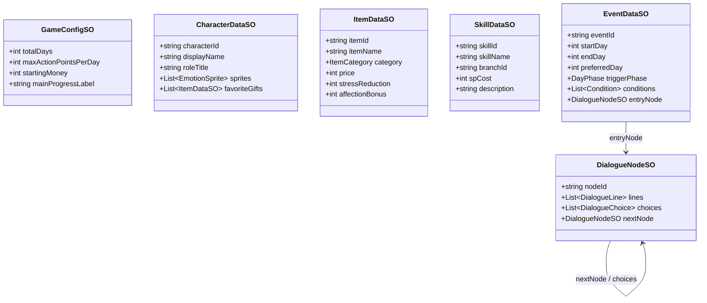

# 00 — Designer Tools and Data Architecture

**Session 064 — L2 partial localization implemented:** [Thai/English architecture/adoption register](13_Localization_Architecture_And_Adoption_Contract.md) now has real `LocalizedTextRef`, catalog/settings/service definitions and `GameConfigSO.localization` opt-in. The current Romance campaign uses catalog-backed Thai authoring and locale resolution; raw text/IDs/graph/GUIDs stay intact. `DialogueLine.SourceText`/`DialogueChoice.SourceText` validate new catalog-only content; locale presentation does not change gameplay state. Save v9 separates mechanical fingerprinting and preserves exact-baseline v8 import. [Actual Workspace/CSV/preview guide](14_Localization_Authoring_Guide.md). Initial 689 entries/96 English drafts/593 missing; extend the existing system and report scope/gaps, without claiming complete translation or owner approval.

**Current authoring, Sessions 044–046:** Thai campaign-scoped Workspace, persistent UI Prefabs, isolated previews and visual room placement are implemented. `ConversationVariant` additionally has an optional `displayName` and `pool` of DialogueNodeSO alternatives alongside its existing `node`. `Nodes` enumerates unique non-null sources. Existing eligibility/priority remains; only the chosen group's playable nodes rotate by stable character/group/day/phase context. No RNG or save-counter field. Single-node assets behave as before. Search, validation and romance fingerprints follow pool nodes. The Workspace exposes group creation, inclusive affection/day/phase/extra conditions, direct first-line editing, source links and a detached actual-selector probe. See the [current workflow](12_Artist_Workspace_And_UI_Authoring_Guide.md); the [Session 043 audit](11_Authoring_Tools_Audit_And_Upgrade_Plan.md) is historical.

**Session 041 current primary path:** `GameConfigSO.romance` references static `RomanceConfigSO`; `RuntimeGameState.romance` is mutable `RomanceState`. `RomanceSystem` reuses clock/dialogue rollback/events and `RomanceRoomView` presents mood/heart/activity/recap feedback. Save v8 is isolated; production/work streams and Stress/AP/Stamina optimization do not run. See [current contract](10_Romance_First_Prototype_Guide.md). Prior planning/production types below remain historical fixtures.

**Session 022 additions:** CharacterInteractions handles the immediate character menu, deterministic ConversationVariant selection, first-daily per-character talk and item-specific GiftPreference reactions. CharacterDataSO owns these definitions/workActivity; ItemDataSO has giftable. WorkStreamSO (Data/WorkStreams) and ActivityDataSO.successWork/failureWork attribute player work to configured streams. Runtime CharacterRuntimeState.lastTalkDay and workProgress preserve these independently from one-time events. Save v3 migrates v2 with unassigned historical aggregate preserved; v1 remains AP-only. Screen-tap VN and back-arrow presentation are in IsometricRoomView. This is the preserved legacy baseline. **Session 026** adds WorkTaskSO, SprintDataSO and ProductionConfigSO, ProductionSystem/ProductionState, StudioSprintView and an isolated Studio fixture package. Task ledgers feed accepted sprint/main progress; all elapsed Studio actions share a once-only phase resolver. Save v4 carries catalog-validated task/plan/event/absence/review/cursor state. See the [Studio schema/authoring guide](03_Studio_Sprint_Prototype.md).

**Baseline status:** Config/Character/DialogueNode/Event SOs, basic Dashboard/validation, a foundation Sandbox and a technical three-day prototype are implemented. Event scheduling, full-event deferral rollback and one manual/day-boundary automatic save slot are implemented. ActivityDataSO and SandboxPresentationSO support test activities/UI copy. Minimal consumable ItemDataSO, RoomDataSO and RoomPresentationSO now support the isometric prototype; complete item categories/SkillDataSO, full tools and advanced checks remain planned. Daily gates, phase costs, Stamina and extended save state are implemented; see the [room guide](02_Isometric_Prototype.md). See the [implementation guide](01_Foundation_Sandbox.md). This is the canonical naming/schema reference. Approval and balance status belong in [Master Decisions](../01_Game_Design/00_Master_Vision_And_Decisions.md).

## Session 032 Night-work schema update

DialogueChoice adds structured workAction/workCharacter; EventDataSO adds minimumRepeatDays/repeatGroup, with existing completion-day state shared across voice variants. CharacterCanVolunteer checks actual eligible pressured work; CharacterSharedNight reads ProductionState.sharedNights. Each record stores person/day/task/helper/team output after genuine Night help. ProductionConfigSO.sharedNightAffection and nightContentVersion expose tuning/one-time content import. The same resolver, order model and event rollback remain canonical; no second scheduler or arbitrary script actions. Existing v6/v5 envelopes remain, while changed mechanical fingerprints reject incompatible older Studio snapshots. See [Night authoring/transactions](05_Studio_Night_Work_Guide.md).

## Session 031 UI/dependency schema update

RoomPresentationSO owns useStudioSkin, icon bindings, four canonical bar sprites, panel/card/portrait-frame/selection-ring sprites, editable stat colors and uiContentVersion. ProductionConfigSO.dependencyContentVersion stamps one-time S1 content binding. No new mutable save fields or second dependency resolver: ProductionSystem.IsReady/ReadyTasks project the existing release/accepted-prerequisite/decision gates. The UI reads these with runtime owner assignments. See [UI/dependency guide](04_Studio_UI_And_Dependency_Guide.md). Updated task references invalidate old mismatched Studio catalog snapshots; no migration is guessed.

## Session 030 event schema update

GameConfigSO.events is the campaign-local EventDataSO catalog. EventDataSO adds delivery/character/room/exclusiveGroup; conditions add workload/task/OT predicates and targetId. DialogueChoice.activateWorkloads connects validated branches to existing production workload IDs. EventScheduleState stores fingerprint and forced deferral stamps separately from definitions. Save v6 is opt-in with a separate event-enabled key; no conversion of old Studio v5 is guessed. Existing manual event catalogs and room/AP migrations remain supported. See [event contract](../01_Game_Design/05_Event_Scheduling_And_Studio_Integration.md) for arbitration, authoring and safe-point rules.

## Session 027 schema update

ProductionConfigSO holds free-rest recovery, OT money/Stress, Producer costs/rewards and useProducerStages. SprintDataSO.producerGoal plus WorkTaskSO.sprint define mandatory sequential unlocks and task-owned quota attribution. ProductionState.orders and producerStages preserve once-only current-phase orders and own-work completion history; deadline records validate accepted effort only through their deadline. Studio save v5 uses a versioned file key, preserving existing IDs/v4 files; legacy schemas remain separate.

ConversationVariant now supports Stress bounds and overtimeOnly with existing affection/day/phase conditions. Twelve temporary OT nodes cover three personalities × two affection bands × two Stress bands. WorkStreamSO adds tint/icon; CharacterDataSO.taskAvatar and RoomPresentationSO.icons accept requested artwork. That Session 027 visual baseline was replaced by supplied UI integration in Session 031; see the current UI schema above. See the [current Studio contract](03_Studio_Sprint_Prototype.md).

## Designer Dashboard — planned scope

**Session 067 next-generation proposal:** [Story authoring/presentation plan](15_Scalable_Story_Authoring_And_Presentation_Plan.md) defines proposed document/entry/block identity, shared manuscript/flow views, typed directing commands and legacy adapters/migration. These are conceptual schema names, not implemented types. Default text authority remains the existing catalog; a native script backend must explicitly resolve ownership rather than introduce another editable Thai copy. Do not replace current nodes/keys/GUIDs or save guards merely because this plan exists.

Menu: `Tools/Project Love/Dashboard`. Intended tabs:

1. **Overview / Day Planner:** use the configured campaign length (approved full game: 30 days), show milestones and mandatory/optional character events, and click to edit. Show event windows and preferred dates so recovery opportunities are visible.
2. **Dialogue / Event Editor:** ordered lines, speaker and expression selectors with previews, choices, skill/item/stat conditions, effects and links; flow preview.
3. **Database Manager:** cards/tables for character sprites/preferences, item categories/prices/unlocks, skill costs/effects and shop data. Create/edit without searching deep folders.
4. **Validator:** IDs, missing assets, broken links, invalid ranges/references and impossible conditions. Free/story items may cost zero; negative prices are invalid. Treat draft artwork separately from required release assets.

Start implementation with useful basic authoring rather than assuming every planned tab already exists. Editor writes must support persistence and appropriate Undo/serialized editing.

## Canonical definitions

All listed SO types are authoring assets; mutable state lives elsewhere. Implemented definitions inherit `IdentifiedDataSO.id` as their common stable ID field. Per-type ID names below describe identity semantics; lineId/choiceId remain distinct nested fields. Activity and Presentation assets currently live in Data/Settings/. The diagram is a design outline, including deferred Item/Skill types.

| Type | Responsibility | Asset folder under `_Project/Data/` |
| --- | --- | --- |
| GameConfigSO | Total days, AP/day, starting money, labels, thresholds and balance settings | Settings |
| CharacterDataSO | Stable identity, display name/role, expression sprites, preferences, initial stat values | Characters |
| ItemDataSO | Consumable/Gift/Key Item, price, effects and unlock references | Items |
| WorkStreamSO | Generic discipline ID/display name; activity output links and separate saved completed units | WorkStreams |
| WorkTaskSO | Effort, main weight, owner/discipline, release, decision block and prerequisites | Studio/Tasks (prototype package) |
| SprintDataSO | Review window and per-stream accepted quotas | Studio (prototype package) |
| ProductionConfigSO | Worker rates/Stress, action costs, phase schedule, task/sprint/workload catalogs | Studio (prototype package) |
| SkillDataSO | Identity, branch ID, SP cost, description, prerequisites and effects | Skills |
| DialogueNodeSO | Lines, choices, conditions/effects and next links | Dialogues |
| EventDataSO | Availability window, phase, entry conditions and starting dialogue node | Events |

DialogueLine, DialogueChoice, Condition and StatModifier are serializable data within assets where appropriate; not every line needs a separate asset file.

This is a design outline, not an exhaustive serialized API. It replaces the earlier single triggerDay sketch with availability windows to support the approved pacing intent. Validate `1 <= startDay <= preferredDay <= endDay <= totalDays` when a preferred date is specified. An exact-day event can use the same start/end day; reserve hard cutoffs for deliberately authored events. A missed preferred date must not by itself invalidate an otherwise eligible event inside its window.

Legacy spec names GameEventSO / DialogueEventSO map to EventDataSO. DialogueChapterSO was an earlier grouping idea and is not a separate Phase 1 requirement. Do not implement duplicate systems from old names.

## IDs and conditions

- Stable IDs: characterId, itemId, skillId, eventId, nodeId, lineId, choiceId; unique within each type. Renaming visible text must not regenerate them.
- Slot saves store IDs and mutable state. Global read history uses lineId; choice history uses choiceId. Never key save/history by display text.
- EventDataSO schedules eligibility; DialogueNodeSO runs content. Condition/effect data checks or updates runtime state without mutating source assets.
- Relationship stages require personal-arc/Stress gates as well as Affection. Numeric ranges in Thai profiles are draft writing references.
- Skill labels follow Core Systems: Empathy / Insight, Management / Efficiency, Support / Care. Technical Insight is a Management example; Care is a Support alias. Use data references/IDs, not setting-specific branch enums.
- Runtime names: DayPhaseManager, ActionPointSystem, StatAndRelationshipManager, ShopAndInventorySystem, SkillTreeSystem. Day/AP/stat foundation, EventScheduler, config-selected Stamina, daily conversation and basic inventory/purchase/recovery are implemented; full shop categories/skills remain planned.

## Static and runtime data

- **Static:** SO definitions in `_Project/Data/`, including the approved 30-day campaign config value. Sandbox/slice configs may use shorter durations for tests.
- **Slot state:** serializable current day/phase/AP, money/SP/progress, inventory, character stats/stages and event flags; persist to JSON.
- **Global state:** read lines, chosen options, unlocked CGs/music/endings across runs, separate from slot saves.
- SaveStore implements one manual and one day-boundary automatic slot at non-dialogue safe points; v3 includes resource-mode identity, Stamina, room, inventory, pickups, daily-use/talk gates and per-stream work. v2 migrates without inventing historical stream attribution. Legacy v1 is restricted to AP configs. Slot snapshots include read/choice history for replay consistency; global cross-run history, full slot/QoL scope and migrations remain planned. See the implementation guide for validation and format limits.
