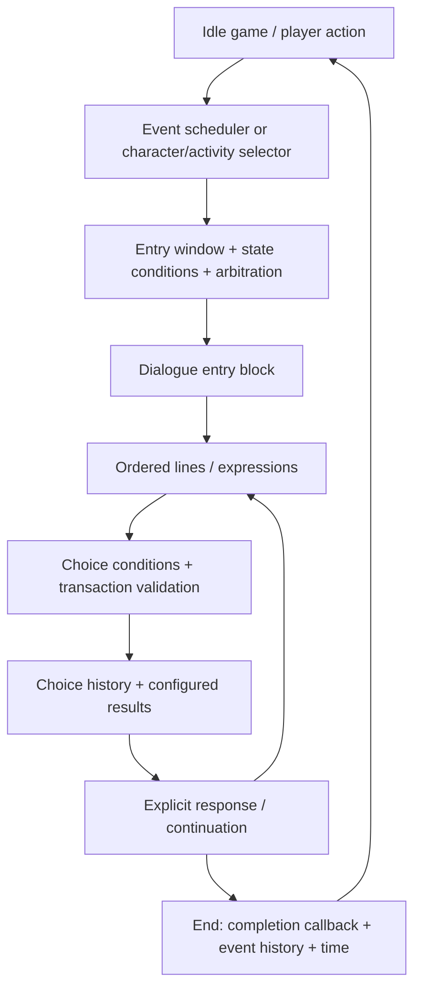

# 17 — Unified Story Workspace and Execution Trace

Session 071, 2026-10-27. **Implemented in the isolated sandbox; owner acceptance and production adoption remain pending.** Owner's hands-on trial rejects the read-only-reader/text-overlay workflow as a wrapper around another writer. The replacement edits writing, performance, routes and caller rules in one window. Tool chrome is concise English with hover help; narrative/game text remains Thai. [Thai workflow](../02_Narrative_And_World/08_Story_Workspace_Owner_Trial.md).

## One source and one window

Open `.sandbox/StoryWorkspaceProject` with Unity 6000.3.24f1, then **Project Love > Story Workspace**. The outer `Sandbox/` directory stores tool source, not the project to open. No old Dashboard, asset Inspector or C# change is required for the supported writing workflow.

`WorkspaceProject` owns an editable deep copy of reachable campaign definitions in one `Assets/_Project/StorySandboxDrafts/Workspace.asset` container with subassets. It includes the copied GameConfig, graph, characters, entry rules and localization catalog. The new window edits this copy directly. Existing source nodes/catalogs are not editing targets. Old `TextDraft.asset` edits are imported once on first creation and the old asset is preserved; existing workspaces are never regenerated by the launcher.

This is an authoring collection/adaptation over the existing runtime, not an approved new production story backend. Original graph IDs and text keys are preserved. The production project has no dependency on the sandbox assembly.

## Writing and structure

| Control | Behavior |
| --- | --- |
| Scenes / Calls / Blocks | Events/drafts; greeting/talk/activity callers; all blocks including unlinked writing |
| New Scene | Create a disabled event draft, entry block and empty line; author its name/trigger/content before enabling |
| Speaker / expression | Inline per-line performance; Narrator is explicit; story text is not translated with the chrome |
| Gap / + Line | Insert a line at the gap or append; empty content is a visible invalid draft until written |
| Drag handle / arrows | Reorder line cards or move them across blocks, keeping line ID and canonical text key |
| + Block | Insert a block between the current lines and the old continuation/choices; preserves the outgoing graph on the new block |
| + Choice / + Reply / Link | Author choice text/results/conditions, create a response, or select a target using search; End is explicit |
| Choice arrows | Reorder options while preserving their IDs, conditions/results and destinations |
| Save / Undo / Redo | Persist the isolated collection; Unity Undo/Redo supports content, performance, links and structural edits |

Line cards are draggable; this does not flatten the graph or silently reorder shared branch blocks. Branch topology changes through block insertion and explicit links. Shared blocks remain a single editable source; their Shared badge/Used By list exposes all callers. Validation rejects invalid cycles/ambiguous next-plus-choice links. Large-corpus virtualization and arbitrary branch-subgraph dragging are not delivered here.

## Where to author and inspect logic

**Inspect** edits an event's title, Enabled state, Trigger, character, room, inclusive day window, preferred day, phase, priority, time cost, repetition/exclusive groups and typed conditions. Greeting/talk callers expose their existing pool name/window/affection/phase/priority/conditions. A selected choice exposes conditions, target, flag writes and numeric results; completion mood rules are visible/editable. Event references are selected by title with search and flags can be searched from existing reads/writes. IDs remain available as advanced source details.

**Flow** shows the current caller/gates, every incoming link, choice/continuation destination, first response, cycle-free entry paths and all root contexts. Variables expands flag references and separates reads from writes. Multiple incoming routes are alternatives, not a combined condition. A flow view establishes possible topology, not eligibility in a particular save.

**Test** supplies explicit day/phase/room/affection/flags/completed-event inputs, then starts either:

- **Run Caller:** real GameSession event/interaction selection and arbitration. A disabled or blocked event does not start. Pending automatic events, room visibility, history and actual typed conditions still apply. Talk can select a different eligible pool or unlocked topic; activity mood/affection can select a different scene. These outcomes are reported, not forced to match the row selected in the library.
- **Preview Block:** deliberately bypass entry eligibility in isolated state and begin at the selected block. Pending forced events are cleared only in that detached preview. It is clearly a different mode and not evidence that the caller is available.

The saved game prefab renders the exact same detached GameSession that **State** and **Trace** inspect. There is no second visual-preview session with different flags. Next Line advances the real runner, choices use CanChoose/TryChoose, Defer uses the actual rollback, and Next Event asks the actual scheduler to start its next forced event. The test view reveals text for inspection; it is not a changed live-player click/typewriter implementation.

**State** separates Values, Flags and History, with search and optional JSON. **Trace** records each action and actual before/after field differences, including callback rewards, flags, read history, choices, completion, mood and phase changes. No player save or preference is loaded/written.

## Runtime call chain, as implemented by the existing game

- `IsometricRoomView.LateUpdate` checks pending forced events while the game can run them. Manual/character actions use the corresponding public session/interaction methods.
- `GameSession.CanStartEvent/CanEvaluateEvent` check event windows, history/cooldown, time/cost, typed conditions and a playable entry; `EventScheduler` adds room/exclusive/visibility and priority arbitration. Highest priority wins; ties use expiry, preferred day and stable ID. The list's order is not the scheduling rule.
- `CharacterInteractions.SelectFor/MatchesVariant` filter day/phase/affection/conditions, choose a pool by priority/stable ID and deterministically rotate its playable members. Romance topic unlocks can override normal Talk. Personal Time selects comfort/warm/personal content using mood and affection; Work Together has a completion callback.
- `DialogueRunner.TryAdvance` follows ordered lines, choices or next links. Ordinary lines have no independent condition array; the current model does **not** re-run the event scheduler before every sentence.
- `DialogueRunner.CanChoose/TryChoose` check choice conditions and transaction constraints. For an event choice, configured flags/values/work actions apply at selection and the choice ID is recorded. Ambient talk/gift/activity interactions use completion callbacks for their rewards; do not assume every interaction choice executes event transaction fields.
- `GameSession.CompleteEvent` records a non-repeat event ID, or a repeat-event completion-day stamp, then applies Romance outcomes/time. Deferral restores the captured state so partial results are not farmed.
- `SaveStore` writes safe non-dialogue state to the existing versioned save. The runtime values exist in GameSession before that save; the sandbox Test never calls SaveStore. Current v9 rules are not weakened or replaced.

## What a choice actually stores

| State field | Meaning / authoring relationship |
| --- | --- |
| `chosenOptions` | IDs of chosen options; history is not automatically a FlagSet condition |
| `flags` | Custom keys explicitly set/cleared by results or systems; later conditions can test them |
| `characters[…].affection`, other values | Configured numeric changes, clamped/validated by the runtime, or completion callback rewards |
| `readLines` | Stable line IDs recorded on advancement |
| `completedEvents` | Event IDs recorded only after a non-repeat event ends |
| `dailyInteractions` | Repeat-event completion-day stamps used by cooldown rules |
| Romance receipts/moods/focus and phase | Actual completion/system outcomes, visible in State/Trace |

Current concrete example: choosing the opening's `opening_advice_direct` records that choice ID and sets flag `opening_advice_direct=true`; it has no direct numeric effect. `romance_welcome` is not completed until its response/shared continuation ends. To gate a later event on this answer, author an explicit Flag Set condition using that key. Do not infer a remembered decision just from similar prose or a file name.

## Stable localization during card moves

The copied catalog remains the sole editable Thai/English source, including scene titles. Thai edits increment sourceRevision and mark English for review; empty English falls back to Thai. New lines/choices get stable GUID IDs and catalog entries. Moves retain canonical IDs/keys.

The current runtime computes node-qualified lookup keys. A cross-block move therefore needs derived lookup aliases in the **detached runtime clone only**. `WorkspaceProject.AddRuntimeAliases` generates these from the canonical entry, rejects collisions and never saves a second editable text copy. This adapter is tested with moved English speech. It is not a production storage/save migration or a promise that arbitrary future backend keys are interchangeable.

## Persistence, evidence and boundaries

First UI initialization is deferred until the Editor is no longer compiling/updating. Live review found that initial creation during reload had not fully persisted the copied subassets; explicit Save persisted them, and the startup timing was corrected (ERR-111). Save/reload checks must inspect the actual collection, not only an in-memory object.

Focused evidence is in [Session 071 verification](../00_Agent_System/WorkLogs/Session_071_Verification/README.md). Initial 9/9, affected 3/3, two 1/1 window/panel checks and final catalog-title 2/2 cover ten unique cases (sixteen executions), not a full game suite. Actual UI review confirmed inline editing layout, Run Caller with the saved game view, line drag insertion, hover help and Undo. The live Workspace file hash matched exactly before/after the drag → Undo → Save trial. User keyboard/semantic discoverability acceptance remains separate.

Limitations: no production integration, player-save import into Test, audio implementation, new vendor/runtime backend, new character/gift inventory authoring or complete whole-game configuration tool. Gift callers expose their references/writing but do not simulate a gift without its inventory/action. Legacy AP/work-command fields are preserved and diagnosed, not presented as a new Romance mechanic. Do not recreate the previous wrapper workflow or call this fully owner-approved.
